# The Uni Black Book

> **The definitive reference for Uni DB** — an embedded, object-store-backed graph database with OpenCypher queries, columnar analytics, vector search, CRDTs, and logic programming.

---

## Table of Contents

- [Part I: Executive Summary & Vision](#part-i-executive-summary--vision)
- [Part II: Architecture Deep Dive](#part-ii-architecture-deep-dive)
- [Part III: Identity Model & Data Types](#part-iii-identity-model--data-types)
- [Part IV: Schema Design Guide](#part-iv-schema-design-guide)
- [Part V: Storage Engine](#part-v-storage-engine)
- [Part VI: Indexing Deep Dive](#part-vi-indexing-deep-dive)
- [Part VII: Cypher Query Language](#part-vii-cypher-query-language)
- [Part VIII: Cypher Extensions & Procedures](#part-viii-cypher-extensions--procedures)
- [Part IX: Graph Algorithms](#part-ix-graph-algorithms)
- [Part X: Locy Framework](#part-x-locy-framework)
- [Part XI: Transactions, Sessions & Concurrency](#part-xi-transactions-sessions--concurrency)
- [Part XII: Snapshots & Time Travel](#part-xii-snapshots--time-travel)
- [Part XIII: Auto-Compaction](#part-xiii-auto-compaction)
- [Part XIV: Python Bindings](#part-xiv-python-bindings)
- [Part XV: Configuration Reference](#part-xv-configuration-reference)
- [Part XVI: Forks](#part-xvi-forks)
- [Part XVII: Plugin Framework](#part-xvii-plugin-framework)
- [Appendices](#appendices)

---

# Part I: Executive Summary & Vision

## What Is Uni?

Uni is an **embedded, serverless graph database** that runs inside your process — no separate server, no network hops, no ops overhead. It persists to **object stores** (S3, GCS, Azure, or local filesystem), supports **OpenCypher** queries, **columnar analytics** via Apache Arrow/DataFusion, **vector similarity search**, **CRDT-based conflict-free data types**, and **Locy** — a Datalog-inspired logic programming language that extends Cypher with recursive reasoning.

Think of Uni as: **SQLite for graphs, but with the analytical power of DuckDB, the vector search of Pinecone, and the reasoning capabilities of Datalog.**

## Why Uni Exists

Traditional graph databases force you to choose:

| Trade-off | Traditional Choice | Uni's Answer |
|---|---|---|
| Embedded vs. Server | Server (Neo4j, TigerGraph) | Embedded (single process) |
| OLTP vs. OLAP | Pick one | Both (Arrow columnar + graph traversal) |
| Graph vs. Vector | Separate systems | Unified (Lance vector indexes) |
| Schema vs. Schemaless | Pick one | Both (schema-defined + overflow JSONB) |
| Simple queries vs. Reasoning | Simple pattern matching | Cypher + Locy recursive rules |
| Local vs. Cloud | Pick one | Both (local, S3/GCS/Azure, hybrid) |

## Key Differentiators

1. **Embedded/Serverless** — `Uni::open("./my-graph").build()` and you're running. No Docker, no ports, no configuration servers.
2. **Object-Store-First** — Data lives in S3/GCS/Azure. Local filesystem is just another backend. Designed for 100ms latency round trips.
3. **OpenCypher Compatible** — Standard graph query language with MATCH, CREATE, MERGE, aggregations, and path patterns.
4. **Columnar Analytics** — Apache Arrow record batches, DataFusion query engine, predicate pushdown. Run analytical queries at columnar speed.
5. **Vector Search** — HNSW, IVF-PQ, and flat indexes with L2, Cosine, and Dot distance metrics. Auto-embedding via Candle models.
6. **CRDTs** — 8 conflict-free replicated data types (GCounter, GSet, ORSet, LWWRegister, LWWMap, Rga, VectorClock, VCRegister) for merge-friendly distributed data.
7. **Locy** — Logic programming as a Cypher superset. Recursive rules, path accumulation, stratified fixpoint evaluation, hypothetical reasoning, abductive inference.
8. **LSM-Style Storage** — Write-optimized 3-tier architecture (L0 memory → L1 sorted runs → L2 compacted base) with automatic background compaction.
9. **Snapshot Isolation** — Single-writer, multi-reader with MVCC versioning. Time travel queries via `VERSION AS OF` and `TIMESTAMP AS OF`.
10. **Python-Native** — PyO3 bindings (`uni-db`) plus a Pydantic OGM (`uni-pydantic`) with type-safe models, lifecycle hooks, and async support.
11. **Polyglot Extensibility** — Five plugin loaders (Rust, WASM Component Model, Extism, Rhai, PyO3) share one capability-gated `PluginRegistry`. A scalar fn authored once runs byte-identically across Component Model + Extism; Rhai and PyO3 agree to ≤ 4 ULP. Every built-in (aggregates, CRDTs, indexes, storage, procedures) is itself a plugin. See [Part XVII](#part-xvii-plugin-framework).

## Target Use Cases

Uni excels in scenarios that combine graph structure with analytics, search, or reasoning:

- **Fraud Detection** — Model transaction networks, propagate risk scores via Locy rules, detect anomalous patterns with graph algorithms
- **RAG / Knowledge Graphs** — Store documents with vector embeddings, traverse knowledge relationships, combine vector search with graph context
- **Recommendation Engines** — Collaborative filtering via graph similarity algorithms, content-based via vector search, hybrid via Locy rules
- **Supply Chain Analysis** — Model supplier networks, trace provenance with recursive path queries, detect vulnerabilities via centrality algorithms
- **RBAC & Access Control** — Model permission hierarchies, resolve effective permissions via Locy priority rules
- **Infrastructure Monitoring** — Blast radius analysis via graph traversal, dependency mapping, impact assessment with Locy reasoning

```mermaid
graph TB
    subgraph "Uni Capability Map"
        direction TB
        A[Graph Database] --> A1[Property Graph Model]
        A --> A2[OpenCypher Queries]
        A --> A3[40+ Graph Algorithms]

        B[Analytical Engine] --> B1[Apache Arrow Columnar]
        B --> B2[DataFusion SQL Engine]
        B --> B3[Aggregations & Window Functions]

        C[Vector Search] --> C1[HNSW / IVF-PQ Indexes]
        C --> C2[Auto-Embedding via Candle]
        C --> C3[Hybrid Search with RRF]

        D[Logic Programming] --> D1[Recursive Rules]
        D --> D2[Stratified Fixpoint]
        D --> D3[Hypothetical & Abductive Reasoning]

        E[Storage Engine] --> E1[Object Store S3/GCS/Azure]
        E --> E2[LSM-Style Compaction]
        E --> E3[Snapshot Isolation & Time Travel]
    end
```

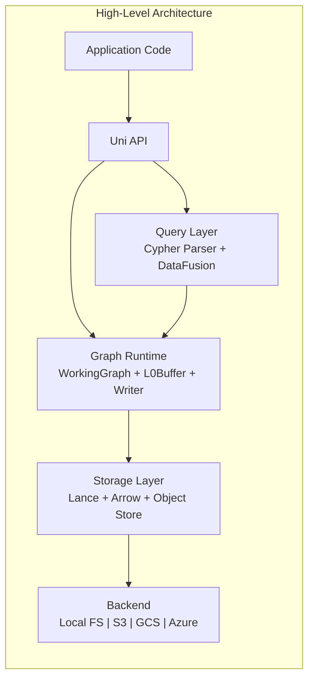

---

# Part II: Architecture Deep Dive

## Layered Design

Uni follows a strict three-layer architecture. Each layer has clear responsibilities and well-defined interfaces:

> **Cross-cutting extensibility.** A fourth, cross-cutting concern — the **Extensibility Layer** (`uni-plugin` plus its loader and built-in-source crates) — sits beside these layers. It backs UDFs and aggregates in the Query Layer, CRDTs and storage backends in the Graph Runtime / Storage layers, and procedures, hooks, and triggers across all three. Every extension, built-in or user-supplied, resolves through one `PluginRegistry`. See [Part XVII: Plugin Framework](#part-xvii-plugin-framework).

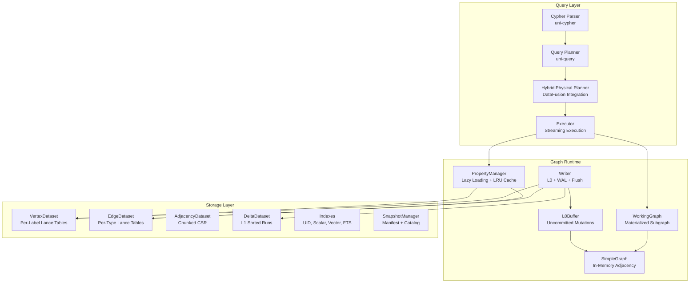

### Query Layer (`uni-cypher` + `uni-query`)

The query layer translates OpenCypher text into a streaming execution plan:

1. **Parser** (`uni-cypher`): pest-based Cypher parser that produces an AST supporting MATCH, CREATE, MERGE, WITH, RETURN, WHERE, UNWIND, DELETE, SET, REMOVE, CALL, WITH RECURSIVE, UNION, and DDL commands.
2. **Planner** (`uni-query`): Converts AST into a logical plan, extracting vector similarity calls, inverted index lookups, and pushdown predicates.
3. **Physical Planner**: Maps logical plan to DataFusion physical operators — `GraphScanExec`, `GraphTraverseExec`, `GraphVectorKnnExec`, `MutationExec`, etc.
4. **Executor**: Streams Arrow `RecordBatch` results through the DataFusion pipeline.

#### Join planning: equi-joins over a cross product

A correlated pattern (`UNWIND $rows AS r MATCH (a:E {uid: r.a})`, two MATCH patterns sharing a predicate, WITH-then-MATCH) reaches the physical planner as `Filter(CrossJoin(L, R), pred)`. `HybridPhysicalPlanner::try_plan_cross_join_as_hash_join` (`uni-query/src/query/df_planner.rs`) splits `pred` into equi-pairs (`l = r`, each side over one subtree's variables), single-side conjuncts (pushed below the join), and a residual. Each equi-pair becomes a pair of hash keys through `unify_join_key_types`; if any pair cannot be keyed, the whole rewrite falls back to `FilterExec` over `CrossJoinExec` (N × V rows).

Key lowering, by the dtypes of the two compiled sides:

| Pairing | Keys | Re-check |
|---|---|---|
| Same dtype, Arrow equality is Cypher equality (integers, `Utf8`, `LargeUtf8`, `Boolean`, `Date32/64`) | as they are | no |
| Two integer dtypes | both `CAST … AS Int64` (a `UInt64` above `i64::MAX` becomes a null key; no `Int64` equals it) | no |
| `Utf8` against `LargeUtf8` | both `CAST … AS LargeUtf8` | no |
| `CypherValue` (`LargeBinary`) against a string, number, boolean or `CypherValue`; float against float or integer | both `_cypher_join_key(x)` | yes |
| Anything else (temporal or struct columns of different dtypes, a string against a number) | refused, cross-join fallback | — |

`_cypher_join_key` (`uni-query-functions/src/df_udfs/join_key.rs`) is a **bucket key**, not an identity: whenever two values compare equal their keys are equal, but unequal values may share a key. Numbers are why. `cypher_eq` compares an integer with a float through `f64`, so it is not transitive above 2^53 (`2^53+1 = 2^53.0` and `2^53 = 2^53.0`, but `2^53+1 <> 2^53`), and no key can be equal exactly when such a relation holds. The key encodes integral numbers below 2^53 exactly (so `1` and `1.0` share a bucket), larger ones through `f64`, every NaN in one bucket, strings and bytes length-prefixed, entities by identity (both the `Node` and the `_vid`-map encodings), lists and maps recursively (map keys sorted), temporals by UTC instant, and anything else by kind only. `null` gets a null key and joins nothing.

**Float comparison and equivalence are openCypher's, not Arrow's.** Arrow's comparison kernels, hash grouping and `DISTINCT` order `f64` by IEEE total order (`-0.0 < 0.0`, a NaN equal to itself bit-for-bit, a sign-bit NaN below `-inf`). openCypher (CIP2016-06-14) compares floats numerically: `-0.0 = 0.0`, every comparison with NaN is false except `<>`, and equivalence (grouping, `DISTINCT`) is equality except that all NaNs are one value. `df_expr::float_comparison` lowers every comparison between two numbers at least one of which is a float — in the logical translator, `build_cypher_comparison` (simple `CASE`, `IN` chains) and the physical compiler's `compile_binary_op` — to `_cypher_float_{eq,not_eq,lt,lt_eq,gt,gt_eq}` (`df_udfs/float_cmp.rs`, Rust's IEEE operators over `Float64`). Against a numeric literal it keeps a native `BinaryExpr` where that is exact (an integer operand; a float column and a finite non-zero literal, guarded by `AND NOT isnan(col)` / `OR isnan(col)` for `<>`; `-0.0` literals become `0.0`), because the scan's L0 pre-filter recovers column-versus-literal `BinaryExpr`s and a UDF is opaque to it. Joins need nothing extra: the `_cypher_join_key` bucket already folds `-0.0` into `0` and the re-check compiles through the same lowering. Group keys (`Distinct`, `Aggregate`, `UNION` dedup) and `DISTINCT` aggregate arguments go through `_cypher_float_key` (type-preserving: `-0.0` → `0.0`, any NaN → `f64::NAN`) for float columns and `_cypher_value_key` for `CypherValue` columns (re-encodes only when a `TAG_FLOAT` byte is present).

**Integers compare with floats exactly.** An `i64` widened to `f64` rounds above 2^53, so every path that compared an integer with a float through `as f64` (or an Arrow cast to `Float64`) answered `9007199254740993 = 9007199254740992.0` true. The single primitive is `uni_common::cmp_i64_f64`; `expr_eval::cypher_numeric_cmp` wraps it for `Value`s and is what `cypher_eq` / `cypher_partial_cmp`, the CypherValue fast paths in `df_udfs.rs` (`compare_numbers`), and list ordering (`cypher_value_cmp`) use. Not yet converted (no reproduction built): Locy's `values_equal` / `value_less_than` and the legacy executor's `cypher_cross_type_cmp`. `float_comparison` casts an integer operand to `Int64`, not `Float64` (`float_comparison_operand_type`), and `_cypher_float_*` accepts `Int64` on either side. Against a literal it rewrites to the operand's own type so the native form stays exact and pushable: an integer operand against a float takes `integer_bound` (`x < 2.5` → `x <= 2`; no form for `=`/`<>` against a fraction, NaN, infinities or values outside `i64`), a float operand against an integer no `f64` holds takes `float_bound` (`y < 2^53+1` → `y <= 2^53`). Equivalence follows equality: `_cypher_value_key` maps an integral float that fits `i64` to that integer (`float_cmp::canonical_number`), so `1` and `1.0` share a group. Because the key is then not the value, a `CypherValue` group key (`Distinct`, `Aggregate`, `UNION` dedup) is emitted through `_cypher_first_seen` over the original column (`equivalence_group_key` / `plan_equivalence_distinct` in `df_planner.rs`), keeping the first value of the group as Neo4j does. `UNION` of an integer column with a float column encodes both as `CypherValue` (`coerce_union_entity_columns`).

Every pair keyed that way also contributes its original equality, compiled exactly as the cross-join fallback would compile it, to a `JoinFilter` on the `HashJoinExec`. The answer is therefore identical to the fallback's by construction; the filter (not a post-join `FilterExec`) keeps OPTIONAL MATCH right, since a candidate rejected by the re-check leaves the outer row NULL-padded. `VidLookupJoinExec` compares non-anchor pairs with `ScalarValue` equality, so it is only chosen when no pair needs a re-check.

**Sideways information passing into an indexed property (`PropertyLookupJoinExec`, P9/A7, 2026-10-18).** `MATCH (a:N {uid: $x}), (b:N) WHERE b.uid = a.name` used to hash-join the one bound `a` row against a scan of every `N` (`rows_scanned` 401 / 1,601 at |N| = 400 / 1,600). When one side of a cross-join equi-pair is `v.prop` with `prop` under an online Hash/BTree scalar index on `v`'s label, and that side plans to a row-wise chain (`ReadSetRecordingExec`, unprojected `FilterExec`, a projection passing `v.prop` through) over a per-label `GraphScanExec`, `try_emit_property_lookup_join` (`df_planner.rs`) emits `PropertyLookupJoinExec` (`df_graph/property_lookup_join.rs`) instead. It materializes the build side, collects the distinct non-null keys, and publishes `prop IN (keys)` into the scan's `DynamicPropertyFilter` slot — as a Lance SQL string (the index serves flushed rows) and as an Arrow `IN` predicate over the merged Lance + L0 batch (unflushed rows stay exact; superseded flushed rows are dropped by the existing pushdown MVCC path). Keys go in chunks of 1,024; above 4,096 keys, or when `vertex_scan_beats_lookup` says the key count is ≥ 25 % of the table, it publishes nothing and runs one unrestricted probe, so the large-bound case reads what the hash join read (`rows_scanned` 800 / 3,200 for an all-`N` build, unchanged). Exactness: every pair must compile to bare columns of one dtype with no re-check (the table above's first row) and the anchor dtype must be a string or `Int64`, so NULL keys match nothing and mixed types (`8 = 8.0`, a string against an int) keep the hash join with its re-check filter. INNER, or LEFT with the probe on the right (OPTIONAL MATCH: unmatched and NULL-keyed build rows are null-padded); a cross-side residual sits above it as above the hash join. When both sides qualify the unfiltered scan is probed. Measured after: 2 / 2 rows scanned, `index_scans` 2. Guards and differentials (flushed, L0, tx, fork, OPTIONAL, type mismatches): `crates/uni/tests/common/perf/anchored_lookup_test.rs`.

History: until 2026-10 the mixed case was handled by wrapping both sides in `toInteger`, and everything else was refused. `toInteger` truncates (`1 = 1.5` matched), parses strings (`1 = '1'` matched) and raises a type error on a boolean or list key; `LargeBinary = LargeBinary` compared raw bytes (`1 = 1.0` missed); and the `Utf8 = CypherValue` refusal made the in-memory load above quadratic (502,000 cross-join rows at N = 1k). `crates/uni/tests/common/bugs/mixed_type_hash_join.rs` runs every pairing against the fallback's answer, flushed and unflushed.

**`IN` over a constant list is a probe, not a scan.** `_cypher_in` scanned the list once per row, so a filter over `n` rows with a literal or parameter list of `k` items made `n × k` comparisons (P10: `FilterExec` 38.6 → 585.8 ms for 2k → 8k ids). When the list argument is a DataFusion scalar (a literal, or a parameter after substitution) and the element is a column of at least two rows, `in_list::invoke_constant_list` (`uni-query-functions/src/df_udfs/in_list.rs`) decodes the list once per batch and builds an `InListIndex`: items of a bucketable kind (entity, boolean, number, string, bytes, temporal) are bucketed by `_cypher_join_key`, entity items are also indexed by their bare id, and every other item (`null`, lists, maps, vectors) goes to a residual list. A bucketable element is compared, with the same `entity_aware_eq` the scan uses, against its key's bucket, the entities or bare ids `entity_aware_eq` equates with it across keys (`n IN [5]` after the `_vid` rewrite, `5 IN [n]`), and the whole residual. Every other item is a bucketable kind with a different key, which `entity_aware_eq` answers `false` for, so the three-valued answer equals the scan's: a key hit is re-checked (keys collide above 2^53), and `null` comes only from the residual. Any other element (a list, a map) takes the scan. A list that arrives as a column (`WITH`-bound, `collect()`ed — the IC5 shape) is split by `in_list::invoke_column_list` into runs of identical rows (equal bytes for a CypherValue `LargeBinary`, equal Arrow values otherwise — exact, never Cypher equality); each run's list is decoded once, and a run of two or more rows is answered from an `InListIndex` built for it, a single row by the scan. `WITH [8 lists of k] UNWIND 1,024 rows each WHERE x IN fs`, debug, IN cost over a control carrying the same lists: 40 / 149 / 613 ms at k = 256 / 1,024 / 4,096 before, 6 / 16 / 91 ms after; what remains is the per-row byte comparison of the replicated list. Pinned by `in_list::tests::list_column_runs_*` (runs, `NULL` lists and lists holding `NULL` against the scan; 2,097,152 comparisons on the scan for 512 rows of 4,096-item runs, at most 2,048 now) and `perf/in_list_column_runs.rs` (against `any(y IN fs WHERE y = x)`). Pinned by `in_list::tests` (scan-vs-probe differential over a 41-value matrix, known answers, an exact comparison-count guard: 512 rows against 256 and 4096 items, 131,072 and 2,097,152 comparisons on the scan) and `cypher_read/constant_in_list_test.rs` (parameter and literal lists against the `WITH`-bound oracle, entities, and a wall-time growth ratio against a linear control).

**List parameters keep their items.** `value_to_scalar` coerced every item of a list with no common native type to `LargeBinary` by stringifying it, so `$l = [[]]` arrived as `[Bytes("[]")]` (`[] IN $l` false while `[] IN [[]]` is true), and a list of dates matched no date. Such a list is now encoded whole as one CypherValue, as a mixed list literal is; a list of only binary items keeps the per-item form.

**Decode failures surface.** `arrow_to_json_value` (`df_graph/unwind.rs`), which decodes values for `UNWIND`, correlated-subquery parameters (`extract_row_params`, used by Apply, `EXISTS`/`COUNT`/`COLLECT` bodies and pattern comprehensions), `COLLECT { }` results and recursive CTEs, returns `Result`: a column whose type the canonical `arrow_to_value` cannot decode, or a typed payload that fails, is a query error rather than `NULL`. An untyped `LargeBinary` that is neither CypherValue nor JSON is returned as `Value::Bytes`, matching `arrow_to_value`'s contract, instead of `NULL`. `typed_large_list_to_cv_array` decodes element types it has no fast arm for (the `Null` type of `[]`, `Date32`) through `arrow_to_value` instead of rejecting them, so `c.v = []` and `c.v = [date(…)]` with `c.v` a CypherValue run.

### Graph Runtime (`uni-common` + `uni-algo` + `uni`)

The runtime manages in-memory graph state and write coordination:

- **WorkingGraph**: A materialized subgraph loaded from storage into a `SimpleGraph` for algorithm execution.
- **L0Buffer**: In-memory buffer backed by `SimpleGraph` for uncommitted mutations. Tracks topology, properties, tombstones, versions, and timestamps.
- **Writer**: Coordinates writes through WAL → L0 → flush → L1 → compact → L2.
- **PropertyManager**: Lazy-loads vertex/edge properties from Lance with an LRU cache, with L0 overlay taking priority.

### Storage Layer (`uni-store`)

Persistent storage using Lance (Arrow-native columnar format):

- **VertexDataset**: Per-label Lance tables (`vertices_{label}`) with schema-defined columns plus JSONB overflow.
- **EdgeDataset**: Per-type Lance tables (`edges_{type}`) with endpoint VIDs and properties.
- **AdjacencyDataset**: Chunked CSR format for O(1) neighbor lookups.
- **DeltaDataset**: LSM-style L1 sorted runs with Insert/Delete operations.
- **Indexes**: UID (SHA3-256), scalar (BTree/Hash/Bitmap), vector (HNSW/IVF-PQ), full-text (BM25), inverted, JSON FTS.
- **SnapshotManager**: JSON manifests capturing consistent views of all datasets.

## Workspace Structure

```
crates/
├── uni/            # Main library crate — public API, Session, Transaction, UniBuilder
├── uni-common/     # Identity (Vid/Eid/UniId), Schema, DataType, Config, Snapshots, SimpleGraph
├── uni-store/      # Lance datasets, CSR adjacency, L0Buffer, Writer, WAL, Indexes
├── uni-algo/       # 42 graph algorithms, GraphProjection
├── uni-query/      # Query executor, DataFusion integration, pushdown, UDFs
├── uni-cypher/     # Cypher parser (pest-based), Locy parser
├── uni-crdt/       # 8 CRDT types with merge semantics
├── uni-locy/       # Locy compiler (stratify, wardedness, typecheck, orchestrator)
├── uni-cli/        # CLI (import, query, repl, snapshot)
├── uni-tck/        # OpenCypher TCK compliance tests
├── uni-locy-tck/   # Locy TCK tests
├── uni-plugin/             # Plugin framework foundation — traits, manifest, capability, registry, lifecycle
├── uni-plugin-builtin/     # Built-ins as plugins (Locy aggregates, CRDTs, collations, vector index, storage)
├── uni-plugin-apoc-core/   # APOC-analogue procedures (38 across 6 namespaces)
├── uni-plugin-custom/      # Meta-plugin: uni.plugin.declare* from Cypher
├── uni-plugin-host/        # Scheduler, declared-plugin persistence, OTel host layer
├── uni-plugin-wasm/        # WASM Component Model loader (wasmtime) + MultiVersionLinker
├── uni-plugin-wasm-rt/     # WASM instance pool / runtime
├── uni-plugin-extism/      # WASM Extism loader
├── uni-plugin-rhai/        # Rhai script loader
├── uni-plugin-pyo3/        # PyO3 live-callable loader
└── uni-plugin-conformance/ # 6-probe loader conformance suite
bindings/
├── uni-db/         # PyO3 Python bindings (sync + async)
└── uni-pydantic/   # Pydantic OGM layer
```

## Crate Dependency Graph

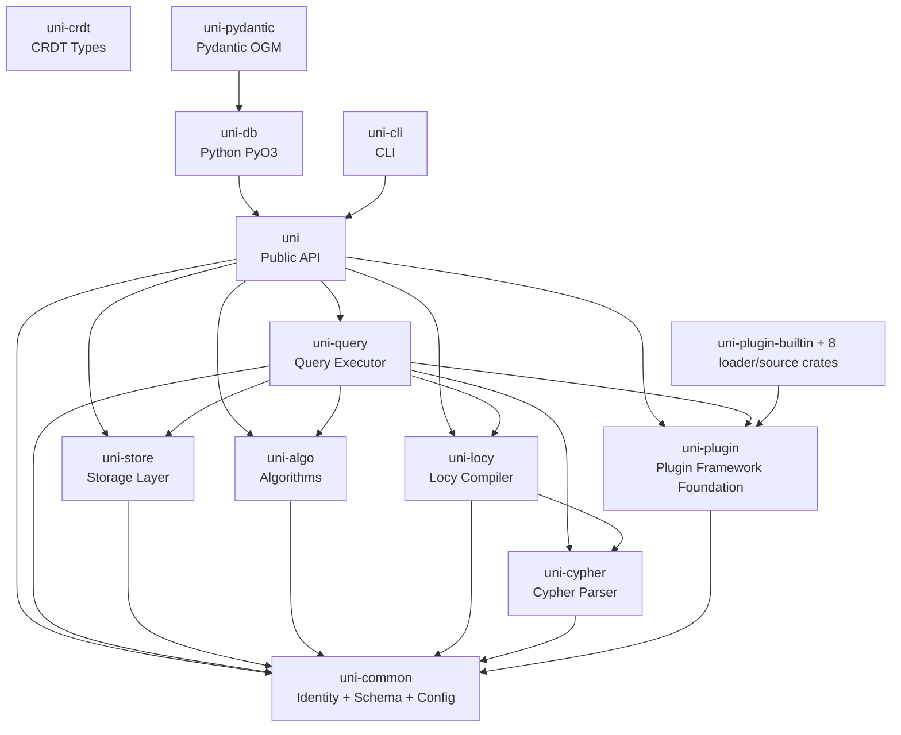

## Key Dependencies

| Crate | Purpose |
|---|---|
| `lance` | Columnar storage with versioning, vector indexes, full-text search. Pinned at `7.0.0` in the root `Cargo.toml`. **`lancedb` is not a dependency** — it was dropped; only the `lance` core crate is used |
| `arrow` / `arrow-array` | In-memory columnar data format (RecordBatch, Array types) |
| `datafusion` | Query engine — physical planning, expression evaluation, aggregation |
| `pest` / `pest_derive` | PEG parser generator powering `uni-cypher`'s Cypher and Locy grammars |
| `object_store` | S3/GCS/Azure/local filesystem abstraction |
| `pyo3` | Python bindings (FFI) |
| `candle-core` / `candle-transformers` | Native Rust ML inference for auto-embedding |
| `uni-xervo` | Embedding + generation runtime used by auto-embedding and host-side multimodal model calls |
| `sha3` | SHA3-256 hashing for UniId content addressing |
| `serde` / `rmp-serde` | MessagePack serialization for CRDTs and CypherValues |

## Write Path (End-to-End)

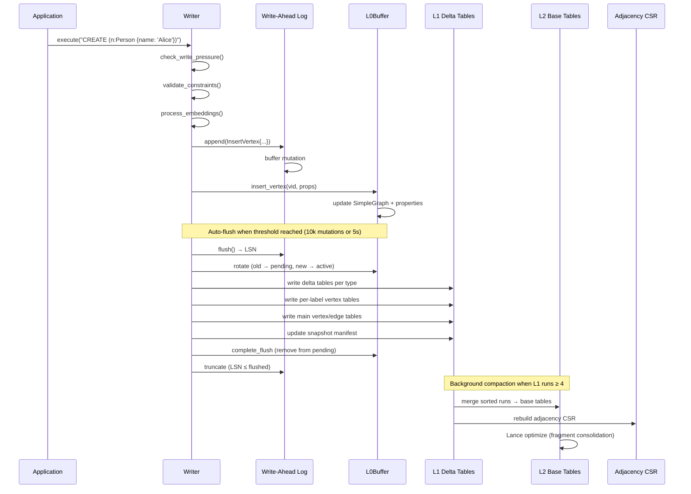

## Read Path (End-to-End)

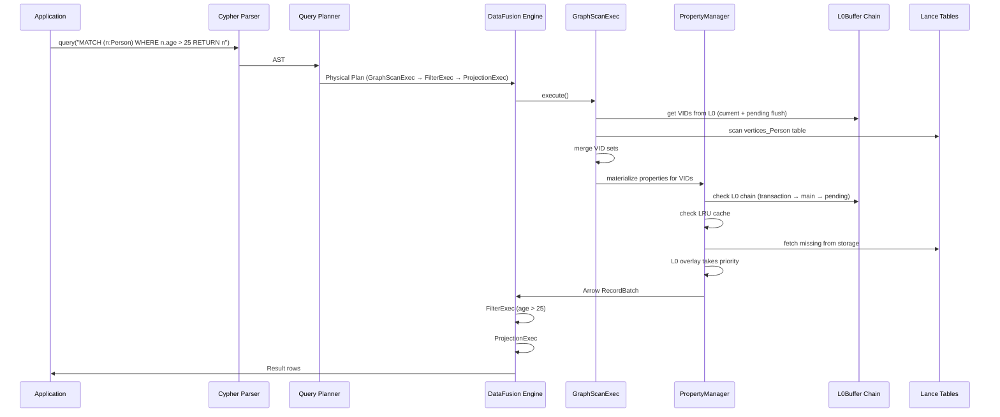

> **Plugin consultation.** When the planner meets an unknown function, aggregate, or procedure name it resolves it against the `PluginRegistry` (`scalar_fn(&QName)` / `aggregate(&QName)` / `procedure(&QName)`) rather than a hardcoded table. UDFs, Locy aggregates, and procedures from every loader enter the read path through this single lookup — see [Part XVII](#part-xvii-plugin-framework).

## Design Principles

These principles, drawn from the original design documents, guide every architectural decision in Uni:

1. **Object-Store-First**: Minimize round trips. Assume 100ms latency. Batch reads. Self-contained chunks where one read gets everything needed.
2. **Simplicity Over Generality**: Explicit constraints, fewer options. A custom `SimpleGraph` instead of a generic graph library.
3. **LSM-Style Writes**: Optimized for write-heavy workloads. Memory buffer → sorted runs → compacted base. Same proven pattern as LevelDB/RocksDB, adapted for graph data.
4. **Columnar Everything**: Arrow arrays for properties, DataFusion for query execution. Get analytical performance without a separate OLAP system.
5. **Content Addressing**: UniId (SHA3-256) provides stable references across systems and decouples identity from storage location. UID is a lookup index, not a uniqueness constraint — multiple vertices may share a UID.
6. **Optimistic Concurrency**: Transactions prepare in parallel against pinned snapshots and validate at commit (SSI/OCC, default-on since 2.0) — conflicts abort with a retriable error instead of silently losing writes. Readers never block writers and vice versa. See [Part XI](#part-xi-transactions-sessions--concurrency).

---

# Part III: Identity Model & Data Types

## Identity System Overview

Uni uses a **dual-identity** system. Each vertex has both an internal dense identifier (VID) for efficient storage and an external content-addressed identifier (UniId) for stable cross-system references.

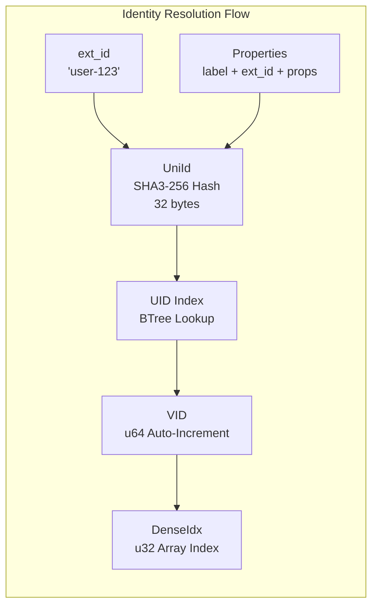

## VID (Vertex ID)

The internal vertex identifier — a 64-bit auto-incrementing integer.

| Field | Details |
|---|---|
| **Type** | `u64` |
| **Encoding** | Pure auto-increment (no embedded label/offset bits) |
| **Sentinel** | `Vid::INVALID = u64::MAX` |
| **Purpose** | O(1) array indexing during query execution |
| **Label Resolution** | Via `VidLabelsIndex` (separate in-memory bidirectional map) |

VIDs are dense, sequential, and never reused. They serve as the primary key in all Lance tables (`_vid` column) and as array offsets in CSR adjacency structures.

## EID (Edge ID)

The internal edge identifier — a 64-bit auto-incrementing integer.

| Field | Details |
|---|---|
| **Type** | `u64` |
| **Encoding** | Pure auto-increment |
| **Sentinel** | `Eid::INVALID = u64::MAX` |
| **Purpose** | Uniquely identifies edges, supports parallel edges |

Multiple edges of the same type between the same vertices are allowed — each gets a unique EID with potentially different properties.

## Edge Type ID Encoding

Edge type IDs use a 32-bit integer with a special bit flag to distinguish schema-defined from schemaless types:

```
Bit 31 = 0: Schema-defined edge type (from schema.json)
Bit 31 = 1: Schemaless edge type (dynamically assigned at runtime)

┌─────────────────────────────────────────┐
│ Bit 31 │     Bits 30..0 (local ID)      │
│  flag  │     up to 2^31 - 1 types       │
└─────────────────────────────────────────┘
```

- `is_schemaless_edge_type(id)` — checks bit 31
- `make_schemaless_id(local_id)` — sets bit 31 flag (`0x8000_0000`)
- `extract_local_id(id)` — masks off bit 31

## DenseIdx

A 32-bit index used for O(1) array access during graph algorithm execution.

| Field | Details |
|---|---|
| **Type** | `u32` |
| **Sentinel** | `DenseIdx::INVALID = u32::MAX` |
| **Purpose** | Remaps sparse VIDs to dense array positions |
| **Remapper** | `VidRemapper` maintains sparse-to-dense mapping |

When algorithms build a `GraphProjection`, VIDs (which may be sparse across the u64 range) are remapped to contiguous `DenseIdx` values for cache-friendly array access.

## UniId (Content-Addressed Identifier)

A SHA3-256 hash that provides **stable, content-addressed identity** for vertices across systems.

| Field | Details |
|---|---|
| **Type** | `[u8; 32]` (256-bit SHA3 hash) |
| **Encoding** | 53-character Base32Lower multibase string |
| **Example** | `z3asjk42...` (z prefix = Base32Lower) |
| **Computation** | `SHA3-256(label ‖ ext_id ‖ sorted_properties)` |

UniId enables:
- **Content lookup**: Find vertices by content hash (multiple vertices may share a UID)
- **Cross-system references**: IDs are stable regardless of which Uni instance created them
- **Content verification**: Detect data corruption or tampering

> **Note:** UID is a lookup index, not a uniqueness constraint. `CREATE (:Label), (:Label)` freely creates two vertices with different VIDs even if they produce the same UID.

The UID Index provides O(log N) lookup from UniId → VID via a BTree index on the hex-encoded UID column.

## ext_id (External ID)

A user-provided string primary key, unique across all vertices (a second vertex with the same `ext_id` under a different label is refused: `Constraint violation: ext_id … already exists`). This is the most common way users reference vertices.

```cypher
// Create with ext_id
CREATE (n:Person {ext_id: 'user-123', name: 'Alice'})

// Lookup by ext_id
MATCH (n:Person {ext_id: 'user-123'}) RETURN n
```

**Storage split, and the readers that must undo it.** `ext_id` is a reserved
name, so it is never a declared property. The main `vertices` table keeps it
in `props_json` *and* its `ext_id` column. A per-label table does not: the
flush puts a **string** `ext_id` in the `ext_id` column and leaves it out of
`overflow_json` (`property_builder::stored_in_ext_id_column`); any other value
stays in `overflow_json` (only a string fits the `Utf8` column — excluding it
by name from both dropped it at flush). Every reader of a per-label table that
assembles undeclared properties from `overflow_json` therefore also reads the
`ext_id` column (`property_builder::restore_ext_id_column`): the
`PropertyManager` vertex paths, the columnar scan (`columnar_scan.rs`
requests the column when `ext_id` or `_all_props` is projected, its L0 batch
builds it with the same split, `build_ext_id_property_column` reads L0, then
the column, then the blob), and semantic compaction.

Before that (A10), every labelled read of a flushed `ext_id` returned NULL —
`n.ext_id`, `{ext_id: …}`, `WHERE`, `properties(n)`, `keys(n)`, `RETURN n`,
traversal targets, forks, after reopen — and `MERGE (n:L {ext_id: …})` missed
the vertex. It was also data loss: any write to a flushed labelled vertex
re-staged its property map without `ext_id`, so the next flush nulled it in
both tables. Fork promote had been built around the missing key; an
insert-only twin of a vertex whose `ext_id` primary holds is now inserted
without it (the key is unique), and a fork-only `ext_id` is carried over
(`uni-fork::diff::run_promote`). Regression: `bugs::ext_id_on_labelled_nodes`.

`(n:L {ext_id: 'x'})` and `WHERE n.ext_id = 'x'` push the equality to the
per-label column's BTree index as Lance SQL (`df_planner.rs`, next to the
indexed-property pushdown); the outer `FilterExec` still applies it to every
row. Measured (`perf::anchored_lookup_test::a10_…`, flushed): `rows_scanned`
400 / 1,600 → 1 / 1, `index_scans` 0 → 1. The same equality narrows the
scan's unflushed read: the planner hands it to the scan as an
`L0PropertyPrefilter` (`with_planner_l0_prefilter`), since a Lance-SQL-only
pushdown leaves no runtime filter to recover one from, and the L0 pass treats
`ext_id` as the `STRING` column it is on disk (`l0_value_may_equal` keeps any
non-string value). Unflushed lookup: `rows_scanned` 2,000 / 8,000 → 1 / 1
(`index::l0_equality_prefilter::unflushed_ext_id_lookup_…`).

**Global uniqueness reads the holder's newest version.** `MainVertexDataset::
find_by_ext_id(s)` picks the newest row *carrying* the `ext_id`, which is
stale once the holder took another value, removed it, or was rewritten
without it; `current_ext_id_holders` re-reads each candidate's newest row and
keeps it only if live and still carrying the `ext_id`. The writer's checks
then ask the L0 buffers, newest first, whether a newer version superseded the
flushed or older-buffer holder (`Writer::l0_ext_id_verdict`; a partial row
that leaves `ext_id` untouched decides nothing), and the batch path collects
constraint keys from each vid's newest L0 version only. Before, a freed
`ext_id` stayed taken for good once its holder had been flushed
(`index::batch_extid_uniqueness::freed_ext_id_…`).

**Reserved property names: one rule for writes and reads.**
`uni_common::core::schema::is_reserved_property_name` is the single test. It
is true for `RESERVED_PROPERTY_NAMES` — the storage columns (`overflow_json`,
`_vid`, `_uid`, `_eid`, `_deleted`, `_version`, `_labels`, `_created_at`,
`_updated_at`), the map-encoding keys `entity_ref_from_map` reads to tell a
vertex from an edge (`_type`, `_type_name`, `_src`, `_dst`,
`_src_vid`, `_dst_vid`, `_all_props`), the per-variable columns the planner
synthesizes (`_label`, `_score`, `_fwd`), Lance's row columns (`_rowid`,
`_rowaddr`, `_rowoffset`, `_row_created_at_version`,
`_row_last_updated_at_version`) and the planner's property-set markers
(`__set_struct__`, `__with_passthrough__`) — and for the
`RESERVED_PROPERTY_PREFIXES` families `_gen_`, `__fde_` and `__alias_of__`.
Writes (`check_written_property_names`, which takes the schema: a prefixed
name the schema declares is the engine's own generated or FDE column and is
allowed, since the engine writes it and a SET stages it back): checked on
every vertex and edge insert path in `Writer`, in
`BulkWriter::insert_vertices`/`insert_edges` (whatever `validate_constraints`
says), and at plan time for a literal `SET x.k = …` target. The error is
`UniError::InvalidIdentifier`; it crosses the executor's string boundary
tagged (`RESERVED_PROPERTY_TAG`) and is recovered in `impl_query.rs`. Reads:
every path that separates an entity's user properties from its system fields
(`Value::property_names` / `entity_properties` / `canonical_entity`, the
`keys`/`properties`/map-projection UDFs and the fallback evaluator, the
planner's property-projection and overflow decisions, the columnar
`_all_props` builder, path construction, SET's in-place binding update,
Locy's property views, the trigger pre-image, the sort key) asks the same
predicate. Any other name — `_foo`, `__x` — is a user property in every read
form; the read paths used to hide every `_`-prefixed key, so such a property
was accepted on write and then missing from `keys()`, `properties()` and
`n {.*}` (and `n {._foo}` failed to plan on a declared label)
(`bugs::underscore_property_reads`). The non-reserved storage names (`ext_id`,
`eid`, `src_vid`, `dst_vid`, `op`, `type`, `labels`, `props_json`) round-trip
and stay writable. Declaring a property still refuses every `_`-prefixed name
(`validate_property_name`): a declared property is a storage column, and
column-level code (schema widening, CSV export) still treats a `_` column as
a system one. Column- and variable-name checks (`__`-prefixed planner
columns, `name.starts_with('_')` on batch fields) are a different namespace and
are unchanged.

**The storage blob never enters a property map.** The planner requests
`overflow_json` beside `_all_props` for an edge type with no declared
properties, and `PropertyManager::merge_overflow_into_props` answered by
storing the blob, as byte values, in the map: every such flushed edge showed
it in `keys(r)`, `properties(r)` and `RETURN r`, and a SET staged it back.

## Complete Type System

Uni supports a rich type system mapped to Apache Arrow types for columnar storage:

### Primitive Types

| Uni Type | Arrow Type | Description |
|---|---|---|
| `String` | `Utf8` | UTF-8 text |
| `Int32` | `Int32` | 32-bit signed integer |
| `Int64` (alias: `Int`) | `Int64` | 64-bit signed integer |
| `Float32` | `Float32` | 32-bit IEEE 754 |
| `Float64` (alias: `Float`) | `Float64` | 64-bit IEEE 754 |
| `Bool` | `Boolean` | true/false |

### Temporal Types

| Uni Type | Arrow Type | Description |
|---|---|---|
| `Timestamp` | `Timestamp(Nanosecond, UTC)` | UTC timestamp with nanosecond precision |
| `Date` | `Date32` | Calendar date (days since epoch) |
| `Time` | Struct(`nanos_since_midnight: i64`, `offset_seconds: i32`) | Time of day with timezone offset |
| `DateTime` | Struct(`nanos_since_epoch: i64`, `offset_seconds: i32`, `timezone_name: Option<Utf8>`) | Full date-time with timezone |
| `Duration` | `LargeBinary` (CypherValue codec) | Time duration |
| `Btic` | `FixedSizeBinary(24)` | Binary Temporal Interval Codec — half-open interval `[lo, hi)` with per-bound granularity and certainty |

### Complex Types

| Uni Type | Arrow Type | Description |
|---|---|---|
| `CypherValue` | `LargeBinary` | MessagePack-tagged binary (any Cypher value) |
| `Bytes` | `LargeBinary` | Raw byte buffer (no codec wrapping) — images, audio, blobs |
| `Vector { dimensions }` | `FixedSizeList(Float32, N)` | Fixed-dimension embedding vector |
| `List(T)` | `List(T)` | Variable-length list of type T |
| `Map(K, V)` | `List(Struct(key: K, value: V))` | Key-value map |

### Spatial Types

| Uni Type | Arrow Type | Description |
|---|---|---|
| `Point(Geographic)` | Struct(`latitude`, `longitude`, `crs`: Float64) | WGS84 geographic coordinates |
| `Point(Cartesian2D)` | Struct(`x`, `y`, `crs`: Float64) | 2D Cartesian point |
| `Point(Cartesian3D)` | Struct(`x`, `y`, `z`, `crs`: Float64) | 3D Cartesian point |

### CRDT Types

| Uni Type | Arrow Type | Description |
|---|---|---|
| `Crdt(GCounter)` | `Binary` (MessagePack) | Grow-only counter |
| `Crdt(GSet)` | `Binary` (MessagePack) | Grow-only set |
| `Crdt(ORSet)` | `Binary` (MessagePack) | Observed-remove set |
| `Crdt(LWWRegister)` | `Binary` (MessagePack) | Last-write-wins register |
| `Crdt(LWWMap)` | `Binary` (MessagePack) | Last-write-wins map |
| `Crdt(Rga)` | `Binary` (MessagePack) | Replicated growable array |
| `Crdt(VectorClock)` | `Binary` (MessagePack) | Vector clock for causal ordering |
| `Crdt(VCRegister)` | `Binary` (MessagePack) | Vector-clock register |

## CRDT Types Deep Dive

CRDTs (Conflict-free Replicated Data Types) enable automatic, deterministic merging of concurrent updates without coordination. Every CRDT merge is **commutative**, **associative**, and **idempotent** — the order and number of merges doesn't matter.

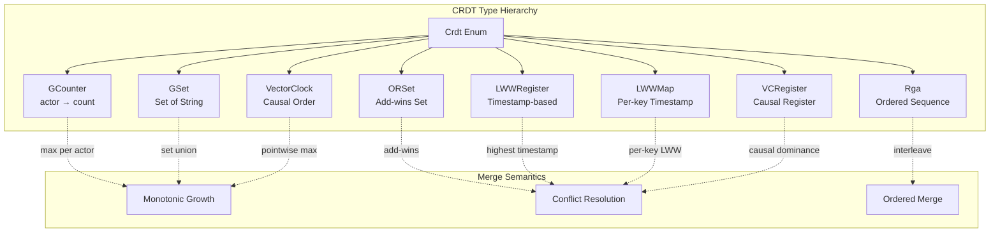

### GCounter (Grow-Only Counter)

```
Structure: HashMap<ActorId, u64>
Merge: max(self[actor], other[actor]) for each actor
Value: sum of all actor counts
```

Use case: Distributed counters (page views, event counts) where only increment is needed.

### GSet (Grow-Only Set)

```
Structure: HashSet<String>
Merge: set union
```

Use case: Tags, labels, or categories that are only added, never removed.

### ORSet (Observed-Remove Set)

```
Structure: Elements tagged with causal dots + a version vector (ORSWOT)
Merge: add-wins conflict resolution
```

Use case: Mutable sets where elements can be added and removed. If concurrent add and remove, add wins.

Since 2.2.0 the ORSet is **tombstone-free** — it uses an ORSWOT (Observed-Remove Set Without Tombstones) encoding where elements carry causal dots and removals are tracked by the version vector rather than explicit tombstones, keeping the structure compact under churn. The legacy v1 (tombstoned) wire format is still read for backward compatibility; new writes use the tombstone-free format.

### LWWRegister (Last-Write-Wins Register)

```
Structure: (value: T, timestamp: u64)
Merge: highest timestamp wins
```

Use case: Simple mutable values where "latest write wins" is acceptable.

### LWWMap (Last-Write-Wins Map)

```
Structure: HashMap<K, (V, timestamp)>
Merge: per-key highest timestamp wins
```

Use case: Property maps where individual keys can be updated independently.

### Rga (Replicated Growable Array)

```
Structure: Ordered sequence with unique position IDs
Merge: interleave by position ID ordering
Operations: insert_at(pos, value), delete_at(pos)
```

Use case: Collaborative text editing, ordered lists.

### VectorClock

```
Structure: HashMap<ActorId, u64>
Merge: pointwise maximum
Comparison: partial order (concurrent, before, after)
```

Use case: Tracking causal ordering between events from different actors.

### VCRegister (Vector-Clock Register)

```
Structure: (value: T, vector_clock: VectorClock)
Merge: causally dominant value wins; concurrent → LWW fallback
```

Use case: Values that need causal consistency rather than simple timestamp ordering.

### Serialization

All CRDT values are serialized using MessagePack with serde-tagged abbreviations:

| Tag | CRDT Type |
|---|---|
| `gc` | GCounter |
| `gs` | GSet\<String\> |
| `os` | ORSet\<String\> |
| `lr` | LWWRegister\<serde_json::Value\> |
| `lm` | LWWMap\<String, serde_json::Value\> |
| `rg` | Rga\<String\> |
| `vc` | VectorClock |
| `vr` | VCRegister\<serde_json::Value\> |

On upsert, if a property has a CRDT type, Uni automatically merges the new value with the existing one using the CRDT's merge function. Non-CRDT properties use last-write-wins (LWW) semantics.

---

# Part IV: Schema Design Guide

## Schema Concepts

Every Uni database has a **schema** that defines the structure of its graph. The schema is stored as `schema.json` at the database root and contains:

- **Labels**: Vertex categories (e.g., `Person`, `Product`, `Document`)
- **Edge Types**: Relationship categories (e.g., `KNOWS`, `PURCHASED`, `SIMILAR_TO`)
- **Properties**: Typed fields on labels and edge types
- **Indexes**: Secondary indexes for query acceleration
- **Constraints**: Uniqueness, existence, and check constraints
- **Schemaless Registry**: Dynamically-assigned edge type IDs for types not in the schema

### Schema Metadata

```rust
Schema {
    schema_version: u32,                  // Incremented on changes
    labels: HashMap<String, LabelMeta>,
    edge_types: HashMap<String, EdgeTypeMeta>,
    properties: HashMap<String, HashMap<String, PropertyMeta>>,  // label → prop → meta
    indexes: Vec<IndexDefinition>,
    constraints: Vec<Constraint>,
    schemaless_registry: SchemalessEdgeTypeRegistry,
}
```

### LabelMeta

```rust
LabelMeta {
    id: u16,                        // Unique label identifier (never reused)
    created_at: DateTime<Utc>,
    state: SchemaElementState,      // Active | Hidden | Tombstone
}
```

### EdgeTypeMeta

```rust
EdgeTypeMeta {
    id: u32,                        // Unique edge type identifier
    src_labels: Vec<String>,        // Allowed source labels (empty = any)
    dst_labels: Vec<String>,        // Allowed destination labels (empty = any)
    state: SchemaElementState,
}
```

Declared endpoints are enforced on write (wave P1, G2). `Writer::insert_edge` — the create path behind `CREATE`, `MERGE`, `Transaction::bulk_insert_edges`, `COPY … FROM` and fork promote — calls `check_edge_endpoints`: an endpoint passes when it carries at least one declared label, read from the writing transaction's buffer first, then the committed buffers, the `VidLabelsIndex`, and storage. `Writer::update_edge` (a `SET` / `REMOVE` on an existing edge) does not re-check. A `REMOVE n:L` that would leave one of `n`'s existing edges outside its declaration is refused (`Executor::check_label_removal_keeps_edges_declared`, probing the CSR + L0 overlay with `get_neighbors`). Both raise `UniError::EdgeEndpointViolation { edge_type, endpoint, labels, allowed }`. Before, the writer checked nothing, while the planner narrows unlabelled endpoints by the declaration; stores written before the check may still hold violating edges, and the read side does not drop them.

### PropertyMeta

```rust
PropertyMeta {
    r#type: DataType,               // String, Int64, Vector{384}, Crdt(GCounter), etc.
    nullable: bool,
    added_in: u32,                  // Schema version when this property was added
    state: SchemaElementState,
    generation_expression: Option<String>,  // For computed/generated properties
}
```

## Schema Element Lifecycle

Schema elements follow a soft-delete lifecycle to enable safe evolution without data loss:

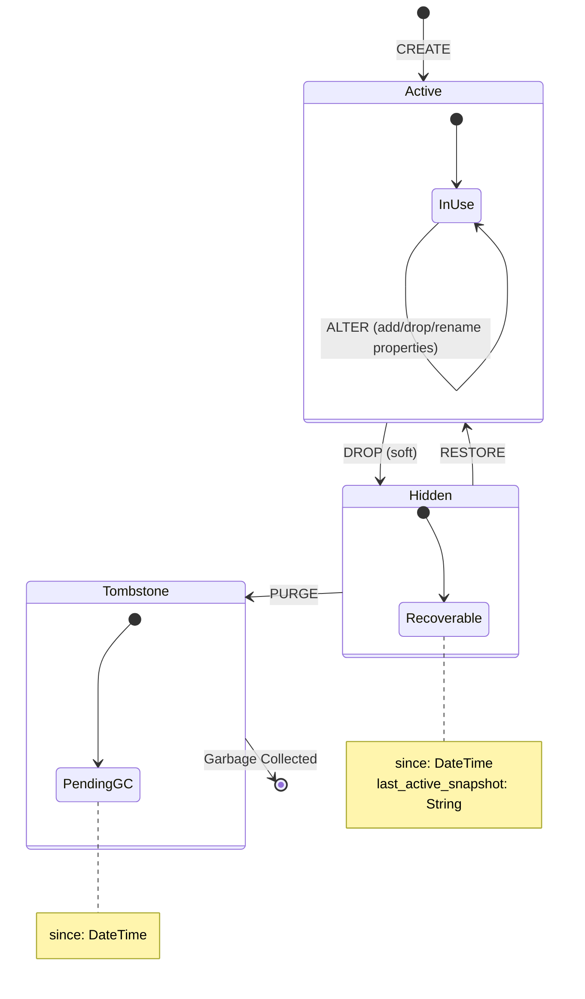

Key rules:
- **Label/type IDs are never reused** — append-only registry in `schema.json`
- **Nullable properties require no data rewrite** — existing rows return NULL
- **Defaults can be backfilled asynchronously** after schema changes
- **Property types are immutable** (since 2.5.0) — re-applying an identical schema is idempotent (the register-on-every-open pattern stays cheap), but re-declaring an existing property with a different type or vector dimension (e.g. `VECTOR(4)` → `VECTOR(8)`) raises a schema conflict error (Python: `UniSchemaError`). Use a new property name or migrate the data.

### Adding a property to a label that already has data

A flush batch's Arrow schema comes from the *declared catalog properties*
(`VertexDataset::get_arrow_schema`), not from the dataset on disk. So the
catalog and the stored table have to be kept in step, and every DDL path that
changes a label's property set widens storage before persisting the catalog.

What happens on `ADD PROPERTY`:

1. **Primary is widened** via Lance `add_columns` with
   `NewColumnTransform::AllNulls` — metadata-only. It clones fragment metadata
   and bumps the manifest schema; no row is read or rewritten, at any table
   size. The column is always added **nullable**: `AllNulls` requires it, and
   every pre-existing row genuinely has no value.
2. **Live fork branches are widened** — see *Schema Evolution × Forks*.
3. **Schemaless values are promoted.** A property written before it was
   declared lives in the per-row `overflow_json` blob. Because the projected
   read path prefers a typed column and only falls back to the blob when none
   exists, materialising an all-NULL column would make `RETURN n.p` answer NULL
   while `RETURN properties(n)` still answered with the real value — two read
   paths, two answers, no error. A one-time backfill therefore moves those
   values into the typed column (**typed wins**, so a value written after the
   declaration is never clobbered) and **strips the key from the blob**, so a
   later `SET n.p = NULL` cannot resurrect it through the `_all_props`
   coalesce. This pass is skipped entirely — one scan, no commit — when the
   property has no schemaless data, which is the ordinary case.
4. **Then, and only then, the catalog is saved.** Storage first, catalog
   second: a Lance column the catalog does not know about is invisible and
   harmless, whereas a catalog column Lance lacks is a hard read failure. There
   is no WAL record for schema DDL, so ordering is the only recovery lever, and
   because the widening is idempotent a half-applied DDL converges on re-run.
   (Note this is deliberately the *opposite* of the index path's order, which
   is how an index can end up recorded `Online` with no artifact on disk.)

Two related behaviours:

- **`NOT NULL` on a populated label is recorded as nullable**, with a `warn!`
  naming the row count. `SchemaBuilder::property` defaults to `NOT NULL`, so
  rejecting would break the most common builder call; and pre-existing rows
  cannot satisfy the constraint. `NOT NULL` is still enforced forward, at write
  time, exactly as before.
- **`DROP PROPERTY` is the mirror case.** Lance tolerates a column missing from
  an appended batch only when the *stored* field is nullable, so dropping a
  `NOT NULL` property wedges the table with `missing=[p], unexpected=[]`. The
  stored column is relaxed to nullable instead — also metadata-only.

A write-path reconcile in `uni-store/src/storage/schema_evolution.rs` backstops
all of this: before an append or merge, a batch carrying a column its table
lacks widens the table first. It is widening-only and refuses to invent a
missing *system* column, so a genuinely corrupt table still fails loudly rather
than acquiring a NULL column. It fires on the fork branch a write is actually
landing on, which is what closes the branch-creation race the eager pass cannot
see.

## Defining a Schema

### Rust API (SchemaBuilder)

```rust
use uni_db::{Uni, DataType, IndexType, ScalarType};

let db = Uni::open("./my-graph")
    .schema_file("schema.json")  // Load from file at build time
    .build()
    .await?;

// Or build programmatically via the fluent SchemaBuilder
db.schema()
    .label("Person")
        .property("name", DataType::String)
        .property("age", DataType::Int64)
        .property_nullable("email", DataType::String)
        .index("name", IndexType::Scalar(ScalarType::BTree))
    .label("Document")
        .property("title", DataType::String)
        .property("content", DataType::String)
        .vector("embedding", 384)
    .edge_type("KNOWS", &["Person"], &["Person"])
        .property("since", DataType::Date)
        .property("weight", DataType::Float64)
    .apply().await?;
```

### Cypher DDL

```cypher
// Create labels with properties
CREATE LABEL Person (
    name STRING,
    age INTEGER,
    email STRING UNIQUE
)

CREATE LABEL Document (
    title STRING,
    content STRING,
    embedding VECTOR(384)
)

// Create edge types with source/destination constraints
CREATE EDGE TYPE KNOWS (since DATE,
    weight FLOAT) FROM Person TO Person

CREATE EDGE TYPE AUTHORED FROM Person TO Document

// Alter existing schema
ALTER LABEL Person ADD PROPERTY phone STRING
ALTER LABEL Person DROP PROPERTY age
ALTER LABEL Person RENAME PROPERTY name TO full_name

// Drop with soft-delete
DROP LABEL IF EXISTS TempData
DROP EDGE TYPE IF EXISTS OLD_RELATION
```

### Python API

```python
from uni_db import Uni, DataType

db = Uni.open("./my-graph")

# Fluent schema builder via db.schema()
db.schema() \
    .label("Person") \
        .property("name", DataType.STRING()) \
        .property("age", DataType.INT64()) \
        .property_nullable("email", DataType.STRING()) \
        .vector("embedding", 384) \
    .done() \
    .edge_type("KNOWS", ["Person"], ["Person"]) \
        .property("since", DataType.DATE()) \
        .property("weight", DataType.FLOAT64()) \
    .apply()
```

## Vector Dimension Enforcement

Since 2.5.0 (#137), declared `VECTOR(dim)` and multi-vector `List(Vector(dim))` columns **enforce their dimensions everywhere**:

- **Write-time**: a wrong-length vector — or a list with non-numeric elements, or an empty list — written into a declared `VECTOR(dim)` column fails with a `TypeError` naming the declared and actual lengths. This applies to Cypher `CREATE`/`SET`, the bulk insert APIs, and auto-embed output (a model whose output width differs from the declared dimension fails with an error naming the embedding alias). Multi-vector columns enforce the dimension of every token vector.
- **Query-time**: `uni.vector.query` (and the dense arm of hybrid search) errors with "vector dimension mismatch" when the query vector's length differs from the declared column dimension, instead of silently returning 0 rows.
- **Flush is fail-closed**: a wrong-dimension value that somehow reaches flush errors instead of being silently nulled. WAL replay of values written by pre-2.5.0 versions nulls them with a warning log, so old databases stay recoverable.

Previously, mismatched values were silently accepted at write time and nulled at flush.

## Schema Design Best Practices

### Label Design

**One label per entity type.** Each label maps to a Lance table. Labels are the primary unit of storage organization.

<!-- doctest: skip -->
```cypher
// GOOD: Clear entity separation
CREATE LABEL Person ( name STRING, age INTEGER )
CREATE LABEL Company ( name STRING, founded DATE )

// BAD: Mega-label mixing entity types
CREATE LABEL Entity ( type STRING, name STRING, age INTEGER, founded DATE )
```

### Edge Type Modeling

**Use directional semantics** that read naturally in English. Specify source/destination label constraints when the relationship has clear domain semantics.

<!-- doctest: skip -->
```cypher
// GOOD: Clear directional semantics with constraints
CREATE EDGE TYPE WORKS_AT (since DATE) FROM Person TO Company
CREATE EDGE TYPE MANAGES FROM Person TO Person
CREATE EDGE TYPE PURCHASED (quantity INTEGER) FROM Customer TO Product

// BAD: Ambiguous direction
CREATE EDGE TYPE RELATED_TO  // Which direction means what?
```

### Property Type Selection

| Use Case | Recommended Type | Why |
|---|---|---|
| Short text (names, codes) | `String` | Indexable, searchable |
| Counts, IDs | `Int64` | Efficient comparison, aggregation |
| Measurements, scores | `Float64` | IEEE 754, aggregation-friendly |
| Timestamps | `Timestamp` | Nanosecond precision, UTC |
| Embeddings | `Vector{N}` | Fixed-size, vector-indexable |
| Distributed counters | `Crdt(GCounter)` | Merge-friendly increments |
| Tag collections | `Crdt(GSet)` | Add-only, merge-friendly |
| Mutable sets | `Crdt(ORSet)` | Add/remove with add-wins |
| Mutable scalars (distributed) | `Crdt(LWWRegister)` | Last-write-wins |
| Feature maps | `Map(String, Float64)` | Structured key-value |
| Multi-value fields | `List(String)` | Variable-length lists |

### When to Use CRDTs vs Regular Properties

Use CRDTs when:
- Multiple writers may update the same property concurrently
- You need deterministic merge semantics without coordination
- The property represents a distributed aggregate (counter, set, clock)

Use regular properties when:
- Single-writer access pattern
- Simple last-write-wins is acceptable
- You need maximum query performance (CRDTs have serialization overhead)

### Multi-Label Vertices

Vertices can carry multiple labels. Each vertex is stored in every label's table with its full label list preserved.

```cypher
// Create a vertex with multiple labels
CREATE (n:Person:Employee {name: 'Alice', employee_id: 'E001'})

// Query by any label
MATCH (n:Employee) RETURN n.name
MATCH (n:Person) RETURN n.name  // Same vertex appears in both
```

Use multi-labels when an entity naturally belongs to multiple categories. Avoid excessive labels — each additional label means the vertex is stored in one more Lance table.

## Schema Anti-Patterns

| Anti-Pattern | Problem | Solution |
|---|---|---|
| **Over-labeling** | Vertex stored in too many tables, duplicating data | Limit to 2-3 labels per vertex |
| **Mega-nodes** | Vertices with millions of edges | Introduce intermediate nodes or edge bucketing |
| **Missing indexes** | Full table scans on filtered properties | Index every property used in WHERE clauses |
| **Strings for numbers** | Can't do range queries or aggregations | Use Int64/Float64 for numeric data |
| **Large blobs as properties** | Bloats Lance tables, slows scans | Store blobs externally, keep references |
| **Schemaless everything** | Properties in overflow JSONB lose columnar benefits | Define schema for frequently-queried properties; use `strict_schema: true` to enforce |

---

# Part V: Storage Engine

## On-Disk Storage Layout

When you open or create a Uni database at a path (e.g., `./my-graph`), the following directory tree is created on disk (or in the object store):

```
my-graph/                                   # Database root (the URI you pass to Uni::open)
├── schema.json                             # Legacy schema location (may exist in older DBs)
│
└── storage/                                # All persistent data lives here
    │
    ├── catalog/                            # Metadata & snapshot management
    │   ├── schema.json                     # Authoritative schema definition
    │   ├── latest                          # File containing current snapshot UUID
    │   ├── named_snapshots.json            # { "name" → "snapshot_id" } mapping
    │   └── manifests/                      # One JSON file per snapshot
    │       ├── a1b2c3d4-....json           # SnapshotManifest (versions, counts, etc.)
    │       └── e5f6g7h8-....json
    │
    ├── wal/                                # Write-Ahead Log segments
    │   ├── 00000000000000000001_<uuid>.wal  # WAL segment (JSON-serialized mutations)
    │   ├── 00000000000000000002_<uuid>.wal  # LSN zero-padded to 20 digits
    │   └── ...                              # Lexicographic ordering = LSN ordering
    │
    ├── vertices_Person/                    # Lance table: per-label vertex data
    │   ├── _versions/                      # Lance versioning metadata
    │   ├── data/                           # Arrow IPC data files (*.lance)
    │   └── _indices/                       # Lance-managed indexes
    │
    ├── vertices_Document/                  # Another per-label table
    │   └── ...
    │
    ├── vertices/                           # Lance table: unified main vertex table
    │   └── ...                             # (all vertices regardless of label)
    │
    ├── edges/                              # Lance table: unified main edge table
    │   └── ...                             # (all edges regardless of type)
    │
    ├── deltas_KNOWS_fwd/                   # Lance table: forward edge deltas
    │   └── ...                             # (sorted by src_vid)
    │
    ├── deltas_KNOWS_bwd/                   # Lance table: backward edge deltas
    │   └── ...                             # (sorted by dst_vid)
    │
    ├── adjacency_KNOWS_fwd/                # Lance table: forward CSR adjacency
    │   └── ...                             # (row-per-vertex with neighbor lists)
    │
    ├── adjacency_KNOWS_bwd/                # Lance table: backward CSR adjacency
    │   └── ...
    │
    └── indexes/                            # Secondary indexes
        ├── uni_id_to_vid/                  # UID Index (UniId → VID mapping)
        │   ├── Person/
        │   │   └── index.lance/            # BTree on hex-encoded UID
        │   └── Document/
        │       └── index.lance/
        │
        ├── idx_Person___email/             # JSON path index (label___path)
        │   └── ...                         # Special chars → underscore
        │
        └── Person_tags_inverted/           # Inverted index (label_property_inverted)
            └── ...                         # Term → VID postings
```

### Path Construction Patterns

Table names are constructed by `LanceDbStore` methods:

```rust
LanceDbStore::vertex_table_name("Person")          // → "vertices_Person"
LanceDbStore::delta_table_name("KNOWS", "fwd")     // → "deltas_KNOWS_fwd"
LanceDbStore::delta_table_name("KNOWS", "bwd")     // → "deltas_KNOWS_bwd"
LanceDbStore::adjacency_table_name("KNOWS", "fwd") // → "adjacency_KNOWS_fwd"
```

Index paths:

```
UID Index:      storage/indexes/uni_id_to_vid/{label}/index.lance
JSON Path:      storage/indexes/idx_{label}___{safe_path}
Inverted:       storage/indexes/{label}_{property}_inverted
```

### Storage Modes

| Mode | Where Data Lives | Use Case |
|---|---|---|
| **Local** | Local filesystem at the URI path | Development, single-machine |
| **Remote** | S3/GCS/Azure at the URI (e.g., `s3://bucket/path`) | Cloud production |
| **Hybrid** | WAL + ID allocation local; bulk data in cloud | Low-latency writes + cloud durability |

In hybrid mode, the local path contains `wal/` and ID allocation state, while `storage/` tables are in the remote object store.

### Temporary Databases and Teardown Ordering

`Uni::temporary()` / `Uni::in_memory()` are only in-memory from the caller's
side: both are backed by a `uni_mem_*` scratch directory under `$TMPDIR`, with
the full on-disk layout inside. `Uni::uri()` returns that root (not the
`storage/` subdirectory) and is exposed through the Python bindings as
`Uni.uri` / `AsyncUni.uri`, so a caller can account for the directory without
globbing `$TMPDIR` — which is unsafe when another process owns one.

Removal is ordered by **ownership**, not timing. The guard (`ScratchDir`) is
held as an `Arc` by `UniInner` *and* by every task registered through
`track_task_with_scratch_claim`, so the directory cannot be removed while a
task that might write to it is still running. This is not a theoretical
concern: several tasks write precisely *because* shutdown was signalled — the
index rebuild worker saves its state, compaction finishes its run, and, with
the WAL off, the auto-flush task performs a final flush. With the guard owned
solely by `UniInner`, teardown removed the directory *successfully* and that
final flush then recreated the tree, leaving a directory containing exactly
`storage/catalog/latest` plus one manifest. Measured at 39/40 bare drops.

With the WAL on (the default), the auto-flush task does **not** flush on the
shutdown signal. Every commit is in the WAL before it returns and a reopen
replays it, so a final flush bought only a shorter replay; `shutdown()`
flushes before it signals, so it found nothing to do there; and on a bare
`Drop` nothing awaited it, so a runtime shutting down right after the drop cut
it off midway (Lance panics on the cancelled `spawn_blocking`: `Background task
failed: JoinError::Cancelled`). Without the WAL, L0 is the only copy and the
best-effort flush stays. `storage::shutdown_test::dropping_without_shutdown_leaves_the_data_to_the_wal`
pins both halves: no manifest is written after a bare drop, and the row is
back after a reopen.

A table exists only once its first manifest is committed. Lance writes a new
dataset's data files before that manifest, so a create cut off midway (a crash,
or a runtime shut down during a label's first flush) leaves `<table>.lance/`
with data and no `_versions/`. `LanceDirectory::table_names` and, on the fork
path, `LanceBranching::table_exists` used to count the directory: every open of
it then failed, and with the WAL on the issue #72 guard refused to open the
store at all (WAL segments, a table, no snapshot manifest). Both now require a
`.manifest` under `_versions/`. Pinned by
`storage::shutdown_test::an_interrupted_first_create_does_not_wedge_the_store`
and `a_fork_writes_past_an_interrupted_first_create`.

`UniSync` owns its runtime, so its `Drop` runs the full `shutdown()` (outside an
async context; inside one it only signals). It used to signal and drop the
runtime at once, which cut off the WAL-off final flush: the commit was lost, or
the half-created dataset above was left behind
(`e2e::api_sync_test::dropping_a_unisync_persists_its_commits_without_the_wal`).

Two teardown paths, deliberately different:

- **`shutdown()` / `shutdown_in_place()`** awaits every tracked task via
  `shutdown_async`, then reaps the directory eagerly. Eager because deferring
  to the guard's `Drop` would keep the directory alive for the lifetime of the
  handle — for a Python `with Uni.temporary() as db:` block, past the end of
  the block until garbage collection.
- **Bare `Drop`** (no explicit shutdown — `db = Uni.temporary()` from Python)
  cancels compaction, waits for in-flight async-flush stream tasks, closes the
  flush coordinator's submit channel, signals shutdown, and then waits for
  every tracked task to finish (`ShutdownHandle::shutdown_and_wait_blocking`),
  all within `DROP_TASK_JOIN_TIMEOUT` (5 s). The
  wait observes the tasks (`JoinHandle::is_finished`); it does not drive them.
  So it depends on where the drop runs:
  - **no runtime on this thread** (process exit, a Python finalizer): waits.
    Ownership ordering assumes *something still runs the tasks*; at process
    exit the embedder's runtime may be abandoned, and without the wait the
    directory was removed by nothing at all.
  - **a `multi_thread` runtime**: waits inside `block_in_place`, so other
    workers keep driving the tasks.
  - **a `current_thread` runtime**: only signals. The tasks run on this very
    thread, so blocking it would stall them until the bound. Call
    `shutdown().await` there.

  Closing the submit channel is required rather than optional — the
  flush-coordinator finalizer blocks on `submit_rx.recv()` and never observes
  the shutdown broadcast, so without it every drop paid the full bound. Past
  the bound the drop logs a warning and returns with the stragglers running.

Before W1 (2026-10-17) a bare drop inside a runtime only signalled. A
compaction pass in flight then kept rewriting the directory after its owner
was gone: removing the directory panicked the detached task, and reopening the
path at once ran a second compactor over it (an overlap in 19/19
drop-and-reopen iterations, with the live handle answering a reverse traversal
with no rows in 4 of them). `runtime::compaction_lifecycle_test` pins the
contract.

`shutdown_async` keeps the `JoinHandle` of a task that overruns its grace
period instead of dropping it (dropping a handle detaches the task), so
`Uni::background_task_count` stays truthful after a timed-out shutdown.

**Background-task rules (W1 follow-ups, 2026-10-17).** Every task the
database starts must be (a) tracked, so shutdown and `Drop` wait for it and
`background_task_count` counts it, and (b) free of blocking work on an executor
thread, because the caller's runtime may be `current_thread`, where one
blocking call stalls every task. Plugin calls are synchronous and of unbounded
duration (a CDC sink does network I/O in `deliver`), and sidecar writes fsync,
so both go to `spawn_blocking`. The audit of `uni`, `uni-store` and
`uni-plugin-host` found and fixed these violations:

| Site | Was | Now |
|---|---|---|
| `TriggerRouter::dispatch_after`, `FireMode::Async` | `runtime.spawn` calling the plugin's `fire` inline, detached | `spawn_blocking`, tracked via `TriggerRouter::with_task_tracker` (the commit path passes the database's `ShutdownHandle`) |
| Deferral tick (`DeferralQueue::tick` + `EcQueue::flush_due`, the 50 ms task in `Uni::build`) | `on_deferred` plugin calls and the fsynced deferral sidecar rewrite inline | the tick body runs on `spawn_blocking`; missed ticks are skipped |
| `SchedulerHost` dispatch | `record_started` (sidecar fsync + `_BackgroundJob` Cypher mirror via `block_in_place`) inline on the driver; completion task (with `record_finished`) detached | one tracked `run_job` task per run; `record_started`, `execute` and `record_finished` each on `spawn_blocking`; a cancelled run is recorded at once and the task then waits for the body, so it stays counted |
| `CdcRuntime` driver | the `streams` lock held across the plugin's `deliver` / `checkpoint` / `shutdown`, inline on the driver | the driver owns the streams and hands them to `spawn_blocking` per commit; a panicking plugin halts only its own stream; stream counts are atomics published after each step |
| `Indexes::rebuild(_, true)` / `retry_failed` | a new `IndexRebuildManager` plus a worker that loops until shutdown per call (a leaked task per call; the managers overwrote each other's `index_rebuild_state.json`) | one manager per `UniInner` (`UniInner::index_rebuild_manager`; the auto-rebuild manager when enabled, else created on first use) |
| `IndexRebuildManager` retry | a detached `sleep(retry_delay)` task per failure, holding the manager and `StorageManager` past drop | the worker re-queues failed tasks whose delay has elapsed on its own tick (`requeue_due_retries`) |
| Post-flush rebuild scheduling (`writer.rs`) | a detached task to persist `schedule` | `IndexRebuildManager::enqueue` (in memory); the worker persists when it claims the task. Indexes are already `Stale`, so a crash before that re-triggers |
| `StorageManager::trigger_async_compaction` | detached, no callers | deleted |
| Async-flush stream tasks | awaited only by `FlushCoordinator::shutdown`, which `Drop` does not call | counted by `background_task_count` (`FlushCoordinator::live_stream_count`); `Drop` waits for them first, then closes the submit channel so their submissions are still finalized, then waits for the tracked tasks, all under one `DROP_TASK_JOIN_TIMEOUT` |
| `DeferralQueue::push` / `drain_due` (Wave C) | the sidecar rewrite and its fsyncs under the queue mutex, on the commit path for a `Defer` outcome | the snapshot is taken under the mutex and encoded and written outside it, under a separate write lock that records the generation written; a push whose change a later write already covered skips its own write. A push still returns only once the sidecar holds it |
| Fork and snapshot `UniInner`s (Wave C) | a fresh `ShutdownHandle` that nothing signalled or awaited | `ShutdownHandle::derive`: own signal, the parent's task list. The parent's shutdown and `Drop` signal, count and wait for the view's tasks; `Drop for UniInner` calls `release`, which signals that view's own tasks only (a nested fork may still be in use). Same-fork sessions share one `UniInner`, so this runs when the last of them goes |
| Bulk load with `async_indexes` (Wave C) | a new `IndexRebuildManager` and worker per load | `BulkBackend::rebuild_manager` hands the load the view's one manager |
| Time-based auto-flush task (Wave C) | `check_flush` → `flush_to_l1`, which holds `flush_lock` across the Lance write; a commit waits at most `commit_timeout` for that lock, so one slow background flush failed a commit with `CommitTimeout` | `Writer::check_flush_in_background`: with async flush on, rotate under the lock and write through the coordinator, as the commit path's trigger does |

`ShutdownHandle` is `Clone` (clones share state) so components that spawn per
event can track; its handle list prunes finished tasks amortized (logging any
that panicked), so tracking one task per commit or per run does not grow it
without bound.

Still open: `Synchronous` triggers run inline in the commit future by
contract, and a `Defer` outcome's sidecar write (now outside the queue lock)
still runs on the committing task's thread; the async-flush finalize step
holds `flush_lock` while it publishes the manifest, so it is still a commit
lock holder of unbounded duration; tasks tracked by a fork view hold no claim
on an `in_memory()` scratch directory (only the primary's do).

A leak here is worth more than the kilobytes suggest. The survivors never
expire, so a suite opening thousands of databases strands many per run; on a
tmpfs `$TMPDIR` that exhausts *inodes* rather than space, and surfaces as
unrelated "failed to create temporary directory" or `No space left on device`
errors while `df -h` shows the disk nearly empty. Filesystem speed changes the
rate — a disk-backed `$TMPDIR` leaked where tmpfs did not — so a quick local
check is not evidence of correctness.

## LSM-Style 3-Tier Architecture

Uni's storage engine uses an **LSM-tree-inspired** design optimized for graph data. Writes go to an in-memory buffer (L0), flush to sorted runs in Lance (L1), and compact into base tables (L2).

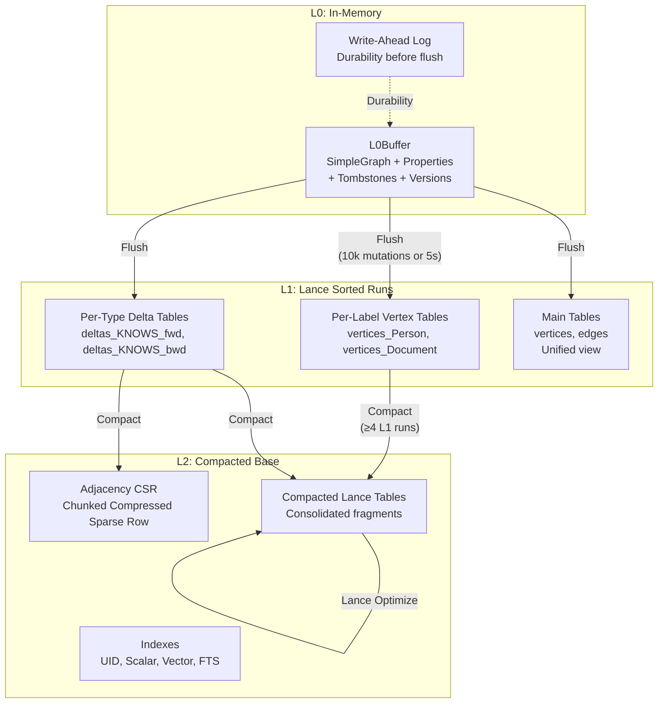

### Design Reasoning

The 3-tier design provides:

1. **Write Performance**: L0 is pure in-memory. Writes are O(1) amortized — just append to the SimpleGraph and property maps.
2. **Read Consistency**: Reads merge L0 overlay with L1/L2 storage. L0 always takes priority (newest data).
3. **Background Maintenance**: Compaction runs asynchronously, never blocking reads or writes.
4. **Crash Recovery**: WAL ensures durability. On restart, replay WAL segments since last flush.

## Vertex Storage

### Per-Label Vertex Tables (`vertices_{label}`)

Each label gets its own Lance table with typed columns:

| Column | Arrow Type | Description |
|---|---|---|
| `_vid` | UInt64 | Vertex ID (primary key) |
| `_uid` | FixedSizeBinary(32) | UniId (SHA3-256) |
| `_deleted` | Boolean | Soft-delete flag |
| `_version` | UInt64 | MVCC version number |
| `ext_id` | Utf8 (nullable) | User-provided external ID |
| `_labels` | List\<Utf8\> | All labels on this vertex |
| `_created_at` | Timestamp(ns) | Creation timestamp |
| `_updated_at` | Timestamp(ns) | Last update timestamp |
| *property columns* | *schema-defined* | One column per schema property |
| `overflow_json` | LargeBinary | JSONB for non-schema properties |

### Main Vertex Table (`vertices`)

A unified table containing all vertices regardless of label:

| Column | Arrow Type | Description |
|---|---|---|
| `_vid` | UInt64 | Primary key |
| `_uid` | FixedSizeBinary(32) | UniId |
| `ext_id` | Utf8 (nullable) | External ID |
| `labels` | List\<Utf8\> | All labels |
| `props_json` | LargeBinary | All properties as JSONB |
| `_deleted` | Boolean | Soft-delete |
| `_version` | UInt64 | MVCC version |
| `_created_at`, `_updated_at` | Timestamp(ns) | Timestamps |

The main table enables cross-label queries without scanning every per-label table.

**Decoding a stored value keeps its type.** `props_json` is a CypherValue map.
`MainVertexDataset` decodes it straight into `Value`s (`decode_props_blob`). A
column value is decoded by `value_codec::decode_column_value`, which hands
every type except a CRDT (or a list of CRDTs) to `arrow_to_value`. Both used to
go through `serde_json::Value`, which kept the shape and lost the type: a
temporal became a string, a vector a plain list, and a `List<DateTime>` a list
of strings. That mattered because several paths read a row, change one thing
and write the row back:
- the flush of a relabeled vertex;
- `SET` of another property (`insert_vertex_partial`);
- edge `SET`;
- semantic compaction.

Each of them stored the converted value. The type was lost on disk, and where
the column could not hold the string the value became NULL: every Duration
column, and a declared DateTime column after a relabel.

**A list column holds any element type.** Both the flush writer
(`PropertyExtractor::build_list_column`) and the L0 batch builder
(`build_list_property_column`) build a list's elements as one child column with
the scalar builder for the element type. Before, the flush supported lists of
String, Int64, Float64, Bytes and Vector only. A declared `List<DateTime>` (or
Date, Time, Duration, Bool, Int32, Float32) was accepted, written and read in
memory, and then failed the flush ("Unsupported inner type for List"), so the
data could not be flushed. The L0 builder wrote each element's `Debug` text
into a `Utf8` child, and the read failed against the declared type.

### Overflow Properties (Schemaless)

Properties not defined in the schema are stored in the `overflow_json` column as JSONB binary. Queries against overflow properties are automatically rewritten to use Lance JSONB functions (`json_get_string`, `json_get_int`, etc.).

Read-your-writes semantics apply to schemaless properties too: direct property access and `properties(node)` consult the L0 overlay before storage, so `SET n.extra = 42` is visible immediately without an explicit flush. The same overflow properties are preserved through flush and later compaction cycles.

```cypher
// This property is in overflow_json if not in schema
MATCH (n:Person) WHERE n.nickname = 'Bob' RETURN n

// Internally rewritten to:
// ... WHERE json_get_string(overflow_json, 'nickname') = 'Bob'
```

### A declaration types a property only on its own label

A declared property type belongs to the label or edge type that declares it,
not to the property name. Every place that types a property column ahead of
reading it resolves the type with `Schema::scoped_property_meta`
(`uni-common/src/core/schema.rs`), from the labels the entity is known to
carry, as an `EntityScope`:

- `AllOf(labels)`: a vertex carrying every label (`(n:A:B)`, a schemaless
  scan's labels). The labels among them that declare the property decide, and
  must agree.
- `OneOf(labels)`: an entity carrying exactly one (`[e:R|Q]`, the edge types
  of an untyped `[e]`). Every alternative must declare it at the same type.

No type from the scope means the column carries the stored value
(`LargeBinary` / `CypherValue`). The callers are the schemaless vertex scan
(`df_graph/scan.rs`), traversal edge-property typing
(`merged_edge_schema_props`: a property not declared alike by every edge type
in scope is listed with type `CypherValue`), correlated-subquery output typing
(`infer_logical_plan_schema`, which collects each variable's scope from the
subquery's own scans and traversals and treats imports, renames and
conflicting bindings as unknown), and Locy's rule-column typing
(`locy_planner::property_arrow_type`, from the clause's MATCH pattern). A
lookup across every label in the schema read `F.v FLOAT` onto `s.v` of a
schemaless `S`: an integer above 2^53 rounded, a string became NULL, and Locy
failed with "cannot read the string as a number".

`UNION` branches whose column types differ are encoded to `CypherValue` on
both sides (`coerce_union_entity_columns`), since a schemaless property column
meeting a declared one is ordinary.

## Edge Storage

### Delta Tables (`deltas_{edge_type}_{direction}`)

Each edge type gets **two** delta tables — one for forward direction (indexed by `src_vid`) and one for backward (indexed by `dst_vid`):

| Column | Arrow Type | Description |
|---|---|---|
| `src_vid` | UInt64 | Source vertex |
| `dst_vid` | UInt64 | Destination vertex |
| `eid` | UInt64 | Edge ID |
| `op` | UInt8 | 0=Insert, 1=Delete |
| `_version` | UInt64 | MVCC version |
| `_created_at`, `_updated_at` | Int64 (nullable) | Nanoseconds since epoch |
| *property columns* | *schema-defined* | Edge properties |
| `overflow_json` | LargeBinary | Non-schema edge properties |

**L1Entry structure** per delta row:

```rust
L1Entry {
    src_vid: Vid,
    dst_vid: Vid,
    eid: Eid,
    op: Op,            // Insert or Delete
    version: u64,
    properties: Properties,
    created_at: Option<i64>,
    updated_at: Option<i64>,
}
```

**OOM Protection**: `DEFAULT_MAX_COMPACTION_ROWS = 5,000,000` with `ENTRY_SIZE_ESTIMATE = 145 bytes` per entry.

### Main Edge Table (`edges`)

| Column | Arrow Type | Description |
|---|---|---|
| `_eid` | UInt64 | Edge ID |
| `src_vid`, `dst_vid` | UInt64 | Endpoint vertices |
| `type` | Utf8 | Edge type name |
| `props_json` | LargeBinary | All properties as JSONB |
| `_deleted`, `_version` | Boolean, UInt64 | MVCC fields |
| `_created_at`, `_updated_at` | Timestamp(ns) | Timestamps |

## Adjacency / CSR Format

The Compressed Sparse Row (CSR) format provides O(1) neighbor lookups — critical for graph traversal performance.

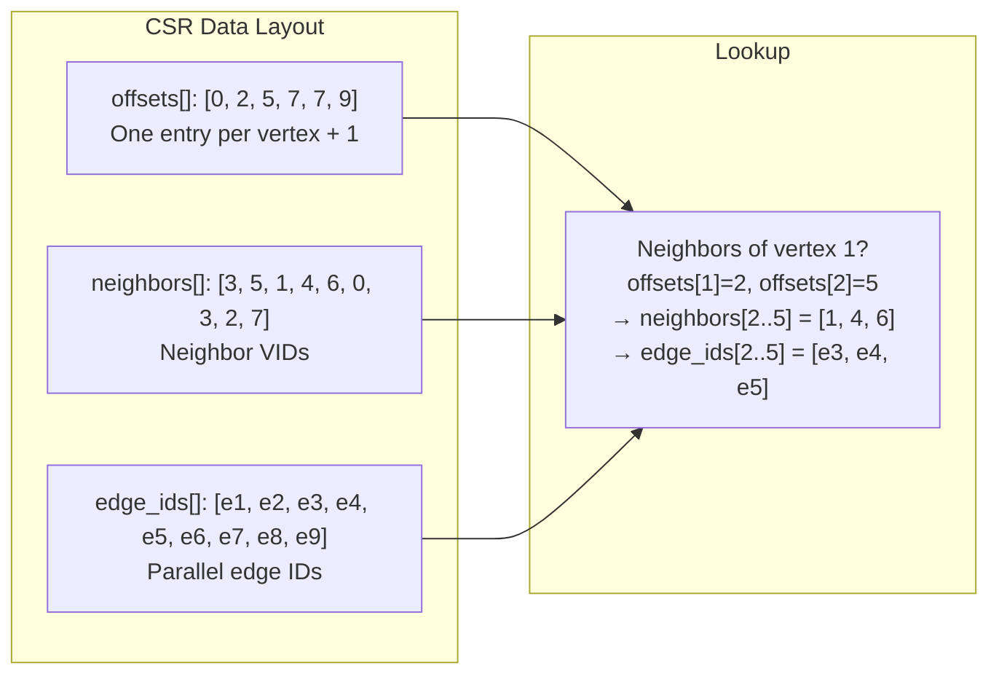

### CompressedSparseRow

```rust
CompressedSparseRow {
    offsets: Vec<u32>,        // O(1) neighbor range lookup
    neighbors: Vec<DenseIdx>, // Dense indices for algorithms
    neighbor_vids: Vec<Vid>,  // Actual VID values
    edge_ids: Vec<Eid>,       // Edge IDs parallel to neighbors
}
```

- **Lookup**: `offsets[vid]..offsets[vid+1]` gives the range into `neighbors[]` and `edge_ids[]`
- **Memory**: `offsets.len() × 4 + neighbors.len() × 4 + neighbor_vids.len() × 8 + edge_ids.len() × 8`

### MainCsr (Versioned CSR)

For MVCC support, `MainCsr` stores per-edge version metadata:

```rust
MainCsr {
    offsets: Vec<u32>,
    entries: Vec<CsrEdgeEntry>,  // neighbor_vid, eid, created_version
}
```

Each `CsrEdgeEntry` carries a `created_version` field, enabling snapshot queries without rebuilding the CSR.

### ShadowCsr (Deleted-Edge Overlay)

A deleted edge leaves the Main CSR but stays recorded in `ShadowCsr`, so snapshot and time-travel reads can resurrect it:

```rust
ShadowEdge {
    neighbor_vid: Vid,
    eid: Eid,
    edge_type: u32,
    created_version: u64,
    deleted_version: u64,
}
```

An entry is alive at `version` when `created_version <= version < deleted_version` (`get_entries_at_version`). Entries arrive from two places: `AdjacencyManager::compact`, which moves overlay tombstones into the shadow as it merges frozen segments, and `AdjacencyManager::warm`, which pushes one for every `op = 1` row it reads out of the L1 delta. The regular (non-snapshot) read path never consults it.

**Retention.** `add_deleted_edge` ignores a repeat of an `Eid` it already holds. The dedup is load-bearing rather than tidiness: unlike `warm_coalesced`, `warm` has no `has_csr` short-circuit, so each warm of the same `(edge_type, direction)` re-pushed the *entire* delete history — growth was unbounded in the number of warms, not the number of deletes. Reads already dedupe by `Eid` downstream, which is why it surfaced as memory rather than as wrong answers.

**GC bound.** `AdjacencyManager::gc_shadow(current_version)` drops entries whose `deleted_version` is at or below a floor, and is called after CSR compaction. The floor is `min(min_pinned_version, current_version)`, collapsing to `current_version` when nothing is pinned. `StorageManager::pinned_at_version` registers a `PinGuard` for the lifetime of the view it builds, and `PinnedVersions` is refcounted so the floor cannot rise while another reader still holds the same version.

The bound is that narrow for a specific reason: `StorageManager::pinned()` and `at_fork` each build a **fresh** `AdjacencyManager` with its own empty `ShadowCsr`, so those readers never consult the live one. `pinned_at_version` — the path a read-write transaction takes whenever it pins at all (`ssi_enabled`, or any ephemeral/scratch transaction) — is the only one that shares it. `SnapshotManager` cannot supply the floor because it is a manifest reader-writer and tracks no live readers.

**Observability.** `AdjacencyManager::memory_usage` adds `ShadowCsr::approx_bytes` to the main-CSR byte counter, so shadow retention is visible to the cache budget; `shadow_entry_count()` / `ShadowCsr::entry_count()` expose the raw count for retention tests and diagnostics.

### CSR Cache Freshness (Second-Handle Revalidation)

The Main CSR is warmed lazily on first traversal of an `(edge_type, direction)`
and, historically, never rebuilt: a flush did not invalidate it. That holds for
the handle that **owns the writer**, whose commits are applied to the manager's
`active_overlay` directly via `insert_edge` — its CSR plus overlay is complete
by construction, so re-reading storage would find nothing new.

It does not hold for a second, independent handle on the same store. A
read-only reader opened alongside a writer receives no `insert_edge` calls, so
its only route to newly committed edges is a re-warm — and a presence-only gate
(`has_csr`) blocks that forever. Such a reader was pinned to whatever edge set
it first traversed, while **node** reads from the same session stayed fresh,
because every scan reopens the Lance dataset and picks up the newest manifest.
The CSR is the one place that materialises a *derived* structure, and so has to
re-implement the invalidation that a plain scan inherits for free.

Each cached CSR now carries a `csr_source_stamp`: the summed Lance versions of
the tables that warm reads for that `(edge_type, direction)` — the L2 adjacency
dataset per participating label, plus the L1 delta dataset. Summed rather than
maxed, so an advance in any contributing table changes the stamp. The stamp is
taken **before** the read, so a write landing mid-warm leaves the CSR looking
stale (a redundant re-warm) rather than falsely fresh (missed edges), and a
missing or unreadable stamp is treated as stale for the same reason.

Revalidation is gated on `StorageManager::requires_adjacency_revalidation`, set
only for a handle opened `read_only`. Checking costs a Lance manifest read per
source table per query — measured at ~0.33 ms on a small traversal, about 5–6%
— and the writer-owning handle provably does not need it.

> **Multi-handle caveat.** This makes *edge reads* coherent for a second
> handle. It does not make the engine generally multi-handle safe: the fork
> registry, for one, still caches `catalog/fork_registry.json` in memory and a
> reader will not see a fork another handle created.
>
> That last point is a decision, not a gap awaiting a fix (2026-09-15).
> Multi-handle *fork administration* on one store is outside the supported
> model: every registry mutation goes through `ForkRegistryHandle`'s 2PC state
> machine as the single writer, so re-reading the cache on a fork listing has
> to be reconciled with that protocol rather than bolted onto it, and the
> scenario is rare enough not to justify that.
>
> Two things make this worth stating explicitly rather than leaving implicit.
> First, it is **asymmetric**: schema additions and property updates by a
> second handle *are* observed — `second_handle_observes_label_added_elsewhere`
> and `second_handle_observes_updated_property_value` both pass — so "a second
> handle sees another's writes" holds everywhere except the fork registry.
> Second, the failure is **silent**: `Uni::list_forks` returns a shorter list,
> never an error, so a stale read is indistinguishable from a store with no
> forks. Callers that would act on the list (create-if-absent, TTL sweeps)
> should re-open the handle instead. Pinned by the `#[ignore]`d
> `second_handle_observes_fork_created_elsewhere` in the same test file.

### AdjacencyDataset (Persistent CSR)

Stored as a Lance table (`adjacency_{edge_type}_{direction}`) with row-per-vertex format:

| Column | Arrow Type |
|---|---|
| `src_vid` | UInt64 |
| `neighbors` | List\<UInt64\> |
| `edge_ids` | List\<UInt64\> |

## Lance Table Naming Conventions

| Entity | Table Name | Purpose |
|---|---|---|
| All Vertices | `vertices` | Cross-label vertex lookups |
| Per-Label Vertices | `vertices_{label}` | Label-specific scans with typed columns |
| All Edges | `edges` | Cross-type edge lookups |
| Forward Deltas | `deltas_{edge_type}_fwd` | Forward edge mutations (by src_vid) |
| Backward Deltas | `deltas_{edge_type}_bwd` | Backward edge mutations (by dst_vid) |
| Forward Adjacency | `adjacency_{edge_type}_fwd` | Forward CSR adjacency |
| Backward Adjacency | `adjacency_{edge_type}_bwd` | Backward CSR adjacency |

## Dataset Opens and the Lance Session Cache

`LanceDirectory::open` builds a fresh `Dataset` on **every** call and
deliberately never caches the handle: a cached handle pins a manifest version,
so a later flush's rows would be silently invisible to it.

Every open is nonetheless given the directory's **shared `Arc<Session>`** via
`DatasetBuilder::with_session`. The session owns Lance's index and metadata
caches, and the two concerns are separate:

| what | cached? | why |
|---|---|---|
| `Dataset` handle | **no** | pins a manifest version; would miss later flushes |
| Index + metadata blocks (the `Session`) | **yes** | content-addressed, so reuse cannot go stale |

**Why this is load-bearing.** Without the shared session each builder gets
`session: None`, i.e. a fresh cache per open, so an ANN index is re-read and
re-decoded on *every query*. The measured signature was: query cost linear in
corpus size, unaffected by `ef_search`, `m`, partition count or payload
encoding, with the HNSW graph search itself only ~6% of profile samples and the
rest in page decode, memmove and allocation. Sharing the session gave HNSW a
**~40x** speedup at 1M vectors (0.8 → 32 QPS) with recall unchanged.

Any new code path that opens a Lance dataset must go through `LanceDirectory`
rather than calling `DatasetBuilder::from_uri` directly, or it silently opts out
of these caches.

## Write Path Detailed

### Regular Writer

1. **Validate**: `check_write_pressure()` — enforce write throttle limits
2. **Embed**: `process_embeddings_for_labels()` — auto-generate vector embeddings if configured
3. **Constrain**: Validate constraints (NOT NULL, UNIQUE, EXISTS, CHECK, global ext_id uniqueness)
4. **Merge**: `prepare_vertex_upsert()` — CRDT merge for CRDT properties, LWW for others
5. **Log**: `WAL::append(mutation)` — buffer mutation for durability
6. **Buffer**: Write to L0Buffer (SimpleGraph topology + property maps + version tracking)

### L0 → L1 Flush

Triggered when `mutation_count >= auto_flush_threshold` (default: 10,000) or `auto_flush_interval` (default: 5s) elapses with `auto_flush_min_mutations` (default: 100) met:

1. Flush WAL to durable storage → capture LSN
2. Rotate L0: old → `pending_flush` list, new empty L0 → `current`
3. Collect edges and tombstones into delta runs per edge type
4. Write per-label vertex tables with indexes (`_vid`, `_uid`, `ext_id` BTree)
5. Incremental inverted index updates for custom indexes
6. Dual-write to main tables (`vertices`, `edges`)
7. Write new snapshot manifest
8. Complete flush: remove old L0 from `pending_flush`
9. Truncate WAL segments with LSN ≤ flushed LSN

Two refinements to this sequence:

- **Async flush** (`UniConfig.async_flush`): the L1 streaming phase (steps
  3–7) runs off the commit path through a `FlushCoordinator` that bounds
  in-flight flushes with a semaphore and finalizes them in rotate order, so
  the snapshot-manifest chain stays linear even when flushes complete out of
  order. Rotated L0s stay readable on the `pending_flush` list until their
  flush succeeds.
- **Clone-on-freeze**: when a pinned snapshot (long-lived read view) holds
  the L0 generation a committer wants to merge into, the committer clones
  the buffer aside instead of mutating the pinned view — snapshots never
  observe post-pin writes, and uncontended commits never pay for the clone.
- **`flush_to_l1` is a synchronization barrier.** Fork setup, shutdown and test
  fixtures rely on it meaning *all writes are now durably in Lance*. With async
  flush on it first drains in-flight streams, bounded by `flush_drain_timeout`
  (default 120s). **A drain that does not finish is an error**, never a silent
  partial flush.

  This was a live defect: the drain was previously bounded by
  `drop_fork_drain_timeout` (10s, a field documented for `drop_fork`) with its
  result discarded, so above roughly 600k rows the barrier returned `Ok` having
  not flushed. Downstream every link also reported success — the index build
  found no flushed table, declined at `debug!` level, and returned
  `BuildOutcome::NotAttempted`, which maps to `Online`. The observable effect was
  an ANN index that was never built while queries silently fell back to an exact
  scan of the unflushed L0. See `docs/perf/ann-2026-08-25.md`.

### BulkWriter Path

For large data loads, `BulkWriter` bypasses WAL for performance:

- `insert_vertices(label, vertices)` — allocate VIDs, buffer by label, flush at `batch_size` (10k) or `max_buffer_size_bytes` (1GB)
- `insert_edges(edge_type, edges)` — allocate EIDs, buffer, flush at thresholds
- No WAL; isolation by **staged writes** (below)
- Deferred index rebuilds (sync or async) on `commit()`

**Staged writes — an open load is invisible.** On a backend whose
`StorageBackend::stages_invisibly()` is true (Lance), a flush writes data files
through Lance's two-step write (`InsertBuilder::execute_uncommitted`) and keeps
the resulting fragments in the writer; no table version references them.
`commit()` then *publishes* them, one Append commit per table, re-based onto the
table's current version under the per-table write lock, in a fixed order:
per-label vertex tables, `vertices`, `edges` (`main_edges`), then each touched
edge type's `fwd`/`bwd` delta. Only after that are the fixed indexes built and
the published VIDs registered in `VidLabelsIndex`. `abort()` — or dropping the
writer — discards files nobody can reach; it touches no table.

The previous design appended every flush into the live tables and made `abort()`
restore each table's pre-load version. Measured defects of that design, each
pinned by `crates/uni/tests/common/bulk_isolation_resilience.rs`:

- Another session saw the uncommitted vertices and edges, compaction or not.
- A background pass folded the uncommitted deltas into L2 adjacency, which abort
  does not restore. After abort every bulk edge stayed traversable in both
  directions with `NULL` properties (no `main_edges` row), after flush and after
  reopen.
- Abort's version restore discarded an edge and a vertex another session had
  committed and flushed to the same tables while the load was open.
- With no compaction at all, an adjacency CSR warmed during the load kept the
  aborted edges traversable in-process (properties `NULL`) until reopen. (From
  the code, not measured: the load's `VidLabelsIndex` entries also outlived an
  abort.)

Invariants:

- **Publish order is load-bearing.** `main_edges` before any delta (compaction
  folds a delta into L2 only on the strength of its `main_edges` row; the
  `delta::before-write-run` seam fires in `DeltaDataset::publish_runs` at the
  instant a run becomes readable), vertex tables before edges.
- **A crash in the publish step is completed, never undone.** Each load owns
  its marker, `catalog/bulk_flush_intents/{load id}.json` (`BulkWriter::load_id`),
  written `Active` immediately before the first publish commit. It records, in
  publish order, every table's staged rows as the backend's durable description
  (`StorageBackend::staged_record`; for Lance, the fragments' serde form) and
  each table's pre-publish version. The load is decided at that write: reopen
  (`recover_interrupted_bulk_load`) calls
  `StorageBackend::publish_staged_record` for each table, which appends onto the
  current version, so it keeps every other writer's commit to the same tables.
  Exactly once: the Lance impl treats a table as already published when the
  current manifest, or the Append transaction of any retained version after the
  pre-publish one, names one of its files. When every file is gone (published,
  rewritten, then pruned), it is published; when only some are gone it refuses
  and the marker stays. A pass that folded the published deltas into L2 is
  consistent with this, because the rest of the load arrives instead of the
  folded part leaving. User indexes on the load's labels are marked `Stale`.
  The old design restored each table to its pre-publish version, which also
  discarded other sessions' commits made inside the window or afterwards
  (measured: a vertex and an edge committed and flushed during the publish, or
  after a failed one, were gone after reopen).
- **The marker write is the commit point, and `commit()` reports which side
  of it the load ended on.** `BulkWriter::commit` is `prepare_commit` (flush
  buffers, save the schema, `plan_publish`) → `reach_commit_point` (the
  `Active` marker with the publish records) → `complete_publish` →
  `finalize`. A failure before the commit point runs `discard_load` (as
  `abort`: staged files deleted, no table touched) and returns a plain error =
  not applied.
  A failed marker write is read back (`decide_marker_write`): present →
  committed; absent after a *terminal* store error (`store_utils::is_terminal`)
  → not applied; absent after a transport error or timeout, or an unreadable
  read-back → `UniError::BulkCommitOutcomeUnknown`, staged files kept. After
  the commit point the publish is essential: the first attempt uses the
  in-memory staging handles; on failure, up to `COMPLETE_PUBLISH_ATTEMPTS` (3)
  retries go through `flush_intent::publish_records` — the
  `publish_staged_record` path recovery takes, which skips tables the failed
  attempt already published. Still failing → `UniError::BulkCommitIncomplete`
  (committed), and the load is handed to a background re-drive (`Redrive` in
  `uni-bulk/src/bulk.rs`): it retries `publish_records` with exponential
  backoff (200 ms doubling to 30 s), keeps the load hidden behind the
  visibility gate (below) until every table is published, then shows it,
  registers its vertices in `VidLabelsIndex`, re-checks declared endpoints
  (below), marks the labels' user indexes `Stale`, flushes L0 if it holds rows
  and raises the snapshot ceiling to the load's version, writes the receipt
  and deletes the marker. It is tracked by the database's
  `ShutdownHandle` (with the scratch-directory claim) and stops on the
  shutdown signal or the storage manager's cancel token, leaving the load
  hidden and its marker for the next open; `Uni::drop` / `shutdown` join it
  under their bound. Seam: `bulk::redrive::attempt`. Every later step is best-effort and
  lands in `BulkStats::warnings` with a `tracing::warn!`: default indexes, user
  index rebuild (a failed sync rebuild marks the label's indexes `Stale` in
  memory), the endpoint re-check, the L0 flush and snapshot manifest, the
  `Committed` marker rewrite, the latest-pointer flip, the index-status schema
  save, receipt and marker delete. The marker is kept (and the next open
  finishes the job) when the endpoint re-check, the flush or manifest (the
  ceiling would stay below the load's version), the pointer flip or the
  schema save failed. Seams: `bulk::commit::{before-commit-point, marker-write,
  marker-read, publish-table, complete-publish, save-snapshot, schema-save}`,
  `bulk::receipt::write`.
- **A load's snapshot covers the load** (wave P1, B-side). Every row of a
  load carries the version `BulkWriter::write_version` reserved from the live
  counter, but `save_load_snapshot` copied the previous manifest's
  `version_high_water_mark`: a session pinned to the load's own snapshot
  (`_version <= hwm`) saw none of it (measured on a fresh database: 0 of 20,
  hwm 0), and the next open restarted the counter at `hwm + 1`, at or below
  the load's version. The manifest now takes `max(hwm, write_version)`; the
  markers record the version (`BulkFlushIntent::version`), and recovery and
  the background re-drive call `flush_intent::raise_snapshot_hwm` when the
  commit did not save the snapshot.
- **A load's snapshot does not change after it is taken** (wave Q). The
  load's version is reserved at its first write, so rows committed before
  then carry lower versions; a pinned snapshot reads L1 only, and while they
  sat in L0 they were missing from the load's snapshot, then joined it once a
  flush stored them under its ceiling (measured on 7b5856437: 20 rows when
  taken, 21 after a flush). `finalize` (and the re-drive) now flush L0 first
  when it holds any row (`flush_older_writes`), so those rows are in the
  snapshot from the start. Recovery at open needs no flush: L0 is empty then,
  and WAL replay assigns versions above the raised ceiling.
- **Ceilings captured before a load is visible exclude it** (wave Q). A load
  reserves its version at its first staged write and is shown at commit, so a
  ceiling captured in between covered it: a transaction begun then saw the
  load appear part way (measured: 2 rows, then 22), a flush manifest cut then
  read 22 once the load committed, and a snapshot taken while a publish was
  parked read the load's 20 vertices without its edges and restored them.
  `L0Manager::reserve_bulk_version` now advances the counter and records the
  version as unpublished under the current buffer's lock (the lock every
  ceiling capture reads the counter under); `BulkVersionReservation` releases
  it once the load is shown (or discarded). Every ceiling records the
  unpublished versions at or below it and excludes them for good:
  `SnapshotView::unpublished_bulk` (transactions,
  `pinned_at_version_excluding`), `SnapshotManifest::unpublished_bulk_versions`
  (every flush manifest, set at rotation from
  `L0Buffer::unpublished_bulk_at_rotation`; the load's own manifest and the
  re-drive's recompute it), applied by `StorageManager::visibility_at` and the
  CSR warm. A restore deletes rows above the snapshot's ceiling and rows of
  its unpublished versions from every rewound table
  (`restore::drop_rows_outside_the_snapshot`). A rotation now starts the new
  buffer's counter at the old one's and copies it with `max`, so a version
  reserved across a rotation is never reused. A transaction's edge tier is
  still unpinned (live CSR), so its traversals see the load's edges once it
  is shown, as they see any later commit's.
- **The `vertices` copy of a bulk vertex carries the load's version.** The
  dual write into the shared `vertices` table hard-coded `_version = 1` (left
  over from before #266, which fixed only the per-label rows), so every
  snapshot ceiling admitted it: a session pinned to a snapshot taken *before*
  a load saw the load through a label-less scan (measured: 21 vertices where
  the snapshot held 1), and the visibility gate, which matches by version,
  could not hide it.
- **The schema is saved before the commit point.** `load_schema` replaces the
  schema in memory only; the bulk commit's save was what persisted it. Saved
  after the publish (as before), a failed save left rows in tables whose
  labels the stored schema lacks — unreadable after reopen — so it is
  essential and runs in `prepare_commit`.
- **"Applied" is answerable by load id.** `Uni::bulk_load_applied` reads the
  load's marker first (applied when `Committed`, or `Active` with publish
  records) and then `catalog/bulk_loads_applied/{load id}.json`, a receipt
  written by `finalize`, by the re-drive or by recovery *before* the marker is
  deleted. Reading in that order cannot miss both while a load is being
  finalized. Markers and receipts are namespaced by `flush_intent::Markers`:
  primary under `catalog/`, a fork under `catalog/forks/{fork_id}/`.
  `Session::bulk_load_applied` answers through the session's storage, so on a
  forked session it reads the fork's namespace; `Uni::bulk_load_applied`
  reads the primary's and answers `false` for a fork's load.
- **Markers are per load.** The single `catalog/bulk_flush_intent.json` let a
  second load's `Active` overwrite the first's and either load's `commit()` or
  `abort()` delete the other's (measured: load A left with its vertices and fwd
  delta published and bwd not, after load B committed). Recovery reconciles
  every marker independently, deletes each only after its reconciliation fully
  succeeded, and still reads the legacy file (as a version rollback, which is
  all it records). A crash during recovery is recovered by the next open
  (`bulk::recover::after-table` seam).
- **A `Committed` marker never moves the latest pointer backwards.** Recovery
  flips the pointer to the load's snapshot only when the pointer is still at
  that snapshot's parent; a flush that moved it on after the load's manifest
  was saved keeps its snapshot (`bulk::commit::after-committed-marker` seam).
- **A table that does not exist yet is created empty at the first flush** (from
  the batch schema, after `ensure_table_accepts`) so staged files carry the field
  ids later appends use. An empty table is the only thing a reader can observe
  before `commit()`, and it survives an abort.
- **Staged files are held against version cleanup.** Lance's unverified-file
  rule keeps an unreferenced file only while it is younger than 7 days (unless
  `delete_unverified`, which uni never sets); older, `cleanup_old_versions`
  deletes it whatever `compaction.version_retention` says. A staged file is
  unreferenced until published, so a load open for a week, or a committed load
  left to the next open (`BulkCommitIncomplete` / `OutcomeUnknown`) in a
  process that keeps compacting, would lose rows, and recovery's "all files
  gone ⇒ published and since rewritten" rule would skip the tables silently
  (measured with aged files: 30 of 30 edges missing after reopen). The writer
  takes `StorageBackend::hold_staged_files(table)` before its first stage into
  each table; `LanceDbBackend::optimize_table` skips `cleanup_old_versions` for
  a held table. Holds drop on publish, abort, or writer drop; for a committed
  load whose publish is unfinished they are kept until process exit
  (`StagedFilesHold::keep_until_exit`). Across a restart there is no window:
  `Uni::open` fails unless recovery succeeds, so nothing compacts first.
- **A fork stages on its own branches.** `BranchedBackend::stage_append` cuts
  the fork's branch of the table if it has none (empty of fork writes), then
  `ForkBranching::stage_on_branch` runs the same two-step write against the
  branch-checked-out dataset; `publish_staged` commits the fragments on the
  branch (`publish_on_branch`), `discard_staged` deletes them. A fork's load
  is therefore as invisible before `commit()` as primary's, and its abort
  touches no table.
- **A staging fork keeps its own marker and receipt** (wave P1, B3), under
  `catalog/forks/{fork_id}/bulk_flush_intents/` and `.../bulk_loads_applied/`.
  `BranchedBackend::staged_record` wraps the branch's record
  (`ForkBranching::staged_record_on_branch`, Lance fragments as for a table)
  as `{branch, staged}`, and `publish_staged_record` completes it on that
  branch exactly once (`lance_branch::publish_recorded_on_branch`, the same
  "referenced by a retained version / all files gone / some gone" rule as a
  table, searching the branch's whole history: the `published_after` bound in
  the marker is a primary version, because `BranchedBackend::get_table_version`
  delegates to primary, and is ignored). So a fork load has the primary's
  outcomes: in-process completion, `BulkCommitIncomplete` plus the background
  re-drive, and completion by `uni_bulk::recover_interrupted_bulk_load` on the
  fork's storage, which `UniInner::at_fork` runs before anything reads the
  fork. Recovery never touches primary tables for a fork (the marker is not
  in primary's namespace, and the publish goes through the branch), which was
  the hazard of the pre-staging protocol: every fork flush wrote the
  *database's* marker with primary versions and reopen rolled primary back
  (`fork::fork_bulk_load::*_leaves_primary_intact_at_reopen`). On a fork,
  `mark_indexes_stale` marks in memory only: saving the fork's merged
  `SchemaManager` would overwrite primary's schema. `delete_fork_artifacts`
  removes the namespace with the fork. A fork whose backend cannot stage is
  refused a bulk load like the primary.
  Measured on df777cb3e: a successful fork load answered `bulk_load_applied`
  `false`; a mid-publish failure returned `Internal` and left the per-label
  table published and the main table not, through reopen.
- **Publishing is atomic for this handle's readers: the bulk visibility
  gate** (wave P1, B1; `uni-store/src/storage/bulk_gate.rs`). Each table is
  its own Lance commit, and there is no read cut (`LanceDirectory::open` reads
  the latest version, `ScanRequest` has no version, the snapshot manifest
  lacks the main and delta tables and records `lance_version = 0`). Measured
  on df777cb3e with a pause before each table (20 vertices, 30 edges): warm
  CSR, `MATCH (n:P)`=20 with `MATCH (n)`=0, then every vertex with none of
  its edges; cold CSR, fwd 30 with bwd 0. Every row of a load carries one
  `_version` (`BulkWriter::write_version`, reserved from the live counter), so
  `commit` hides it before the first table: `BulkVisibilityGate::hide`
  returns a `GateHold`, and every L1 read in the `StorageManager` read tree
  conjoins `NOT (_version IN hidden)` through `RowVisibility`
  (`row_visibility` for the scan tier, `edge_row_visibility` for the edge
  tier, `visibility_at(hwm)`; the main-table readers take
  `impl IntoRowVisibility`, so write-side callers passing a bare
  `Option<u64>` stay ungated). `AdjacencyManager::warm` reads under the same
  filter and installs the CSR only if the gate's epoch did not change while
  it read (`install_if_current`), else re-reads. `GateHold::release` removes
  the version and, under the gate's lock, invalidates the cached CSRs of the
  load's edge types, so no reader sees the vertices without the edges or fwd
  without bwd. A hold dropped without release (a panic or a stopped re-drive)
  keeps the version hidden for the life of the process. Semantic compaction
  takes the gate's exclusion lock for writing (`Compactor::compact_all_locked`)
  and every hold takes it for reading: folding hidden deltas into L2 (whose
  rows carry the pass's version) would expose the load part way. A
  background pass skips while the gate is closed; a manual one waits. Limits:
  the gate is in memory and per `StorageManager` family (the handle and its
  transaction and snapshot views; a fork has its own, since it has its own
  version space). Other processes, and another handle on the same path (a
  read-only reader beside a writer), read the tables directly and can still
  see a load part way. A query that is running when the gate is released may
  read some tables before and some after (reads are not pinned to one gate
  state per query).
- **A fork is never cut part way through a publish** (wave Q). The fork reads
  through branches cut at the versions captured at creation, with a gate of
  its own, so a fork point captured mid-publish kept part of the load for good
  (measured on 7b5856437: the load's 20 vertices by label, none of its 30
  edges). `create_fork_2pc` waits for the parent's gate to open
  (`BulkVisibilityGate::wait_open`, bounded by 30 s), captures the fork point,
  and retries the capture when the gate's epoch moved meanwhile (a publish
  began). Past the bound -- a load left incomplete keeps its version hidden
  while the re-drive retries -- it fails with `UniError::ForkLifecycle {
  stage: "bulk_publish" }` before anything is registered, and the fork can be
  retried. Seams: `fork::create-before-capture`,
  `fork::create-bulk-publish-wait`.
- **Declared endpoints are re-checked when a load is published** (wave Q,
  `uni-bulk/src/endpoint_check.rs`). `insert_edges` checks each edge when it
  is buffered, but an endpoint older than the load can lose its label, or be
  deleted, before the hidden edge is published: the label-removal guard sees
  no edge on it. Measured on 7b5856437: the type stayed `enforced` and
  `()-[r:E]->()`, narrowed to the declared labels, missed the edge, live and
  after reopen. The load is past its commit point and is not refused; each
  conforming type it wrote is checked again and, on a violation, recorded
  `Unverified` and reported (`BulkStats::warnings`, a `warn!`). `commit` and
  the re-drive check the endpoints `insert_edges` found outside the load
  (L0 first, then storage; not `VidLabelsIndex`, which learns of a label
  change only at flush). Recovery at open cannot check before the WAL is
  replayed, so a marker it completed is rewritten `Committed` (not
  `endpoints_checked`) and `check_recovered_bulk_endpoints`, called after WAL
  replay on the primary and on a fork, reads the load's edges from `edges` by
  its `_version` (all of the type's edges for an older marker without one),
  checks them, then writes the receipt and deletes the marker. The catalog is
  saved on the primary; a fork records the types in
  `catalog/forks/{id}/bulk_endpoints_unverified.json`, applied at each open.
  Not closed: a removal that passes its own check before the publish and
  commits after the re-check reads (unmeasured).
- **A backend that cannot stage is refused** (wave Q):
  `BulkWriterBuilder::build` returns `UniError::BulkLoadUnsupported` before
  anything is written. The old protocol (visible writes; abort and crash
  recovery by version restore, which discards other writers' commits to the
  same tables) is gone; recovery still rolls back the legacy single marker of
  releases that predate staging, and refuses, keeping it, a per-load marker
  without a publish record.

## L0Buffer

The L0Buffer is the in-memory write buffer, backed by a `SimpleGraph` for topology:

```rust
L0Buffer {
    graph: SimpleGraph,                          // In-memory adjacency lists
    tombstones: HashMap<Eid, TombstoneEntry>,    // Soft-deleted edges
    vertex_tombstones: HashSet<Vid>,             // Soft-deleted vertices
    edge_properties: HashMap<Eid, Properties>,   // Edge properties
    vertex_properties: HashMap<Vid, Properties>, // Vertex properties
    edge_endpoints: HashMap<Eid, (Vid, Vid, u32)>, // EID → (src, dst, type)
    vertex_labels: HashMap<Vid, Vec<String>>,    // Multi-label support
    edge_types: HashMap<Eid, String>,            // EID → type name
    current_version: u64,                        // MVCC version counter
    mutation_count: usize,                       // For flush decisions
    mutation_stats: MutationStats,               // Statement side-effect counters (see below)
    estimated_size: usize,                       // O(1) maintained estimate
    constraint_index: HashMap<Vec<u8>, Vid>,     // Unique constraint lookups
    wal: Option<Arc<WriteAheadLog>>,             // Durability
    wal_lsn_at_flush: u64,                       // WAL LSN at rotation
    // Version tracking
    edge_versions: HashMap<Eid, u64>,            // MVCC edge version
    vertex_versions: HashMap<Vid, u64>,          // MVCC vertex version
    // Timestamp tracking
    vertex_created_at: HashMap<Vid, i64>,
    vertex_updated_at: HashMap<Vid, i64>,
    edge_created_at: HashMap<Eid, i64>,
    edge_updated_at: HashMap<Eid, i64>,
}
```

**Size Estimation**: Maintained incrementally on every mutation (O(1) per write, avoids O(V+E) traversal).

**Side-effect counters** (wave P1, CNT). `ExecuteResult`'s counters are the diff of the transaction buffer's `MutationStats` across one statement (`Transaction::compute_execute_result`). They follow the openCypher TCK's side-effect vocabulary:

- A *create* is counted by the buffer: `L0Buffer::insert_vertex_with_labels` (`+nodes 1`, `+labels` per label, `+properties` per non-null value) and `L0Buffer::insert_edge`. A row *rewrite* — `SET`, `REMOVE`, a `MERGE` action, a promote upsert — goes through `update_vertex_with_labels` / `update_edge` (writer and buffer) and counts nothing there. Before, every rewrite went through the create path: `MATCH … SET n.v = 7` reported `+nodes 1 +labels 1 +properties 3`, `MERGE … ON CREATE SET` reported `+nodes 2`.
- Property effects are recorded by the executor, which holds the old row: `Writer::record_property_effects` → `L0Buffer::record_property_effect(entity, old, new)`. A property is the TCK's triple (entity, key, value): add = `+1` set, remove = `+1` removed, overwrite with a different value = both, same value = nothing.
- Label changes (`SET n:L`, `REMOVE n:L`) are recorded where the executor writes the label set (`record_labels_added` / `record_labels_removed`), per node and only when the set changes. They counted nothing before.
- A statement's net effect: an `l0::StatementScope` (opened per statement and per bulk batch, see Write Throttling) remembers the vertices and edges the statement created. A change to one of them adjusts the create's counts instead of adding new ones (`CREATE (n {x: 1}) SET n.x = 2` is `+properties 1`, as TCK Set1 [6] expects).
- Counters follow Neo4j's `QueryStatistics`, not the TCK's side effects. openCypher specifies no execution counters, and `uni-tck` computes `+labels`, `-properties`, ... itself by diffing the graph (`world.rs`, `capture_before` / `capture_after`), so the TCK never reads `ExecuteResult`. Hence: a deleted entity's properties are not counted in `properties_removed` (Neo4j has no such counter; counting them was measured at 1.6–2.3x on a 20k-node `DETACH DELETE`, debug build), and labels count per node (`labelsAdded`), not as labels newly in use across the graph. Pinned by `cypher_write::execute_counters_matrix::deleting_counts_entities_not_their_properties`.
- A delete counts once (wave Q): `L0Buffer::apply_vertex_deletion` / `apply_edge_deletion` bump `nodes_deleted` / `relationships_deleted` only when the tombstone is new, so an entity named twice in one `DELETE` (or deleted by name and again by `DETACH`) is one deletion. `DETACH DELETE n, m` with `m = n` used to report `nodes_deleted 2`.

## L0 Visibility Chain

Reads see a **chain** of L0 buffers — the transaction-local L0 (if in a transaction), the current main L0, and any L0s pending flush:

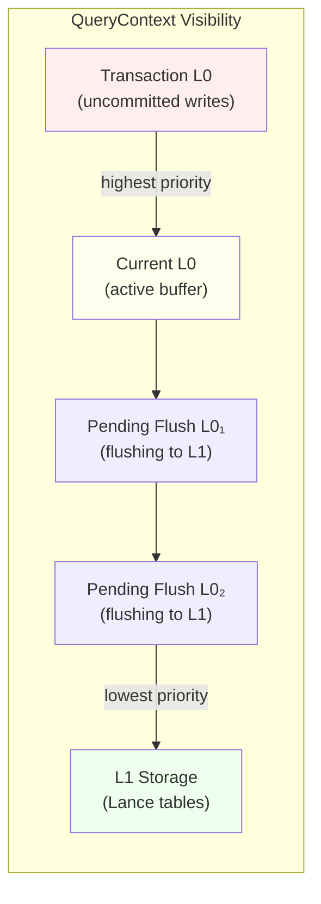

Priority order: **Transaction L0 > Current L0 > Pending Flush L0s > L1 Storage**

The L0Manager coordinates this chain:

```rust
L0Manager {
    current: RwLock<Arc<RwLock<L0Buffer>>>,               // Active L0
    pending_flush: RwLock<Vec<Arc<RwLock<L0Buffer>>>>,     // L0s being flushed
}
```

## WAL (Write-Ahead Log)

The WAL ensures durability before flush. Each WAL segment is stored as a JSON file in the object store:

| Field | Details |
|---|---|
| **Filename** | `{LSN:020}_{uuid}.wal` (zero-padded for lexicographic ordering) |
| **Format** | JSON-serialized `WalSegment { lsn: u64, mutations: Vec<Mutation> }` |
| **Mutations** | `InsertVertex`, `DeleteVertex`, `InsertEdge`, `DeleteEdge` |
| **LSN** | Monotonically increasing Log Sequence Number (starts at 1) |
| **Replay** | `replay_since(hwm)` fetches segments with LSN > high-water mark |

On startup, the Writer calls `replay_wal(hwm)` to recover any mutations that were buffered in L0 but not yet flushed to L1.

`replay_wal` also calls `WriteAheadLog::ensure_lsn_above(hwm)` after
`initialize`. `initialize` resumes after the highest LSN still on disk, but a
flush deletes every segment at or below the mark its manifest publishes, so a
cleanly closed store has none and the log used to restart at LSN 1 under a
manifest mark of, say, 3: recovery skipped every segment written between the
reopen and the next flush (`bugs::wal_lsn_after_reopen`). `flushed_lsn` is
raised to the mark too, so a later manifest's mark never goes backwards.
Segments carry `writer_features` (see declared-endpoint conformance).

## PropertyManager

The PropertyManager handles lazy property loading with an LRU cache and L0 overlay:

```rust
PropertyManager {
    storage: Arc<StorageManager>,
    schema_manager: Arc<SchemaManager>,
    vertex_cache: Option<Mutex<LruCache<(Vid, String), Value>>>,
    edge_cache: Option<Mutex<LruCache<(Eid, String), Value>>>,
    cache_capacity: usize,  // Max entries per cache (0 = disabled)
}
```

**Lookup priority for edge properties:**

1. Check if deleted in L0 → return None
2. Check L0 chain (transaction → main → pending flush) → return if found
3. Check LRU cache → return if found
4. Fetch from Lance storage runs, bounded by the reader's version high water mark when it has one → update cache → return
5. L0 properties **always** take precedence over storage

Step 4 spans two tiers, and both conjoin `_version <= hwm` when the `PropertyManager`'s own `StorageManager` carries one: the per-type delta scan (via `StorageManager::apply_version_filter`) and the `props_json` fallback in the main edges table (via `MainEdgeDataset::find_props_by_eid`). Schemaless and overflow edge properties live *only* in `props_json`, so every such read reaches the fallback — not only reads that come after a compaction.

> **Which readers are actually bounded.** The high water mark comes from the `StorageManager` the `PropertyManager` was *constructed* with, not from whatever manager the surrounding query routes its scans through. Only the manifest-pinned time-travel view built by `UniInner::at_snapshot` constructs a `PropertyManager` over pinned storage, so only it gets a bounded step 4. A read-write transaction routes *scans* through `pinned_at_version` but keeps the live database-level `PropertyManager` on purpose (see [Known Limitations](#known-limitations)), so its hwm is `None` and step 4 reads at HEAD; forks are likewise unbounded. Step 3's LRU cache is version-agnostic in every case.

> **Embedder note (breaking).** `MainEdgeDataset::find_props_by_eid` takes a third argument, `version: Option<u64>`; pass `storage.version_high_water_mark()`, or `None` for an unbounded read at HEAD. Without it even a snapshot-pinned reader read L0 and the delta tier at its snapshot but this tier at HEAD, so a post-snapshot write leaked in and a post-snapshot delete made the edge vanish. The version bound is a *conjunct* — the highest-version-row-wins tombstone rule runs unchanged over whatever survives it. `exists_by_eid` stays deliberately unbounded: it is the compaction dual-write invariant check and must see rows at any version.

## Storage Best Practices

| Practice | Details |
|---|---|
| **Cloud Config** | Set appropriate timeouts per provider (S3: higher read timeout, GCS: higher connect timeout) |
| **Flush Tuning** | Write-heavy: raise `auto_flush_threshold` to 50k+. Read-heavy: lower to 5k for fresher reads |
| **BulkWriter for Imports** | Always use BulkWriter for initial data loading — bypasses WAL, defers indexes, 10-100x faster |
| **Monitor L1 Runs** | If L1 run count grows above `max_l1_runs` (4), compaction may be falling behind |

## Storage Anti-Patterns

| Anti-Pattern | Problem | Solution |
|---|---|---|
| **Disabling WAL in production** | Data loss on crash | Keep `wal_enabled: true` (default) |
| **Flush threshold too high** | Memory pressure, stale reads | Keep ≤ 100k mutations between flushes |
| **Not monitoring L1 runs** | Unbounded L1 growth → degraded reads | Set up alerts on `l1_runs` metric |
| **Single huge transaction** | L0 grows unbounded until commit | Break into smaller transactions |

---

# Part VI: Indexing Deep Dive

## Index Architecture

Uni uses a **two-tier index maintenance** strategy:

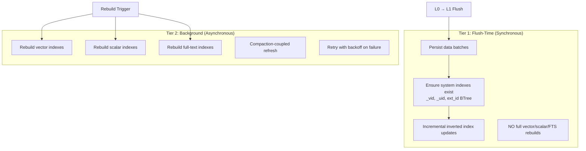

### Rebuild Triggers

| Trigger | Condition | When |
|---|---|---|
| **Growth** | Row count increased by 20-50% since last build | After flush |
| **Churn** | Update/delete ratio exceeds threshold | After compaction |
| **Bulk** | Always after bulk ingest commit | After BulkWriter.commit() |
| **Time** | Optional periodic maintenance window | Configurable |

## Index Types

### UID Index

Content-addressed O(1) lookup from UniId (SHA3-256) to VID.

| Field | Details |
|---|---|
| **URI** | `{base_uri}/indexes/uni_id_to_vid/{label}/index.lance` |
| **Schema** | `_uid: FixedSizeBinary(32)`, `_vid: UInt64`, `_uid_hex: Utf8` |
| **Index** | BTree on `_uid_hex` for O(log N) lookups |
| **Methods** | `get_vid(uid)`, `resolve_uids(&[UniId])` |

```cypher
// UID lookup is O(1) via BTree
MATCH (n:Person) WHERE n._uid = 'z3asjk42...' RETURN n
```

### Scalar Indexes (BTree, Hash, Bitmap)

Traditional database indexes on typed property columns:

| Type | Best For | Query Pattern |
|---|---|---|
| **BTree** | Range queries, ordering, prefix scans | `WHERE n.age > 25`, `STARTS WITH 'pre'` |
| **Hash** | Exact match lookups | `WHERE n.id = 123` |
| **Bitmap** | Low-cardinality columns | `WHERE n.status = 'active'` |

```cypher
// Create scalar indexes
CREATE INDEX idx_name FOR (p:Person) ON (p.name)           // Default: BTree
CREATE INDEX idx_status FOR (o:Order) ON (o.status)         // BTree
```

### Vector Indexes (HNSW, IVF-PQ, Flat)

For approximate nearest neighbor (ANN) search on embedding vectors:

| Type | Best For | Build Parameters | Query Knobs |
|---|---|---|---|
| **IVF-PQ** | the default; best recall/QPS with `refine_factor` | `num_partitions`, `num_sub_vectors`, `bits` | `nprobes`, **`refine_factor`** |
| **HNSW** | high recall without a refine pass | `m`, `ef_construction`, `partitions` | `ef_search` |
| **Flat** | small corpora, exact search | None (brute force) | None |

#### Measured trade-offs (SIFT-1M, 128-d, L2, K=10)

From `crates/uni/benches/ann_pareto.rs`, scored against SIFT's own published
ground truth. Full analysis in `docs/perf/ann-2026-08-25.md`.

| index | knob | recall@10 | QPS |
|---|---|---:|---:|
| flat (exact) | — | 1.0000 | 6.3 |
| hnsw | `ef_search=25` | 0.9600 | 32.6 |
| hnsw | `ef_search=50` | 0.9800 | 32.6 |
| ivf_pq | `nprobes=64` (no refine) | 0.5620 | 50.8 |
| ivf_pq | `nprobes=64, refine_factor=5` | 0.9260 | 52.3 |
| **ivf_pq** | **`nprobes=64, refine_factor=20`** | **0.9920** | **49.1** |

Three things this replaces earlier guidance with:

- **`refine_factor` is applied by default on PQ indexes (since 3.5).** Omitting
  it caps recall at ~0.56 no matter how high `nprobes` goes — the ceiling is
  quantization precision, not search breadth. A quantized index now carries a
  default derived from its compression ratio, so the same `nprobes=64` cell
  measures **0.978**. An explicit `refine_factor` overrides it; `1` opts out.
  Resolved by `uni_common::vector_index_opts::default_refine_factor`, stored on
  `VectorIndexConfig.default_refine_factor` at creation, and recomputed at query
  time for indexes created before the field existed.
- **`sub_vectors` is dimension-aware (since 3.5).** It was a fixed 16 regardless
  of `dim`, which meant compression grew with embedding width — 32x at 128-d but
  192x at 768-d and 384x at 1536-d. `default_sub_vectors(dim)` now picks the
  smallest divisor of `dim` at or above `dim/8`, holding compression near 32x
  (768-d -> 96, 1536-d -> 192). It must be a **divisor**: `IndexManager` rejects
  `dim % sub != 0`. Dimensions below 128, and those with no divisor in range,
  keep 16 — which preserves the deliberate `sub > dim` case that lets an index be
  declared on an empty table.
- **The old "HNSW < 1M, IVF-PQ > 1M" rule does not hold.** Both work at 1M;
  IVF-PQ with refine beats HNSW on recall *and* throughput.
- **`ef_search` saturates.** Recall stops improving at 50 and QPS falls
  monotonically after; 25–50 is the useful band. Lance's `1.5xk` default (15 for
  k=10) lands near 0.86 and is too low for recall-sensitive work.

```cypher
// Create vector index with HNSW
CREATE VECTOR INDEX idx_embed FOR (d:Document) ON (d.embedding)
  WITH { metric: 'cosine', type: 'hnsw' }

// Create vector index with IVF-PQ for large datasets
CREATE VECTOR INDEX idx_embed FOR (d:Document) ON (d.embedding)
  WITH { metric: 'l2', type: 'ivf_pq', num_partitions: 256 }
```

**Distance Metrics:**

| Metric | Raw Distance | Score Conversion | Similarity Range | Best For |
|---|---|---|---|---|
| `Cosine` | `1.0 - cos(a,b)` (range [0, 2]) | `(2.0 - d) / 2.0` | [0, 1] | Normalized embeddings (most models) |
| `L2` | Squared Euclidean distance | `1.0 / (1.0 + d)` | (0, 1] | Raw embeddings, spatial data |
| `Dot` | Negative dot product | Pass-through | Unbounded | Maximum inner product search |

Score conversion is **metric-aware**: `uni.vector.query`, `uni.search`, and `similar_to()` all use the same `calculate_score(distance, metric)` function to normalize raw Lance distances into similarity scores, regardless of which metric the vector index was created with.

**Sparse (learned-sparse / SPLADE) index kind.** Beyond the dense ANN families above, a vector index may be created with `type: 'sparse'` to index high-dimensional, mostly-zero `SparseVector` columns (SPLADE-style term-weight vectors). It is backed by an inverted term→(VID, weight) structure rather than HNSW/IVF graphs, and scores by sparse dot product. One knob is specific to it:

| Option | Type | Default | Description |
|---|---|---|---|
| `quantize` | Bool | `true` | `true` = 8-bit quantization of term weights (smaller, lossy); `false` = lossless `f32` weights |

```cypher
CREATE VECTOR INDEX idx_sparse FOR (d:Doc) ON (d.emb)
  OPTIONS { type: 'sparse', quantize: false }
```

Query it through `uni.sparse.query` (see Part VIII, [Sparse Vectors](#sparse-vectors)).

### Full-Text Indexes (BM25)

BM25-based full-text search on text properties:

```cypher
CREATE FULLTEXT INDEX idx_content FOR (a:Article) ON EACH [a.content]

// Query with BM25 scoring
CALL uni.fts.query('Article', 'content', 'graph database', 10)
YIELD node, score
```

### JSON FTS Indexes

Full-text search on nested JSON/JSONB properties:

```cypher
CREATE JSON FULLTEXT INDEX idx_meta FOR (d:Data) ON metadata
```

### Inverted Indexes

Term-to-VID mapping for `ANY(x IN list WHERE x IN allowed)` query patterns:

```rust
InvertedIndex {
    dataset: Option<Dataset>,           // Backing Lance dataset
    base_uri: String,                   // Storage URI
    label: String,                      // Vertex label
    property: String,                   // Indexed property
    config: InvertedIndexConfig,        // { label, property, normalize, max_terms_per_doc }
}
```

Postings (`term → VIDs`) are built transiently during index operations, not stored as a struct field.

**Memory guard**: `DEFAULT_MAX_POSTINGS_MEMORY = 256 MB`. Build uses temp segment flushing when memory limit is reached.

### VidLabelsIndex

In-memory bidirectional index for O(1) VID ↔ label lookups:

```rust
VidLabelsIndex {
    vid_to_labels: HashMap<Vid, Vec<String>>,
    label_to_vids: HashMap<String, HashSet<Vid>>,
}
```

Rebuilt from the main vertex table on database open. Updated incrementally on writes.

## Index Lifecycle

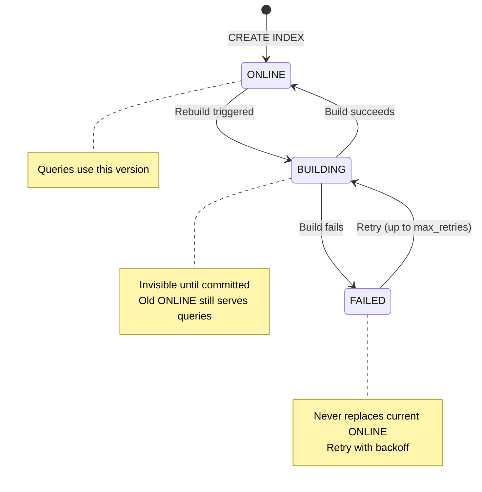

**Index Status Gating**: The query planner only uses indexes with `Online` status. Indexes in `Building`, `Stale`, or `Failed` states are invisible to queries — the old `Online` version continues serving until a rebuild succeeds. This means index rebuilds are zero-downtime: the new index is built in the background and atomically swapped in on success.

| Status | Query Visible | Writes Trigger Rebuild | Description |
|---|---|---|---|
| `Online` | Yes | No | Up-to-date and serving queries |
| `Building` | No (old Online serves) | Queued | Rebuild in progress |
| `Stale` | No (old Online serves) | Queued | Scheduled for rebuild after transient failure |
| `Failed` | No (old Online serves) | Retry if under max_retries | Exhausted retry attempts |

**An index declared before the label has data is built at its first flush.**
With no table to build against, `create_scalar_index`, `create_fts_index` and
`create_json_fts_index` record `BuildOutcome::NotAttempted`, which is `Online`
with no `last_built_at`. Every vertex flush calls
`IndexManager::ensure_declared_indexes`, which builds each declared scalar,
full-text or JSON full-text index on the label that has no physical artifact
(scalar matched by covered columns, full-text by name) and is a no-op once it
exists. Full-text indexes used to be left out on the belief that they are
updated incrementally; that holds for uni's own inverted index, not for the
Lance index behind `CREATE FULLTEXT INDEX`, which stayed unbuilt until a
rebuild or compaction. Searches meanwhile ran Lance's flat scan, whose bare
tokenizer does not lowercase, so `'GRAPH'` did not match `graph`
(`index_lifecycle_test::a_fulltext_index_declared_before_any_data_is_built_at_the_first_flush`).

A flush does not add the rows it writes to an existing Lance full-text index.
They stay in fragments the index does not cover until compaction's
`optimize_indices`, a growth-triggered rebuild (off by default), or an explicit
rebuild; Lance searches them with a flat pass meanwhile.

## Predicate Pushdown Priority

When executing a query, the planner pushes predicates down to the most efficient index:

```mermaid
graph TB
    PRED[WHERE Predicate] --> UID{UID Lookup?<br/>n._uid = '...'}
    UID -->|Yes| UIDX[UID Index<br/>O(1) hash lookup]
    UID -->|No| BT{Scalar Index?<br/>n.prop = value<br/>n.prop > value}
    BT -->|Yes| BTX[BTree/Hash/Bitmap<br/>O(log N) lookup]
    BT -->|No| FTS{Full-Text?<br/>CONTAINS 'term'}
    FTS -->|Yes| FTSX[BM25 Full-Text<br/>Scored results]
    FTS -->|No| LANCE{Lance Filter?<br/>Arrow predicate}
    LANCE -->|Yes| LX[Lance Scan<br/>Columnar pushdown]
    LANCE -->|No| RES[Residual Filter<br/>Post-scan evaluation]
```

**Orientation comes first.** Every matcher above recognizes a property
comparison only with the property on the left. `plan_where_clause`
(`uni-query/src/query/planner.rs`) therefore rewrites `const OP n.prop` to
`n.prop OP' const` once, before any of them runs, via
`pushdown::orient_property_comparisons`: `=` and `<>` stay, `<` ↔ `>`,
`<=` ↔ `>=`. A constant is a literal, a parameter, or a list / map / unary
expression built only from those. Only the boolean skeleton (`AND`, `OR`,
`XOR`, `NOT`) is descended. `IN`, `STARTS WITH`, `ENDS WITH`, `CONTAINS` and
`=~` are not commutative and are never flipped. Every WHERE path goes through
this function: MATCH, element (`(n WHERE …)`) predicates folded into it,
`CALL {}` subqueries, and Locy rule bodies (#226). Before this, `$p = n.uid`
scanned the whole label while `n.uid = $p` read one row from the index (perf
audit 2026-10-17, A9). Regression suite:
`crates/uni/tests/common/index/commuted_comparison_pushdown.rs`.

**Indexed point lookups only push type-exact operands.**
`build_indexed_property_pushdown` (`df_planner.rs`) hands the resolved literal
to Lance, which coerces it to the column type and fails the query when it
cannot. `index_operand_fits_column` keeps a predicate out of the Lance filter
unless the coercion is exact: an integer for an INT column, a float or an
integer of magnitude at most 2^53 for a FLOAT column, a string for a STRING
column, a boolean for a BOOL column, and never NULL. Anything else is left to
the outer `FilterExec`, which applies Cypher semantics. Before this,
`n.x = 41.5` on an indexed INT column failed with Lance's
`could not convert to literal of type 'Int64'` instead of returning no rows.
A float operand must also be finite and non-zero: `NaN` and `inf` have no SQL
literal (they parse as column names), and `-0.0` renders as `-0`, an integer,
so `n.f = -0.0` went to Lance as `f = 0`, found the `+0.0` row, and the
residual dropped it: `[]` instead of the `-0.0` row. Zero is refused in either
spelling, integer `0` included: Cypher's `-0.0 = 0.0` holds, but Lance compares
by IEEE total order, so `f = 0` would drop a stored `-0.0` row before the
residual sees it. On a column known not to be temporal a string literal also reaches
Lance unchanged; the datetime normalizer used to rewrite
`n.s = '2021-06-01T00:00Z'` on a STRING column to `…T00:00:00Z` and lose the
row. `i64::MIN` has no literal either (`-9223372036854775808` is the negation
of an overflowing integer, which Lance types as `Float64` and then rejects), so
`FilterExpr::to_sql` respells every comparison against it with `MIN + 1`, `IS
NULL` and an explicit unknown.

**Ranges, prefixes and null tests reach the index too.** Perf audit
2026-10-17, F1: before this only `=` and `IN` were pushed, and `n.x < 10`,
`n.x >= 100 AND n.x < 110`, `n.uid STARTS WITH 'u42'` and `n.uid IS NULL` read
the whole label (`rows_scanned` 2,000 → 8,000 for a 10-row answer).
`IndexAwareAnalyzer` now records `indexed_range_columns`: `<`, `<=`, `>`, `>=`
and `STARTS WITH` (literal or parameter operand) against an Online **BTree**,
and `IS [NOT] NULL` against an Online BTree or **Hash** index (a Hash index is
not ordered, so it takes no range even though Lance builds it as a BTree).
`build_indexed_property_pushdown` resolves parameters and hands each such
conjunct to `pushdown::indexed_range_filter`, which returns a type-exact
`FilterExpr` for Lance under a one-sided contract: it must accept every row
the conjunct accepts and may accept more, because the original conjunct stays
above it twice — as the scan's Arrow runtime filter over the merged Lance + L0
batch, and in the outer `FilterExec`. The renderings:

| Form | Sent to Lance | Why it is exact or a superset |
|---|---|---|
| INT64 col, int bound | same comparison | — |
| INT64 col, float bound | `<` / `>=`: `ceil`; `<=` / `>`: `floor` | selects the same integers; rounding to `f64` is monotone, so also a superset of the widened comparison |
| INT64 col, `±0.0` bound | inclusive bound at 0 | a superset of the residual's `x op 0` (it was chosen when the residual held `0 > -0.0` by total order; inclusive covers both readings) |
| FLOAT64 col, finite non-zero float, or int with \|i\| ≤ 2^53 | same comparison | — |
| STRING col, string bound | same comparison | both sides compare bytes; no datetime normalization |
| `STARTS WITH p`, STRING col | `col >= p AND col < succ(p)` | `succ` drops trailing U+10FFFF and bumps the last char, U+D7FF → U+E000; no successor ⇒ lower bound only |
| `IS [NOT] NULL`, STRING / INT / FLOAT / BOOL col | same test | not `CypherValue`, whose cells can hold an encoded NULL |

Deliberately left to the residual alone: NaN, infinite and zero float bounds on
a FLOAT column (Lance orders floats by total order, so `f >= 0` would lose a
stored `-0.0` row the residual accepts, and NaN/inf have no literal), out-of-range and type-mismatched operands (string vs
int, bool, NULL — Cypher answers NULL, Lance would reject or coerce), the empty
prefix, ranges on INT32 / FLOAT32 columns (the bound would be narrowed to the
column type, not one-sidedly), `NOT` / `OR` shapes, and every unindexed column.
EXPLAIN reports the served columns with reason `… range / prefix / null scan
pushed into Lance scan`. Unflushed rows: the scan's L0 pre-filter
(`columnar_scan::L0PropertyPrefilter`, W3b) now also carries range bounds
recovered from the runtime filter, so an indexed range over L0 builds the
matching rows rather than the label's whole L0 set; `STARTS WITH` and null
tests are not recovered there and keep the full L0 read.

**Column names are backtick-quoted in every rendered filter.**
`FilterExpr::to_sql` (`uni-store/src/backend/types.rs`) is the single place a
storage filter becomes text, and it wraps every column name in backticks — the
Lance filter dialect's only identifier quote. A double-quoted name is a *string
literal* there (`"col" >= 2` is `'col' >= 2`; the deleted range fusion shipped a
wrong answer that way). Names used to be emitted bare, which broke on any
property a user can write with Cypher backticks: measured against a real Lance
dataset, 90 of 222 renderings failed — parse/planning errors for `my prop`,
`a-b`, `1lead`, `has'sq`, `not`, `select` inside `AND`/`NOT`, and **silent
wrong rows** for `null` and `true`, which parse as literals (`null IS NULL`
kept every row). End to end the indexed `=`/`IN`/range/prefix/null paths either
surfaced the Lance error to the user or returned `[]`. Quoting is unconditional,
not keyword-list driven, which also stops a bare name that misses the schema
from resolving case-insensitively. A backtick-quoted name still reaches the
scalar index (checked via Lance's explain plan). The one name no spelling
reaches is one containing a backtick (Lance resolves the unescaped identifier
as a field path, where a bare backtick is invalid, and refuses to index it
too): `to_sql` returns `ToSqlError::Unsupported`, so `sql_pushable` drops that
conjunct to the residual filter. `indexed_range_filter`'s former
`is_bare_identifier` gate is gone; only reserved system columns
(`is_reserved_property_name`) are excluded. A Lance column name cannot contain `.` at all (rejected at write).
Tests: `uni-store` `backend::eval::tests::awkward_column_names_*`,
`crates/uni/tests/common/index/awkward_property_name_pushdown.rs`
(pushed vs unpushed, BTree / Hash / unindexed, flushed and half in L0).
Writing that test exposed a parser defect on the same names: a `SET` target
(`SET n.`order` = …`), a map-literal key (`CREATE (n {`order`: …})`, pattern
property maps) and a map-projection selector kept the backticks, while property
access stripped them — so the write went to an overflow property literally
named `` `order` `` and `n.`order`` read NULL. The walker now unquotes all four
through `normalize_identifier` (`uni-cypher/tests/repro_backtick_property_name.rs`).
**Quoted identifiers (wave C).** The grammar's quoted form is the shared
`escaped_name` rule, openCypher's `EscapedSymbolicName`: a doubled backtick
inside stands for one backtick (`` `has``tick` `` is ``has`tick``), and
`$`p q`` is a parameter. `normalize_identifier` strips the quotes and undoubles
the backticks; it must run exactly once per token, since its output can look
quoted again. Every identifier the walkers extract now goes through it
(`walker::ident`): before, variables (pattern, UNWIND, FOREACH, comprehension,
quantifier, REDUCE, SET/REMOVE targets, map-projection selectors), procedure
names, parameters, index and constraint names, DDL property names and Locy
generator names/outputs kept their backticks, so `` MATCH (`n`) RETURN n ``
failed to plan and `` CREATE LABEL L (`my prop` STRING) `` declared a property
literally named `` `my prop` ``. Index DDL took the property name by splitting
the text on `.`, which broke on `` p.`a.b` ``; it now reads the last token.
Oracle: `uni-cypher/tests/repro_escaped_identifier.rs` (quoted AST equals bare
AST) and `crates/uni/tests/common/bugs/escaped_identifier_round_trip.rs`.

A *declared* property cannot contain `.` or a backtick
(`validate_property_name`): Lance refuses a top-level field named with `.` at
table creation (the declaration used to succeed and every later flush of the
label failed), and writes a field named with a backtick but cannot project it —
`Scanner::project` escapes the name, but lance-datafusion's
`ColumnCapturingVisitor` hands the unescaped root name to the field-path
parser, so the column is silently not loaded and the read fails with
`No field named` (`uni-store/tests/common/storage/lance_backtick_column_probe.rs`).
Undeclared, both live in `overflow_json` and work. `CREATE LABEL` /
`CREATE EDGE TYPE` and `SchemaBuilder::apply` validate property names before
touching the schema; they used to add the element first and leave it behind
when a later property was refused.

Two prerequisites sat outside the translation. `PredicateAnalyzer::is_pushable`
accepted only a string literal for `STARTS WITH` / `CONTAINS` / `ENDS WITH`,
so `STARTS WITH $p` never reached the scan's filter; it now accepts a parameter
(`LanceFilterGenerator` still renders only literals). And the parser folded
`-5` into a literal but left `-2.5` as `Neg(2.5)`, which no matcher reads as a
constant, so `n.f > -2.5` was never pushed at all; `negate_expression` now
folds float literals too.

**Cost.** A pushed property predicate makes the scan re-read `_vid`/`_version`
for the vids it returned (`drop_superseded_pushdown_rows`), because Lance
filters rows before the MVCC dedup and a stale matching version would
otherwise win. That re-read was chunked `_vid IN (…1000…)` queries, which made
a non-selective range 3x slower than not pushing it (32,000 rows: 126 ms
against 37 ms unpushed, 39 ms with the re-read skipped). A dense candidate set
(over 1,000 vids filling at least 1/16 of their vid span) is now re-read as one
`_vid` range: 60 ms against 38 ms. Selective forms: 7-8 ms against 37-40 ms at
32,000 rows, about even at 2,000. There are no column statistics, so a range
that matches most of the label still pays about 1.5x. Pushing *unindexed*
ranges to Lance was measured and not adopted: about 2x faster for a selective
range at 32,000 rows, flat at 8,000, and it would pay the same re-read on a
non-selective one (inferred from the indexed path, not measured).

The residual compares with Arrow's kernels, which order floats by IEEE total
order: `NaN = NaN` and `NaN > x` for every `x`, and `-0.0 < 0.0`. That differs
from openCypher, which holds `-0.0 = 0.0` and every NaN comparison false. The
pushdown matches the residual as it is (the differential's oracle), not the
spec. Regression suite: `crates/uni/tests/common/index/range_prefix_null_pushdown.rs`
(differential against an unpushed `WITH n WHERE …` oracle over NULL, NaN,
±inf, ±0.0, extreme-int and unicode / wildcard / quote rows; flushed, half in
L0, mutated in L0, mutated and re-flushed, in a transaction, on a fork; counter
guards at 2,000 and 8,000 rows).

**An `OPTIONAL MATCH`'s `WHERE` reaches only the clause's own optional
scans.** `plan_where_clause` takes a `WhereScope`. Under
`WhereScope::Mandatory` (MATCH, `CALL … YIELD`, Locy rule bodies) all four
rewrites run: the vector KNN rewrite (`n.prop ~= q` only — see "A
`vector_similarity` threshold is never index-served" below; under `Optional`
it runs too, for a created variable's `optional` scan — see "`~=` is sized by
the `LIMIT` it feeds"), the label/type
disjunction rewrite,
scan/traverse-target pushdown, and the correlated-subquery
`Apply.input_filter`. Under `WhereScope::Optional { created }` one pushdown is
left. A conjunct over a single variable the clause creates may go into that
variable's scan, but only a scan marked `optional`
(`optional_scan_reachable`). Such a scan is the clause's own and emits one
NULL row when nothing passes. This is what the inline
`OPTIONAL MATCH (b:N {uid: $u})` form always did, and it keeps the index
lookup: without it, `MATCH (a:A) OPTIONAL MATCH (b:N) WHERE b.uid = 'u42'` read
all 4003 rows instead of 3. Everything else goes into one `Filter` carrying
`created`, which lowers to `OptionalFilterExec`, so a row it rejects is
null-extended instead of dropped. Every other pushdown target is a producer the
null-extension sits above or beside. That covers an earlier clause's scan
(`MATCH (a) WHERE a.x < 4 OPTIONAL MATCH (a)-->(b) WHERE a.x < 3` lost the
`x = 3` row), an earlier OPTIONAL's traversal target (a rejected `b.x < 3`
nulled `b` itself), a subquery's input filter, and a traversal's
`target_filter`, which drops rows rather than null-extending them. The KNN
rewrite stays off because `VectorKnn` has no `optional` flag: a vector
predicate nothing satisfied lost the NULL row. The label-disjunction rewrite
stays off because it would build a union of optional scans, each able to emit
its own NULL row.
`plan_match_clause` makes the same rule hold for the pattern's own syntax
before planning. In an OPTIONAL clause, labels and a property map on a node an
earlier clause bound (`OPTIONAL MATCH (a:L {x: 1})-->(b)`) are moved into the
`WHERE`. Planned in place they were a plain `Filter` on the rows entering the
clause. And when every node in the clause is bound, its anonymous
relationships get hidden names. Such a clause still matches an entering row
once per relationship, and without created variables its `Filter` would have
nothing to null. A clause that creates no variable even then (every node and
relationship bound) matches an entering row at most once and returns it
unchanged, so its `WHERE` is validated and then dropped. Regression suite:
`crates/uni/tests/common/bugs/optional_where_bound_var_pushdown.rs`. It
compares each query against `MATCH … ⊎ NOT EXISTS {…}` padded with NULL, and
runs schemaless and with scalar and vector indexes, flushed and unflushed. Its
counter guard (`…_counters_1000` / `…_counters_4000`) holds `rows_scanned` to at
most 64 and requires an index scan, for the created-only scan, the traversal
form and a mixed `b.uid = 'u42' AND a.x < 3`.

## Choosing the Right Index

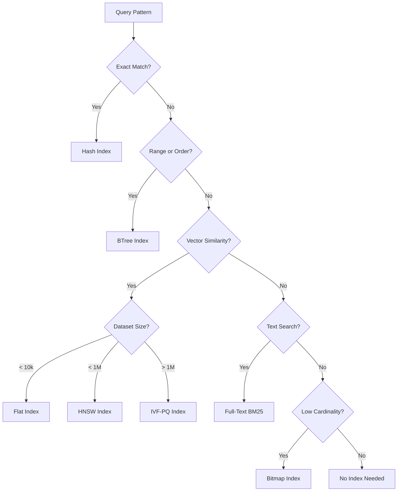

## Indexing Best Practices

| Practice | Details |
|---|---|
| **Index every WHERE property** | Properties used in WHERE clauses should have scalar indexes |
| **HNSW for < 1M vectors** | Best recall-latency trade-off for moderate datasets |
| **IVF-PQ for > 1M vectors** | Memory-efficient with acceptable recall |
| **Match metric to model** | Use Cosine for models with normalized output (most), L2 for raw |
| **BTree for range queries** | ORDER BY, >, <, >=, <=, STARTS WITH |

## Indexing Anti-Patterns

| Anti-Pattern | Problem | Solution |
|---|---|---|
| **Over-indexing** | Index maintenance cost on every write | Only index properties used in queries |
| **Wrong distance metric** | Cosine on unnormalized vectors gives poor results | Check your embedding model's documentation |
| **Missing scalar index on filters** | Full scan on high-cardinality columns | Add BTree index on filtered properties |
| **Vector index without enough data** | HNSW/IVF-PQ need minimum data to be effective | Use Flat for < 1000 rows |

---

# Part VII: Cypher Query Language

## Overview

Uni implements a substantial subset of the OpenCypher query language, extended with vector search, full-text search, DDL commands, time travel, and window functions. The parser is based on `pest` (PEG grammar) and produces an AST that the query planner converts to DataFusion physical plans.

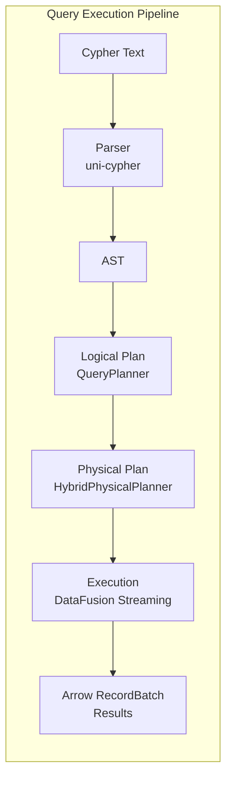

## Clauses

### MATCH

Pattern matching — the core of Cypher. Finds subgraphs matching a pattern.

```cypher
// Simple node match
MATCH (n:Person) RETURN n

// Node with properties
MATCH (n:Person {name: 'Alice'}) RETURN n

// Edge pattern
MATCH (a:Person)-[r:KNOWS]->(b:Person) RETURN a, r, b

// Multi-hop pattern
MATCH (a:Person)-[:KNOWS]->(b:Person)-[:WORKS_AT]->(c:Company)
RETURN a.name, c.name

// OPTIONAL MATCH (left outer join)
OPTIONAL MATCH (n:Person)-[r:MANAGES]->(m:Person) RETURN n, m
```

### Node Patterns

<!-- doctest: skip -->
```cypher
(n)                    // Any node, bound to variable n
(n:Person)             // Node with label Person
(n:Person:Employee)    // Node with multiple labels
(n {name: 'Alice'})    // Node with property filter
(n:Person {age: 30})   // Label + property filter
()                     // Anonymous node
```

### Edge Patterns

<!-- doctest: skip -->
```cypher
-[r]->                 // Outgoing edge
<-[r]-                 // Incoming edge
-[r]-                  // Undirected edge
-[r:KNOWS]->           // Typed edge
-[r:KNOWS|FRIEND_OF]-> // Multiple types (OR)
-[r:KNOWS {since: 2020}]-> // Edge with properties
-[r *1..3]->           // Variable-length path (1 to 3 hops)
-[r *]->               // Variable-length (any number of hops)
-[r *..5]->            // Variable-length (up to 5 hops)
```

### Path Patterns

```cypher
// Named path
MATCH p = (a)-[:KNOWS*]->(b)
RETURN nodes(p), relationships(p), length(p)

// Shortest path
MATCH p = shortestPath((a:Person)-[:KNOWS*]-(b:Person))
WHERE a.name = 'Alice' AND b.name = 'Bob'
RETURN p

// All shortest paths
MATCH p = allShortestPaths((a:Person)-[:KNOWS*]-(b:Person))
RETURN p
```

### Pattern Comprehension

```cypher
// Inline pattern with filtering and projection
RETURN [(a)-[:KNOWS]->(b) WHERE b.age > 25 | b.name] AS friends_over_25
```

### CREATE

```cypher
// Create nodes
CREATE (n:Person {name: 'Alice', age: 30})

// Create edges
MATCH (a:Person {name: 'Alice'}), (b:Person {name: 'Bob'})
CREATE (a)-[:KNOWS {since: 2023}]->(b)

// Create with RETURN
CREATE (n:Document {title: 'Hello'}) RETURN n
```

### MERGE

Upsert — create if not exists, update if exists:

```cypher
// Merge node
MERGE (n:Person {ext_id: 'user-123'})
ON CREATE SET n.created = datetime()
ON MATCH SET n.last_seen = datetime()
RETURN n

// Merge edge
MATCH (a:Person {name: 'Alice'}), (b:Person {name: 'Bob'})
MERGE (a)-[r:KNOWS]->(b)
ON CREATE SET r.since = date()
```

**Performance.** A single-node, single-label `MERGE (n:Label {key: ...})` with a
literal key map takes a batched fast path: the existing-node lookup is resolved
from one per-statement L0 snapshot plus a persisted lookup, with no per-row query
planning. This is what makes `UNWIND $rows AS e MERGE (n:Label {key: e.key}) ...`
scale (it also handles intra-batch duplicate keys correctly). Put a **scalar
index** on the MERGE key so the persisted lookup is an index point-lookup rather
than a full label scan. Multi-node/edge MERGE (`MERGE (a)-[:R]->(b)`) and
non-literal property maps (`MERGE (n:Label $props)`) use the slower per-row
general path — prefer a single-node MERGE for the node and batched
`CREATE`/`MATCH` for edges.

### WITH

Intermediate result projection — acts as a pipeline stage:

```cypher
MATCH (n:Person)
WITH n, n.age AS age
WHERE age > 25
RETURN n.name, age
ORDER BY age DESC
```

### WITH RECURSIVE

Recursive common table expressions:

<!-- doctest: skip -->
```cypher
WITH RECURSIVE reachable(vid, depth) AS (
    MATCH (n:Person {name: 'Alice'}) RETURN id(n) AS vid, 0 AS depth
    UNION ALL
    MATCH (a)-[:KNOWS]->(b)
    WHERE id(a) IN reachable.vid AND reachable.depth < 5
    RETURN id(b) AS vid, reachable.depth + 1 AS depth
)
RETURN DISTINCT vid, min(depth) AS min_depth
```

### RETURN

Final result projection:

```cypher
RETURN n.name, n.age                    // Columns
RETURN n.name AS person_name            // Aliases
RETURN DISTINCT n.city                  // Deduplicate
RETURN n ORDER BY n.age DESC            // Ordering
RETURN n LIMIT 10                       // Limit results
RETURN n SKIP 20 LIMIT 10              // Pagination
RETURN count(*) AS total                // Aggregation
```

### WHERE

Filtering conditions (applies to MATCH, WITH, RETURN):

<!-- doctest: skip -->
```cypher
WHERE n.age > 25
WHERE n.name = 'Alice' AND n.active = true
WHERE n.name STARTS WITH 'A'
WHERE n.name CONTAINS 'lic'
WHERE n.name ENDS WITH 'ce'
WHERE n.name =~ '.*lice.*'             // Regex
WHERE n.name IN ['Alice', 'Bob']
WHERE n.email IS NOT NULL
WHERE EXISTS { MATCH (n)-[:KNOWS]->() }
```

### UNWIND

Expand a list into rows:

```cypher
UNWIND [1, 2, 3] AS x RETURN x
UNWIND $names AS name MATCH (n:Person {name: name}) RETURN n
```

`UNWIND`-driven operations are batched rather than run per row: `CREATE`,
property-/id-correlated `MATCH` (index IN-list pushdown when the property is
indexed), `SET`, `REMOVE`, `DELETE`, and single-node `MERGE` (see MERGE above)
all process the whole batch in one statement. For bulk upserts, prefer one
`UNWIND $batch AS e MERGE (n:Label {key: e.key}) ON CREATE SET ... ON MATCH SET ...`
over a MERGE-per-row loop, and scalar-index the key.

### DELETE

```cypher
// Delete node (must have no edges)
MATCH (n:Person {name: 'Alice'}) DELETE n

// Detach delete (removes all edges first)
MATCH (n:Person {name: 'Alice'}) DETACH DELETE n
```

### SET / REMOVE

```cypher
// Set properties
MATCH (n:Person {name: 'Alice'}) SET n.age = 31, n.updated = datetime()

// Set labels
MATCH (n:Person {name: 'Alice'}) SET n:Employee

// Remove properties
MATCH (n:Person {name: 'Alice'}) REMOVE n.temporary_field

// Remove labels
MATCH (n:Person {name: 'Alice'}) REMOVE n:Employee
```

### CALL

Invoke procedures with YIELD:

```cypher
CALL uni.vector.query('Document', 'embedding', $query_vector, 10)
YIELD node, score
RETURN node.title, score

CALL uni.schema.labels()
YIELD label, nodeCount
RETURN label, nodeCount
```

### UNION

Combine query results:

```cypher
MATCH (n:Person) RETURN n.name AS name
UNION
MATCH (n:Company) RETURN n.name AS name

// UNION ALL keeps duplicates
MATCH (n:Person) RETURN n.name UNION ALL MATCH (n:Company) RETURN n.name
```

## Expressions

### Operators

| Category | Operators |
|---|---|
| **Arithmetic** | `+`, `-`, `*`, `/`, `%`, `^` |
| **Comparison** | `=`, `<>`, `<`, `<=`, `>`, `>=` |
| **Logical** | `AND`, `OR`, `XOR`, `NOT` |
| **String** | `CONTAINS`, `STARTS WITH`, `ENDS WITH`, `=~` (regex) |
| **Membership** | `IN` |
| **Similarity** | `~=` (vector similarity — desugars to `uni.vector.query` top-K scan) |
| **Null** | `IS NULL`, `IS NOT NULL` |

### CASE Expression

<!-- doctest: skip -->
```cypher
CASE n.status
    WHEN 'active' THEN 'Active'
    WHEN 'inactive' THEN 'Inactive'
    ELSE 'Unknown'
END

CASE
    WHEN n.age < 18 THEN 'Minor'
    WHEN n.age < 65 THEN 'Adult'
    ELSE 'Senior'
END
```

### Quantifiers

<!-- doctest: skip -->
```cypher
ALL(x IN n.scores WHERE x > 50)       // All elements match
ANY(x IN n.tags WHERE x = 'important') // At least one matches
SINGLE(x IN n.refs WHERE x = target)   // Exactly one matches
NONE(x IN n.errors WHERE x IS NOT NULL) // No elements match
```

### REDUCE

<!-- doctest: skip -->
```cypher
REDUCE(total = 0, x IN n.scores | total + x) AS sum
```

### List Comprehension

<!-- doctest: skip -->
```cypher
[x IN range(1, 10) WHERE x % 2 = 0 | x * x] AS even_squares
```

### Map Projection

```cypher
MATCH (n:Person)
RETURN n{.name, .age, city: n.address.city} AS person_data
```

### Parameters

```cypher
MATCH (n:Person) WHERE n.name = $name RETURN n
MATCH (n:Person) WHERE n.age > $min_age RETURN n
```

Parameters prevent injection and enable query plan caching.

A referenced parameter missing from the map is an error at every evaluation
site -- the DataFusion expression translation (`df_expr::cypher_expr_to_df`),
the row evaluator (`executor/read.rs` `Expr::Parameter`, which the write
executor uses for `CREATE`/`SET`/`MERGE` values) and the Locy evaluator
(`locy_eval::eval_expr`). Each raises `UniError::parameter_missing_message`,
whose `PARAMETER_MISSING_TAG` prefix the API layer (`into_query_error`,
`into_execution_error`, `into_stream_error`, Locy's `map_native_df_error`)
parses back into the typed `UniError::ParameterMissing { names }`. The
evaluator used to substitute `NULL`, which a write stored -- and a `SET`
overwrote with.

Those sites are now the fallback. Before a statement runs, the API layer checks
its parameters up front (`impl_query::check_parameters`): the parse
(`uni_cypher::parse_with_parameters`, `parse_locy_with_parameters`) also walks
the pest tree for every `parameter` pair -- so subqueries, `SKIP`/`LIMIT`,
procedure arguments and property maps all count and string literals do not --
and returns their names in order of first appearance. Any the caller did not
supply raise `ParameterMissing { names }` with all of them, as openCypher
specifies (compile time) and Neo4j reports. A plan-cache hit skips the parse,
so `PlanCacheEntry::parameters` keeps the names (session and `UniInner`
caches), and `PreparedQuery` keeps them for each execution. Checked on the
session and transaction paths, cursors, `PROFILE`, prepared queries and the two
Locy evaluation entries (`evaluate_with_db_and_config_capturing`,
`LocyEngine::evaluate_with_config_capturing`); not on `EXPLAIN`, which Neo4j
plans without parameters. A parameter referenced only inside a rule registered
earlier is not in the program text: each `CompiledRule` carries its own
`parameters` (`RuleDefinition::parameters`, collected by the Locy walker from
the same pest pairs), and `impl_locy::check_program_parameters` checks the
program's names, then each merged rule's in stratum order, after
`merge_registered_rules` (only the registered strata the program reaches). The
same check runs for a prepared program (`PreparedLocy`), which checked nothing
up front before (Wave Q).

**Search-procedure node yields.** `uni.fts.query`, `uni.vector.query` and
`uni.search` emit a node yield as `node._vid`, a VID-string placeholder `node`,
`node._labels` and the requested property columns. When the yield is used as a
whole entity (`"*"` or the structural sentinel in the collected properties),
`plan_procedure_call` adds `_all_props` (which makes `hydrate_node_props` fetch
every property) and replaces the placeholder with the same node struct a scan
builds (`add_structural_projection`). Without it, entity functions inside the
query saw a string.

**One-row arrays across `Apply`.** `apply.rs::value_to_single_row_array`
rebuilds a subquery's post-`SET` entity columns. Types without a dedicated arm
-- a declared `MAP` (`List<Struct<key, value>>`), typed lists, vectors,
temporals, `Float32` -- are built by `columnar_scan::build_property_column_static`,
the builder that covers every declared property type, and a result of any
other type is an error rather than a mistyped column. DateTime, Time and sparse
vector structs are values, not entities, and take the same route.

**`uni.graph.project` in a transaction.** The projection catalog
(`projection_store`, per database) is not transactional. The procedure refuses
when the host's `transaction_l0` has `mutation_count > 0`
(`UniError::UncommittedWritesInTransaction`, carried as
`UNCOMMITTED_WRITES_TAG`); a clean transaction builds from its snapshot.

## Aggregation Functions

| Function | Description | Example |
|---|---|---|
| `count(expr)` | Count rows | `count(*)`, `count(DISTINCT n.city)` |
| `sum(expr)` | Sum values | `sum(n.amount)` |
| `avg(expr)` | Average | `avg(n.score)` |
| `min(expr)` | Minimum | `min(n.created_at)` |
| `max(expr)` | Maximum | `max(n.price)` |
| `collect(expr)` | Collect into list | `collect(n.name)`, `collect(DISTINCT n.tag)` |
| `percentileDisc(expr, p)` | Discrete percentile: the input at index `round(p * (n - 1))` of the sorted inputs, with its own type and exact value | `percentileDisc(n.latency, 0.99)` |
| `percentileCont(expr, p)` | Continuous percentile: a float, interpolated between the exact inputs around position `p * (n - 1)` | `percentileCont(n.score, 0.5)` |

Both percentiles are one definition (`uni-query-functions/src/percentile.rs`)
shared by the DataFusion aggregates and the fallback executor. The input
reaches the aggregate uncast, so integers stay integers; the percentile is the
first non-NULL value of the second argument and must be a number in `[0, 1]`.

## Window Functions

```cypher
MATCH (n:Employee)
RETURN n.name, n.salary, n.department,
    ROW_NUMBER() OVER (PARTITION BY n.department ORDER BY n.salary DESC) AS rank,
    LAG(n.salary) OVER (ORDER BY n.salary) AS prev_salary,
    SUM(n.salary) OVER (PARTITION BY n.department) AS dept_total
```

| Function | Description |
|---|---|
| `ROW_NUMBER()` | Sequential row number |
| `RANK()` | Rank with gaps |
| `DENSE_RANK()` | Rank without gaps |
| `LAG(expr, offset)` | Previous row value |
| `LEAD(expr, offset)` | Next row value |
| `FIRST_VALUE(expr)` | First in window |
| `LAST_VALUE(expr)` | Last in window |
| `NTH_VALUE(expr, n)` | Nth value |
| `NTILE(n)` | Distribute into n buckets |

## Built-in Functions Reference

### Graph Introspection

| Function | Returns | Description |
|---|---|---|
| `id(node)` | UInt64 | Internal VID or EID |
| `created_at(node_or_rel)` | DateTime (UTC, ns) | Wall-clock time when the row was first inserted. Read-only, system-managed. |
| `updated_at(node_or_rel)` | DateTime (UTC, ns) | Most-recent write-touch time. Advances on any CREATE/SET/MERGE that targets the row, including same-value writes. |
| `type(rel)` | String | Edge type name |
| `labels(node)` | List | Node labels |
| `keys(map)` | List | Map keys or node property names |
| `properties(node)` | Map | All properties as a map |
| `nodes(path)` | List | Vertices in a path |
| `relationships(path)` | List | Edges in a path |
| `startNode(rel)` | Node | Source vertex of edge |
| `endNode(rel)` | Node | Destination vertex of edge |

#### System-managed timestamps

`created_at(n)` and `updated_at(n)` (and the edge-equivalent `created_at(r)` / `updated_at(r)`) surface storage-layer timestamps that uni-db automatically maintains on every vertex and edge — no schema declaration needed. They return `DateTime` in UTC at nanosecond precision.

**Semantics:**

- `created_at` is set when the row is first inserted and never changes afterward.
- `updated_at` is set at creation and bumped on every subsequent write that touches the row — including label changes, property updates, and same-value `SET`s. Idempotent `MERGE ... ON MATCH SET` will keep advancing it.
- Both columns are visible inside the writing transaction (uncommitted writes see their own timestamps).
- Read-only: there is no Cypher syntax to overwrite these values. The bulk loader can supply explicit per-row values via its API.

```cypher
// Filter by recency
MATCH (n:Person) WHERE created_at(n) > datetime("2026-05-01") RETURN n

// Compare to a known cutoff
MATCH (a)-[r:KNOWS]->(b) RETURN r, updated_at(r) AS last_touched
ORDER BY last_touched DESC LIMIT 10
```

### String Functions

| Function | Returns | Description |
|---|---|---|
| `toString(x)` | String | Convert to string |
| `toLower(s)` | String | Lowercase |
| `toUpper(s)` | String | Uppercase |
| `trim(s)` | String | Remove whitespace |
| `left(s, n)` | String | First n characters |
| `right(s, n)` | String | Last n characters |
| `substring(s, start, len)` | String | Substring |
| `replace(s, from, to)` | String | Replace occurrences |
| `split(s, delim)` | List | Split by delimiter |
| `size(s)` / `length(s)` | Integer | String length |

### Math Functions

| Function | Returns | Description |
|---|---|---|
| `abs(x)` | Numeric | Absolute value |
| `ceil(x)` | Numeric | Ceiling |
| `floor(x)` | Numeric | Floor |
| `round(x)` | Numeric | Round |
| `sqrt(x)` | Float | Square root |
| `exp(x)` | Float | e^x |
| `log(x)` | Float | Natural log |
| `log10(x)` | Float | Base-10 log |
| `pow(x, y)` | Numeric | x^y |
| `sign(x)` | Integer | -1, 0, or 1 |
| `rand()` | Float | Random [0, 1) |
| `sin(x)`, `cos(x)`, `tan(x)` | Float | Trigonometric |
| `asin(x)`, `acos(x)`, `atan(x)` | Float | Inverse trig |
| `atan2(y, x)` | Float | Two-argument arctangent |

### Type Conversion

| Function | Returns | Description |
|---|---|---|
| `toInteger(x)` | Integer | Convert to integer |
| `toFloat(x)` | Float | Convert to float |
| `toBoolean(x)` | Boolean | Convert to boolean |
| `toString(x)` | String | Convert to string |

### Collection Functions

| Function | Returns | Description |
|---|---|---|
| `size(list)` | Integer | List length |
| `head(list)` | Value | First element |
| `last(list)` | Value | Last element |
| `tail(list)` | List | All except first |
| `reverse(list)` | List | Reverse order |
| `range(start, end, step?)` | List | Integer range; null if any argument is null (all four evaluators: UDF, UNWIND, fallback, Locy) |
| `index(list, elem)` | Integer | Position of element |
| `coalesce(a, b, ...)` | Value | First non-null |

### Temporal Functions

**Constructors:**

| Function | Returns |
|---|---|
| `date(year, month, day)` / `date(string)` | Date |
| `time(hour, min, sec, tz?)` | Time |
| `localtime(hour, min, sec)` | LocalTime |
| `datetime(year, month, day, hour, min, sec, tz)` | DateTime |
| `localdatetime(year, month, day, hour, min, sec)` | LocalDateTime |
| `duration(months, days, seconds, nanos)` | Duration |
| `btic(literal)` | Btic — temporal interval from ISO 8601 string |

**BTIC literal formats:** `btic('1985')` (year), `btic('1985-03')` (month), `btic('1939/1945')` (range), `btic('~1985')` (approximate), `btic('2020-03/')` (ongoing), `btic('/')` (unbounded).

**Dotted functions:**

| Function | Returns |
|---|---|
| `duration.between(start, end)` | Duration |
| `duration.inMonths()` | Integer |
| `duration.inDays()` | Integer |
| `duration.inSeconds()` | Float |
| `datetime.fromepoch(seconds)` | DateTime |
| `datetime.fromepochmillis(millis)` | DateTime |

**Clock functions:**

| Function | Description |
|---|---|
| `datetime.transaction()` | Time at transaction start |
| `datetime.statement()` | Time at statement start |
| `datetime.realtime()` | Current wall clock |

**Property accessors:** `year`, `month`, `day`, `hour`, `minute`, `second`, `timezone`

### BTIC Temporal Interval Functions

BTIC (Binary Temporal Interval Codec) encodes half-open time intervals `[lo, hi)` with per-bound granularity (millisecond through millennium) and epistemic certainty (definite, approximate, uncertain, unknown) into a single 24-byte property value. The packed format is `memcmp`-compatible for efficient B-tree ordering.

**Accessors:**

| Function | Returns | Description |
|---|---|---|
| `btic_lo(b)` | DateTime | Lower bound (inclusive); NULL if unbounded |
| `btic_hi(b)` | DateTime | Upper bound (exclusive); NULL if unbounded |
| `btic_duration(b)` | Int64 | Duration in milliseconds; NULL if unbounded |
| `btic_granularity(b)` | String | Lower bound granularity (`"year"`, `"month"`, `"day"`, ...) |
| `btic_lo_granularity(b)` / `btic_hi_granularity(b)` | String | Per-bound granularity |
| `btic_certainty(b)` | String | Least-certain bound (`"definite"`, `"approximate"`, `"uncertain"`, `"unknown"`) |
| `btic_lo_certainty(b)` / `btic_hi_certainty(b)` | String | Per-bound certainty |
| `btic_is_finite(b)` | Boolean | True if both bounds are finite |
| `btic_is_unbounded(b)` | Boolean | True if either bound is infinite |
| `btic_is_instant(b)` | Boolean | True if interval is 1ms wide |

**Allen's interval algebra predicates (2-arg → Boolean):**

| Function | True when |
|---|---|
| `btic_contains_point(b, point)` | `b.lo <= point < b.hi` |
| `btic_overlaps(a, b)` | intervals share at least one tick |
| `btic_contains(a, b)` | `a` fully contains `b` |
| `btic_before(a, b)` | `a` ends at or before `b` starts |
| `btic_after(a, b)` | `a` starts at or after `b` ends |
| `btic_meets(a, b)` | `a.hi == b.lo` (adjacent, no gap) |
| `btic_adjacent(a, b)` | either meets or met-by (symmetric) |
| `btic_disjoint(a, b)` | no shared ticks |
| `btic_equals(a, b)` | same bounds, ignoring metadata |
| `btic_starts(a, b)` | same `lo`, `a` ends earlier |
| `btic_during(a, b)` | `a` strictly inside `b` |
| `btic_finishes(a, b)` | same `hi`, `a` starts later |

**Set operations (2-arg → Btic or NULL):**

| Function | Returns |
|---|---|
| `btic_intersection(a, b)` | Overlapping portion; NULL if disjoint |
| `btic_span(a, b)` | Smallest interval spanning both |
| `btic_gap(a, b)` | Gap between disjoint intervals; NULL if overlapping |

**Aggregation:**

| Function | Returns | Description |
|---|---|---|
| `btic_min(collection)` | Btic | Earliest interval by total order |
| `btic_max(collection)` | Btic | Latest interval by total order |
| `btic_span_agg(collection)` | Btic | Bounding interval of all inputs |
| `btic_count_at(collection, point)` | Int64 | Count of intervals containing the point |

**Comparison operators:** BTIC values support `<`, `>`, `<=`, `>=`, `=`, `<>` using the canonical `(lo, hi, meta)` lexicographic total order.

**Example:**

```cypher
// Store fuzzy historical dates
CREATE (e:Event {name: 'Renaissance', period: btic('1400/1600')})

// Query: find events overlapping with the 15th century
MATCH (e:Event)
WHERE btic_overlaps(e.period, btic('1400/1500'))
RETURN e.name, btic_lo(e.period) AS start, btic_hi(e.period) AS end

// Aggregation: span of all events
MATCH (e:Event)
RETURN btic_span_agg(e.period) AS total_span
```

### Bitwise Functions

| Function | Returns | Description |
|---|---|---|
| `bitwise_and(x, y)` | Integer | Bitwise AND |
| `bitwise_or(x, y)` | Integer | Bitwise OR |
| `bitwise_xor(x, y)` | Integer | Bitwise XOR |
| `bitwise_not(x)` | Integer | Bitwise NOT |
| `shift_left(x, n)` | Integer | Left shift |
| `shift_right(x, n)` | Integer | Right shift |

## Relationship Property Maps

An inline property map on a relationship — `-[:E {tag: "keep"}]->` — is a
filter, exactly as it is on a node. Both are honoured in `MATCH` (fixed-length
and variable-length) and in `MERGE`'s match phase, whether or not the
relationship binds a variable.

The "whether or not it binds a variable" clause is load-bearing. Node patterns
have always been fine because an anonymous node is given a synthesized variable
(`next_anon_var`) before its filter is built. Relationships were not, and the
edge filter was gated on that binding — so an anonymous relationship's property
map was parsed and then silently discarded, and `-[:E {tag: "keep"}]->` matched
*every* `E` edge. The name is not cosmetic: the physical planner materializes
edge property columns keyed by the step variable, so substituting a placeholder
at the filter site alone yields a predicate over a column that was never
produced. Anonymous relationships that carry a property map are therefore given
a synthesized variable at the point `step_var` is derived, in both the
schema'd (`Traverse`) and schemaless (`TraverseMainByType`) branches.

Cypher and Locy share this path — `locy_planner` calls the same
`QueryPlanner::plan_pattern` — so the two front-ends cannot diverge here.

**Declared endpoints narrow a read only over conforming types.** `plan_traverse`
turns an unlabelled endpoint into the edge type's declared label -- the
anonymous source into a single-label `Scan` in place of `ScanAll` (via
`replace_scan_all_with_label_union`), the unlabelled target into an inferred
`target_label_id` that `check_target_label` enforces -- only when every type in
the pattern has `EdgeTypeMeta::endpoint_conformance` conforming
(`QueryPlanner::narrowing_side`); a virtual or undeclared type, an empty side,
or an unverified type disables it for that side. A typed traversal reads
violating edges: `compact_adjacency` files every L1 delta under each declared
label it compacts and the L1 delta table is label-free, so narrowing over a
violating edge would drop it.

**An unconstrained source is read from the edge type's adjacency.** When
narrowing does not apply (an unverified type, several declared source labels,
`[:R|S]`, or no type at all) the source is still a `ScanAll`. If that `ScanAll`
is unfiltered and non-optional and feeds a fixed-length, non-optional
`Traverse` over native types, `DataFusionPlanner::plan_edge_driven_source`
puts an `EdgeSourceScanExec` directly over the all-vertex `GraphScanExec`
(below its filter, read-set wrapper and structural projection). At execute
time it warms the types' CSRs, collects
`GraphExecutionContext::edge_source_candidates` -- every vid the layers
`get_neighbors` reads hold an entry for along the traversal's direction:
Main CSR (`MainCsr::vids_with_entries`), frozen and active overlays, the
shadow CSR on a versioned read, and the transaction L0's edges on a live read
(`AdjacencyManager::collect_source_vids`) -- and publishes them as `_vid IN`
chunks into the scan's `DynamicVidFilter`, the slot `VidLookupJoinExec` uses.
The rows are those of the unrestricted plan by construction: the scan is the
same operator under the same visibility, restricted only by vid; the
candidates are a superset of the vertices with a visible neighbor; and the
traversal above is unchanged and drops a source with none. Two arms read the
whole table instead: a read-write transaction with SSI (its read set must
record every vertex the pattern depended on, since a vertex with no edge yet
is a read a concurrent insert must conflict with; Locy evaluations always
have one) and `vertex_scan_beats_lookup` (candidates × 4 ≥ main-table rows).
Variable-length, optional and virtual-type hops are not restricted.

`EndpointConformance` is `Unverified` (serde default: every catalog written
before it existed), `Enforced` (set by `add_edge_type_with_desc` when the name
is not already in the schemaless registry -- stored schemaless edges of that
name were written unchecked and are read by name), or `Verified { at }`. A
declaration cannot change in place (`apply` refuses a re-declaration with other
endpoints, and a dropped type is tombstoned, not re-addable), so the record
cannot go stale; `set_endpoint_conformance` bumps the schema version.
`Verified` is set by `CALL uni.admin.verifyEdgeEndpoints([type])`
(`Executor::verify_edge_endpoints`). It refuses a fork and a transaction,
flushes L0, takes the L0 manager's `current_version` as the read version `V`,
and per unverified type reads the `(src, dst)` of every edge live at `V`
(`MainEdgeDataset::find_visible_endpoints_by_type_name` under
`RowVisibility::at_most(V)`: identity and MVCC columns only, newest row wins,
bulk-hidden rows included), checking labels in bulk through
`StorageManager::vids_carry_any_label` (falling back to
`Writer::get_vertex_labels` for a vid the index lacks). Any reader at `V` or
later sees the read's edges plus enforced writes (`Writer::insert_edge`, and
`BulkWriter::insert_edges`, which checks the load's own vertices through a
VID-run map before the database's) minus deletes. Readers fixed earlier are
excluded three ways: `await_older_snapshots` waits (10 s, then fails) until
`PinnedVersions::min_pinned()` reaches `V`, so no transaction snapshot older
than the read survives the flag; `at` is stamped after that, and
`distrust_verifications_after(t)` downgrades every `Verified { at > t }` in a
fork's merged schema (`UniInner::at_fork`, `t` = fork `created_at`, or
`MIN_UTC` for a nested fork), in a snapshot view's private schema copy
(`UniInner::at_snapshot`, `t` = manifest `created_at`), and persistently on
`StorageManager::restore_snapshot` (catalog first, then the pointer). The
catalog is saved per clean type. A binary from before this record that writes
to the store drops the field when it saves the catalog (reads as
`Unverified`). One that writes edges without saving the catalog is caught by
writer features: every enforcing binary stamps `WRITER_FEATURES`
(`["endpoint_enforcement"]`, `uni_common::core::schema`) on each catalog save
(`Schema::writer_features`, set in memory at load so every save carries it;
`SchemaManager::loaded_writer_features` keeps what disk held), each snapshot
manifest (`SnapshotManifest::writer_features`, stamped by
`SnapshotManager::save_snapshot` -- the one choke point, since flushes clone
the previous manifest) and each WAL segment (`WalSegment::writer_features`;
`WriteAheadLog::without_writer_features` exists only to simulate an older
binary in tests). After `replay_wal`, `UniInner` open calls
`Writer::distrust_conformance_after_unmarked_writes(persist = !read_only)`:
if a replayed segment was unmarked (`WalReplay::unmarked_segments`), or the
latest manifest is unmarked and is not `Schema::trusted_unmarked_manifest`
(trusted only when the loaded catalog itself was marked),
`SchemaManager::distrust_all_conformance` sets every `Enforced` / `Verified`
type to `Unverified`, with a `warn!`, and saves (never on a fork, whose view is
downgraded in memory). An unmarked latest manifest is then recorded as the
trusted floor, so a store whose last flush predates the upgrade does not
downgrade types declared after it on the next open. Sound because an older
binary's data writes always leave either an unmarked WAL segment or, once it
flushes, an unmarked latest manifest (it clones the manifest and drops the
unknown field). Not covered: a bulk load staged by such a binary and published
by a later re-drive (the re-drive endpoint check is the bulk loader's), and an
older binary writing Lance tables with the WAL disabled and crashing before
its manifest.

**A property write cannot move an edge.** `Writer::update_edge` (every
`SET` / `REMOVE` on a relationship) takes `(src, dst, type)` from the row
binding, and a map with `_eid` / `_src` / `_dst` / `_type` is such a binding,
so it can name anything. `check_edge_identity` compares them with the stored
identity -- tx buffer, current and pending L0 (`edge_endpoints`, kept for
deleted edges too), then `L0Buffer::edge_identity_memo`, filled by reading the
source's outgoing adjacency once per `(src, type)` (an eid is unique and an
identity immutable, so every neighbour read is memoized; without it a `SET`
over a hub's edges was O(degree^2)), then `lookup_edges_by_eids`. Without a
CSR for the type, the first 64 identities per buffer are read from storage and
the CSR is warmed after that. A mismatch is `UniError::EdgeIdentityChange`; an
eid found nowhere gets `check_edge_endpoints`, like a create. The memo is
charged to its buffer's `estimated_size` (40 bytes per identity, 24 per
scanned pair; `EdgeIdentityMemo::charge`), so it counts toward the flush
trigger and a transaction's memory limit; a merge or a fork, which do not
carry the memo, leave its charge out.

**Mixed declared and undeclared relationship types.** `[:R|Q]` with `R`
declared and `Q` not is planned as one `TraverseMainByType` over all the names:
the main edge table holds every edge under its type name. Only a plugin-virtual
type mixed with an undeclared one is still refused.

`shortestPath` / `allShortestPaths` apply the map **during** expansion rather
than to the result set — the shortest path over permitted edges is not the
unconstrained shortest path filtered afterwards, so a post-filter would report
"no path" whenever a longer permitted route exists. The predicate is evaluated
into an `EidFilter` of admissible edge IDs and checked at each expansion. The
search records the edge each vertex was reached over, so the returned
relationship is the admitted edge the search actually took — with parallel
edges between the same pair, a later lookup by endpoints could pick another.

**The map is read over the reachable region, not the whole type (P7).**
`ReachableMapFilter` (`df_graph/traverse.rs`, shared by the simple
variable-length and the shortest-path operators) grows the allow-set per input
batch, before the batch is walked: a breadth-first pass from the batch's
sources, bounded by the hop limit, that expands only through passing edges.
Each layer's not-yet-evaluated edges are read in one batched
`PropertyManager::get_batch_edge_props` call (L0 overlay, delta runs, then the
main-edges fallback, all MVCC-correct), and a target node map's properties are
read once per batch for the vertices first reached. It is complete for the
walk because the walk only tests edges leaving vertices it reached through
passing edges, at a depth below the bound, and the pass reaches each such
vertex at no greater depth (it keeps the shallowest across all sources so
far). It falls back to the whole-type pre-scan (`build_edge_property_filter`,
`build_accepting_vid_filter`) once its sequential read rounds cost about what
that scan would (`max(16, type edges / 160)` rounds, from measured 0.8 ms per
round against about 5 µs per scanned edge), or past half the type's edges for
a type of 4096 edges or more. A quantified path pattern is read the same way
(`ReachableMapFilter::for_steps`): each hop of the iteration is a slot with its
own types, direction, edge map and vertex map, hop `d` of a walk uses slot
`d mod k` (the slots `PathNfa::from_qpp` stamps), and the pass tracks
`(vertex, slot)` pairs at their shallowest depth. A hop's vertex map is the
authoritative check there, so its allow-set is fail-closed, as the whole-type
`build_vertex_property_filter` it replaces is. The fall-back builds every slot's
whole-type filters. `((x)-[:R {w: 0}]->(y)-[:R]->(z)){1,2}` from one anchor
reads 1 + 10 rows at both 400 and 1,600 edges, where the whole-type pre-scan
read 401 / 1,601 (`qpp_property_map_reads_only_the_reachable_region`;
answers against fixed-length references in `cypher_path/qpp_region_map_oracle.rs`).

**A shortest-path map value computed per row gates the search per value set.**
`shortestPath((a)-[:R* {w: a.x}]->(b))` carries the map's non-constant entries
on `LogicalPlan::ShortestPath`/`AllShortestPaths` as `edge_row_conditions`;
the physical planner compiles each value against the operator's input, and
`GraphShortestPathExec` evaluates them per batch. Rows are grouped by
(source, value set); each distinct value set gets its own allow-set (the
map's constant entries plus that set's values, a `ReachableMapFilter` covered
over that set's sources), kept across batches in `keyed_filters` and charged to
the operator's reservation, and the retained source search is keyed by
(source, value set). A `NULL` value admits no edge, without a read. A value
may name the endpoints and earlier variables, not the path or the relationship
variable (refused at planning). Before, such a map was refused. Oracle:
`cypher_path/shortest_path_row_dependent_map.rs` (minimum length, and the
count of minimum-length trails for `allShortestPaths`, of the variable-length
match with `all(r IN rs WHERE …)`, random graphs, schema and schemaless,
flushed and unflushed).
Measured (debug, flushed, anchored `*1..3`): `{w: 0}` 172 ms → 9.7 ms at 20k
nodes / 40k edges and 736 ms → 14.2 ms at 80k / 160k; `(b:N {x: 2})` 262 →
10.0 ms and 1149 → 13.8 ms. `rows_scanned` 40,001 / 160,001 → 7 / 7.

Map values compare with Cypher equality (`cypher_eq`), so `{w: 1.0}` matches
`w = 1` as `WHERE r.w = 1.0` does; structural `Value` equality returned no rows.
A `$param` value is resolved from the query parameters; it used to be skipped,
leaving no conditions, so the map matched every edge.

**A value that is neither a literal nor a parameter** — `{w: a.x}`,
`{w: a.x - 1}`, `{w: toInteger($p)}`, `{w: b.x}` — cannot be tested by the
walk, which has no input row to evaluate it against. The walk-time extractor
(`extract_edge_property_conditions`) skipped it, and with nothing after the
walk the map admitted every edge: a silent wrong answer on every
variable-length relationship, in `MATCH`, `OPTIONAL MATCH`, `EXISTS {}`,
pattern predicates, pattern comprehensions and single-hop-shaped quantified
patterns (which plan as variable-length). The rule now, all in the logical
planner (`planner.rs`):

- `is_walk_constant_map_value` (literal or parameter) is the one definition
  of what the walk may test; the extractor `debug_assert`s it agrees.
  `split_walk_constant_entries` keeps only those entries in
  `edge_filter_expr`; every other entry becomes a residual
  `all(e IN step WHERE e.k = v)` `Filter` over the step list right after the
  traversal (`every_relationship_satisfies`), in both the `Traverse` and the
  schemaless `TraverseMainByType` branches. An anonymous variable-length
  relationship with such an entry is given a hidden step variable for it,
  which forgoes the reachability-only output mode for that pattern. Under
  OPTIONAL the residual nulls the pattern's variables instead of dropping the
  entering row.
- A map value may name any variable the match binds, as its `WHERE`
  spelling may — openCypher defines the map as that predicate, and the TCK
  has no scenario restricting it. `plan_match_clause` moves every entry that
  names another variable of its own pattern into the clause's `WHERE`
  (`defer_pattern_bound_map_values`): `(a {x: b.x})-[:R]->(b)` failed with
  "No field named b" when the planner bound `a` first, and which element is
  planned first depends on anchoring, not text order. Entries naming only the
  element itself or earlier clauses stay where they are planned.
- "Where they are planned" for a **traversal target** means split, as a
  scanned node's map is (`split_node_property_filters_for_scan`): the
  traversal operators evaluate `target_filter` against the target alone, with
  a translation context that knows only the hop's own variables, so
  `MATCH (s:S) MATCH (a)-[:R]->(b {uid: s.name})` failed with
  `No field named s` (fixed-length, variable-length, schemaless,
  quantified, either direction, `MATCH` and `OPTIONAL MATCH`). Now
  `traverse_target_filter` keeps the labels and the self-only entries in
  `target_filter`, and `apply_traverse_target_residual` puts the entries
  naming another variable in a `Filter` right above the traversal, whose
  optional variables are the hop's null-extension set under `OPTIONAL` — the
  same set the relationship-map `Filter` uses. Walk-constant entries in the
  same map still prune in the walk. Regression:
  `bugs::outer_variable_in_pattern_map` (each query against its `WHERE`
  twin, flushed and L0).
- A node map naming an earlier variable on a node an `OPTIONAL MATCH` scans
  (`OPTIONAL MATCH (b:N {x: a.x + 10})`) is a residual `Filter` above the
  scan; it carried no optional variables, so it dropped every `a` with no
  such `b`. It now nulls `b`.
- Refused rather than dropped, because no later filter is equivalent:
  a non-walk-constant value inside a quantified sub-pattern planned per hop
  (its map applies per iteration and may name per-iteration variables). On a
  `shortestPath`/`allShortestPaths` relationship such a value was refused too;
  it now gates the search per value set (see the shortest-path section). A shortest-path *target* node map naming the
  source (`(b:N {x: a.x})`) is split: the scan takes the self-only entries,
  a `Filter` above the join takes the rest.

Regression suite: `NON_CONSTANT_MAPS` and the tests after it in
`crates/uni/tests/common/cypher_path/vlp_property_map_oracle.rs`, each query
against its `WHERE` spelling, flushed, L0, mixed, through a fork, and over an
edge type the schema does not declare; plus `MERGE`, and the two refusals.

Multi-hop **quantified path patterns** apply the map **per hop**, and so do
inline property maps on their intermediate *nodes* — the step loop previously
read only the node's label, so `((x)-[:E]->(y:B {k:'v'})){1,3}` silently matched
every `B`.

Each hop gets its own filter, built once during warming and selected at
expansion by a slot index the NFA stamps onto its transitions (edges) and
states (target nodes). That is what lets the two hops of
`((x)-[:E {a:1}]->(y)-[:L {b:2}]->(z)){1,3}` constrain different things; a
single filter shared across the pattern cannot express it. A hop with no map
costs no scan — the builders short-circuit on empty conditions.

Both gates **fail closed** on an out-of-range slot. An out-of-range slot can
only be a programmer error in the slot↔filter lockstep, and failing open would
reproduce the exact over-matching the whole change removes.

Vertex predicates are precomputed during warming rather than evaluated at the
gate for a correctness reason, not a performance one: the gate is synchronous,
and the only synchronous per-vertex accessor is the **L0-only** visibility
chain, which reports a flushed vertex as property-less and would admit it —
the trap behind #135 and #141.

An intermediate node needs no label for its map to work: with one, the read
targets that label's table and projects to the map's columns (#134); without
one, the label-free batch read resolves per-label and then the schemaless main
table.

### Group variables

Inner variables *are* exposed, following openCypher and GQL.

`shortestPath` and `allShortestPaths` bind their relationship as a list, exactly
as an ordinary variable-length pattern does:

```cypher
MATCH p = shortestPath((a:A)-[r:T*]->(b:B)) RETURN size(r), [e IN r | e.tag]
```

A **quantified path pattern** binds every variable declared inside it as a GQL
**group variable** — a list holding one element per iteration of the
quantifier. With `h = hops_per_iter` steps in the sub-pattern, over a matched
path's node and edge lists:

- a relationship at step `j` takes `edge_path[j + i*h]` for iteration `i`
- a node at inner position `p` (`0..=h`) takes `node_path[p + i*h]`
- the list length is the iteration count; zero iterations gives an **empty
  list**, and NULL is reserved for an unmatched OPTIONAL

So in `((x)-[r:E]->(y)-[s:L]->(z)){2}`, `z[0]` and `x[1]` are the same node —
consecutive iterations share a boundary node, and the two lists overlap by
construction. `qpp_group_bindings` in `df_graph/nfa.rs` is the single place
those offsets are assigned; it sits beside `PathNfa::from_qpp` because it
mirrors that function's `hop % hops_per_iter` cycling, which is what keeps the
executor's columns and the NFA's per-hop filter slots from drifting apart.

**A quantified pattern's endpoints are the adjacent outer nodes, never its
inner variables.** With no adjacent outer node the endpoint gets an anonymous
column; the inner node's labels and property map still constrain it, only its
name stops leaking out. This is a **breaking change** — `MATCH ((a)-[:E]->(b)){2}
RETURN a.id` used to mean the start node and is now a type error, because `a`
is a list. Write the endpoint explicitly:

```cypher
// The endpoints:
MATCH (s)((a)-[:E]->(b)){2}(e) RETURN s.id, e.id
```

```cypher
// The group variable:
MATCH (s)((a)-[:E]->(b)){2}(e) RETURN [n IN a | n.id]
```

`last(a).id` reproduces the old value exactly, and the diagnostic for property
access on a group variable names both replacements.

Grouping follows **quantification**, not parentheses: a parenthesized pattern
with no quantifier binds ordinary singletons.

A group variable is not a node or a relationship, so `y.name`, `nodes(y)`,
reusing `y` as a pattern element, and mutating it are planner errors. Supported:
`RETURN y`, `size(y)`, `y[0]`, `head`/`last(y)`, `[n IN y | n.prop]`,
`all(n IN y WHERE …)`, `UNWIND y AS n`, and `WITH y AS ys`. Those work without
per-site special cases because `VariableType::NodeList` / `EdgeList` are
distinct variants: every existing `== VariableType::Node` comparison excludes a
list by construction, so misuse is rejected without a bespoke check at each
site.

Materializing a group column forces full path enumeration where an
endpoint-only BFS would otherwise do, so bindings the rest of the plan never
reads are **pruned** in `df_planner` before the output mode is chosen. That
keeps merely naming a position free, and keeps `RETURN t.id` answering exactly
as the anonymous form does. `EXPLAIN` shows the chosen mode and any live group
bindings on the `GraphVariableLengthTraverseExec` line.

A pruned quantified pattern, like an anonymous variable-length relationship,
still yields **one row per path**: the endpoint-only mode is chosen only where
the consumer ignores multiplicity (see Stage 2). This used to be a known gap —
a quantified pattern over a diamond reported one row where GQL specifies one
per binding.

A quantified pattern is compiled to edge type **ids** and has no schemaless
main-table operator, so a QPP over an undeclared relationship type is
**refused** rather than silently matching nothing. Write the sub-pattern
without inner variable names to have it planned as a variable-length pattern
instead, or declare the type.

In Locy, a DERIVE head that references a group variable derives **one fact per
iteration** — an implicit `UNWIND`. `expand_group_bindings` in
`df_graph/locy_derive.rs` binds the i-th element of every referenced group
variable before the head is built.

### Path element properties

Node and relationship structs inside a path, a step variable, or a group
variable carry their user properties in a `properties` CypherValue blob. That
blob is filled from a **storage-backed batch pre-fetch**
(`EntityPropertyCache`), not the synchronous L0 chain: L0 alone reports a
flushed entity as property-less, which silently emptied `nodes(p)` and
`relationships(p)` after a flush — the #135 / #141 shape, in all six
path-materializing executors. `PropertyManager::get_batch_vertex_props`
already overlays the whole L0 chain with correct MVCC precedence, so a cache
hit is authoritative and needs no further L0 consultation.

Reading a property *off* such an element (`[e IN r | e.tag]`) resolves through
the same blob: a name that is not a literal struct field is looked up inside
`properties` via the `index` UDF. Before that, the miss compiled to an untyped
`ScalarValue::Null`, which the list encoder cannot encode — so the query failed
outright rather than returning nulls.

### shortestPath hop bounds

`min_hops` / `max_hops` were parsed and then discarded before reaching the exec,
so `shortestPath((a)-[:T*1..2]->(b))` searched without any bound and could
return a path of any length. Both are now enforced:

- **`max_hops`** bounds the search depth in both the single-path and
  all-shortest-paths loops.
- **`min_hops == 0`** is what admits the zero-length self path. Without an
  explicit `0` the lower bound defaults to 1, so `[:T]` and `[:T*1..n]` no
  longer report a vertex as reaching itself for free.
- **`min_hops > 1`** is refused. Honouring it means not returning on the first
  sighting of the target and relaxing the visited-set semantics that make the
  walk terminate — a different search, not a bound on this one.

### shortestPath: a pair with no path

Matches openCypher / Neo4j (a breaking change from 4.2.0, where every no-path
pair was kept as a row with a NULL path, in mandatory and OPTIONAL MATCH alike):

- **Mandatory `MATCH`** drops the pair. `GraphShortestPathExec` gets
  `optional: false` (carried on `LogicalPlan::ShortestPath` /
  `AllShortestPaths`) and `compute_paths` emits only rows with a path; a NULL
  endpoint, and a source equal to its target outside `*0..`, are no-path pairs.
  The unnamed form `MATCH shortestPath(...)` is planned with a hidden path
  variable and behaves the same (it used to fail to plan).
- **`OPTIONAL MATCH`** null-extends an entering row only when the pattern as a
  whole matched nothing for it. The operator (`optional: true`) keeps a no-path
  pair as a NULL-path row; for a bound pair that row is the answer. With a
  target the clause scans for itself, one entering row is one row per
  candidate, so the clause is always closed by an `OptionalFilterExec`
  (`optional_clause_has_several_steps` counts the unbound target as a step),
  which treats a shortest path's `{p}._path` as an evidence column — a carrier
  row has a real target but a NULL path. The endpoint scans the clause plans
  are `optional`, so an entering row with no candidate target (an empty label,
  a property map nothing satisfies) survives as one NULL row instead of
  vanishing in the cross join, and `plan_tagging_optional_entry` tags the
  entering rows (`OptionalSourceRowIdExec`) below those cross joins so the
  close is per entering row, not per bound node.
- A `WHERE` on the path filters what the search found — it does not steer the
  search toward a path that satisfies it. Mandatory: `WHERE length(p) > 2`
  drops a pair whose shortest path is shorter. OPTIONAL: that pair is
  null-extended (bound target) or, if no target passes, the entering row gets
  one NULL row. Neo4j evaluates some path predicates during the search and can
  return a longer path that passes; uni does not.

Pinned by `cypher_path::shortest_path_no_path` (hand-computed, both storage
states, schema and schemaless) and the BFS oracle in
`cypher_path::shortest_path_many_targets`, whose oracle drops no-path pairs for
mandatory MATCH and null-extends per entering row for OPTIONAL MATCH.

### shortestPath with many targets (A8)

An unbound target — `shortestPath((a {id: 0})-[:R*]->(b:N))` — is planned as
the source cross-joined with every `N` node, one row per pair. Two things keep
that from costing one search per row:

- **Target predicates reach the target scan.** `plan_where_clause` pushes a
  single-variable conjunct (`WHERE b.x < 20`) past `ShortestPath` /
  `AllShortestPaths` into the endpoint's `Scan`
  (`scan_reachable_through_shortest_path`), so the cross join carries only the
  qualifying targets. Sound because the operator emits only copies of its input
  rows' values (`allShortestPaths` one per path; none for a no-path pair under a
  mandatory MATCH). Withheld
  inside OPTIONAL MATCH, where a conjunct on a variable bound by an earlier
  mandatory clause would drop that clause's rows instead of null-extending them.
- **One search per source.** `GraphShortestPathStream::compute_paths` groups a
  batch's rows by source and answers each group from one `SourceBfs`
  (`SourceLayers` for `allShortestPaths`), grown only until the group's targets
  are settled and retained across batches while the source is unchanged. A
  target the search has already passed costs a map lookup. Every search begun
  ticks the per-query `QueryCounters::shortest_path_searches`, reported as
  `QueryMetrics::shortest_path_searches` (the guard in
  `cypher_path::shortest_path_many_targets` asserts it equals the number of
  sources).

Measured on the perf-class probe graph: `WHERE b.x < 20` 6.1 s → 13.5 ms (2k
nodes) and 83 s → 15.8 ms (8k); the fully unbound target 5.5 s → 0.40 s (2k).

The search is **single-direction**, not bidirectional (an older module comment
claimed otherwise). Which of several equal-length paths `shortestPath` returns
is decided by expansion order, and that order is **deterministic**:
`AdjacencyManager::get_neighbors` and `get_neighbors_at_version` return a
vertex's neighbours sorted by `(neighbor vid, eid)`, each edge once, and the
transaction-L0 overlay (`overlay_l0_neighbors`) re-sorts after merging. They
used to come out of a fresh `std::collections::HashMap` per call, and 30 runs
of one bound-pair query returned 30 different paths on a 5x5 lattice. The same
query now returns the same path every time, and the same path whether the
edges are flushed, in L0, in an uncommitted transaction or on a fork
(`shortest_path_tie_break_is_deterministic`). The sorted vector is also cheaper
than the map it replaced (release, per call: degree 4 1.16 → 1.02 µs, degree 64
4.9 → 1.1 µs, degree 512 20.5 → 1.7 µs for a Main-CSR-only vertex).

**Relationships are recorded during the search, not looked up afterwards.**
Each vertex's `parent` (and each `allShortestPaths` predecessor) carries the
`Hop` it was reached over: the eid, the edge type and whether the edge is
stored forward. An undirected pattern looks the two directions up separately,
so the orientation is known without the per-hop adjacency probe
`append_traversed_edge` would make. Output used to call `find_edge` twice per
hop (once for the prefetch, once to build) plus that probe; on the ladder graph
that was 41,889 adjacency reads for 1,999 paths at 2k nodes and 202,258 at 8k,
now 1,977 and 7,954 (`QueryMetrics::shortest_path_adjacency_reads`, guarded at
two scales by `path_output_reads_no_extra_adjacency`). It also fixes
`allShortestPaths` over parallel edges: each parallel edge is a distinct path
and each now reports its own relationship, where both rows used to carry the
first one found.

### shortestPath without a schema

A relationship type the schema does not declare is resolved to its
schemaless id (`Schema::edge_type_id_unified`), the id an untyped traversal
already walks; a type with no id at all has no edges and contributes nothing
to the search — the answer `-[:T]->` gives, not an error. An unbound target
whose label the schema does not declare is planned with `plan_unbound_node`
(a schemaless label scan) and then treated as bound. Both used to fail
planning (`Edge type R not found`, `Label N not found`), so no schemaless
query could use `shortestPath` (`bugs::outer_entity_in_subquery`, `SHORTEST`).

## Correlated subqueries: imports are the outer row's columns

The body of `EXISTS { }`, `COUNT { }`, `COLLECT { }`, an unanchored pattern
comprehension and `CALL { WITH … }` is planned once and executed per outer
row. Its imports start the plan as one `LogicalPlan::OuterRow` leaf.

- **Unbound, each import is its same-named parameter**, a single value. That
  is all an outer node used to be inside a body: in `EXISTS` its vid, in
  `CALL` a map. Every operation compiled against the columns a node has
  elsewhere failed or answered wrongly: `a:L` (`No field named "a._labels"`),
  `labels(a)`, `a['x']`, `properties(a)` / `keys(a)` (silently NULL),
  `shortestPath((a)-[:R*]->(c))` (`Source column 'a._vid' not found`),
  `elementId`, a nested `EXISTS` over the import (in schemaless `CALL`,
  `WITH * WHERE NOT EXISTS {…}` dropped every row), and every operation on an
  outer *relationship* (`._eid` was not recognised as an identity column, so
  `r` was undefined). A body pattern naming an outer relationship
  (`MATCH (x)-[r]->(y)`) bound a fresh `r`, because the body's scope typed it
  `Imported` rather than `Edge`.
- **`bind_outer_row(plan, outer_schema)`** marks an import a node when the
  outer rows carry `{name}._vid` and a relationship when they carry
  `{name}._eid`; `outer_row_scope` types the body's scope the same way for
  `QueryPlanner::plan_with_typed_scope`. The physical planner, given the row
  (`HybridPhysicalPlanner::with_outer_row`), plans a bound import as the outer
  row's own `{name}` and `{name}.*` columns — the body sees the entity exactly
  as the enclosing query does. `ExistsExecExpr`, the comprehension subquery
  and `GraphApplyExec` bind. `GraphApplyExec` has no other path: its batched
  path (one sub-plan run with `$a._vid` as a list, joined back on that key)
  required an `Apply` with an `input_filter` whose subquery was not a
  procedure call, which no planner path builds, and was removed. Over an
  input with no rows it returns no rows; it used to run the body once with no
  outer row, which emitted the body's rows as if the input had one (and a
  correlated body failed with `Unresolved parameter`). The fallback
  executor's `execute_apply` made the same mistake and now returns nothing.
- **`EXISTS` / `COUNT` bodies run once per source, not once per row**
  (`df_graph/exists_decorrelate.rs`). When an outer node occurs in the body
  only as a bare `(b)` — no label, map or `WHERE` naming it, no parameter of
  its name — and at least one other outer entity the body's pattern names
  stays bound, `ExistsExecExpr` plans the body a second time against the
  outer row minus `b`'s columns, so `b` is a fresh pattern variable. One
  execution per distinct binding of the other imports (keyed on every column
  of every name the body reads, row-encoded) returns each matching `b`; a row
  answers from the count for its own `b._vid`. Binding a pattern node is an
  equality constraint on it, so this is exact for `EXISTS` (which keeps its
  `MultiplicityInsensitive` wrapper on both plans) and `COUNT` alike, with any
  direction or range, `*2..3` included — nothing is reinterpreted as
  reachability. The bare-`b` rule is what keeps it exact: a label or property
  of `b` read with `b` free comes from storage, where the bound body reads the
  outer row's columns. A key is executed free only once it is seen twice
  (twice in the batch, or once before), so a source with one row stays on the
  cheaper bound path; answers are kept across batches in the expression,
  which is built per execution, up to 4M identities. Rows with a NULL import
  identity, `COLLECT`, `OPTIONAL MATCH`/`WITH`/`RETURN` bodies, quantified
  groups, `shortestPath` and nested subqueries keep the per-row path.
  Each body execution builds one physical plan, so `physical_plans` shows the
  cost: 52 x 52 pairs over the DQP topology fixture went from 2,705 plans to
  53.

**An in-query procedure call is an `Apply` over a `ProcedureCall`.**
`MATCH … CALL p(args) YIELD …` plans as `Apply { input, ProcedureCall }`; the
procedure reads its arguments per row with `evaluate_simple_expr` (literals,
parameters, scalar functions of those, and a bare variable — a node as its
vid). Three defects sat around it:

- **Routing.** `is_ddl_or_admin` sent any plan containing a procedure not on
  the DataFusion-native list to the row-based fallback executor — every
  plugin procedure, `uni.system.*`, and the TCK mock registry. That executor
  reads the rows around the call without entity semantics: `RETURN a` gave the
  vid, `labels(a)` / `a:L` and every relationship property NULL. An `Apply`
  whose procedure `GraphProcedureCallExec` can dispatch (the plugin,
  algorithm and mock registries — `is_df_dispatchable_procedure`) now runs on
  DataFusion; only the procedures the fallback alone implements
  (`uni.admin.*`, `uni.schema.create*` / `drop*`) keep it there.
- **Arguments.** An argument that reads the row through an entity (`a.x`,
  `labels(a)`, `EXISTS {…}`, `startNode(r)`) has no meaning to the constant
  evaluator. `hoist_procedure_arguments` (planner) computes each such argument
  as a column of a `Project` over the input that passes every in-scope
  variable through, and the call reads `__proc_arg_{clause}_{i}` by name. A
  call whose arguments are constants or bare variables keeps its plan shape.
- **Post-`YIELD` predicates.** `push_predicates_to_apply` moved an input-only
  conjunct into `Apply.input_filter`, a hand-written row-map evaluator. It now
  becomes a `Filter` on the `Apply`'s input, evaluated by the engine
  (`input_filter` is still honoured if set); the evaluator dropped a stored
  `2` under `a.x = 2.0`. The walk down to the `Apply` no longer crosses a
  `Limit` (the predicate ran before the rows a `LIMIT` keeps:
  `CALL … YIELD … WITH a, c, echo ORDER BY a.id LIMIT 3 MATCH (a)-[:R]->(z)
  WHERE a.x > c.x` returned rows of a fourth `a` in the indexed schema), an
  `Aggregate`, or a `Project` that rebinds a name (below `WITH a.x AS a` the
  predicate's `a` would read the entity; this one is inferred, not
  reproduced).

The matrix in `bugs::outer_entity_in_subquery` covers both procedure forms
(`CALL procedure(op) YIELD`, `CALL procedure YIELD … WHERE op`), the
empty-input cases (`EMPTY_INPUT`, including a fallback-only procedure) and the
rows around a call (`AROUND_PROCEDURE`).

`coalesce` over an expression the expression compiler builds itself (a
subquery, a pattern comprehension) failed with DataFusion's internal error
"coalesce should have been simplified to case": the UDF is never meant to be
invoked, and that path plans it past the simplifier.
`compile_function_with_custom_args` lowers it to the equivalent `CASE`.
- An entity held as one CypherValue (`UNWIND` of a collected list) has no
  identity column; `cypher_value_entity_columns` recognises it by value so a
  body pattern naming it refers to it instead of shadowing it (it re-bound `a`
  to every node: `EXISTS` always true, `COUNT` the whole edge count).
- With the outer row supplied, an import the row has no value for (an outer
  variable a projection pruned, since `CALL` imports everything in scope) is
  left out instead of failing with `Unresolved parameter`.
- The property rewrite (`a.x` → `$a.x`) and the label lifting (`(a:L)` →
  `'L' IN $a._labels`) of `rewrite_query_correlated` predated the leaf and
  were removed: the body is planned as written. Measured before removal, with
  the rewrite switched off: the `outer_entity_in_subquery` matrix (including
  outer labels in body patterns, `OUTER_PATTERN_LABEL`), the W4 OPTIONAL
  tests, `issue_225`, and the per-row counters of the unanchored
  comprehension stayed green; `EXISTS` / `COUNT` / a comprehension correlating
  `b.k = a.k` against an indexed `:Q(k)` reported the same `index_scans` (200
  for 200 outer rows) and `rows_scanned` (400) at |Q| = 2k and 8k, flushed and
  not, with wall time within run-to-run noise. The index pushdown inside the
  body does not depend on the parameter form.

`startNode(r)` / `endNode(r)` on an imported `r` cannot be rewritten to a
traversal endpoint, so it takes the unresolved path, which had two defects
of its own, at top level too: the `Filter` path did not hydrate endpoints
(`WITH r AS rel WHERE startNode(rel).x < 3` failed), and the UDF took the
first in-scope node with a matching vid, which carries only the columns its
own clause loaded (`WITH r AS rel, a AS q RETURN startNode(rel).x` read NULL).
`plan_filter` now hydrates like a projection, hydrated `_endpoint.*` columns
are offered to the UDF first, and an unresolved call marks its relationship
struct-only so the outer row carries `_src` / `_dst`.

Coverage: `bugs::outer_entity_in_subquery` crosses 34 entity operations with
15 contexts, schemaless and declared, flushed and unflushed, against the same
operation evaluated per row at top level.

## Variable-length path execution

A variable-length pattern (`-[:T*]->`, `-[:T*1..n]->`) and a QPP both compile to
`GraphVariableLengthTraverseExec`. It runs in two stages, and almost every
performance question about these patterns is really a question about which
stage is doing the work.

### Stage 1 — breadth-first search into a predecessor DAG

The search is NFA-driven (`df_graph/nfa.rs`) and expands one depth at a time,
deduplicating `(vid, nfa_state)` per depth. It does not record paths. It records,
for each `(dst_vid, dst_state, depth)`, a linked list of the
`(src_vid, src_state, eid)` triples that reach it — the **predecessor DAG**
(`df_graph/pred_dag.rs`). The DAG is a compact `Vec<PredRec>` pool plus a head
map; it is linear in edges explored, not in paths.

A QPP's inner-node labels live in the NFA in two forms. A destination
constraint (`PathNfa::state_constraint`) holds for the vertex *reaching* a
state: step `j`'s target label sits on every state `j + 1 + k·hops`. The first
inner node's label cannot be put there: the vertex an iteration ends on starts
the next one only if the path goes on, and an accepting state may also
continue. It is a *departure* constraint instead
(`NfaTransition::source_constraint`, set by
`PathNfa::with_iteration_source_constraint`): every transition that begins an
iteration checks the vertex it leaves, the outer start node included. Both are
checked in `expand_neighbors`.

Two safety caps bound this stage: `MAX_FRONTIER_SIZE` (500,000 vertices in one
frontier) and `MAX_PRED_POOL_SIZE` (2,000,000 predecessor records). Hitting
either stops the search and pushes a `QueryWarning` — results below are
**incomplete**, and the warning says so. This is deliberate: an abandoned search
with a step or group variable bound means *missing rows*, not merely a missed
endpoint, so it is surfaced rather than returned as a short answer that looks
complete.

### Stage 2 — enumerating paths out of the DAG

Run whenever the result depends on the paths. With no path, step or group
variable bound there are two modes, and which one is correct depends on the
consumer, not on the pattern:

- **`EndpointsPerPath`** (the default) enumerates the paths and emits one row
  per path carrying only the endpoint. openCypher binds a row per matched path
  whether or not the relationship is named, so `MATCH (x)-[:R*2..2]->(e)
  RETURN count(*)` over a diamond is 2 — the same as with `[r:R*2..2]`.
- **`Reachability`** skips enumeration and verifies each `(endpoint, depth)`
  with `has_trail_valid_path`, which stops at the first valid path. It is only
  valid where multiplicity cannot be observed.

The planner tracks that with a flag on `HybridPhysicalPlanner`
(`multiplicity_insensitive`). `LogicalPlan::MultiplicityInsensitive` — a
planning hint allowed only at a plan's root, stripped by `plan()` before the
logical pre-passes — sets it for an `EXISTS` subquery or pattern predicate and
for the body of a set-semantic Locy rule (no FOLD, ALONG or PROB). `Distinct`,
and an `Aggregate` whose every aggregate is DISTINCT or min/max, set it for
their input. `Project`, `Filter`, `Sort` and the traversals pass the inherited
value through; every other operator — `Limit`, a counting aggregate, a join, a
mutation — plans its subtree as sensitive, the always-correct default. This is
why `RETURN count(DISTINCT b)` is cheap on a graph where `RETURN count(*)` and
`RETURN p` are not.

Until 2026-09 the endpoint-only BFS was the default for every anonymous
relationship, so a plain `MATCH` silently reported one row per endpoint and
depth — a count that changed when the relationship was given a name. The
regression tests (`cypher_path::vlp_anonymous_path_multiplicity`) run each
query shape with the relationship anonymous and named and require identical
results.

**Deciding reachability from distances (`df_graph/trail_reach.rs`).** The
per-depth search above is cheap only where the frontier drains. On a cyclic
graph a walk can always step back the way it came (an undirected pattern is
cyclic as soon as it has one edge), so the frontier lasts to the hop ceiling,
and each depth asks the predecessor DAG for a trail of exactly that length, an
exponential search where none exists: one 5-clique took 3 s in a debug build,
a 6-clique over 150 s. For a plain `[:T*min..max]` (the linear-chain NFA,
`PathNfa::simple_chain_range`, Trail mode), `bfs_endpoints_only` first decides
from breadth-first distances:

- a shortest walk is a path, hence a trail, so for `v != s` the shortest trail
  is `dist(s, v)` and none is shorter: `min <= dist <= max` means yes,
  `dist > max` means no;
- a closed trail from `s` leaves by some relationship `e` to `u` and returns by
  a trail that avoids `e`, so the shortest is `1 + min over e of
  dist_{G-e}(u, s)` (a self-loop is 1, a parallel pair 2).

When an accepted endpoint's shortest trail is shorter than `min` (a `*2..` to a
neighbour) the answer depends on which longer trails exist, a longest-trail
question, so that source keeps the per-depth search. That search is now
capped at the number of relationships reachable from the source, since no
trail is longer: on a cyclic graph it used to run to the hop ceiling and then
warn of a truncation that could not have hidden a trail. An undirected
unbounded range with `min >= 2` therefore stays exponential in the worst case.

The schemaless traversal (`GraphVariableLengthTraverseMainExec`) ignored its
output mode and listed every trail; in `Reachability` mode it now answers from
the same distances (`reachable_endpoints`), falling back to the listing on the
same condition.

Enumeration is a backward depth-first walk from each accepting endpoint. The
count is **not** bounded by the DAG's size: a DAG with 15,000 accepting entries
over a cyclic graph holds combinatorially many distinct paths.

### Why enumeration is resumable

`PathEnumerator` holds the DFS stack explicitly rather than recursing, so a
`ControlFlow::Break` from the consumer is a **pause**, not an abort: `resume`
returns with every frame intact and the next call continues at the path after
the one that broke.

This exists because the operator was otherwise a *blocking producer*. It
enumerated every path a source vertex owns inside a single `poll_next`, so the
consumer could stop asking but the operator could not stop producing —
`LIMIT 5` cost exactly what no limit cost. On a cyclic graph that set is
combinatorial, and the query died on the memory budget or the deadline with five
rows asked for and none delivered.

`enumerate_paths` is kept as a thin run-to-completion wrapper over the cursor on
purpose: every existing caller and the openCypher TCK therefore exercise the
resumable walk, so the two cannot drift apart.

A half-drained row parks in `PausedRowEnumeration` on the stream, holding the
DAG, the accepting list and the cursor. It takes precedence over `pending_rows`
— while it is set, every batch the operator emits comes out of that row's own
chunk — and `resume_state()` must check it first.

The pause only engages for a **single-row chunk with no bound endpoint**.
Single-row is what `retune_rows_per_chunk` converges to under a large fan-out,
so it is exactly the exploding case. The bound-endpoint exclusion is a
correctness requirement, not a heuristic: with a bound endpoint the expansion
loop filters *after* enumeration, so a pause could hand back fewer rows than the
pass was asked for. (Narrowing the accepting set by the bound endpoint first
would make the pause safe there too. It was written and then dropped, because no
query shape could be found that reaches it: `bound_target_column` is unset even
for `MATCH (b {..}) WITH b MATCH p=(a)-[*]->(b)`, where the endpoint is enforced
by a `FilterExec` above this operator.)

### How a LIMIT actually binds

**Not by fetch pushdown.** `push_fetch_into_scan` descends only through
`ProjectionExec`, and a variable-length pattern with a labelled endpoint always
plans as

```
LocalLimitExec -> ProjectionExec -> FilterExec: array_has(b._labels, L)
                                 -> GraphVariableLengthTraverseExec
```

A fetch pushed past a row-dropping filter can under-deliver, so the descent
correctly stops. That `FilterExec` is **not** redundant with the operator's own
`check_target_label`, which deliberately fails *open* for a vertex it cannot
resolve from L0 or the `VidLabelsIndex` (`None => true // trust storage`) — the
filter above it is the authoritative check, and removing it would be a fail-open
regression (#141).

The limit binds as ordinary **back-pressure** instead: the operator drains at
most `slice_size` paths per batch, hands the batch downstream, and if nothing
pulls again the remaining paths are never walked. `slice_size` is DataFusion's
`SessionConfig::batch_size` — **8192** unless `UniConfig::execution_batch_size`
overrides it. It is not `UniConfig::batch_size` (1024), which is only the page
size a query cursor hands back.

So the granularity of a limit is one batch, which is directly measurable. On an
852-vertex / 1013-edge cyclic graph:

| `LIMIT` | rows | time |
|---|---|---|
| 5 / 100 / 8000 / 8192 | as asked | ~4.0 s |
| 8500 | 8500 | 9.4 s |
| 20000 | 20000 | 16.3 s |
| 50000 | — | 30 s timeout |
| none (`count(p)`) | — | 30 s timeout |

Everything at or below 8192 costs one batch. The ~4 s floor is stage 1: the BFS
has to finish before any accepting endpoint is known, and no limit can avoid it.
The no-limit row is the honest one — counting every path of an unbounded pattern
over a cyclic graph is unbounded work, and a declared limit is what stops it.

### The default hop bound is 100, and truncating at it is reported

An unbounded `*` is planned with `DEFAULT_MAX_HOPS = 100`, which lives on the
traversal (`df_graph/traverse.rs`) and is imported by the planner so the two
cannot drift.

This is a *planning* bound rather than a safety cap, and it used to be silent —
the frontier and pool caps reported their truncation while this one did not,
though the consequence is identical. It now warns on the same terms, but only
when it actually truncated: the search must stop at the ceiling with a non-empty
frontier. A pattern that completes inside 100 hops stays quiet, which is the
overwhelming majority of them, and an explicitly written bound is never reported
because that is the user getting what they asked for.

A bound written as `[*1..100]` is indistinguishable from `[*]` here — the "was
it written" bit does not survive the `LogicalPlan` boundary — so such a query is
reported as though the bound were the default. The warning is true either way.
Pinned by `crates/uni/tests/common/bugs/vlp_default_hop_bound_warns.rs`, whose
quiet cases are asserted as hard as its loud one.

On a 150-vertex chain, `MATCH p=(a {uid:'n0'})-[:R*]->(b)` returns 100 paths with
a maximum length of 100; the same pattern written `[:R*1..140]` returns 140. An
explicit bound above 100 is honoured — the default only applies when no upper
bound is written. A graph deeper than 100 hops therefore gets a silently short
answer from `[*]`, and that is worth knowing before reaching for it.

### Path modes

`PathMode` has four variants, and mode determines what the enumerator rejects as
it walks: `Trail` (no repeated edge), `Walk` (no restriction), `Acyclic` (no
repeated vertex), `Simple` (no repeated vertex except start may equal end).

**Only `Trail` is ever emitted.** Every construction site in `query/planner.rs`
writes `PathMode::Trail`, which is openCypher's default relationship-uniqueness
semantics; the other three are reachable only from unit tests. Treat them as
scaffolding for a future GQL `WALK`/`ACYCLIC` selector rather than as live
behaviour, and note that a defect in one of them is not a live wrong answer.

Mode bookkeeping is incremental — an `edge_set` for `Trail`, a **counted**
`node_counts` map for `Acyclic`/`Simple` — pushed on descent and undone on
backtrack. The count matters: `Simple` admits one repeat, so the same vertex can
be pushed twice, and with a plain set the first undo erases the entry that the
seeded target put there, after which every later branch wrongly re-admits it.
The recursion that `PathEnumerator` replaced had exactly this defect, and it was
found by the brute-force oracle in `pred_dag.rs`'s tests rather than by any of
the hand-written fixtures.

### Testing the enumerator

Two kinds of test, because neither alone is sufficient:

- **Pause equivalence** — drive a cursor one path per `resume` and assert the
  sequence matches the uninterrupted walk exactly. This is the only thing that
  catches a frame restored wrongly after a `Break`; run-to-completion tests call
  `resume` once and stay green through such a bug.
- **A brute-force oracle** — an independent recursion that recomputes membership
  from the path itself, so there is no incremental set to forget to undo.

The pair is the point. A self-comparison cannot see a bug that both of its arms
share: sabotaging the `Trail` undo leaves every pause-equivalence assertion
green, because it corrupts the paused and the uninterrupted walk identically.
The oracle catches it; the oracle in turn cannot see a pause bug. Both live in
`crates/uni-query/src/query/df_graph/pred_dag.rs`.

## Cypher Best Practices

| Practice | Details |
|---|---|
| **Use parameters** | `$param` syntax prevents injection and enables plan caching |
| **Filter early** | Put WHERE close to MATCH — enables predicate pushdown |
| **Use LIMIT with ORDER BY** | Enables top-K optimization |
| **Prefer MERGE** | Over manual CREATE + existence check |
| **Index MERGE keys** | A scalar index on the MERGE key turns the batched-MERGE lookup into an index point-lookup (vs a full label scan) |
| **Bulk upsert with `UNWIND ... MERGE`** | One single-node MERGE statement per batch beats one statement per row |
| **Named paths** | Use `p = (a)-->(b)` when you need path functions |
| **Label intermediate QPP nodes you filter** | Optional, but a labelled node projects to that label's table instead of falling back to a schemaless read |
| **Name a QPP's endpoints explicitly** | `(s)((x)-[:E]->(y)){2}(e)` — inner variables are group variables (lists), not the pattern's start and end |
| **Leave QPP inner positions anonymous unless you read them** | A named-but-unread position is pruned, but anonymity also keeps a schemaless pattern planable as a variable-length path |

## Cypher Anti-Patterns

| Anti-Pattern | Problem | Solution |
|---|---|---|
| **Cartesian products** | Unconnected patterns multiply results | Connect patterns or use WITH |
| **Unbounded VLP returning paths** | `[*]` with a path variable → the path set is combinatorial, not the frontier. `[*]` also caps at 100 hops (reported via a warning) | Set an upper bound `[*..5]`; or add a `LIMIT`, which now stops the enumeration (one batch granularity); or drop the path variable if only endpoints are needed |
| **COLLECT without DISTINCT** | Duplicate elements in collected list | Use `collect(DISTINCT x)` |
| **WITH \*** | Materializes everything in pipeline | Explicitly name needed variables |
| **String concatenation for filters** | Injection risk | Use `$param` parameters |
| **MERGE on an un-indexed key** | Per-row match degrades to a full label scan | Add a scalar index on the MERGE key |
| **MERGE-per-row loop** | Misses the batched fast path | Use `UNWIND $batch AS e MERGE (n:L {key: e.key}) ...` |

---

# Part VIII: Cypher Extensions & Procedures

Uni extends standard OpenCypher with procedures, DDL commands, time travel, and search capabilities, organized into hierarchical namespaces.

> **Note:** Every procedure in this Part is registered through the plugin framework and resolved from the `PluginRegistry` at call time — there is no hardcoded procedure-dispatch table. See [Part XVII: Plugin Framework](#part-xvii-plugin-framework) for the `ProcedurePlugin` surface and the authoring path; the "Declared Plugins" and "Background Job Procedures" sections below cover defining procedures and scheduling jobs from Cypher.

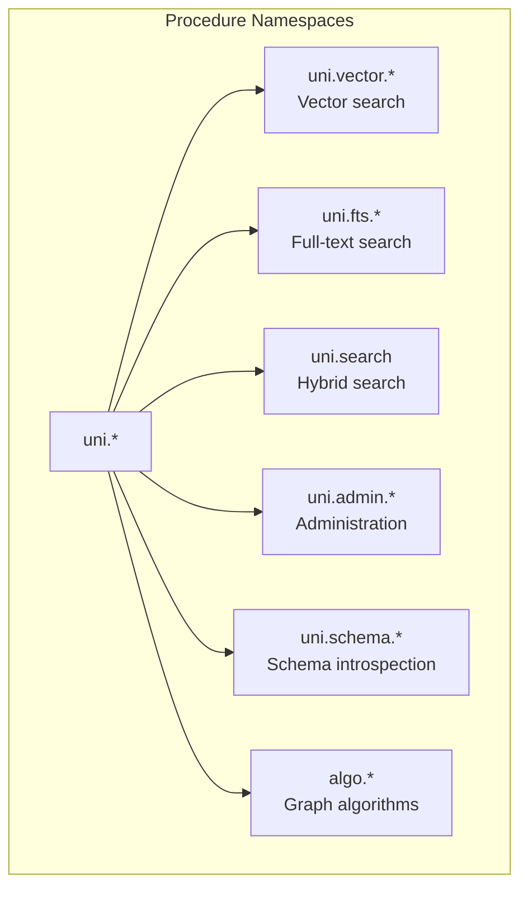

## Vector Search

<!-- doctest: skip -->
```cypher
CALL uni.vector.query(label, property, query_vector, k [, filter] [, threshold] [, options])
YIELD node, score, distance, vector_score, rerank_score, vid
```

| Parameter | Type | Description |
|---|---|---|
| `label` | String | Vertex label to search |
| `property` | String | Vector property name |
| `query_vector` | List\<Float\> or String | Embedding vector or text (auto-embedded) |
| `k` | Integer | Number of results |
| `filter` | String (optional) | WHERE predicate string |
| `threshold` | Float (optional) | Minimum similarity score |
| `options` | Map (optional) | Reranker configuration (see [Cross-Encoder Reranking](#cross-encoder-reranking)) |

**Example — basic vector search:**

```cypher
CALL uni.vector.query('Document', 'embedding', $query_vector, 10)
YIELD node, score
RETURN node.title, score
ORDER BY score DESC
```

**Example — vector search with filtering:**

```cypher
CALL uni.vector.query('Document', 'embedding', $query_vector, 20, 'category = "tech"')
YIELD node, score
WHERE score > 0.7
RETURN node.title, score
```

**Example — auto-embedding (when embedding config exists):**

```cypher
CALL uni.vector.query('Document', 'embedding', 'graph databases for beginners', 5)
YIELD node, score
RETURN node.title, score
```

Score normalization: Returns a 0-1 similarity score regardless of distance metric. Uses metric-aware conversion: Cosine → `(2-d)/2`, L2 → `1/(1+d)`, Dot → pass-through.

Dimension check: the query vector's length must match the column's declared `VECTOR(dim)` — a mismatch errors with "vector dimension mismatch" (since 2.5.0; previously it silently returned 0 rows). The same check applies to the dense arm of hybrid search. See [Vector Dimension Enforcement](#vector-dimension-enforcement).

**Example — vector search with cross-encoder reranking:**

```cypher
CALL uni.vector.query('Document', 'embedding', 'graph databases', 10,
    null, null,
    {reranker: 'rerank/minilm', reranker_property: 'content'})
YIELD node, score, rerank_score
RETURN node.title, score
ORDER BY score DESC
```

## similar_to() Expression Function

`similar_to()` is a unified similarity scoring expression that can be used directly in `RETURN`, `WHERE`, and `ORDER BY` clauses — no `CALL`/`YIELD` boilerplate required.

<!-- doctest: skip -->
```cypher
similar_to(source, query [, options]) → Float
```

Unlike the `uni.vector.query` / `uni.fts.query` / `uni.search` procedures which are standalone scan operators, `similar_to()` is a **per-row expression** evaluated inline within any `MATCH` query. It supports three scoring modes that are auto-detected from argument types:

### `~=` Operator vs `similar_to()` Function

Uni provides two syntaxes for similarity search. They serve **different purposes**:

| Syntax | What It Does | Best For |
|---|---|---|
| `n.embedding ~= $query` | **Top-K index scan** — desugars to `uni.vector.query` procedure, returns nearest neighbors from the vector index | "Find the 10 most similar documents from millions" |
| `similar_to(n.embedding, $q)` | **Per-row scoring** — evaluates inline within `MATCH`, scores each already-bound node | "Score this matched node's similarity" |
| `similar_to([sources], [queries])` | **Hybrid fusion** — combines vector + FTS scores via RRF or weighted fusion in a single expression | "Rank by combined semantic + keyword relevance" |

The `~=` operator is **vector-only** and cannot do FTS or hybrid search. For hybrid search, use `similar_to()` with multi-source arrays.

> **Common confusion:** `=~` is regex match over the whole string (`n.name =~ '(?i)john.*'`), `~=` is vector similarity. They are unrelated operators.

**A `vector_similarity` threshold is never index-served.**
`WHERE vector_similarity(d.emb, q) > t` keeps exactly the rows whose cosine
similarity passes `t`; it plans as a per-row `Filter` over the label scan, with
or without a vector index. Only `n.prop ~= q` becomes `VectorKnn`
(`extract_knn_predicate` in `planner.rs`), and `VectorKnn` carries no
threshold. The planner used to rewrite the threshold form into a top-100
`VectorKnn` as well, which was wrong three ways at once: the exec compared `t`
with the *index's* score (`(1 + cos) / 2` for cosine, `1 / (1 + d)` for L2, the
raw dot product for dot) rather than the cosine, so `> 0.5` on a cosine index
kept every row with `cos >= 0`; it kept `score >= t` for a strict `>`; and it
dropped every match past the 100th. An index cannot answer a range predicate
exactly in any case — IVF and HNSW miss rows, and a top-K bound truncates — so
the rewrite was removed rather than repaired. Two scalar-path defects the
oracle found alongside: `vector_similarity` on two stored vectors rounded an
exact cosine to f32 (0.8 became 0.800000011920929 and passed `> 0.8`), and
`vector_distance` errored on a NULL operand instead of returning NULL. On a
multi-vector (`List<Vector>`) operand pair `vector_similarity(doc, query)` is
MaxSim with a cosine per query token, computed per row.

**`~=` is sized by the `LIMIT` it feeds, or by `vector_knn_default_k`.**
`LogicalPlan::VectorKnn` carries `k: Option<usize>` and `optional: bool`.
`replace_scan_with_knn` (called from `plan_where_clause` step 1) leaves `k`
`None`. The two places that add a `Limit` — the end of `plan_return` and of
`plan_with_clause` — call `size_knn_from_limit(input, skip, fetch)` first, which
sets `k = skip + fetch` on a `VectorKnn` reached only through `Project` and a
`Sort` whose leading key is that KNN's `_score` descending (an alias is followed
into the `Project` that defined it). Those nodes pass KNN rows through one for
one and in score order, so the first `skip + fetch` KNN rows are exactly the
rows the `Limit` keeps. Any other node in between — a residual `Filter`
(including an inline property map kept above the KNN), `Traverse`, `CrossJoin`,
`Distinct`, `Aggregate`, a `Sort` on another key, a `Limit` without `fetch` —
leaves `k` `None`. A filter is why: `fetch` nearest rows, then filtered, would
return fewer than the `LIMIT` asked for. At physical planning `None` becomes
`GraphExecutionContext::vector_knn_default_k` (from
`UniConfig::vector_knn_default_k`, default `DEFAULT_VECTOR_KNN_K` = 100, threaded
by `HybridPhysicalPlanner::with_vector_knn_default_k` in `read.rs` and inherited
across `execute_subplan_with_outer_vars`), and `GraphVectorKnnExec` pushes a
`QueryWarning::Other` naming the setting when a defaulted search returns `>= k`
rows. The exec sorts its output by score descending (vid ascending on ties)
because the `LIMIT`-sizing relies on it; the native path already did, a plugin
`IndexHandle` need not.

`replace_scan_with_knn` and `rewrite_target_reachable(RewriteTarget::Knn)` no
longer descend `Limit`. They did, so `MATCH (n:N) WITH n LIMIT 5 WHERE n.emb ~= q`
became `Limit(5, VectorKnn)` — the 5 nearest neighbours of the whole label, not a
selection among the 5 rows the `WITH` kept. A `~=` left in the predicate after
step 1 is refused by `reject_unplanned_approx_eq` with an error naming
`vector_similarity`; it used to reach the expression compiler, which failed with
`ApproxEq (~=) not yet supported`.

Under `WhereScope::Optional { created }` the KNN rewrite runs when the `~=`
variable is in `created` and its scan is `optional` (`optional_scan_reachable`).
The `VectorKnn` inherits `optional`, and `GraphVectorKnnExec` emits one all-NULL
row (identity columns become nullable) when nothing qualifies; an inline
property filter kept above it becomes a `Filter` with `optional_variables =
{var}`. The rest of the WHERE stays in the clause's `OptionalFilterExec`.

Sub-plans share the enclosing query's warning collector
(`HybridPhysicalPlanner::with_inherited_warnings`); before, a sub-plan's fresh
`GraphExecutionContext` collected warnings nobody harvested.
`GraphExecutionContext::push_warning` drops an exact duplicate, since a
correlated sub-plan runs once per outer row.

**Outer vector columns reach a subquery body.** `EXISTS { }` / `COUNT { }`
bodies read outer values through `extract_row_params`, which decoded columns
with `arrow_to_json_value`. That function had no arm for `FixedSizeList` (a
stored dense vector) and returned NULL for it, so `vector_similarity(a.emb, q)`
on an outer `a` was always NULL inside the body and `EXISTS` always false. Any
type it does not decode itself now goes to the storage layer's
`arrow_to_value`.

### Scoring Modes

| Source Type | Query Type | Mode | Behavior |
|---|---|---|---|
| Vector property | Vector literal | **Vector** | Metric-aware similarity per row (cosine, L2, or dot — resolved from vector index) |
| Vector property (with embedding config) | String literal | **AutoEmbed** | Auto-embeds query string once, then metric-aware similarity per row |
| String property (with FTS index) | String literal | **FTS** | BM25 full-text search, normalized via `score / (score + fts_k)` saturation to [0, 1] |

### Single-Source Examples

```cypher
// Vector-to-vector cosine similarity
MATCH (d:Doc)
RETURN d.title, similar_to(d.embedding, $query_vector) AS score
ORDER BY score DESC

// Auto-embed: string query → embedded → cosine against stored vectors
MATCH (d:Doc)
RETURN d.title, similar_to(d.embedding, 'graph databases') AS score
ORDER BY score DESC

// FTS: BM25 scoring (requires FULLTEXT INDEX on d.content)
MATCH (d:Doc)
RETURN d.title, similar_to(d.content, 'distributed systems') AS score
ORDER BY score DESC

// In WHERE clause for filtering
MATCH (d:Doc)
WHERE similar_to(d.embedding, $query_vector) > 0.8
RETURN d.title
```

### Multi-Source Fusion

Combine multiple scoring sources into a single fused score:

```cypher
// Multi-source: vector + FTS fusion (RRF by default)
MATCH (d:Doc)
RETURN d.title,
  similar_to([d.embedding, d.content], [$query_vector, 'search term']) AS score
ORDER BY score DESC

// Multi-source with weighted fusion
MATCH (d:Doc)
RETURN d.title,
  similar_to(
    [d.embedding, d.content],
    [$query_vector, 'search term'],
    {method: 'weighted', weights: [0.7, 0.3]}
  ) AS score
ORDER BY score DESC
```

### Correct vs Incorrect Hybrid Search

**Correct — single `similar_to` with multi-source arrays and fusion:**
```cypher
MATCH (d:Doc)
RETURN d.title,
  similar_to([d.embedding, d.content], [$qvec, $qtxt]) AS score
ORDER BY score DESC
```
This uses RRF fusion by default, with proper BM25 score normalization (saturation to [0, 1]).

**Incorrect — naive addition of two separate calls:**
```cypher
// DON'T DO THIS: scores are on different scales, no normalization
MATCH (d:Doc)
RETURN d.title,
  (similar_to(d.embedding, $qvec) + similar_to(d.content, $qtxt)) AS score
ORDER BY score DESC
```
Adding raw scores mixes incompatible scales (cosine similarity [0, 1] vs unbounded BM25). The multi-source form normalizes BM25 via `score / (score + fts_k)` before fusion.

### Options Map

| Option | Type | Default | Description |
|---|---|---|---|
| `method` | String | `'rrf'` | Fusion method: `'rrf'` or `'weighted'` |
| `weights` | List\<Float\> | Equal | Per-source weights for weighted fusion (must sum to 1.0) |
| `k` | Integer | `60` | RRF constant (higher = less weight to rank position) |
| `fts_k` | Float | `1.0` | BM25 saturation constant: `score / (score + fts_k)` |

### Implementation

`similar_to()` is implemented as a custom DataFusion `PhysicalExpr` (`SimilarToExecExpr`) that carries an `Arc<GraphExecutionContext>` for storage and embedding model access. This means it runs **inside DataFusion's columnar engine** with full optimizer support (pushdown, projection pruning, parallel execution), unlike the fallback row-by-row executor previously used.

Key optimizations:
- **FTS pre-computed per-batch**: Calls `storage.fts_search()` once per RecordBatch, builds `HashMap<Vid, f32>` for O(1) per-row lookups
- **Auto-embed per-batch**: Embeds query string once per batch, then cosine per-row
- **Async-in-sync**: Drives async storage calls from the sync `PhysicalExpr::evaluate()` on a scoped thread through the process-wide `uni-io` runtime — never a runtime built per call (see [Runtime Affinity](#runtime-affinity-the-uni-io-runtime))

### Execution Paths

`similar_to()` has two execution paths depending on context:

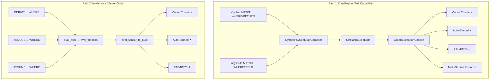

**Path 1 — DataFusion (Cypher queries and Locy rule evaluation):**
All `MATCH ... WHERE` and `YIELD` expressions — whether in standalone Cypher or inside Locy rules — are compiled to DataFusion `FilterExec` / projection plans via `CypherPhysicalExprCompiler`. This creates `SimilarToExecExpr` with full `GraphExecutionContext` access: auto-embedding, FTS search, multi-source fusion all work.

**Path 2 — In-memory (Locy command dispatch):**
`DERIVE`, `ABDUCE`, and `ASSUME` commands execute **after strata converge**, in program order. They operate on already-materialized `Vec<Row>` facts (re-derived after an earlier command wrote, see *Top-level commands are sequenced* below) and use `eval_expr()` for WHERE filtering. This path calls `eval_similar_to_pure()`, which only supports vector-vector cosine similarity — no storage or schema access is available.

**Why two paths?** Locy execution is two-phase:

1. **Strata evaluation** (DataFusion): Plans and executes rules via `LocyProgramExec` → fixpoint iteration → converged facts stored in `DerivedStore` as `RecordBatch`es.
2. **Command dispatch** (row-level): Takes the facts of the current state as `Vec<Row>` and applies commands in sequence — DERIVE generates mutations, ABDUCE does hypothetical reasoning with savepoints, ASSUME tests hypothetical mutations. These are not queries; they're fact-application operations that iterate over rows.

The `GraphExecutionContext` and `SessionContext` are available in `NativeExecutionAdapter` at command dispatch time but are not currently threaded through to `eval_function()`. This is a known limitation, not a fundamental constraint.

| Context | Execution Path | Vector | Auto-Embed | FTS | Multi-Source |
|---|---|---|---|---|---|
| Cypher `MATCH ... WHERE/RETURN` | DataFusion | Yes | Yes | Yes | Yes |
| Locy rule `MATCH ... WHERE/YIELD` | DataFusion | Yes | Yes | Yes | Yes |
| Locy rule `ALONG / FOLD` | DataFusion | Yes | Yes | Yes | Yes |
| `DERIVE ... WHERE` | In-memory | Yes | No | No | No |
| `ABDUCE ... WHERE` | In-memory | Yes | No | No | No |
| `ASSUME ... WHERE` | In-memory | Yes | No | No | No |

## Sparse Vectors

Uni supports **learned-sparse retrieval** (SPLADE-style): instead of a dense embedding, a model emits a high-dimensional, mostly-zero weight vector over a term vocabulary. Each non-zero entry is a `(term_id, weight)` pair, and relevance is the **sparse dot product** of query and document vectors. Sparse vectors complement dense vectors — they capture exact-term signal (lexical match) that dense embeddings tend to smear away — and are a first-class arm of [Hybrid Search](#hybrid-search).

### The `sparse_vector(N)` Type

A sparse-vector property is declared with the Cypher type `sparse_vector(N)` (Rust: `DataType::SparseVector { dimensions: N }`), where `N` is the **term-space cardinality** — the size of the vocabulary, i.e. `max_term_id + 1`. It bounds the index space; the value itself stores only its non-zero entries.

```cypher
CREATE (:Doc {
  content: 'graph databases for beginners',
  emb: sparse_vector(30522)        // 30 522-term vocabulary (e.g. BERT WordPiece)
})
```

In the Rust schema builder:

```rust
db.schema()
    .label("Doc")
    .property("content", DataType::String)
    .property_nullable("emb", DataType::SparseVector { dimensions: 30522 })
    .apply()
    .await?;
```

### Value Shape

A sparse-vector value is a `{indices, values}` map: `indices` is the list of non-zero term ids, `values` the parallel list of their weights. The two lists must be the same length; `indices` are term ids in `[0, N)`.

```cypher
// Literal write of a 3-term sparse vector
CREATE (:Doc {emb: {indices: [12, 884, 9001], values: [0.71, 0.33, 1.20]}})
```

The same `{indices, values}` shape is accepted as the query value for `uni.sparse.query` (a native sparse vector is also accepted directly).

### Storage Layout

On disk a sparse-vector column is an **Arrow struct of two lists** — `indices` (a list of integer term ids) and `values` (a list of `f32` weights) — one struct entry per row. This is the columnar analogue of the `{indices, values}` map: only non-zeros are materialized, so storage scales with vector sparsity, not with the vocabulary size `N`.

### The Sparse Index

A sparse index is created as a `VECTOR INDEX` with `type: 'sparse'` (see Part VI, [Vector Indexes](#vector-indexes-hnsw-ivf-pq-flat)):

```cypher
CREATE VECTOR INDEX idx_sparse FOR (d:Doc) ON (d.emb)
  OPTIONS { type: 'sparse', quantize: false }
```

| Option | Type | Default | Description |
|---|---|---|---|
| `type` | String | — | Must be `'sparse'` to select the learned-sparse index kind |
| `quantize` | Bool | `true` | `true` = 8-bit term-weight quantization (smaller, lossy); `false` = lossless `f32` weights |

Quantization defaults **on** (8-bit) for compactness; set `quantize: false` when exact weight fidelity matters more than index size.

### `uni.sparse.query`

<!-- doctest: skip -->
```cypher
CALL uni.sparse.query(label, property, query, k [, filter] [, threshold] [, options])
YIELD vid, score, rerank_score
```

| Parameter | Type | Description |
|---|---|---|
| `label` | String | Vertex label to search |
| `property` | String | `SparseVector` property name |
| `query` | Map or SparseVector | Query as a `{indices, values}` map or a native sparse vector |
| `k` | Integer | Number of results |
| `filter` | String (optional) | WHERE predicate string |
| `threshold` | Float (optional) | Minimum score |
| `options` | Map (optional) | Reranker configuration (see [Cross-Encoder Reranking](#cross-encoder-reranking)) |

The YIELD columns are exactly **`vid`, `score`, `rerank_score`** — there is no `sparse_score` or `distance` column here (those names belong to the hybrid `uni.search` YIELD). **`score` is the raw sparse dot product** of the query and stored vectors (not a normalized [0, 1] similarity), with larger meaning more relevant. `rerank_score` is populated only when a cross-encoder reranker is configured in `options`.

```cypher
// Sparse retrieval over a SPLADE column, top 10
CALL uni.sparse.query('Doc', 'emb',
    {indices: [12, 884, 9001], values: [0.71, 0.33, 1.20]}, 10)
YIELD vid, score
RETURN vid, score
ORDER BY score DESC
```

The query is **MVCC- and L0-aware**: candidates retrieved from the index are exact-rescored against the live row state, so freshly written or updated sparse vectors that have not yet been flushed into the index are scored correctly rather than served stale.

### Best Practices

- **Pair sparse with dense, don't choose.** Sparse retrieval recovers exact-term matches that dense embeddings miss; the two are most effective fused through [Hybrid Search](#hybrid-search), not used in isolation.
- **Auto-embed from one model.** With a hybrid alias (e.g. BGE-M3) you do not hand-build `{indices, values}`; declaring a `SparseVector` index over a text source and registering an `EmbedHybrid` alias fills the column from a forward pass. See [Hybrid Search](#hybrid-search) and [Host-Side Model Runtime (Uni-Xervo)](#host-side-model-runtime-uni-xervo).
- **Keep `N` honest.** `dimensions` must cover every term id the model can emit (`max_term_id + 1`); an undersized `N` silently drops or rejects high term ids.
- **Use `quantize: false` only when needed.** Lossless `f32` weights cost more space; the 8-bit default is sufficient for ranking in most workloads.

### Anti-Patterns

- **Reading `score` as a similarity.** Sparse `score` is an unbounded dot product, not a [0, 1] cosine. Do not threshold it on a `> 0.8`-style cutoff calibrated for dense search; calibrate against your own corpus.
- **Expecting a `sparse_score` / `distance` column.** Those columns exist only on `uni.search`; `uni.sparse.query` yields `vid, score, rerank_score`.

## Full-Text Search

<!-- doctest: skip -->
```cypher
CALL uni.fts.query(label, property, search_term, k [, filter] [, threshold] [, options])
YIELD node, score, fts_score, rerank_score, vid
```

BM25-based full-text search. Scores are normalized to 0-1 relative to the top match. Supports optional cross-encoder reranking via the `options` map.

```cypher
CALL uni.fts.query('Article', 'content', 'distributed graph database', 10)
YIELD node, score
RETURN node.title, score
```

**Tokenizer / analyzer configuration (3.0.0).** Full-text indexes honor tokenizer, stemmer, and stop-word configuration set at index-create time — previously every FTS index used Lance's default "simple" tokenizer regardless of options, making CJK / multilingual text effectively unindexable:

```cypher
CREATE FULLTEXT INDEX article_fts FOR (a:Article) ON EACH [a.content] OPTIONS {
  analyzer: 'standard', language: 'English', stemmer: 'english',
  stopwords: 'english', ascii_folding: true, lower_case: true,
  max_token_length: 40, ngram_min: 2, ngram_max: 3
}
```

18-language stemming and stop-words plus ngram tokenization are supported (`TokenizerConfig::Analyzer`); CJK requires dictionary files under `LANCE_LANGUAGE_MODEL_HOME`.

### Unflushed rows in a search

A vector or full-text search asks the backend about flushed rows and merges the
unflushed (L0) rows in afterwards. Two rules make the merged answer the one the
search gives after a flush:

- **The `filter` applies to unflushed rows too.** It used to reach only the
  backend scan, so `filter: 'id = 2'` returned every unflushed row, and an
  unflushed update that moved a flushed row out of the filter left it matching.
  `StorageManager::l0_rows_failing_filter` lays the label's L0 rows out as its
  table (`build_l0_vertex_batch`) and asks `StorageBackend::filter_batch`, which
  the Lance backend answers with Lance's own filter planner. A vertex that fails
  is dropped like a tombstone. Lance's planner is used, not DataFusion's alone,
  because the two disagree on `"col"`: Lance reads it as a string literal.
- **Full-text scores come from the backend, split as Lance splits them.**
  Unflushed rows used to score the share of query words their text holds,
  split on whitespace. That is not BM25 and ignores the index's tokenizer, so
  the ranking (and which rows made the top `k`) changed at the flush.

  Lance scores the rows its inverted index covers on the index's statistics
  alone, and the rows it does not cover (fragments flushed since the index was
  built, or every row with no index) by a flat BM25 pass whose statistics are
  the index's plus those rows', counted after the filter, with the index's
  tokenizer (or a bare simple tokenizer with no index). A flush leaves the
  covered rows' scores alone, and its rows join the uncovered ones.

  `StorageBackend::full_text_search_with_unstored` runs that split with the
  unflushed rows in place (`backend/lance_fts.rs`): the index search
  restricted to the covered fragments; the unflushed documents added to the
  index's statistics; one flat pass over the uncovered fragments starting
  from those, which scores the uncovered rows on exactly the statistics Lance
  will use after the flush; and the unflushed documents scored on the same
  final statistics. Fragment coverage is the union of the index segments'
  `fragment_bitmap`s, as Lance's `unindexed_fragments` computes it. The
  search used to re-score the covered hits with the unflushed rows counted
  (row 1 of the test: 0.835 before the flush, 0.859 after) and to leave the
  uncovered flushed rows out of the statistics. Measured now: identical
  rankings and scores (to 1e-6) across two flushes, the second with uncovered
  flushed rows present, filtered and not, with and without an index
  (`bugs::fts_rank_survives_flush`).

  Two things still move a score. An index optimization that brings a row
  under the index switches it to the index's statistics, in Lance itself.
  And rows tying on score are ordered by vid, so which of two tied rows makes
  the top `k` at the boundary depends on Lance's own cut. A schemaless
  property keeps the word-overlap score on both sides, since it has no column
  for Lance to search.

### Searching a schemaless property

A vector or full-text search over a property the schema does not declare on the
label is served by brute force, flushed or not. Only a declared property is
flushed to a column named after it, which is what a Lance nearest-neighbour or
inverted-index scan needs. An undeclared label is flushed to the main vertex
table only, and an undeclared property of a declared label goes to the label's
`overflow_json` column. Either way, the main table's `props_json` is the one
flushed copy that holds the value.

`StorageManager::vector_search` and `fts_search` check
`is_schemaless_property(label, property)` first. If it is true, they read every
live flushed vertex of the label with `MainVertexDataset::find_label_props_counted`
and score each one directly. Unflushed rows are then merged in by the same L0
merges as for a declared property.

- **Scoring.** A vector is scored with the same `compute_distance` (L2: no index
  can be declared on the property) and the same length guard as unflushed rows.
  Text is scored by `compute_text_relevance`, the fraction of query tokens the
  text holds. This is not BM25. A row therefore scores the same before and
  after a flush, which BM25 over the flushed rows could not promise.
- **Which rows count.** A vertex counts only if its latest row is live and
  still carries the label. The read filters on the label to find candidates,
  then re-reads all their rows. A label filter alone would also match the
  older row of a vertex relabeled away since.
- **A relabel has a version.** `L0Buffer::set_vertex_labels`, the commit merge
  and WAL replay record it in `vertex_label_versions`, and the flush stamps
  rows with `L0Buffer::vertex_write_version` (the later of the property and
  label versions). Before that, the flush re-appended a relabeled vertex's row
  at version 0, and its old row, with the old labels, won every latest-version
  read, so `labels(n)` reverted after a flush. It is not stored in
  `vertex_versions`. The L0 scans read an entry there as "this buffer holds the
  vertex's newest properties", and a relabel holds none, so stamping it there
  made the scans drop the flushed properties.
- **The label scans apply the same rules.** The schemaless `MATCH (n:L)` scan
  filters the main table on the label, so it runs `drop_superseded_pushdown_rows`
  whenever it has a label, not only for a pushed-down property predicate.
  Before that, a vertex relabeled away from an undeclared label still matched
  it after a flush. Both label scans (`columnar_scan_vertex_batch` and the
  schemaless one) start a vertex whose only L0 state is a relabel from its
  flushed properties (`label_only_l0_base_props`), at the relabel's version.
  Before that, `MATCH (n:New)` found a vertex freshly relabeled to `New` with
  every property NULL until the next flush, and an id lookup did not find it
  at all.
- **Filters are refused.** The `filter` argument is an expression over the label
  table's columns, which these rows do not have, so a search with one returns
  an error instead of ignoring it. This applies to unflushed rows too: before,
  an undeclared label's unflushed rows were returned with the filter silently
  ignored.
- **Cost.** The read is O(rows of the label) per query, plus decoding each
  vertex's latest `props_json`. It is checked against the query deadline every
  1024 rows (`DeadlineTicker`). Declare the property, and index it, when the
  label is large.

Before this, the flushed side of such a search returned nothing for an
undeclared label (its table does not exist) and failed in Lance for an
undeclared property ("column ... does not exist"). The same query found the rows
while they were unflushed.

## Hybrid Search

```cypher
CALL uni.search(label, properties, query_text, query_vector, k, filter, options)
YIELD node, score, vector_score, fts_score, sparse_score, rerank_score, distance, vid
```

Combines vector, full-text, and (optionally) sparse search with score fusion. Arguments are **positional**: `query_vector` and `filter` are passed as `null` when not used.

The `properties` argument is a map `{vector, fts, sparse}` selecting which property feeds each arm. A bare string is shorthand for "use this same property for both the vector and FTS arms, sparse off."

| Option | Values | Description |
|---|---|---|
| `method` | `'rrf'` (default), `'weighted'`, `'dbsf'`, `'relative_score'` | Score fusion method (3.0.0 added `dbsf` = distribution-based z-score; `relative_score` = min-max + weighted) |
| `alpha` | 0.0 - 1.0 | Vector-vs-FTS weight (2-way `weighted` mode only) |
| `weights` | List\<Float\> `[vector, fts, sparse]` | Per-arm weights for 3-way `weighted` fusion |
| `rrf_k` | Integer (default: `60`) | RRF constant (higher = less weight to rank position) |
| `over_fetch` | Float (default: 2.0) | Over-fetch factor for pagination |
| `sparse_query` | Map or SparseVector | Query vector for the sparse arm (`{indices, values}` or native) |
| `reranker` | String | Cross-encoder alias, **or** `'maxsim'` for multi-vector/ColBERT late-interaction rerank |
| `reranker_property` | String | Node text property for cross-encoder document input |
| `reranker_k` | Integer (default: k×3) | Over-fetch for reranking (clamped to [k, 1000]) |
| `reranker_query` | String | Override query text for cross-encoder |
| `maxsim_query` | List\<Vector\> | Query token vectors for `reranker: 'maxsim'` |
| `maxsim_metric` | String | Distance metric for MaxSim late interaction |

> ANN tuning knobs (`nprobes`, `refine_factor`, `ef_search`) are **not** plumbed through `uni.search`; tune them at index-create time or via `uni.vector.query`.

```cypher
// Basic 2-way hybrid search with RRF
CALL uni.search('Document', {vector: 'embedding', fts: 'content'},
    'graph databases', null, 10, null, {})
YIELD node, score
RETURN node.title, score

// 2-way hybrid with cross-encoder reranking
CALL uni.search('Document', {vector: 'embedding', fts: 'content'},
    'graph databases', null, 10, null,
    {method: 'rrf', reranker: 'rerank/minilm', reranker_property: 'content'})
YIELD node, score, rerank_score, vector_score, fts_score
RETURN node.title, score
```

### 3-Way Hybrid (vector + FTS + sparse)

The sparse arm is **opt-in and requires two things together**: a `sparse:` key in the `properties` map **and** a `sparse_query` in `options`. Supplying only one of them is a **silent no-op** — the sparse arm simply does not run. When active, fuse all three arms with `method: 'weighted'` and a 3-element `weights: [vector, fts, sparse]`.

```cypher
// 3-way fusion: dense + lexical + learned-sparse, optionally MaxSim-reranked
CALL uni.search(
    'Document',
    {vector: 'embedding', fts: 'content', sparse: 'emb'},
    'graph databases',
    null,                         // query_vector (auto-embedded from query_text)
    10,
    null,                         // filter
    {
      method: 'weighted',
      weights: [0.5, 0.2, 0.3],   // [vector, fts, sparse]
      sparse_query: {indices: [12, 884, 9001], values: [0.71, 0.33, 1.20]},
      reranker: 'maxsim',         // multi-vector / ColBERT late interaction
      maxsim_query: $query_token_vectors
    })
YIELD node, score, vector_score, fts_score, sparse_score, rerank_score, distance
RETURN node.title, score
ORDER BY score DESC
```

Here the full YIELD surface is available: `vector_score`, `fts_score`, and `sparse_score` carry the per-arm contributions, `score` the fused (or reranked) final score, `rerank_score` the late-interaction score when `reranker` is set, and `distance` the raw vector distance.

### Single-Pass BGE-M3 Hybrid (`EmbedHybrid`)

The cleanest way to feed a 3-way hybrid is one model that emits all three representations at once. **BGE-M3** does exactly this: a single forward pass yields a dense embedding, a learned-sparse vector, and a multi-vector / ColBERT token matrix. Uni models this as **one catalog alias** with task `EmbedHybrid` (provider `local/onnx`, model `aapot/bge-m3-onnx`).

```json
{
  "alias": "embed/bge-m3",
  "task": "EmbedHybrid",
  "provider_id": "local/onnx",
  "model_id": "aapot/bge-m3-onnx"
}
```

The key move is **sharing one alias and one source property across three index configs**. You declare three destination columns of different `DataType`s, each pointing its `embedding: { alias, source }` at the same alias and the same text source:

| Destination `DataType` | Routed head | Index |
|---|---|---|
| `Vector` | dense | dense vector index |
| `SparseVector` | sparse | sparse index (`type: 'sparse'`) |
| `List<Vector>` | multi-vector | multi-vector / ColBERT index |

Because the alias and source match, the engine treats the three configs as **one hybrid group and runs a single forward pass**, fanning the result out to the three columns. **Head routing is inferred from the destination column's `DataType`** — `Vector` → dense, `SparseVector` → sparse, `List<Vector>` → multi-vector — so there is **no `head:` sub-key** to set. At index-open time a capability check enforces that the heads required by the declared columns are a subset of the heads the alias actually exposes (`required_heads ⊆ available_heads`); a mismatch fails fast at open rather than silently producing empty columns.

```rust
// One EmbedHybrid alias + one source ("content") → three columns, one pass.
let hybrid = EmbeddingCfg {
    alias: "embed/bge-m3".into(),
    source_properties: vec!["content".into()],
    ..Default::default()
};

db.schema()
    .label("Doc")
    .property("content", DataType::String)
    .property_nullable("embedding", DataType::Vector { dimensions: 1024 })
    .property_nullable("emb", DataType::SparseVector { dimensions: 250002 })
    .property_nullable("tokens", DataType::List(Box::new(DataType::Vector { dimensions: 1024 })))
    .index("embedding", dense_index_with(hybrid.clone()))         // → dense head
    .index("emb", IndexType::sparse_with_embedding(250002, hybrid.clone())) // → sparse head
    .index("tokens", dense_index_with(hybrid.clone()))            // → multi-vector head
    .apply()
    .await?;
```

> A passing end-to-end test of this exact pattern (mock 3-head hybrid model, all three columns round-tripping post-flush, pre-flush L0, deferred-batch, and Cypher literal) lives at `crates/uni/tests/bge_m3_hybrid_3way.rs`.

The `EmbedHybrid` alias is dispatched through the same host-side model runtime as every other embedding — see [Host-Side Model Runtime (Uni-Xervo)](#host-side-model-runtime-uni-xervo) for catalog configuration, prefetch, and the `uni-xervo` types (`HybridEmbeddingModel`, `HeadSet`) that back it.

## Host-Side Model Runtime (Uni-Xervo)

Applications can access configured embedding and generation aliases directly through the host API:

```rust
use uni_xervo::Message;

let xervo = db.xervo();  // Always succeeds; individual methods error if unconfigured

let vectors = xervo
    .embed("embed/default", &["graph databases for beginners"])
    .await?;

let answer = xervo
    .generate(
        "llm/default",
        &[
            Message::system("You summarize technical material."),
            Message::user("Explain what snapshot isolation means in Uni."),
        ],
        GenerationOptions::default(),
    )
    .await?;

// Convenience wrapper — each string is treated as a user message
let quick = xervo
    .generate_text(
        "llm/default",
        &["List three use cases for hybrid search."],
        GenerationOptions::default(),
    )
    .await?;
```

- `embed(alias, texts)` returns `Vec<Vec<f32>>`
- `rerank(alias, query, documents)` returns `Vec<ScoredDoc>` — cross-encoder relevance scoring for reranking search results
- `generate(alias, messages, options)` accepts `&[Message]` with roles `system`, `user`, `assistant` and a `GenerationOptions` struct
- `generate_text(alias, messages, options)` is a convenience wrapper — each string becomes a user message
- `prefetch(aliases)` pre-loads and caches specific model aliases — downloads model files, builds sessions, runs warmup
- `prefetch_all()` pre-loads every model in the catalog
- `raw_runtime()` exposes the underlying `ModelRuntime` for advanced orchestration
- `GenerationOptions` supports `max_tokens`, `temperature`, `top_p` fields

**Sharing a runtime across databases.** A `ModelRuntime` owns its providers, its
catalog, and its cache of loaded models, so a database built from a catalog holds
its own copy of every model's weights. `UniBuilder::xervo_runtime(Arc<ModelRuntime>)`
takes an already-built runtime instead, and `UniXervo::raw_runtime()` hands one
back out — N databases then share one resident copy. `uni_db::xervo::build_model_runtime`
is the single definition of the provider registration `cfg` chain; both
`UniBuilder::build` and the Python `ModelRuntime` constructor route through it so
the enabled-provider set cannot drift between them.

The prebuilt path validates only that each alias the persisted schema references
is *present* in the runtime's catalog. The per-alias head-capability check
(`embed_caps::text_embedding_heads`) requires `spec.task`, which uni-xervo does not
expose publicly, so a task mismatch on a shared runtime surfaces at first inference
rather than at open. The catalog path checks both.

**Best practice — prefetch at startup:**

```rust
let xervo = db.xervo();
xervo.prefetch(&["embed/default", "llm/default"]).await?;
// All subsequent embed/generate calls skip cold-start latency
```

Both `prefetch` methods are awaitable and fail-fast. Use them instead of relying on first-call lazy loading, especially in latency-sensitive pipelines. For models that must be available at startup, prefer `warmup: "Eager"` in the catalog with `required: true`.

This is the same runtime used by vector-index auto-embedding on writes, by text-query auto-embedding in `uni.vector.query(...)` / `similar_to(...)`, and by cross-encoder reranking in search procedures.

## Cross-Encoder Reranking

All three search procedures support an optional **cross-encoder reranking** stage. A cross-encoder jointly attends to a (query, document) pair to produce a more accurate relevance score than bi-encoder similarity or BM25, but is too expensive to run on the full corpus. It runs on a small over-fetched candidate set for fast retrieval with high-precision final ranking.

**Pipeline:** `Retrieval (vector/FTS/hybrid) → Over-fetch reranker_k candidates → Cross-encoder scores (query, doc) pairs → Top k returned`

Reranking is opt-in — enabled by adding `reranker` to the options map of any search procedure.

### Reranker Options

| Option | Type | Default | Description |
|---|---|---|---|
| `reranker` | String | `null` (disabled) | Xervo model alias (e.g. `'rerank/minilm'`) |
| `reranker_property` | String | FTS property (hybrid/FTS) or required (vector) | Text property fed as cross-encoder "document" |
| `reranker_k` | Integer | `k × 3` | Candidates to over-fetch for reranking (clamped to [k, 1000]) |
| `reranker_query` | String | Query arg | Override query text. Required when `uni.vector.query` receives a pre-computed vector |

When reranking is active, `score` reflects the reranker score and `rerank_score` is populated. Original retrieval scores (`vector_score`, `fts_score`, `distance`) remain available.

### Available Providers

| Provider | Provider ID | Model Example | Type |
|---|---|---|---|
| ONNX (local) | `local/onnx` | `cross-encoder/ms-marco-MiniLM-L6-v2` | Local CPU inference, `provider-onnx` feature |
| Cohere | `remote/cohere` | `rerank-english-v3.0` | Remote API |
| Voyage AI | `remote/voyageai` | `rerank-2` | Remote API |

### Catalog Configuration

```json
{
  "alias": "rerank/minilm",
  "task": "Rerank",
  "provider_id": "local/onnx",
  "model_id": "cross-encoder/ms-marco-MiniLM-L6-v2"
}
```

### Reranking Does Not Apply to `similar_to()`

`similar_to()` is a per-row scalar expression with no bounded candidate set. Cross-encoders are only effective on small candidate sets, so reranking is limited to the three search procedures.

## Admin Procedures

### Modes, the read-only check and authorization

The `uni.admin.*` and `uni.schema.create*` / `drop*` procedures are executor
built-ins (`Executor::execute_procedure`), not plugin-registry entries, so a
registry lookup cannot classify them. Their modes live in one table,
`uni_query::BUILTIN_PROCEDURE_MODES` (`query/executor/procedure.rs`):
`Dbms` for `compact`, `snapshot.create`, `snapshot.restore`,
`snapshot.delete`, `verifyEdgeEndpoints`; `Schema` for the DDL procedures; `Read` for
`compactionStatus` and `snapshot.list`. Three consumers read it:

- `uni_query::validate_read_only_with` consults the table before its
  registry-backed predicate, so `validate_read_only` (time travel) and every
  `Session::query` / prepared / pinned / read-only-handle path refuses a
  non-`Read` built-in. Before, all of them were "reads": `Session::query` ran
  `snapshot.restore()`, and a pinned session wrote the on-disk catalog through
  `uni.schema.dropLabel`.
- The authorization verb: `transaction::statement_verb` maps the statement's
  strongest procedure mode (`uni_query::strongest_procedure_mode`, ranking
  `Read < Write < Schema < Dbms`) to `"dbms"` / `"schema"`, else
  `classify_verb`. `Transaction::query` / `execute` / `prepare` use it;
  `Session::run` authorizes an administrative statement as `"dbms"`.
- Dispatch: `execute_procedure` reaches its built-in arms only for a name in
  the table, so a new built-in without a mode is not callable rather than
  silently read-only; a unit test scans the dispatch `match` for unclassified
  arms.

`Session::run` routes a statement for which `uni_query::is_admin_statement`
holds (a `Dbms` procedure, nothing else but reads) to
`Session::run_admin_statement`: outside any transaction (`snapshot.restore`
and `verifyEdgeEndpoints` refuse inside one), `UniError::ReadOnly` on a pinned
session or a writer-less handle. A session-level Locy program and any `ASSUME`
body refuse a Cypher command calling a `Schema`/`Dbms` procedure
(`impl_locy::refuse_undeferrable_procedures`): their effect bypasses the
overlay. Neo4j's procedure modes carry the same names; there, admin rights are a
separate `@Admin` privilege (`dbms.listConfig`, `db.clearQueryCaches`), which
uni expresses as the `dbms` authorization verb.

### Compaction

```cypher
// Trigger manual compaction
CALL uni.admin.compact()
YIELD tables_optimized, fragments_removed, fragments_added, bytes_reclaimed, duration_ms

// Check compaction status
CALL uni.admin.compactionStatus()
YIELD l1_runs, l1_rows, l1_estimated_bytes, in_progress, pending, total_compactions, total_bytes_reclaimed
```

### Snapshots

```cypher
// Create snapshot
CALL uni.admin.snapshot.create('release-v1.0')
YIELD snapshot_id

// List snapshots
CALL uni.admin.snapshot.list()
YIELD snapshot_id, name, created_at, version_hwm

// Restore snapshot
CALL uni.admin.snapshot.restore($snapshot_id)
YIELD status
```

### Declared Plugins (`uni.plugin.declare*`)

Define new extensions from inside Cypher (Uni's `apoc.custom` analogue). The definitions are persisted (`_DeclaredPlugin` node + JSON sidecar) and survive restart. Cycle detection, dependency-missing detection, and drop-with-dependents protection are enforced.

```cypher
// A scalar function whose body is Cypher:
CALL uni.plugin.declareFunction(
  'myco.discount', '(price: float, pct: float) -> float',
  'cypher', 'RETURN price * (1.0 - pct)')
// A procedure (WRITE mode requires Capability::ProcedureWrites):
CALL uni.plugin.declareProcedure('myco.reindex', '...', 'cypher', '...')
CALL uni.plugin.declareAggregate('myco.wmean', ...)
// 3.0.0: declareTrigger installs a REAL firing TriggerPlugin (was a no-op procedure).
// Event filter: CREATE|UPDATE|DELETE [ON :Label | -[:Type]-] [WHEN pred] [ASYNC]; binds $vid/$label/$event_kind.
CALL uni.plugin.declareTrigger('myco.audit', 'Account', 'AfterCommit', ...)
CALL uni.plugin.listDeclared()              // enumerate declared extensions
CALL uni.plugin.dropDeclared('myco.discount')
```

### Background Job Procedures (`uni.periodic.*`)

Schedule recurring or one-shot maintenance jobs against registered `BackgroundJobProvider`s (see [Part XVII](#part-xvii-plugin-framework)). Schedules and job state are durable (`_BackgroundJob` node + `background_jobs.json`).

```cypher
CALL uni.periodic.schedule('uni.system.ttl_sweep', 'cron', '0 */5 * * * *')  // (qname, kind, schedule_arg)
CALL uni.periodic.cancel('uni.system.ttl_sweep')                              // yields true if a job was removed
CALL uni.periodic.list()                                                      // one row per known job
CALL uni.periodic.submit('MATCH (n:Stale) DETACH DELETE n')                   // run one write-mode batch now
CALL uni.periodic.iterate('MATCH (n:Big) RETURN n', 'DETACH DELETE n', '{}')  // (query, mutating_query, options_json)
CALL uni.periodic.commit()                                                    // sync sentinel (v1 no-op)
```

Schedule kinds: `once` / `periodic` / `cron` / `manual`. Built-in jobs: `uni.system.ttl_sweep` and `uni.system.compaction` are wired to real host hooks; `uni.system.statistics_refresh` is a stub pending a planner statistics API. A `CircuitBreaker` opens a job after 10 consecutive failures (30 s cooldown). The Rust API exposes `Uni::periodic_schedule` / `periodic_cancel` / `periodic_list`.

## Schema Introspection

```cypher
// List all labels
CALL uni.schema.labels()
YIELD label, propertyCount, nodeCount, indexCount

// List edge types
CALL uni.schema.edgeTypes()
YIELD type, propertyCount, sourceLabels, targetLabels

// Label details
CALL uni.schema.labelInfo('Person')
YIELD property, dataType, nullable, indexed, unique

// List indexes
CALL uni.schema.indexes()
YIELD name, type, label, state, properties

// List constraints
CALL uni.schema.constraints()
YIELD name, type, enabled, properties, target
```

## DDL via Cypher

### Labels

```cypher
CREATE LABEL Person ( name STRING, age INTEGER, email STRING UNIQUE )
ALTER LABEL Person ADD PROPERTY phone STRING
ALTER LABEL Person DROP PROPERTY age
ALTER LABEL Person RENAME PROPERTY name TO full_name
DROP LABEL IF EXISTS Person
```

### Edge Types

```cypher
CREATE EDGE TYPE KNOWS (weight FLOAT) FROM Person TO Person
ALTER EDGE TYPE KNOWS ADD PROPERTY since DATE
DROP EDGE TYPE IF EXISTS KNOWS
```

### Indexes

```cypher
CREATE INDEX idx_name FOR (p:Person) ON (p.name)
CREATE VECTOR INDEX idx_embed FOR (d:Document) ON (d.embedding) OPTIONS { metric: 'cosine' }
CREATE FULLTEXT INDEX idx_content FOR (a:Article) ON EACH [a.content]
CREATE JSON FULLTEXT INDEX idx_meta FOR (d:Data) ON metadata
DROP INDEX idx_name
```

### Constraints

```cypher
CREATE CONSTRAINT email_unique ON (p:Person) ASSERT p.email IS UNIQUE
CREATE CONSTRAINT product_sku_key ON (p:Product) ASSERT p.sku IS KEY
DROP CONSTRAINT constraint_name
```

### SHOW Commands

```cypher
SHOW DATABASE       // Database metadata
SHOW INDEXES        // All indexes with status
SHOW CONSTRAINTS    // All constraints
SHOW CONFIG         // Current configuration
SHOW STATISTICS     // Storage statistics
```

### Admin Commands

```cypher
VACUUM              // Reclaim space
CHECKPOINT          // Force flush
BACKUP TO '/path/to/backup'
COPY Person TO '/path/to/file' WITH {format: 'csv'}
COPY Person FROM '/path/to/file' WITH {format: 'parquet'}
```

`COPY` lives in `uni-query/src/query/executor/copy.rs` (plans
`LogicalPlan::CopyTo` / `CopyFrom`). Export reads the entities through the
query engine — `MATCH (n:L) RETURN id(n), properties(n)` (edges:
`MATCH (a)-[r:T]->(b)`) — so a file carries exactly the user-visible
properties, L0 included, never storage columns. Layout: `_vid` or
`_eid`/`_src`/`_dst`, then the sorted union of property keys. Parquet columns
are built with the storage `PropertyExtractor` (declared type, else the
values' shared scalar type, else `CypherValue`); import decodes with the
declared type or the field's raw-bytes hint. Local paths go through
`Executor::validate_path`, which reads `config.file_sandbox`.

Import writes through the statement's transaction buffer
(`Executor::transaction_l0_override`) like any other write (wave P1, f): the
rows are visible only to that transaction, a rollback discards them, the
transaction memory check bounds them, and the commit makes them durable. It
used to write the main L0 with `tx_l0 = None` and then `flush_to_l1`: the
transaction saw none of its own rows, another session saw them before the
commit, they were on disk before the commit, and they survived a rollback.
Without a transaction (a bare executor) it still writes the main L0 and
flushes. Edges go through `Writer::insert_edge`, so declared endpoints are
enforced.

**Declared values are stored in their column's form** (wave P1, VEC).
`DataType::accepts` admits lossless widenings (`Int` into a float column, a
numeric `List` into `VECTOR` or a multi-vector column); the write path
(`Executor::coerce_and_validate_property_value` → `to_declared_form`) now
converts them before they reach L0, so a row reads the same before and after a
flush (`Float`, `Vector`). L0 used to hold the literal (`Int`, `List[Int]`)
until the flush. The `index` UDF indexes a `Value::Vector` like a list
(`n.e[0]`); it raised "cannot index into Vector". The row-at-a-time evaluator
in `executor/read.rs` (`Expr::ArrayIndex`) still has no `Vector` arm.

## Time Travel

Query historical data using snapshots or timestamps:

```cypher
// By snapshot ID
MATCH (n:Person) VERSION AS OF 'snapshot-abc123'
RETURN n.name, n.age

// By timestamp
MATCH (n:Person) TIMESTAMP AS OF '2025-01-15T12:00:00Z'
RETURN n.name, n.age
```

## EXPLAIN and PROFILE

```cypher
// Show query plan without executing
EXPLAIN MATCH (n:Person)-[:KNOWS]->(m:Person) RETURN n, m
```

Profiling is a builder terminal, not a Cypher keyword (the grammar has no
`PROFILE`): `session.query_with(cypher).profile()` executes and returns
`(QueryResult, ProfileOutput)`.

### What the profiler counts

`profile()` returns `ProfileOutput`: per-operator `OperatorStats` (rows, time,
index hits) walked from the executed DataFusion plan, plus planning cost. The
query-level counters (`QueryMetrics`: `rows_scanned`, `l0_reads`,
`storage_reads`, `index_scans`, …) come from the per-query `QueryCounters`
threaded through the planner's `GraphExecutionContext`, the `QueryContext` and
each `ScanRequest`.

- **Rows are counted where the batch is in hand**, never at request time:
  `columnar_scan::merge_lance_and_l0` for label scans, and
  `MainEdgeDataset::find_edges_by_type_names_counted` for main-edge-table
  scans (every returned row, tombstones included, before per-eid ranking).
  The L0 overlay of `build_edge_adjacency_map` counts each L0 edge of the type
  it examines, which keeps the whole-type fall-back visible
  (`vlp_property_map_falls_back_to_the_whole_type_on_a_deep_walk`). A simple
  variable-length, shortest-path or quantified map is read over the reachable region
  (`ReachableMapFilter`, P7) and counts one row per edge and per target vertex
  whose properties it reads: `-[:R*1..3 {w: 0}]->` from one anchor reads
  1 + 6 rows at both 400 and 1,600 edges, where the whole-type pre-scan read
  401 / 1,601 (`vlp_property_map_reads_only_the_reachable_region` pins the
  count exactly, so hiding the read or restoring the pre-scan both fail it).
  The anchored walk itself reads the adjacency CSR and is not a scan.
- **Planning.** Every successful `HybridPhysicalPlanner::plan` /
  `plan_with_properties` call adds one to `QueryCounters::physical_plans` and
  its wall time to `planning_nanos`. Only two places build a physical planner
  (the executor's top-level plan and `execute_subplan_with_outer_vars`), and
  neither calls `plan` re-entrantly, so the count is exact: one for the query,
  plus one per execution-time sub-plan — a correlated `CALL { … }` body per
  outer row, a MERGE read plan per row, a Locy clause body per fixpoint
  iteration. Surfaced as `QueryMetrics::{physical_plans, physical_plan_time}`
  (also on `LocyResult::metrics()`) and `ProfileOutput::{physical_plans,
  physical_planning_ms}`. Logical planning (AST → `LogicalPlan`) is measured by
  the API layer: `ProfileOutput::logical_planning_ms` and
  `QueryMetrics::plan_time` on the profile path. A Locy evaluation's
  program-level plan (`build_program_plan_with_full_neural`, every stratum's
  clause bodies) is `LocyResult::metrics().plan_time`, and `exec_time` is the
  remainder of `total_time`. The plans ASSUME bodies and ABDUCE candidates
  build for their hypothetical states (`run_strata_native`) are added to it:
  the adapter accumulates them (`NativeExecutionAdapter::hypothetical_plan_time`)
  and they run inside `total_time`, so `plan_time <= total_time` still holds.
- **Python.** The same counters are bound: `QueryMetrics.{physical_plans,
  physical_plan_time_ms, shortest_path_searches, shortest_path_adjacency_reads,
  subquery_executions,
  lance_iops}` (also the `ExecuteResult.metrics` dict, which carries the same
  keys), `ProfileOutput.{logical_planning_ms, physical_planning_ms,
  physical_plans}`, and `planning_ms` / `plans` in every Locy iteration dict
  (the `strata` tree is serialized from `LocyExecProfile`, so a new serde field
  appears there without binding work). `scripts/ci/check_rust_python_parity.py`
  compares the public fields of `QueryMetrics`, `ProfileOutput` and `LocyStats`
  with their pyclasses, and the metrics dict's keys with the `QueryMetrics`
  class, so a counter added in Rust and not bound fails CI.
- **Not counted as rows:** property point-reads (`PropertyManager`), including
  the accepting-filter's fetch of candidate vertices' properties; adjacency
  CSR walks. `OperatorStats` has no per-operator rows-scanned field; a
  pre-scan's cost shows in its operator's `time_ms`.

---

# Part IX: Graph Algorithms

Uni includes **42 graph algorithms** organized by category, accessible as procedures via `CALL algo.*`.

## Algorithm Catalog

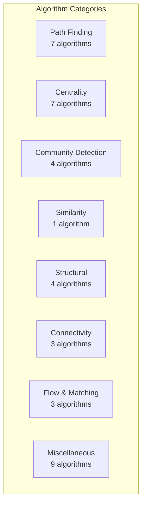

### Path Algorithms

| Procedure | Description | Use Case |
|---|---|---|
| `algo.dijkstra` | Single-source shortest path (weighted) | Navigation, routing |
| `algo.bidirectionalDijkstra` | Bidirectional shortest path | Faster point-to-point |
| `algo.bellmanFord` | Shortest path with negative weights | Financial arbitrage |
| `algo.astar` | A* with heuristic guidance | Spatial routing |
| `algo.kShortestPaths` | K distinct shortest paths | Alternative routes |
| `algo.allSimplePaths` | All simple paths between nodes | Dependency analysis |
| `algo.allPairsShortestPath` | Floyd-Warshall for all pairs | Network diameter |

### Centrality Algorithms

| Procedure | Description | Use Case |
|---|---|---|
| `algo.degreeCentrality` | Vertex degree (in/out/total) | Hub identification |
| `algo.betweenness` | Shortest-path betweenness | Bridge nodes, bottlenecks |
| `algo.closeness` | Average distance to all others | Information spread |
| `algo.harmonic` | Harmonic centrality | Disconnected graphs |
| `algo.eigenvector` | Eigenvector centrality (iterative) | Influence measurement |
| `algo.katz` | Katz centrality | Status in social networks |
| `algo.pagerank` | PageRank (iterative) | Web ranking, importance |

### Community Detection

| Procedure | Description | Use Case |
|---|---|---|
| `algo.wcc` | Weakly Connected Components (union-find) | Cluster identification |
| `algo.scc` | Strongly Connected Components (Tarjan) | Cycle groups |
| `algo.louvain` | Louvain modularity optimization | Community structure |
| `algo.labelPropagation` | Label propagation (semi-synchronous) | Fast community detection |

### Similarity

| Procedure | Description | Use Case |
|---|---|---|
| `algo.nodeSimilarity` | Jaccard neighborhood overlap | Similar users/items |

### Structural

| Procedure | Description | Use Case |
|---|---|---|
| `algo.triangleCount` | Count triangles | Clustering coefficient |
| `algo.topologicalSort` | DAG topological ordering | Build systems, dependencies |
| `algo.cycleDetection` | Detect cycles | Deadlock detection |
| `algo.bipartiteCheck` | Bipartite graph verification | Two-coloring |

### Connectivity

| Procedure | Description | Use Case |
|---|---|---|
| `algo.bridges` | Bridge edge detection | Network reliability |
| `algo.articulationPoints` | Cut vertex detection | Single points of failure |
| `algo.kcore` | K-core decomposition | Dense subgraph discovery |

### Flow & Matching

| Procedure | Description | Use Case |
|---|---|---|
| `algo.fordFulkerson` | Maximum flow | Network capacity |
| `algo.dinic` | Maximum flow (Dinic's) | Large flow networks |
| `algo.maxMatching` | Maximum cardinality matching | Assignment problems |

### Miscellaneous

| Procedure | Description | Use Case |
|---|---|---|
| `algo.mst` | Minimum spanning tree (Kruskal) | Network design |
| `algo.randomWalk` | Random walk sampling | Graph embedding, sampling |
| `algo.elementaryCircuits` | All elementary cycles | Circuit analysis |
| `algo.maximalCliques` | Maximal clique enumeration | Dense groups |
| `algo.graphColoring` | Graph coloring | Scheduling, register allocation |
| `algo.graphMetrics` | Global metrics (diameter, density, avg clustering) | Graph summary |

## Execution Modes

Algorithms run in one of two modes depending on their computational requirements:

```mermaid
graph TB
    Q[Algorithm Request] --> LIGHT{Light Algorithm?<br/>Single path, reachability}
    LIGHT -->|Yes| DT[DirectTraversal<br/>Zero-copy BFS<br/>AdjacencyManager + L0]
    LIGHT -->|No| HEAVY{Heavy Algorithm?<br/>PageRank, WCC, Louvain}
    HEAVY -->|Yes| GP[GraphProjection<br/>Materialized Dense CSR<br/>1 GB default, 100M vertex limit]

    DT --> FAST[Fast Startup<br/>Streaming Results]
    GP --> BULK[Full Materialization<br/>Iterative Computation]
```

### DirectTraversal

- **Zero-copy BFS** on `AdjacencyManager` + `L0Buffer`
- Used for: shortest path, reachability, single-source queries
- **Fast startup**: No materialization needed
- **Streaming results**: Results available as traversal progresses

### GraphProjection

- **Materialized dense CSR** graph in memory
- Used for: PageRank, WCC, Louvain, betweenness, eigenvector, etc.
- **Configuration**: `ProjectionBuilder` with `node_labels()`, `edge_types()`, `include_reverse()`, `build()`
- **Limits**: `max_projection_memory` (1 GB default), `max_vertices` (100M default)

## Running Algorithms

### Example: PageRank

```cypher
CALL algo.pagerank({
    nodeLabels: ['Person'],
    edgeTypes: ['KNOWS'],
    dampingFactor: 0.85,
    maxIterations: 20,
    tolerance: 0.0001
})
YIELD nodeId, score
RETURN nodeId, score
ORDER BY score DESC
LIMIT 10
```

### Example: Shortest Path

```cypher
CALL algo.dijkstra({
    startNode: $start_vid,
    endNode: $end_vid,
    edgeTypes: ['ROAD'],
    weightProperty: 'distance'
})
YIELD path, totalCost
RETURN path, totalCost
```

### Example: Community Detection

```cypher
CALL algo.louvain({
    nodeLabels: ['Person'],
    edgeTypes: ['KNOWS'],
    maxIterations: 10
})
YIELD nodeId, communityId
RETURN communityId, count(*) AS size
ORDER BY size DESC
```

### Example: Weakly Connected Components

```cypher
CALL algo.wcc({
    nodeLabels: ['Device'],
    edgeTypes: ['CONNECTED_TO']
})
YIELD nodeId, componentId
RETURN componentId, collect(nodeId) AS members
```

## Extending the Catalog — GraphView & GraphCompute

The 35 algorithms above are native. **Custom** graph algorithms are authored through the plugin framework's `AlgorithmProvider` surface ([Part XVII](#part-xvii-plugin-framework)), which offers two paths:

- **In-process (`GraphView`)** — an algorithm authored in Rust obtains a read-only CSR topology snapshot via `AlgorithmHost::project(&GraphProjectionSpec) -> Arc<dyn GraphView>` and walks it with dense-slot accessors (`out_neighbors` / `out_degree` / `out_weight` / `to_vid` / …). First-party `uni.algo.reachability`, `uni.algo.pagerank`, `uni.algo.sssp`, and `uni.path.expand` are authored purely against this surface. Gated by `Capability::HostQuery`.
- **Guest-authored (`GraphCompute`)** — the same graph algorithms can be authored in **Rhai, Python, WASM, or Extism**, driving coarse native kernels over opaque handles ("conductor, not worker"). First-party `uni.algo.gcpagerank` / `gcwalks` / `gcoverlap` dogfood it. See [§GraphCompute — Guest-Authorable Graph Algorithms](#graphcompute--guest-authorable-graph-algorithms) for the kernel catalog, determinism guarantees, and budgets.

Both paths dispatch through `CALL` alongside the built-in `algo.*` procedures (miss-only, so a custom `uni.algo.*` never shadows a built-in).

## Algorithm Best Practices

| Practice | Details |
|---|---|
| **Use DirectTraversal for single paths** | Much faster than GraphProjection for point queries |
| **Use GraphProjection for iterative algorithms** | PageRank, WCC, Louvain need full materialization |
| **Set iteration limits** | Prevent infinite loops in convergence algorithms |
| **Project only needed labels/types** | Smaller projection = faster execution + less memory. For **guest GraphCompute** projections this is now enforced: an unscoped projection (no `nodeLabels`/`edgeTypes`) fails loud — name them, or pass `{projectAll: true}` to deliberately take the whole graph. |

## Algorithm Anti-Patterns

| Anti-Pattern | Problem | Solution |
|---|---|---|
| **Full graph for single path** | GraphProjection wastes memory | Use DirectTraversal |
| **Ignoring convergence params** | Algorithm may not converge | Set `maxIterations` and `tolerance` |
| **Running on unprojected graph** | Processing irrelevant vertices/edges | Use `nodeLabels` and `edgeTypes` filters |

---

# Part X: Locy Framework

## What Is Locy?

**Locy** (Logic + Cypher) is a Datalog-inspired logic programming language that extends OpenCypher with **recursive rules**, **path-carried values**, **aggregation**, **graph derivation**, **hypothetical reasoning**, and **abductive inference**. Every valid Cypher query is valid Locy — it's a strict superset.

Locy enables reasoning over graphs that would be impossible or extremely awkward in plain Cypher:

- **Transitive closure**: "Find all nodes reachable from X through any chain of Y relationships"
- **Risk propagation**: "Compute cumulative fraud risk along payment chains"
- **Permission resolution**: "Resolve effective RBAC permissions with priority and inheritance"
- **Provenance tracking**: "Trace the full supply chain lineage of a component"
- **What-if analysis**: "What would happen if we added/removed this edge?"

## Design Philosophy

From the Locy design document:

1. **Cypher superset** — Every valid Cypher query works unchanged
2. **Compiler, not engine** — Locy compiles rules into Cypher AST objects. The existing query planner/executor runs them.
3. **No string roundtripping** — The orchestrator builds AST objects programmatically, never serializes to text
4. **Single parse location** — All parsing (Cypher + Locy) happens in `uni-cypher`
5. **Decoupled** — `uni-locy` depends on `uni-cypher` (ASTs), not on `uni-query` or `uni-store`

## Compilation Pipeline

```mermaid
graph LR
    SRC[Locy Source] --> PARSE[Parse<br/>Pest Grammar]
    PARSE --> AST[LocyProgram AST]
    AST --> MOD[Module Resolution<br/>USE declarations]
    MOD --> DEP[Dependency Graph<br/>Rule-to-rule refs]
    DEP --> STRAT[Stratify<br/>SCC Detection]
    STRAT --> WARD[Wardedness Check<br/>Prevent unsafe negation]
    WARD --> TYPE[Typecheck<br/>Variable inference]
    TYPE --> COMP[CompiledProgram<br/>Topological strata order]
```

1. **Parse**: Pest grammar (`locy.pest` stacked on `cypher.pest`) produces `LocyProgram` AST with rules and commands
2. **Module Resolution**: Resolve `USE module { rule1, rule2 }` imports
3. **Dependency Graph**: Build rule-to-rule reference graph
4. **Stratify**: Detect strongly connected components (SCCs) — these are recursive rule groups
5. **Wardedness Check**: Ensure negation is stratified (no recursive negation)
6. **Typecheck**: Infer variable types across rules
7. **Assemble**: Topological ordering of strata into `CompiledProgram`

## Rule Syntax

```
MODULE namespace.path
USE other.module { rule1, rule2 }

CREATE RULE ruleName [PRIORITY n] AS
    MATCH pattern
    WHERE conditions                     -- pre-aggregation filter
    [ALONG name = expr]
    [FOLD name = aggregate]
    [REQUIRE aggregate_condition]        -- definitional threshold (per iteration)
    [WHERE aggregate_condition]          -- post-FOLD filter (HAVING)
    [BEST BY expr [ASC|DESC], ...]
    [YIELD [KEY] expr [AS alias] [PROB], ...
    | DERIVE pattern, ... ]
```

### IS Reference (Rule Invocation)

Rules reference other rules using `IS`:

<!-- doctest: skip -->
```cypher
// 1-arg form: single subject
WHERE x IS reachable

// 2-arg form: pair matching
WHERE x IS reachable TO y

// Tuple form: multi-arg
WHERE (x, y) IS reachable

// Negation
WHERE x IS NOT compromised
```

Which occurrence of a variable binds it is decided once per clause by the
binding plan (`uni_locy::binding_plan`), independently of conjunct order: one
binder per variable, every other occurrence a test, negations last. The plan is
the single source of truth for the compiler's scope and IS NOT checks, the
planner, EXPLAIN, the anti-join and the feature resolvers (C-BIND). Reading a
value column two references expose is `AmbiguousRuleColumn`; KEY columns are
never exposed by name; a node / relationship / scalar mismatch at a position is
`IsRefKindMismatch`.

### ALONG (Path-Carried Values)

Accumulate values along traversal paths:

```locy
CREATE RULE shortest_risk AS
    MATCH (a:Account)-[t:TRANSFER]->(b:Account)
    WHERE a IS flagged
    ALONG cumulative_risk = prev.risk + t.amount * 0.01
    YIELD KEY b, cumulative_risk
```

- `prev.fieldName` — access the accumulator from the previous hop
- Supports full Cypher arithmetic: `+`, `-`, `*`, `/`, `%`, `^`
- Supports logical operators: `AND`, `OR`, `XOR`

### FOLD (Aggregation)

Aggregate across paths:

```locy
CREATE RULE total_exposure AS
    MATCH (a:Account)-[:TRANSFER*]->(b:Account)
    WHERE b IS suspicious
    FOLD total = SUM(t.amount),
         path_count = COUNT(*)
    YIELD KEY a, total, path_count
```

Supported aggregators: `COUNT`, `SUM`, `AVG`, `MIN`, `MAX`, `COLLECT`, `MSUM`, `MMAX`, `MMIN`, `MCOUNT`, `MNOR`, `MPROD`

#### Monotonicity in Recursive Strata

A rule in a recursive stratum may only `FOLD` with an aggregate the compiler can prove monotone; anything else fails with `NonMonotonicInRecursion` at compile time. The verdict comes from the plugin registry — `Semilattice::monotone_join` on the registered `LocyAggregate` — falling back to the built-in `M*` contract (`MMAX`, `MMIN`, `MCOUNT`, `MNOR`, `MPROD`, `MSUM`) when the registry has no entry, so a plugin-less embedding keeps working. The compile-time oracle and the planner's guard both go through the same `locy_monotonicity_verdict`; when they disagreed, a program could compile cleanly and then fail at plan time.

Consequences:

- `COUNT` and `COLLECT` are `monotone_join: true` in the builtin registry, so a recursive `FOLD n = COUNT(*)` or `FOLD xs = COLLECT(x)` **compiles**. Both are `has_top: false` — monotone but unbounded. The unboundedness only costs iterations for the aggregates the fixpoint loop actually tracks: `COUNT` overrides `update_step`, so its accumulator can keep changing and fail convergence condition (2) indefinitely, ending at `max_iterations`. `COLLECT` does not override `update_step`, so `AggregateTracker::update` skips it (the `CODE_UNKNOWN_FUNCTION` arm) and it is aggregated after the fixpoint via `LocyAggState::ingest` — it cannot itself keep the loop iterating. The iteration cap is the backstop, not a proof of termination.
- `SUM` and `AVG` are `monotone_join: false` and remain rejected in recursion. Use `MSUM` (caller-asserted non-negative) when a recursive sum is genuinely wanted.
- A plugin-registered aggregate declaring `monotone_join: true` works in a recursive stratum. That includes rules registered through `db.rules().register(...)` — the facade chains `RuleRegistry::with_plugin_registry` so registration compiles against the same aggregates queries see. It does **not** extend to reopening the database: `UniBuilder` has no plugin-registration hook (`Uni::add_plugin` is only reachable after open), and `build_locy_registry_from_persisted` runs immediately after `register_builtin_plugins` with a registry that holds builtins only. A persisted rule folding over a plugin aggregate therefore fails the open naming that rule, unless `skip_invalid_locy_rules(true)` is set — in which case it is dropped with a warning and must be re-registered after `add_plugin`. Rules folding over built-in aggregates reload normally.

#### What a self-reference reads: the two derived-scan views

A recursive rule's own facts exist in two shapes while the fixpoint runs, and different consumers need different ones. `DerivedScanView` (`crates/uni-query/src/query/df_graph/locy_fixpoint.rs`) names them, and the `DerivedScanRegistry` keys handles by `(rule_name, is_self_ref, view)` so both can be live at once:

- **`Contributions`** — the pre-fold rows, one per derivation, carrying the hidden `__deriv_*` discriminators. ALONG's `prev.x` needs these (it accumulates along a single path); so does a self-negated `IS NOT`. (Provenance no longer joins against a view: a derivation's referenced facts are read from its own hidden `__deriv_isref_*` columns, see Shared-Proof Detection.)
- **`Folded`** — one row per KEY carrying that KEY's folded value, refreshed at the end of every merge by running `PriorityExec` + `FoldExec` — the same operators the post-fixpoint chain uses — over the accumulated contributions and grafting the result onto a representative row per KEY. A clause that folds a child's value reads this.

The planner picks the view **per clause**: a positive same-stratum reference to a rule carrying FOLD gets `Folded` unless the clause carries ALONG, in which case ALONG wins for that clause only. Before this split (issue #162), every self-reference read contributions, so a parent joined one row per *contribution* of its child rather than one row per child, and whole-row dedup then collapsed the equal-valued ones — a silently optimistic rollup.

Two consequences inside `FixpointState`:

- Contributions are **replaced** on re-derivation, keyed on every column except the fold inputs, rather than appended. Once a child's folded value can move between iterations, a parent that already emitted a row against the child's partial value would otherwise fold the stale row in alongside the fresh one.
- Convergence is **value-based**: a clause reading a full snapshot re-derives every iteration, so delta-emptiness alone is not progress. `MonotonicAggState` cannot serve here — it is only ever fed the delta.

#### Derivation identity: what tells two contributions apart

The replace-on-re-derivation merge above is only correct if the derivation key really does identify one derivation. The key is every column except the fold inputs, and the columns that make it discriminating are the hidden `__deriv_*` ones, built by `derivation_discriminators` in `locy_planner.rs` for a recursive rule carrying FOLD or ALONG:

| Column | Projected from | Separates |
|---|---|---|
| `__deriv_clause` | the clause index | rows of different clauses, whose other discriminators are NULL-padded |
| `__deriv_vid_{v}` | `{v}._vid`, a MATCH-bound node not yielded bare | derivations through different nodes |
| `__deriv_eid_{r}` | `{r}._eid`, a single-hop relationship | **parallel edges** between the same pair of nodes |
| `__deriv_path_{r}` | `{r}`, the edge list of a variable-length relationship | **distinct paths** between the same endpoints |
| `__deriv_ref_{c}_{o}` | `__locy_row_hash` of every column of the fact the clause's `o`-th positive same-stratum IS-ref read (contributions view only) | extensions of **different referenced facts** — two sub-paths that share the first hop and diverge below it |

The referenced-fact column hashes the whole referenced row, its own hidden columns included, so the identity chains through the derivation at a fixed 16 bytes (`df_graph/locy_row_hash.rs`). Without it, `0 -> 1` followed by two parallel `1 -> 2` edges of equal weight was one `(0, 2, 3)` fact, not two, and a downstream SUM read 4 instead of 7 — found by the random-program oracle. A reference reading the **folded** view gets no such column: that row is the child's KEY with its current folded value, so hashing it would give a re-derived contribution a new key each iteration, and it would be appended instead of replacing the old one. One consequence: an ALONG rule over a cycle whose values do not grow (a zero-weight cycle) now has a new derivation every lap — infinitely many paths — and reaches the iteration limit, reported as such, where it used to converge on a collapsed answer.

An **anonymous** relationship is bound to the positional name `__anon_edge_{clause}_{path}_{elem}` before the body is planned (`name_anonymous_edges`), so it gets a column too. The name is positional so that an IS-ref target's discriminator schema, computed from the compiled rule, matches the one its own clauses project. Binding a variable does not change which rows the MATCH produces.

Until issue #294 only node vids were used. Two stakes `x -[30]-> a` and `x -[40]-> a` bind the same nodes, so they shared one derivation key and the merge kept whichever row came last — `a` came out as 60 or 50 depending on batch order, never 90. The non-recursive form of the same rule was always right, because it never builds a `FixpointState` and aggregates the plain bag of MATCH rows; that equivalence is what the #294 regression tests check.

The discriminator columns are nullable by construction (a clause that does not bind a variable projects NULL), so `reconcile_schema` marks every `__deriv_*` field nullable before adopting a batch's schema. A relationship's `_eid` is declared non-nullable by the scan, and adopting it verbatim rejected a sibling clause's NULL-padded batch.

In debug builds `merge_fold_contributions` also checks the invariant directly: two candidates of one merge that share a derivation key must agree on their fold input, since a derivation is evaluated once per iteration. If they differ, the key has failed to separate two derivations, and the merge returns an internal error instead of silently keeping one. The check is blind when the colliding rows carry equal fold inputs (e.g. `MSUM(1.0)` over two paths), which is why the discriminators themselves are the fix and the check is the tripwire.

### Post-FOLD WHERE (HAVING)

A `WHERE` clause after `FOLD` filters aggregated groups — equivalent to SQL's `HAVING`:

```locy
CREATE RULE frequent_payer AS
    MATCH (p:Person)-[r:PAID]->(i:Invoice)
    FOLD n = COUNT(*), total = SUM(r.amount)
    WHERE n >= 3 AND total >= 100
    YIELD KEY p, n, total
```

#### Seeding a fold

A rule may seed a column in one clause and fold into it in another:

```locy
CREATE RULE f AS MATCH (e:E) WHERE e.uid IN ['x','y'] YIELD KEY e, 100.0 AS v
CREATE RULE f AS MATCH (o:E)-[r:OWNS]->(e:E) WHERE o IS f FOLD v = MSUM(r.pct) YIELD KEY e, v
```

A FOLD aggregates, per KEY, **every** row of its rule: a folding clause
contributes its aggregate's input and a seeding clause contributes the value it
yields — SQL's `AGG(v) FROM (seeds UNION ALL inputs) GROUP BY key`. Measured:
a seed of 100 plus an incoming stake of 20 is 120, recursive or not. For a
count the same rule means a non-NULL seed is one counted row (its value is
never read), and `NULL AS v` seeds a key without counting it. Because
`YIELD KEY e, 0 AS n` beside `FOLD n = MCOUNT(r)` reads like a starting value,
the compiler warns with `CountFoldSeedCounted`.

Both kinds of row share the column, so both must carry one type:

- a seeding clause projects the column with the fold's input type
  (`fold_input_column_types`), so `0` feeds `MSUM(r.pct)` as `0.0`; the
  self-reference's derived-scan schema uses the same types, rather than
  inferring from whichever clause happens to be first;
- a `COUNT` / `MCOUNT` input is projected as `CASE WHEN x IS NULL THEN NULL
  ELSE 1 END` (`count_input_marker`), since a count only observes nullness.
  Carrying the node or relationship itself put a `LargeBinary` or `UInt64`
  column next to the seed's integer, and the merge failed with
  `concatenate arrays of different data types`.

#### What a FOLD clause may YIELD

A FOLD emits one row per distinct KEY: the KEY columns plus one column per FOLD binding. `KEY` marks a **single** YIELD item, so a composite key is `YIELD KEY a, KEY b, total`; `YIELD KEY a, b, total` declares one KEY and a plain column `b`. A plain column has no single value per group, and `FoldExec` used to drop it without a diagnostic — a later `QUERY ... RETURN b` then read the absent column as NULL (issue #293). `check_fold_yield_is_grouped` now rejects, with `UngroupedFoldYield`, any YIELD item of a FOLD clause that is not a KEY, not a FOLD output, and does not mention one (`total * 2.0 AS score` is still allowed; the planner evaluates it after the fold). A clause *without* FOLD is unconstrained: a base clause `YIELD KEY e, 100.0 AS agg` seeds the column its sibling folds into.

For the same reason a QUERY is checked against its rule's YIELD columns: `check_query_variables` rejects, with `UnknownQueryVariable`, a WHERE / RETURN / ORDER BY variable the rule does not yield (ORDER BY may also name a RETURN alias). The row-level evaluator in `locy_query.rs` would otherwise return NULL for it on every row.

The post-FOLD `WHERE` runs after all FOLD aggregates are computed and before BEST BY. It can reference FOLD output columns and KEY columns. Multiple conditions are combined with `AND`.

In a **recursive** rule it filters the converged answer only. `apply_having_filter` is called once from `apply_post_fixpoint_chain_inner`, never from the per-iteration `FoldViewState::recompute_folded`, so a self-reference reads the rule's *unfiltered* folded value: a group the threshold excludes is absent from the output while still having derived rows into it. That is the intended reading for the PROB case of issue #162 — a child HAVING removes must still have been visible to its parent during the fixpoint — and it is deliberate. `HavingInRecursivePath` warns when the shape appears, because the other intent is spelled identically.

### REQUIRE (definitional threshold)

`REQUIRE` is the other reading of the same predicate (issue #265). It is part of the rule's *definition*, so it constrains what the recursion derives rather than what the answer displays:

```locy
CREATE RULE blocked AS
    MATCH (o:Entity)-[s:OWNS]->(e:Entity)
    WHERE o IS blocked
    FOLD agg = MSUM(s.pct)
    REQUIRE agg >= 50.0
    YIELD KEY e, agg
```

**Applied at two points, both load-bearing.** `FoldViewState::recompute_folded` filters the per-iteration snapshot, which is what a same-stratum self-reference reads — that is what stops an excluded group deriving anything downstream. `apply_post_fixpoint_chain_inner` filters again, before HAVING — that is what keeps the excluded group itself out of the answer, which the snapshot pass cannot do because the final rows are assembled from contribution facts rather than from the snapshot. Both reuse `apply_having_filter`; the alias substitution from the planner is applied to `require` exactly as to `having`.

**Admitted in a recursive stratum only when one-way.** `check_require_direction` (`uni-locy/src/compiler/typecheck.rs`) pairs each comparison against the fold's direction and raises `NonMonotonicFilterInRecursion` otherwise: a lower bound over a non-decreasing fold, or an upper bound over a non-increasing one. Equality is never admissible, nor is a predicate naming a fold output on both sides, nor an aggregate that declares no direction. A predicate mentioning no fold output at all is constant across iterations and is admitted.

This is a compile error rather than a warning because the runtime cannot recover. The change test (`prev_rows`) compares whole *contribution* rows, not the folded view, so a group leaving the snapshot is invisible to the producing rule's own convergence check and reaches consumers as a row set that flips back and forth — which `rows_now != prev_rows` reads as progress. A non-monotone `REQUIRE` would run to `max_iterations` and return partial results.

**Direction is a `LocyAggregate` method, not `Semilattice` state.** `Semilattice::monotone_join` says *whether* an aggregate is monotone, never which way, and `MIN`/`MAX` share one `BOUNDED_MIN_MAX` constant. `LocyAggregate::direction()` defaults to `FoldDirection::Unknown`, so an aggregate that has not declared one declines `REQUIRE` and existing plugin implementors are unaffected. The enum lives in `uni-common` because `uni-locy` does not depend on `uni-plugin`, and is re-exported from `uni_plugin::traits::locy`. The registry-backed oracle mirrors `is_monotonic_aggregate` as `e.aggregate.direction()`; the registry-free fallback covers the same six `M*` names.

Outside recursion the direction is not policed: there is one pass, nothing can flip, and `REQUIRE` means what the post-FOLD `WHERE` means. That keeps a rule refactor-safe — it holds the meaning its author wrote if a self-reference is added later.

**Gotcha for anyone adding a field here.** `FixpointRulePlan` is cloned field by field inside `FixpointExec::execute` (it carries a `LogicalPlan`), so a new field silently arrives empty at runtime however correctly it was populated upstream. `require` was threaded through the AST, compiler and planner and was still empty at the fixpoint until that clone was updated.

### Probabilistic Aggregation (MNOR / MPROD)

Two monotonic aggregators for combining probabilities in recursive rules:

| Aggregator | Formula | Identity | Semantics |
|---|---|---|---|
| `MNOR` | `1 − ∏(1 − pᵢ)` | 0.0 | "Any one cause can produce the effect" (Noisy-OR) |
| `MPROD` | `∏ pᵢ` | 1.0 | "All matched conditions hold simultaneously" (product of independent successes) |

Both are monotonic (safe in recursive strata), clamp inputs to [0, 1], skip nulls, and are commutative.

```locy
// Risk combination: any signal can flag the account
CREATE RULE risk_combined AS
    MATCH (a:Component)-[s:SIGNAL]->(b:Flag)
    FOLD risk = MNOR(s.probability)
    YIELD KEY a, risk

// Joint reliability: all parts must work
CREATE RULE joint_reliability AS
    MATCH (asm:Part)-[r:REQUIRES]->(sub:Part)
    FOLD availability = MPROD(sub.reliability)
    YIELD KEY asm, availability
```

MPROD uses log-space computation when the product drops below 1e-15 to prevent underflow. MNOR and MPROD are incompatible with `BEST BY` (compiler error).

> **MPROD multiplies over *matched* rows, not over an expected set.** A condition that produces no matching row is simply absent from the product — it does **not** force the result to zero. MPROD alone therefore does not encode "every required element must be present." To express a true all-elements conjunction (e.g. a patent claim is infringed only when a product maps *every* claim element), pair MPROD with a completeness guard: count matched vs. total and keep only equal-count groups, or exclude incomplete groups with an `IS NOT` complement.
>
> ```cypher
> CREATE RULE claim_size AS
>     MATCH (c:Claim) WHERE c IS claim_elements TO ce
>     FOLD n_total = COUNT(ce) YIELD KEY c, n_total
>
> CREATE RULE pc_mapped AS
>     MATCH (p:Product), (c:Claim)
>     WHERE c IS claim_elements TO ce, p IS element_mapped TO ce
>     FOLD n_mapped = COUNT(ce), infringement = MPROD(mapping_conf)
>     YIELD KEY p, KEY c, n_mapped, infringement
>
> CREATE RULE claim_infringed AS         -- all-elements guard: n_mapped = n_total
>     MATCH (p:Product), (c:Claim)
>     WHERE (p, c) IS pc_mapped, c IS claim_size TO n_total, n_mapped = n_total
>     YIELD KEY p, KEY c, infringement
> ```

### PROB Columns and Probabilistic `IS NOT`

Locy can mark one output column per rule as the rule's probability channel:

```locy
CREATE RULE supplier_risk AS
    MATCH (s:Supplier)-[:HAS_SIGNAL]->(sig:Signal)
    FOLD risk = MNOR(sig.risk)
    YIELD KEY s, risk AS PROB
```

Supported forms:

- `expr AS PROB` — infer the output name from the expression
- `expr AS alias PROB` — explicit alias
- `expr PROB` — shorthand for simple expressions

When `IS NOT` targets a rule with a `PROB` column, negation becomes probabilistic complement instead of Boolean anti-join:

```locy
CREATE RULE usable_supplier AS
    MATCH (s:Supplier)
    WHERE s IS NOT supplier_risk
    YIELD KEY s, 1.0 AS confidence PROB
```

- If the referenced rule has a `PROB` column, `IS NOT` contributes `1 - p`
- If the referenced rule has no `PROB` column, `IS NOT` keeps normal Boolean semantics

A **positive** `IS` reference to a `PROB` rule is the mirror image: the row holds only when the referenced fact does, so its probability `p` is multiplied into the caller's `PROB` value — `P(r) + P(NOT r) = 1`. The **count-once rule** keeps a clause that already reads `p` from counting it twice: the planner (`locy_planner::classify_prob_read`) inspects the clause's resolved PROB expression (the FOLD input, or the PROB YIELD item):

- `p` absent → multiplied in (`ProbRead::Absent`);
- `p` exactly one factor of a product (`MNOR(p)`, `MNOR(e.w * p)`) → already counted, nothing multiplied (`ProbRead::Factor`);
- any other read (`1 - p`, `p * p`, `max(p, x)`) → nothing multiplied either (never double-counts), the row is one independent event in exact mode, and a `ProbabilityReadNotFactor` runtime warning is raised (`ProbRead::Opaque`).

The referenced probability travels in a hidden body column: transient `__isprob_{clause}_{occurrence}` (stripped after the multiply, `locy_lineage::apply_positive_prob_factors`) for a rule without lineage, persistent `__deriv_isprob_*` next to `__deriv_isref_*` (a hash of the referenced fact's KEY) and `__deriv_event` (see below) for an `MNOR`/`MPROD` rule. `__deriv_isprob_*` moves with the child's folded value, so `merge_fold_contributions` leaves it out of the derivation key, like a fold input. A PROB column computed after the fold (`YIELD 1 - total AS x PROB`) has no per-row value, and its positive references stay Boolean.

### Shared-Proof Detection and Exact Probability Mode

MNOR and MPROD assume independent derivations. Every `MNOR`/`MPROD` rule records its pre-fold rows as **lineage** (`locy_lineage::LineageStore`, held by the run's `ProvenanceStore`) once its stratum converges — every rule of the stratum before any is corrected, since a rule's formula reads its stratum-mates. A fact's possible-worlds formula is `OP over its rows of (row event AND each referenced fact's formula AND NOT the disjunction of each negated reference's facts' formulas)`, OP = OR for MNOR, AND for MPROD:

- **One reference resolution.** Which facts a row references is read in one place, `locy_lineage::RefResolver`, from the hidden columns: `__deriv_isref_*` (positive) and `__deriv_isnot_*` (negated). **(Wave Q)** When the run records provenance (`LocyPlanBuilder::with_provenance`, set exactly when a tracker is attached), two more kinds of column are projected. Both are transient (`__lin_*`, `planner_locy_types::LIN_COL_PREFIX`): they are read from a clause's rows and then dropped (`strip_transient_columns`) before the facts are deduplicated, so they are never part of a fact's identity. (1) A PROB rule without a fold keeps a *transient lineage* (`LineageMode::Transient`): `__lin_ref_*`, `__lin_prob_*`, `__lin_not_*` and `__lin_event` mirror the `__deriv_*` columns. `LineageStore::record_rows` accumulates its distinct derivations: a derivation seen again over the same event and facts is dropped, while two derivations of one row are kept, because the fact holds when either does. `publish_rows` keeps those of its published facts, grouped by KEY and ORed (facts sharing a KEY are alternatives, as the complement's noisy-OR reads them). It then corrects the facts' own values (`correct_rows`). A published row derived more than one way, or whose row formula is not read-once (`Analysis`), raises `SharedProbabilisticDependency`. In exact mode and under `TopKProofs`, such a row is recomputed as the OR of its derivations (`fact_probability` over its row indices); `e.p` over `a IS reach TO b` gave `e.p × reach` and now gives `e.p`. A recursive stratum finishes its rules without a fold first, so that a stratum-mate that is corrected reads their lineage. Exact mode therefore composes such a fact's own formula, positive or negated. Before, the fact was one fresh variable: on the diamond, `reach(s,t) AND NOT edge(s,t)` was 0.2235 against possible worlds 0.045. (2) Every positive reference that no lineage column names (one to a rule without a PROB column, or from a rule that keeps no lineage) gets a `SupportRef` (`__lin_sup_*`, and `__lin_supp_*` when the target has a PROB column). `RowRefs::support` holds these references for provenance only: EXPLAIN Mode A lists them as children, at probability 1 for a certain fact. `RefScope` selects the columns: `All` for a clause's rows, `Kept` for facts, `Transient` for the recursive path's candidates (`transient_support`, keyed by yield row like `clause_attribution`). A derivation of a rule without a PROB column weighs 1 when it references only certain facts (`compute_proof_probability(has_prob, …)`). Lineage, EXPLAIN's provenance support (`locy_fixpoint::row_provenance`) and so `TopKProofs` all read it. The old provenance join (`collect_is_ref_inputs`, matching the subject's body column against the referenced rule) is gone: it found nothing when YIELD did not carry the subject (`mid IS reach TO b`) and dropped the `TO` target, so EXPLAIN Mode A and the TopK support map recorded no support. A reference without a hidden column (to a rule with no PROB column, or from a rule that keeps no lineage) is a certain condition and is not support.
- **Row event.** The row's PROB value divided by the referenced probabilities and complements it carries, which recovers the clause's own weight whether the reference was multiplied in or read as a factor. A divisor of 0 (a referenced probability of 0, a negated one of 1) means a default value that is also exact, so the weight is never read. Two rows whose own weight is the same expression over the same nodes and relationships are one event: `__deriv_event` hashes the expression's shape and their identities (`locy_planner::row_event_expr`), so the direct `s→t` row of a reachability rule and its row through a self-loop at `t` share the edge `s→t`. A weight that reads no node or relationship (a constant) makes the row its own event.
- **Referenced fact.** Found by `(rule, __deriv_isref_*)`; a fact of a rule without lineage (a non-fold PROB rule) is one independent event of the probability read. A reference to a lineage rule that holds no such fact fails the run.
- **Negated facts.** The planner projects a typed-NULL `__deriv_isnot_{clause}_{occurrence}` (Binary) for every `IS NOT` to a PROB rule in an `MNOR`/`MPROD` rule (`NegatedLineageRef`), and the complement (`locy_complement::probe_prob_complement`) fills it with each fact its negation key matched: the fact's KEY hash, over the negated rule's KEY columns in yield order (the hash its lineage records), and the probability the complement used (24 bytes each, `encode_negated_facts`); NULL when nothing matched. Default mode keeps `1 - p`. Negation is stratified, so a negated fact is never in the referencing fact's strongly connected component; `fact_probability` evaluates components dependencies first, each a monotone least fixpoint, and the negated formula is complete before it is negated.

`SharedProbabilisticDependency` fires when some fact's formula reads a variable twice — two rows, or two parts of one row (a negated fact's variables count like a referenced fact's), sharing an event or a referenced fact, or a cycle (`Analysis` walks strongly connected components dependencies first; a support past `ANALYSIS_SUPPORT_CAP` variables counts as shared). Nodes in common are not evidence in common: the Source/Mid/Target diamond's proofs `{S→T}` and `{S→M, M→T}` share nothing, and independence is exact there (0.745). When no fact of a program is shared, the default value of every fact is already its possible-worlds probability, so the two modes agree — pinned by `locy_prob_is_ref_semantics::exact_matches_possible_worlds_and_default_agrees_without_sharing` and, with `IS NOT` over shared lineage, `negation_exact_matches_possible_worlds_and_default_agrees_without_sharing`, against a brute-force enumeration of worlds.

With `LocyConfig::exact_probability = true`, each fact whose formula is not read-once is rebuilt as a BDD (least fixpoint from false, so a derivation through itself adds nothing) and evaluated by Shannon expansion; the group keeps one row carrying that probability. Two fallbacks remain important:

- `BddLimitExceeded` — the group exceeded `max_bdd_variables`, so Uni falls back to the independence result for that key group
- `CrossGroupCorrelationNotExact` — shared evidence crosses separate aggregate groups; each group is exact internally, but cross-group correlation is still approximate

Derived rows from approximate groups are annotated with `_approximate = true`, and `LocyResult.approximate_groups` records the affected rule/key groups.

`SemiringKind::TopKProofs { k }` runs through the same `LineageStore::correct`: every fact that is not read-once, and every `MNOR` fact with more than `k` rows, is evaluated by `fact_probability` over its `k` highest-weight rows (`top_rows`, ties by position), the facts those rows reference keeping all theirs. A read-once fact with at most `k` rows keeps its default value, already exact. The fold then sees one row per recomputed fact and runs the plain aggregate. This replaced the fold-time DNF (`BodySupportMap`, `topk_dnf_disjunction`), which weighted each referenced fact by the largest row reading it and treated it as the rows' only event, so two edges into one hub that both referenced a certain `hub_score(h)` folded to 0.7 instead of 0.88, and which, through the old join, saw no support for `mid IS reach TO b`.

### BEST BY (Ranked Selection)

Select optimal results:

```locy
CREATE RULE best_route AS
    MATCH (a:City)-[r:ROAD]->(b:City)
    ALONG distance = prev.distance + r.length
    BEST BY distance ASC
    YIELD KEY b, distance
```

Enables `LIMIT 1` optimization — the engine can prune suboptimal paths early during semi-naive evaluation.

Criteria rank as Cypher's `ORDER BY` does. A CypherValue (`LargeBinary`) criterion column — a schemaless property, or a column mixing integers and floats — is sorted by its values' Cypher sort keys (`locy_best_by::order_column`, over `encode_cypher_sort_key`), not by its encoded bytes, which ranked every integer below every float and negatives above positives. A recursive rule selects among one iteration's candidates through the same `BestByExec`, and its merge against held facts (`merge_best_by` in `locy_fixpoint.rs`) compares through `order_column` too. That merge resolves each criterion by its column name (`SortCriterion::column`) in the facts' schema and refuses one the facts do not hold; it used the position and silently dropped one past the schema's end. A `QUERY`'s `ORDER BY`, `min`/`max` and `DISTINCT` likewise use Cypher's orderability (`cypher_value_order`) and equivalence (`canonical_cypher_value`): numbers by exact value, `1` and `1.0` one value, the first seen kept.

`BEST BY` cannot be combined with a *declared lattice fold* — `MMAX`, `MMIN`, `MCOUNT`, `MNOR`, `MPROD`, `MSUM` — and the combination is rejected with `BestByWithMonotonicFold`. That guard is purely syntactic over those six spellings and is deliberately decoupled from the monotonicity oracle above: the oracle asks whether an aggregate is sound under a fixpoint, this asks whether the user wrote a lattice fold. It also runs for **every** rule, not just recursive ones. `BEST BY … FOLD MAX(x)` / `MIN` / `COUNT` / `COLLECT` are therefore legal, even though those aggregates are `monotone_join: true`.

### YIELD KEY (Grouping)

Control result grouping:

```locy
CREATE RULE risk_summary AS
    MATCH (a:Account)-[:TRANSFER]->(b:Account)
    WHERE b IS flagged
    YIELD KEY a,       // Group by source account
          count(*) AS exposure_count,
          sum(t.amount) AS total_exposure
```

`KEY` marks grouping dimensions (implicit GROUP BY). Unmarked outputs are regular value columns. `PROB` marks the clause's probability column when probabilistic semantics are required.

### PRIORITY (Execution Ordering)

Control evaluation order within a stratum:

```cypher
CREATE RULE high_priority_rule PRIORITY 100 AS ...
CREATE RULE normal_rule AS ...  // Default priority: 0
CREATE RULE low_priority_rule [PRIORITY -10] AS ...
```

Higher priority values execute first.

### DERIVE (Graph Mutation)

Create new graph elements from reasoning results:

```locy
CREATE RULE infer_risk AS
    MATCH (a:Account)-[:TRANSFER]->(b:Account)
    WHERE a IS flagged
    DERIVE (b)-[:RISK_FROM]->(a)

// MERGE combines paths
CREATE RULE merge_paths AS
    MATCH (a)-[r]->(b)
    DERIVE MERGE a, b
```

### PREV (Previous Iteration Access)

Access values from the previous fixpoint iteration:

```locy
CREATE RULE converging_score AS
    MATCH (n:Node)
    ALONG score = (prev.score + neighbor_avg) / 2.0
    YIELD KEY n, score
```

`prev.<field>` is rewritten to a bare column reference over the self-referential derived scan, so a clause carrying `ALONG` always reads the **`Contributions`** view — a per-KEY aggregate is not defined per path. See *What a self-reference reads* above.

## Execution Model

### Two-Phase Execution Architecture

Locy programs execute in two distinct phases with different execution engines:

```mermaid
graph TB
    subgraph "Phase 1: Strata Evaluation (DataFusion)"
        LP[LocyProgramExec<br/>DataFusion ExecutionPlan]
        LP --> S0[Stratum 0: Base rules]
        S0 --> S1[Stratum 1: Recursive fixpoint]
        S1 --> S2[Stratum 2+: Dependent strata]
        S2 --> DS[DerivedStore<br/>RecordBatch facts]

        LP -.- GEC2[GraphExecutionContext<br/>storage + schema + xervo]
        LP -.- SC[SessionContext<br/>DataFusion session]
    end

    subgraph "Phase 2: Command Dispatch (Row-Level)"
        DS --> CONV[Convert to Vec Row]
        CONV --> CMD{Command Type}
        CMD --> DER[DERIVE<br/>Generate mutations]
        CMD --> ABD[ABDUCE<br/>Hypothetical reasoning]
        CMD --> ASM[ASSUME<br/>What-if analysis]
        CMD --> QRY[QUERY<br/>Goal resolution]
        CMD --> EXP[EXPLAIN RULE<br/>Derivation trace]

        DER --> MUT[execute_mutation]
        ABD --> SP[Savepoint → Mutate → Re-evaluate → Rollback]
        ASM --> SP
    end
```

**Phase 1** runs entirely within DataFusion. Locy rules compile to `LogicalPlan` nodes (Scan → Filter → Projection), physical planning uses `CypherPhysicalExprCompiler` (which creates `SimilarToExecExpr`, `ExistsExecExpr`, etc.), and fixpoint iteration runs via `FixpointExec`. All expression functions have full access to `GraphExecutionContext` — storage, schema, xervo runtime.

**Phase 2** operates on converged facts materialized as `Vec<Row>`. Commands are not queries — DERIVE iterates rows and generates CREATE/MERGE mutations; ABDUCE uses savepoint-rollback loops for counterfactual reasoning; ASSUME tests hypothetical mutations. WHERE filters on commands use `eval_expr()`, a lightweight row-level evaluator. Expression functions in this path (e.g., `similar_to`) are limited to pure computation (vector cosine) without storage access.

The `NativeExecutionAdapter` that dispatches commands does hold `GraphExecutionContext` and `SessionContext` — they're used for `execute_mutation()`, `re_evaluate_strata()`, and `execute_cypher_read()`. They are not currently threaded through to `eval_expr()` / `eval_function()`, which is why command WHERE clauses have limited expression support.

### Stratified Fixpoint

```mermaid
graph TB
    subgraph "Stratified Evaluation"
        S0[Stratum 0<br/>Non-recursive base rules]
        S1[Stratum 1<br/>Recursive group A]
        S2[Stratum 2<br/>Recursive group B<br/>depends on A]
        S3[Stratum 3<br/>Non-recursive final rules<br/>depends on A, B]
    end

    S0 -->|"Facts"| S1
    S1 -->|"Fixpoint reached"| S2
    S2 -->|"Fixpoint reached"| S3

    subgraph "Fixpoint Loop (per stratum)"
        INIT[Initialize delta = base facts]
        EVAL[Evaluate rules using delta]
        NEW[Compute new facts]
        CHECK{Delta empty?}
        CHECK -->|No| EVAL
        CHECK -->|Yes| DONE[Fixpoint reached]
        NEW --> CHECK
        EVAL --> NEW
        INIT --> EVAL
    end
```

1. Compute stratum 0 (non-recursive, base rules) — single pass
2. For each recursive stratum:
   - **Semi-naive evaluation**: Only re-evaluate rules using newly-derived facts (delta)
   - Each iteration produces a delta of new facts
   - **Fixpoint**: When delta is empty, the stratum is complete
3. Final non-recursive strata consume all previously-derived facts

### Semi-Naive Evaluation

The key optimization: instead of re-evaluating all rules against all facts each iteration, only consider **new** facts from the previous iteration. This provides exponential speedup for transitive closures.

```
Iteration 0: delta₀ = base facts from MATCH
Iteration 1: delta₁ = evaluate(rules, delta₀) - known_facts
Iteration 2: delta₂ = evaluate(rules, delta₁) - known_facts
...
Iteration n: deltaₙ = ∅ → fixpoint reached
```

**What each stratum scan reads (P5, 2026-10-17).** Between clause evaluations every derived-scan handle rests on the view negation, provenance and the post-fixpoint chain read through the registry (`update_derived_scan_handles`: a linear self-reference's delta, everything else the full relation). While a clause runs, `run_fixpoint_loop` overrides the scans *that clause* reads into its own stratum — `FixpointClausePlan::stratum_scans`, recorded by the planner — and restores them afterwards:

- **A linear clause** (one reference into its stratum) reads the referenced rule's latest **delta**, whether the reference is to its own rule or to the other rule of a mutually recursive stratum (R3 mutual). Every fact enters exactly one delta, every rule merges once per iteration, and every clause runs once per iteration in a fixed order, so between two merges of a rule each consumer runs exactly once: it meets each delta exactly once. Before P5 a cross-reference read the other rule's whole relation every iteration (`DerivedScanExec` 55/820 rows at chain length 20/80 for even/odd, against 20/80 now).
- **A non-linear clause** (two or more references into its stratum, e.g. `a IS tc TO m, m IS tc TO b`, or `p :- q, q` with `q` in the stratum) gets one **exclusive** handle per reference (`DerivedScanEntry::exclusive`; the planner still mints the shared handle, which negation and provenance resolve to). The clause runs in k passes; pass i feeds scan i the **delta**, scans j < i the **old** facts (`FixpointState::old_facts`, full minus delta; `folded_old` for the folded view) and scans j > i the **full** facts. `F_new^k \ F_old^k` is exactly the disjoint union over i of `F_old^{<i} × Δ_i × F_new^{>i}`: a tuple of facts is joined in the pass of its *first* member from the latest delta, and in no other. So each derivation — and with it each per-path (`ALONG`) or `FOLD` contribution row, whose `__deriv_ref_*` identity is the tuple of referenced facts — is produced exactly once, at the evaluation where its last member arrived, which is when reading every position in full would first produce it. Merges are idempotent on a re-produced identical row, so the facts equal full feeding's; only the repetition is gone. A pass whose delta is empty is skipped (every stratum reference is an inner join), so the converging iteration does no join work; before P5 it re-joined the whole relation with itself. Measured on the non-linear TC probe (chains of 20, 2k / 8k nodes): `HashJoinExec` rows summed over the run 722,800 / 2,891,200 → 114,000 / 456,000 (exactly one row per derivation `(a, m, b)`), the converging iteration's 247k / 988k → 800 / 3,200. The old and full scans are still read in full per pass, so `DerivedScanExec` per iteration stays proportional to the relation (38,600 rows in the last iteration at 2k, as before): a hash join over an in-memory relation, not a persistent index.
- **BEST BY** (R2): `merge_best_by`'s delta is the winners that are new for their KEY or strictly better, not the whole pruned set. On an exact tie the held row wins (origin is the last sort key), and a candidate whose rounded criteria equal the held row's keeps the held row, so the delta never churns between equals. A self-reference fed an unchanged row would only re-derive candidates it derived when that row entered; a superseded row's derivations were made while it was current, exactly as under full feeding. `DerivedScanExec` on a chain: 190/3,160 → 19/79 at length 20/80.
- **BEST BY merge cost** (Wave C): `FixpointState::best_index` maps each KEY (rounded key view) to its held row (`batch`, `row`) and rounded criteria. A merge picks the best candidate per KEY (earliest on an exact tie), compares it with the held row through `make_comparator` on the exact criteria (held rows gathered with `interleave`), and admits it only when strictly better and its rounded criteria differ. A displaced row is filtered out of the one batch holding it; emptied batches are dropped and the tail batches merged binary-counter style (`compact_best_tail`), re-indexing only batches whose index changed. So a merge is O(candidates + rewritten batches), not O(facts · log facts); `row_dedup` is `None` for these states, since no BEST BY rule takes the whole-row dedup path.
- **The folded view.** A rule serving the **`Folded`** view keeps a full per-KEY snapshot — an aggregate is a whole-relation quantity — so for those rules the fixpoint has settled when no KEY has been added *and* no value has moved, not merely when the delta is empty. A reference fed by delta reads only the snapshot rows that are new or changed since the previous snapshot (`FoldViewState::folded_delta`, compared exactly over every column): contributions are replaced on the derivation key, so an unchanged row would only re-derive contributions already held, and a changed row is re-fed so every value-dependent contribution is recomputed (issue #301; the argument is at `update_derived_scan_handles`). It applies to a cross-reference as much as to a self-reference: the consumer meets each snapshot change once.
- **BEST BY ranks after IS NOT.** A non-FOLD clause's body used to carry its own `LocyBestBy`, an early prune per KEY; the fixpoint applies `IS NOT` (anti-join or complement) *after* the body, so a clause with a negation kept the best row, negation removed it, and the runner-up negation keeps was already gone (a silent wrong answer, under full and semi-naive feeding alike; found by the P5 oracle families). A clause with a negated reference no longer prunes in its body; the rule-level BEST BY ranks after negation.
- **IS NOT** (R5): a negated reference always targets a lower stratum (cyclic negation is a compile error), so its facts are fixed while the stratum iterates. `locy_complement::NegationIndexCache` builds each banned-key set / probability map once per fixpoint and reuses it while the handle still holds the very batches it was built from (column `Arc` identity; the cache keeps its source batches alive so an address cannot be reused). Each build is reported as `LocyIsNotBuild` with the negated facts it read: 202 rows over a whole run at chain length 20 and 80, against 202 per iteration before.

Delta feeding alone does not make an iteration cost the delta. Issue #301 measured every iteration of a one-node-per-iteration chain walking all 40,008 edges and rescanning every vertex, because:

- **The pattern was walked from a scan, not from the delta.** A clause planned its MATCH on its own and joined each `IS` reference to the result. The binding plan now names an **anchor** (`ClauseBindingPlan::anchor`, `uni-locy/src/binding_plan.rs`): a positive reference into the clause's own recursive group whose KEY position tests a plain MATCH node. The Locy planner reads that reference first and plans the pattern from it (`QueryPlanner::plan_pattern_from_anchor`): the anchor node's own scan is joined on `_vid`, which lowers to `VidLookupJoinExec` (a `_vid IN (...)` lookup) and enforces the node's labels and properties, and every path is then walked from the looked-up nodes. The anchored node may sit at either end of its path, or in the middle: the pattern planner reverses or splits the path at whichever node is bound (`reversed_for_bound_anchor`, `split_at_bound_anchor`), so `(a)-[:T]->(m) WHERE m IS r TO b` walks `m <- a` from the delta. A named fixed-length path reverses too (P9/A6, 2026-10-18): `reversed_for_bound_anchor_keeping_path` keeps the path variable, and `plan_path` reverses its collected node / edge / edge-type lists before building `BindPath`, so `p` binds in written order; relationship direction comes from stored endpoints in `BindFixedPathExec`, so it is unaffected. `MATCH p = (a)-[:R]->(b {uid: $u})` went from `rows_scanned` 800 / 3,200 (N = 400 / 1,600) to 1 / 1. A named path with a variable-length or quantified segment is still walked as written (the segment builds its part of `p` in traversal order), and MERGE keeps using `reversed_for_bound_anchor`, which still declines any named path.
- **Anchoring beyond the recursive group (P4, 2026-10-17).** `Anchor::source` records which kind of reference anchors. A reference into the clause's own recursive group (`AnchorSource::Recursive`) is preferred and seeds the walk with its own rows, the anchoring test being the seed join. Failing one, a lower-stratum reference whose KEY position tests a plain MATCH node anchors (`AnchorSource::LowerStratum`): the walk is seeded with the *distinct* anchored vids (`Distinct(Project(LocyDerivedScan))` under its own `__anchor_` prefix), and the reference is still joined in full at its step with every test, so the seed is a pure semi-join and the binding is the unanchored plan's exactly. It is skipped when another node of the pattern carries an equality (inline map, or a WHERE conjunct `v.p = <constant>`), which the pattern planner would start from instead. There is no plan-time cardinality threshold: the seed never walks from more nodes than the unanchored plan (the distinct anchors are a subset of the label), and its extra cost is reading the facts twice plus a distinct, O(|facts|), which the unanchored plan's hash join already pays. The fact-count-versus-label-count decision is taken at run time, where both are known, by `VidLookupJoinExec`'s existing switch (`vertex_scan_beats_lookup`: distinct vids × 4 ≥ label rows reads the label in one pass instead of chunked `_vid IN` lookups). Measured on the chain+noise fixture at 2,000 / 8,000 noise edges: a one-fact lower stratum went from `GraphScanExec` 1,011 / 4,011 and `GraphTraverseExec` 2,008 / 8,008 rows to 1 / 1 at both sizes; when every vertex is a fact the plan reads the label once and walks every edge, as before (49.7 vs 51.1 ms, 166 vs 174 ms, single runs).
- **A node a reference binds is looked up by vid.** A `BindNode` position materialises its node with a `ScanAll` joined on the node's vid; the join key is now `Property(var, "_vid")` rather than the flattened `var._vid` column, which is the shape the physical planner lowers to `VidLookupJoinExec`. It was a hash join over a full `ScanAll` on every iteration (1,012 / 4,012 rows per iteration; two of them per iteration in non-linear TC, 2,030 / 8,030), and is now one lookup per bound node (2 rows per iteration for a one-node frontier; 23 per iteration for the non-linear TC probe at both sizes).
- **`VidLookupJoinExec` could not fire inside Locy.** Every Locy evaluation runs with an SSI read set, so its scans are wrapped in `ReadSetRecordingExec`, which used to mask the scan. The rewrite now looks through that wrapper and keeps it as the probe child (`vid_lookup_join::probe_scan` / `wire_probe`), so the looked-up rows are still recorded.
- **Non-recursive clauses re-ran every iteration.** A clause that references no rule of its stratum reads only fixed inputs, so `run_fixpoint_loop` evaluates it in iteration 0 only; every merge keeps (or only replaces) existing facts. Two latent defects that re-running had masked were fixed with it: `reconcile_schema` reset the row-dedup state when two clauses differed only in nullability (a re-derivation was then admitted as a new fact), and `merge_delta` did not re-snapshot the monotonic-fold accumulators when an iteration produced no candidates at all (the stratum then ran to its iteration limit).

`DerivedScanExec` records the rows it serves, and the folded snapshot's `PriorityExec`/`FoldExec` metrics are appended to each iteration's profile row, so `profile()` shows how much of a derived relation every iteration read and what the per-iteration fold cost.

Work that runs outside any physical plan is reported in the same per-iteration operator list as synthetic `OperatorStats` entries (`locy_profile::synthetic_operator`), with `actual_rows` = rows that survived the step and `time_ms` = its wall time:

- `LocyIsNotAntiJoin` / `LocyIsNotComplement` — one per negated `IS NOT` reference applied to a clause's rows (`locy_complement::apply_negated_is_refs`, shared by the recursive and non-recursive loops): the probe, with the rows that survived it. `LocyIsNotBuild` — one per build of the banned-key set or probability map, `actual_rows` = negated facts read. In a recursive stratum it appears once per fixpoint (R5); a non-recursive clause runs once and builds once.
- `LocyFactDedup` (row dedup: `merge_delta` in a recursive stratum, `dedup_fact_rows` in a non-recursive one), `LocyBestByMerge`, `LocyFoldMerge` — one per rule per iteration.

Each `LocyIterationProfile` also carries `planning_ms` and `plans`: the difference of the query's planning counters across that rule's evaluation, so it includes every clause body re-planned that pass and any sub-plan built while it ran (R6). The program-level logical plan and its top-level physical plan are built in `impl_locy.rs` before the program runs; the physical one is in `LocyResult::metrics().physical_plans`, the logical one is not measured yet.

### Goal-Directed QUERY: the Magic-Sets Rewrite (P8, opt-in)

Bottom-up evaluation answers `QUERY reach WHERE a.uid = 'c0_0'` by deriving the whole relation and filtering it (A1: 76k facts for 19 rows). `uni_locy::magic::rewrite_goal_directed` rewrites the compiled program before it is planned, so the unchanged planner and fixpoint derive only what the goal reaches. It runs at the top of `LocyEngine::evaluate_compiled_capturing_inner` (`crates/uni/src/api/impl_locy.rs`), after registered rules are merged, and is the identity unless `LocyConfig::goal_directed` is `On` or `Shadow` (default `Off`).

- **Adornment.** Only node KEY columns are adornable: a KEY position whose column `ColumnKinds` infers as a node and that every clause yields as a bare variable bound by MATCH or an IS reference. A goal conjunct `c.p = v` / `v = c.p` / `c.p IN [...]` (`v` a string, integer or boolean literal or a `$param` holding one) binds `c`. Floats, OR, cross-column comparisons and value columns stay filters; the QUERY keeps its whole WHERE, so the seed only has to be a superset.
- **Rules emitted.** Per `(rule, adornment)` reachable from the goal: a copy `__locy_gd{g}_{rule}_{bf}` whose every clause gains the guard `(bound head vars) IS __locy_gdm{g}_{rule}_{bf}`, and that magic rule. The goal's magic rule is seeded with `MATCH (c[:L]) WHERE <conjuncts> YIELD KEY c` (`L` = a label every clause puts on the head node, so the seed can use a label index).
- **SIP.** At an IS reference inside a copy, a KEY position is bound when its variable is a bound head variable or a MATCH node connected by the pattern to one (`Components`, top-level node variables per path, unioned across shared variables). A call with bound adornable positions reads the callee's copy and contributes a magic propagation clause: the clause's MATCH paths in a bound component, a bare `(v)` for a head variable they do not bind, the guard, and the filters whose free variables those paths bind (`has_local_scope` filters — subqueries, comprehensions — are skipped). A propagation equal to `magic(x) :- magic(x)` is dropped (left-linear TC needs only its seed). Because magic rules read only the graph and magic rules, never a copy or an original, the rewrite adds no recursion through any rule that exists in the original, and the program stratifies whenever the original does; the #300 binding plan binds MATCH variables first, so this SIP agrees with it for every conjunct order. Bindings flowing from one IS reference into another are not passed: non-linear recursion's inner call reads its callee in full.
- **Safety matrix (per stratum, `stratum_unsafe`).** Adorned: plain set rules (recursive or not); FOLD / BEST BY / REQUIRE / post-FOLD WHERE in a non-recursive stratum (the guard keeps or drops whole KEY groups). Callee read in full: `IS NOT` targets always; any callee that is unsafe or called with no bound adornable position. Fallback of the goal: ALONG; FOLD / BEST BY / REQUIRE / post-FOLD WHERE in a recursive stratum (BEST BY pruning and per-iteration REQUIRE are not iteration-order independent once magic facts arrive later); PROB columns, MNOR/MPROD, `IS NOT` of a PROB rule; PRIORITY; generators; neural models; DERIVE rules; a clause without a binding plan. Only top-level `QUERY` is rewritten — `EXPLAIN RULE` (its derivation trees would name copies and guards), `DERIVE`, `ABDUCE`, `ASSUME` bodies are not.
- **Assembly.** Generated rules get their own strata (Tarjan over the generated rules, dependencies first) appended after the original strata; ids continue past the largest. In `On` mode `prune_originals` drops every adorned original that no other evaluated rule, generated rule or command (`prune::collect_referenced_rule_names`) reaches. `attach_binding_plans` recomputes every plan; a failure (never seen) returns the original program and reports `Fallback::Binding`. `build_locy_result` filters `is_goal_directed_rule` names out of `LocyResult::derived`, so `derived` never holds a partial relation: a pruned rule is absent. `Shadow` skips the prune, so `derived` is unchanged while QUERY reads the copies — the verification mode the Locy TCK runs in (`UNI_LOCY_TCK_GOAL_DIRECTED=shadow`).
- **Why default `Off`.** `derived` is documented as every rule's full relation; `On` by default would remove the queried rule from it in every rewritten program. Measured on the Locy TCK: Shadow 530/530 in both schema modes; On 518/530, the 12 failures all `derived relation 'X' should have N facts` steps for a rule only a rewritten goal needed.
- **Measured** (`locy_goal_directed::goal_directed_work_is_proportional_to_the_goal`, `k` chains of 20, right-linear TC from `c0_0`, flushed, uid index): facts derived over all strata Off 4,750 / 19,000 at k = 25 / 100, On 210 / 210 (20 magic + 190); `rows_scanned` Off 13,025 / 52,100, On 422 / 422.
- **Why the old resolver is not this.** The removed SLG resolver was a second evaluator without FOLD, BEST BY or post-FOLD WHERE, so its answers could differ from the fixpoint's. The rewrite emits an ordinary program for the one evaluator, and refuses what it cannot prove.

## Locy Commands

Commands execute in **Phase 2** (row-level dispatch) after strata have converged, one after another in program order. They receive the facts of the state they run in as `Vec<Row>` and perform operations that go beyond query evaluation — mutations, hypothetical reasoning, and derivation tracing.

**Top-level commands are sequenced against the state they leave.** The contract: a program's commands behave like the same commands run one by one, each as its own `tx.locy`, in one transaction. The machinery is `uni_query::query::df_graph::locy_sequence`, shared with ASSUME bodies. `CommandSequence` holds the current state's `CommandFacts` (raw `DerivedStore` + hydrated `Arc<RowStore>` + the adapter's `base_state_token` when derived) and the merged `MutationFootprint` of the writes since (`pending`). `dispatch_native_command` (`impl_locy.rs`) returns a `DispatchOutcome { result, written }`; a write is recorded with `record_write`, and the next command that reads facts (`locy_sequence::reads_facts`: everything but Cypher and CALIBRATE) calls `CommandSequence::facts`, which re-derives through `derive_command_facts` with the previous state as baseline: `reuse_plan` keeps every stratum the footprint cannot affect (`uni_locy::incremental::affected_strata`), unless the base-state token moved (another transaction committed in between under the unpinned session path), in which case nothing is reused. Re-derivation is lazy: consecutive writes fold into one, and nothing is derived after the last write, so a write-free program and a program ending in DERIVE pay nothing. At the top level the re-derivation goes through `LocyExecutionContext::re_evaluate_sequenced`: when the program records provenance the adapter runs it with a fresh `ProvenanceStore` and no reuse (a reused stratum has no provenance), and keeps the new tracker and approximate-probability groups for later EXPLAIN commands; its warnings are added to the result's. `run_strata_native` now plans with `build_program_plan_with_full_neural`, as the program's own run does, so a model-invoking rule re-derives the same facts. Counters: `LocyStats::sequenced_strata_evaluated` / `sequenced_strata_reused`.

What writes: a DERIVE with `affected > 0` (footprint = union of `query_footprint` over its mutations) and a Cypher command `uni_locy::incremental::query_may_write` accepts (anything but `MATCH`/`WITH`/`UNWIND`/`RETURN`, a `UNION` of those, or `EXPLAIN`); its footprint is `command_write_footprint`. ASSUME and ABDUCE restore the state they forked from. `run_program`'s inline loop (Cypher reads, VALIDATE, CALIBRATE run inside `LocyProgramExec`) stops at the first write command; that command and every later one go through the dispatch loop, which therefore also runs VALIDATE (against `CommandFacts::raw`) and CALIBRATE. A Cypher write ahead of the first DERIVE used to run inline, through `execute_subplan` with no `MutationContext`, and failed with "Mutation context not set".

Write targets: `tx.locy` writes into the transaction's L0 (commit is the caller's). Every collecting (session-level) evaluation runs against an ephemeral overlay L0 (`writer.create_transaction_l0()`), created in `evaluate_compiled_capturing_inner` when the engine has none — `PreparedLocy` and the internal `InnerLocyBuilder` had none, so their DERIVE was invisible to later commands, their ASSUME failed to fork, and their Cypher write went straight to the shared L0. A session program's Cypher write is collected into the `DerivedFactSet` next to the DERIVE output, in program order, so `tx.apply` replays the whole program in one transaction. A collected DERIVE whose bound endpoints include a node the program created (id at or above the allocator's `current_vid` at program start and present in the overlay; `CollectedDeriveOutput::bound_vids`) is refused: the replay re-creates that node under a new id, and the DERIVE's id-matched statement would silently match nothing.

**Prepared in a transaction (Wave P1).** `Transaction::prepare_locy` binds the `PreparedLocy` to the transaction (`PreparedTxBinding`: its L0, its live snapshot slot) and its cancel scope; every execution builds the engine `tx.locy` builds (`tx_l0_override` = `locy_l0` = the transaction's L0, `collect_derive = false`, the current read snapshot). It used to build a session-style engine: no transaction L0 (its reads missed the transaction's own writes), no snapshot (a concurrent commit leaked in), the default cancel scope, and collected writes. A session-prepared program is unchanged.

**Parameters reach every command and the replay (Wave P1).** `NativeExecutionAdapter::execute_cypher_read` runs a dispatched Cypher command with the program's `params` (it passed none, so after the program's first write a `$param` read failed as unresolved and a `$param` write stored NULL) and under the program's cancel scope on every branch. `DerivedFactSet::mutation_params` (hidden) holds the program's params, and `Transaction::replay_facts` replays `mutation_queries` with them.

**One budget for the whole program (Wave P1).** The program's deadline is its start plus the executor's `query_timeout` (`LocyLimits::timeout`). Every re-evaluation (`NativeExecutionAdapter::re_evaluate_with`: after a write, an ASSUME body, an ABDUCE candidate) runs with `timeout = Some(deadline - now)`, not a fresh timeout; it used to get the full timeout each time (8 writes, each followed by a QUERY, ran about three timeouts long and returned `Ok`). After the run, a program past its deadline fails with `Timeout` before converting and hydrating its facts, and an incomplete run without `allow_partial` returns its `LocyIncomplete` there too; the deadline is checked again before each dispatched command and after the last. `run_program` checks it after each clause body and before a rule's post-fixpoint chain, which run outside every operator's own check. Measured before (debug, 1200 items in five categories, 287k facts, 300 ms timeout): the clause body ended at 289 ms, dedup at 525 ms, the run at 781 ms, the row-store conversion at 1.08 s, hydration at 2.08 s, the QUERY at 2.85 s, then `Ok`. Under `allow_partial`:
- a re-evaluation cut short (budget or `max_iterations`) returns its partial facts and records its `LocyIncomplete`, merged into the result's (`merge_incomplete`: first reason, every incomplete / skipped / unsound rule); `LocyExecutionContext::is_cut_short` then ends the commands (top level, ASSUME body, ABDUCE candidates), and the command that hit the cut is not reported, as a cut-short run of the program skips its commands. Before, the partial facts were answered as complete (`max_iterations 100`: 100 of 239 rows, `incomplete` unset). Without `allow_partial` the cut is `LocyError::Incomplete` → `UniError::LocyIncomplete`, not a string inside a runtime error;
- an operator's deadline inside a stratum (`check_deadline`'s "Query timed out") is an interruption (`run_program::cut_by_deadline`, enabled by `LocyProgramExec::set_allow_partial`) recorded like the checks between strata and iterations; it raised `Timeout` before;
- a budget spent after a complete run skips the commands and reports a `Timeout` `incomplete` with no rule listed (`commands_cut_short`). The facts derived are still converted and hydrated to be returned; that materialization is outside the deadline.

**Wave Q follow-up.** An in-memory QUERY (`locy_query::evaluate_query`) runs inside no operator, so it calls `LocyExecutionContext::check_interrupt` every `QUERY_CHECK_INTERVAL` (1024) rows it evaluates across its filter, grouping and projection passes. The adapter's check fails with `LocyError::Timeout` once the program's budget is spent, or with a cancellation (`CancelScope::is_cancelled`, mapped to `UniError::Cancelled`). The command loop turns a `Timeout` from a command into a cut under `allow_partial` (the command is not answered), and into the typed `Timeout` without it. A command that finishes past the deadline keeps its answer under `allow_partial`, but the overrun is reported in `incomplete`, and no later command runs. The final check uses the same instant that `evaluation_time` ends on, so a result reported complete took at most its budget. Without `allow_partial`, converting and hydrating the facts (`native_store_to_row_store`, `enrich_vids_with_nodes`, at the top level, after a write, and in a re-evaluation) stop once the deadline passes, and the program fails with the `Timeout` it would raise afterwards anyway. Under `allow_partial` they stay unbounded: the documented contract returns the complete facts after a post-run cut, and a deadline-cut run would otherwise return no facts at all and leave its facts unhydrated (the `VID_HYDRATION_MIN_BUDGET` floor).

`LocyResult::derived` stays the facts before the first command (re-hydrated after the commands when any command may write). Guard: `locy_toplevel_sequencing` (every case on seven entry points, L0 and flushed, against the per-command `tx.locy` oracle and a hard-coded answer) and the TCK `derive/CommandSequencing.feature`; the TCK's query/derived parity check compares only QUERYs ahead of the first write.

> **Expression limitation:** WHERE filters in commands use `eval_expr()` (row-level evaluator), not DataFusion. Expression functions like `similar_to()` are limited to pure vector cosine — no auto-embed, FTS, or multi-source fusion. Rule WHERE clauses (Phase 1) have full DataFusion expression support.

### QUERY (Goal Query)

```locy
QUERY reachable WHERE start.name = 'Alice' RETURN node, distance
```

Reads the rule's facts as the fixpoint derived them for the current state
(derived again after an earlier command wrote), keeps the rows the WHERE
holds for, and projects RETURN. It never derives a rule itself.

### DERIVE (Fact Derivation)

```locy
DERIVE risk_propagation WHERE threshold > 0.5 RETURN flagged_nodes
```

Iterates over the named rule's facts in the current state, applies the WHERE filter, and generates Cypher CREATE/MERGE mutations for each matching row. The mutations are executed via `NativeExecutionAdapter::execute_mutation()`.

### ABDUCE (Abductive Reasoning)

"What facts would need to be true for this conclusion to hold?"

```locy
ABDUCE compromised WHERE target.name = 'ServerA' RETURN assumptions
ABDUCE NOT safe WHERE node.name = 'Gateway' RETURN required_conditions
```

Three-phase pipeline: (1) build derivation tree via EXPLAIN, (2) extract candidate modifications (edge removals, property changes, edge additions), (3) validate each candidate by savepoint → mutate → re-evaluate the strata the candidate can affect (the rest reused, see *Incremental re-evaluation* under ASSUME) → check if conclusion holds → rollback. Returns the minimal set of changes that achieve (or prevent) the goal.

**Anonymous body elements are bound for phase 1.** A removal candidate is proposed only when its edge is identified (bound `eid`, or both endpoint vids), and a derivation's evidence row (`execute_pattern` over the clause body) binds only named elements. So `locy_abduce::name_anonymous_elements` builds the tree over a program copy whose top-level body paths name every anonymous node and relationship (`abduce_anon_{n}`, skipping any name the clause's text already contains); naming changes a pattern's columns, not its rows. Generated names are reported as the empty variable (`anonymize`) and excluded from `ChangeProperty` candidates. Without it a body like `(l:Lot)-[:OBSERVED]->(:Feature)-[:ON]->(t:Tool)` proposed nothing. Guards: `locy_abduce_identity::abduce_through_anonymous_middle_node_proposes_both_edges`, the semiconductor flagship notebook.

### EXPLAIN RULE

Show the inference chain:

```locy
EXPLAIN RULE risk_score WHERE account.id = 'ACC-001' RETURN derivation
```

**Proof weights and top-k retention (Wave P1).** Every recorded derivation (`ProvenanceAnnotation`) carries `proof_probability`, its weight: the row's own pre-fold PROB value (the `MNOR`/`MPROD` fold's input column, else the rule's PROB column; `locy_fixpoint::derivation_weight_column`), which is its local weight times every probability it referenced. A leaf, referencing nothing, weighs its own PROB value; a rule without a PROB column falls back to the product of its references' probabilities, each carried on its `ProofTerm::prob` (`RefTerm::prob`), or `None`. Before, the weight came from `ProvenanceStore::base_fact_probs`, keyed by each recorded row's provenance hash under a literal `"PROB"` column and looked up by the support terms' `base_fact_id` (a referenced fact's KEY hash): the keys never matched, so every weight was `None`. Under `top_k_proofs > 0` a derivation is recorded under its *fact* (`locy_explain::top_k_fact_hash`: rule + KEY hash), so the fact's derivations compete; `record_top_k` keeps the `k` heaviest (stable on ties) and replaces a derivation recorded again by a recursive refinement (`ProvenanceAnnotation::derivation`, the per-derivation row hash). It used to key by the derivation's own row hash, so `k = 1` kept every derivation of a fact. `TopKProofAccumulator` groups proofs by fact the same way, with base variables interned per referenced `(rule, fact)`, so `TopKPruningCrossedDependency` is computed on real weights over a fact's competing proofs. `ProvenanceStore::all_entries` returns every retained derivation (one per key outside top-k). The synthetic EXPLAIN root carries no weight. Guards: `locy_proof_probability` (hand-computed 0.9 / 0.4 / 0.3 / 0.7), TCK `monotonic/TopKProofs.feature`.

### ASSUME (Hypothetical Reasoning)

"What if we made these changes?"

```locy
ASSUME {
    CREATE (x:Account {name: 'Suspicious'})-[:TRANSFER]->(existing:Account)
}
THEN {
    QUERY risk_propagation RETURN affected_nodes
}
```

Executes within a savepoint: applies mutations, re-evaluates the strata in the mutated state, dispatches body commands (QUERY, Cypher, DERIVE, nested ASSUME) in sequence, collects one result per command, then rolls back. The database is never permanently modified.

**Body commands are sequenced against the state they leave.** The semantic contract is the body's commands run one by one in a transaction that is rolled back. `evaluate_assume` uses the same `locy_sequence::CommandSequence` as the top level, with `SequenceScope::Hypothetical` (counted in `hypothetical_strata_*`): its `CommandFacts` hold the parent facts + hydrated parent rows + the full row store with the body's own rules on top, derived by `derive_command_facts`. `dispatch_body_command` returns a `BodyOutcome { result: CommandResult, written: Option<MutationFootprint> }`; a write is recorded, and before the next body command that reads facts `derive_command_facts` runs again with the previous state as the baseline and the merged footprint, so `reuse_plan` keeps every parent stratum the writes cannot affect and the body's strata are re-derived on top (positionally reusing the new parent strata). The nested-ASSUME baseline is popped and re-pushed for the new state. A DERIVE's footprint is the union (`MutationFootprint::extend`) of `query_footprint` over the mutations it ran (`locy_derive::derive_command_footprint`); a DERIVE with `affected == 0` ran none and writes nothing. A Cypher command counts as a write when its footprint is non-empty or does not preserve existing entities. Before this, the facts were derived once before the first command, so a QUERY or second DERIVE after a DERIVE read stale facts while a Cypher read saw the new edges. Result: `evaluate_assume` returns `CommandResult::Assume { results, derived }`. `results` has one entry per body command, the variant the same command produces at the top level (`Query`, `Derive { affected }`, `Cypher`, a nested `Assume`). `derived` is the hypothetical state's facts at the point the first body command reads them: `CommandFacts::shared_store` of the facts `derive_command_facts` returned in step 3, taken before the sequence starts, so it is the post-mutation, pre-body state, the same point the top-level `LocyResult::derived` is taken at. The post-body state is deliberately not reported: re-derivation is lazy, and a body ending in a write never derives it. After `CommandSequence::finish` the handle is usually the only owner, so `Arc::try_unwrap` moves the rows out without a copy. `CommandResult::rows()` (used by `LocyResult::rows()`) searches an `Assume` depth first; the Python `AssumeCommandResult` mirrors `results` / `derived` / `rows` and records `has_rows` so `LocyResult.rows()` skips a row-less ASSUME as Rust does. (Until 4.2 the result was `Assume(Vec<FactRow>)`, every body command's rows concatenated, a DERIVE as an `{affected: n}` row, a rules-only body as every derived fact flattened.) Guards: `locy_assume_body_sequencing` (each body result against the same command run alone in a tx + rollback oracle, kind and rows), TCK `assume/AssumeBodyResults.feature` (path-addressed steps `the result at path i.j ...`).

**ABDUCE and EXPLAIN RULE in an ASSUME body (Wave P1).** Both run against the hypothetical state; the compile-time ban (`AssumeBodyCommandNotAllowed`, 4.2-unreleased) is gone. Three pieces make them answer as the same command does at the top level in a transaction that applied the mutations:
- *Provenance in every evaluation.* `CompiledProgram::needs_provenance_tracker` looks inside ASSUME bodies (their commands and their own rules, recursively). When it holds, the adapter (`NativeExecutionAdapter::records_provenance`) gives every hypothetical re-evaluation (`re_evaluate_strata_reusing`) a fresh `ProvenanceStore` and reuses no stratum, as the top-level sequenced re-derivation already did. `ReEvaluation` and `CommandFacts` carry the state's tracker and approximate groups, and a body `EXPLAIN RULE` passes them to `explain_rule`, so it takes Mode A from the hypothetical derivations. The same tracker is what `exact_probability`'s shared-proof correction runs on: without it a body `QUERY` read the independence value (0.484375 against the exact 0.46875 for the five-edge diamond in `locy_assume_explain_abduce`), a silent wrong answer.
- *Entity lookups read the current state.* `NativeExecutionAdapter::state_ctx` is the one context for reads of the current state (active Locy L0, the hypothetical overlay inside ASSUME/ABDUCE, over the pinned snapshot), used by `execute_pattern`, the re-evaluation's hydration, and `lookup_ctx` (EXPLAIN's annotation hydration). `lookup_ctx` used the fixpoint context's L0, so an entity a hypothetical mutation created stayed a raw id, a body EXPLAIN's WHERE naming it matched nothing, and the tree fell back to Mode B.
- *ABDUCE validates against the body's programs.* `locy_abduce::evaluate_abduce_with` takes a `SequencePrograms` (the parent's strata, and the body's program when the body has rules); `validate_modification` re-derives with `derive_command_facts` when there is a body program, so a body rule is validated as derived, not found empty in every candidate state. `evaluate_abduce` is the top-level wrapper (`body: None`, the previous path).

#### Incremental re-evaluation (A4, 2026-10-18)

The hypothetical state differs from the state before the block only by the block's mutations, so a stratum the mutations cannot affect keeps its facts. `locy_assume::re_evaluate_hypothetical` re-derives only the affected strata (from scratch) and copies the rest from the facts of the state before the mutation. Before this, every ASSUME and every ABDUCE candidate re-derived the whole program (`rows_scanned` 1.97x the plain program for an ASSUME adding one isolated node).

- **Criterion** (`uni_locy::incremental`, purely syntactic). The mutation's `MutationFootprint`: labels whose membership changes (created nodes' labels, `SET`/`REMOVE` labels, *every* label for a node `DELETE`), relationship types created or deleted (a `DELETE r` narrows to `r`'s bound types; a node `DELETE` is every type), property keys that may change on existing entities (`SET n = …` / `+=` is every key), and `opaque` for `CALL` / `WITH RECURSIVE`. Each rule's `RuleReads`: node-pattern labels (an unlabelled pattern reads every label), relationship types (untyped reads every type), property keys read anywhere in the body (MATCH maps, WHERE, YIELD, ALONG, FOLD, BEST BY, REQUIRE, HAVING); a named path, a variable-length relationship variable, a map projection, a dynamic index, `labels`/`keys`/`properties` or an entity passed whole to a non-id function reads every property (and label). A rule is **opaque** (always recomputed) with a subquery / `EXISTS` / pattern comprehension, a generator, a neural model, a namespaced or retrieval function, or a non-deterministic one (`rand`, `timestamp`, nullary temporal constructors). A stratum is affected when a rule is opaque, its reads meet the footprint, or it references (`IS` / `IS NOT`) a rule in an affected stratum or one the program does not hold. Strata are in dependency order, so one forward pass closes the relation.
- **Same state, same program, same settings.** The adapter (`NativeExecutionAdapter`) offers a baseline only while its state is current: an *epoch* is replaced by a fresh value on every Locy-issued write (`execute_mutation`, a writing Cypher command) and restored by `restore_l0`; under the session path a `BaseFingerprint` of the writer's L0 (buffer identity, version, mutation count, pending flushes) detects a commit or flush by someone else (under a pinned read snapshot nothing can move). The program's own facts are a baseline only when no provenance tracker ran (`CompiledProgram::needs_provenance_tracker`: `EXPLAIN RULE` or an MNOR / MPROD fold; a tracker can change PROB values via shared-proof BDD, which a re-evaluation does not reproduce). Inside an ASSUME body the parent strata re-derived for the body become the baseline for a nested ASSUME; the body's own strata reuse the parent strata positionally (a body rule may shadow a parent rule's name). ABDUCE takes the baseline once and every candidate reuses it, since each candidate's fork is restored before the next.
- **Hydration.** Reused facts are copied as raw facts (`LocyProgramExec::set_reused_strata` skips the stratum and seeds the run's store, which later strata read as usual) and re-hydrated in the hypothetical state, unless the mutation only *adds* entities (`MutationFootprint::preserves_existing_entities`), in which case the baseline's hydrated rows are reused too.
- **Reused strata are not planned.** `LocyPlanBuilder::with_reused_strata` emits a reused stratum as a stub (`reused_stratum_stub`: rule names and YIELD columns, no clause bodies), since `LocyProgramExec` reads nothing else of it. Planning every stratum anyway was the dominant cost of a block that reuses most of the program: 60 one-rule strata, 8 ASSUMEs that reuse all of them, `plan_time` 26.7 ms before and 3.4 ms after, against 3.2 ms for the program alone (`locy_program_plan_time::locy_program_plan_time_skips_reused_strata`).
- **Why not delta-seeded semi-naive.** Seeding an affected stratum from the change needs each base clause's delta (the matches the mutation added or removed), which no operator computes, and is unsound for deletions, negation and aggregates. Affected strata recompute in full; that is the conservative choice and leaves the O(change) case for later.
- **Side fixes in the re-evaluation path.** It now runs under the program's pinned read snapshot and custom functions (it read live storage and dropped UDFs), and an incomplete hypothetical run (timeout, iteration limit) is an error unless `allow_partial` — it used to return the partial facts silently.
- **Measured** (`locy_assume_incremental::assume_cost_does_not_scale_with_unaffected_strata`, a KNOWS chain of n people plus 3 Company nodes, ASSUME creates a Company): `rows_scanned` plain / ASSUME = 6,006 / 6,016 at n = 2,000 and 24,006 / 24,016 at n = 8,000 (ASSUME adds 10 rows at both scales); with reuse disabled the ASSUME read 12,015 at n = 2,000. `LocyStats::hypothetical_strata_{evaluated,reused}` and `hypothetical_facts_derived` report the split. Differential: `uni-locy-oracle` `assume.rs` compares every relation's ASSUME answer over random programs and random mutations with a fresh evaluation of the committed mutation.

## Module System

Locy programs can be organized into modules:

```locy
MODULE acme.compliance
USE acme.common { reach, control }
USE acme.security { threat_model }

CREATE RULE compliance_check AS
    MATCH (system:System)-[:HOSTS]->(service:Service)
    WHERE system IS reach TO service
    AND service IS NOT threat_model
    YIELD KEY system, KEY service, 'compliant' AS status
```

> **Note the `KEY service` in the YIELD.** An `IS NOT` subject must appear as a
> projected output column of the consuming rule — the anti-join resolves it by
> name after projection. Being bound in `MATCH`, or being the `TO` target of a
> positive `IS`, is *not* sufficient. Omitting `service` here would make the
> negation unresolvable; the engine rejects that rather than silently returning
> unfiltered rows (see issue #158).

## Configuration

```rust
LocyConfig {
    max_iterations: usize,          // Max fixpoint iterations per recursive stratum
    timeout: Duration,              // Overall evaluation timeout
    max_explain_depth: usize,       // Max derivation tree depth
    max_slg_depth: usize,           // Deprecated: no effect
    goal_directed: GoalDirected,    // Off (default) | On | Shadow: magic-sets QUERY rewrite
    max_abduce_candidates: usize,   // Candidate modifications to explore
    max_abduce_results: usize,      // Validated ABDUCE results to return
    max_derived_bytes: usize,       // Memory bound per derived relation
    deterministic_best_by: bool,    // Stable tie-breaking for BEST BY
    strict_probability_domain: bool, // Error instead of clamp for values outside [0,1]
    probability_epsilon: f64,       // MPROD log-space threshold (default: 1e-15)
    top_k_proofs: usize,           // Top-k proof filtering (0 = unlimited)
    top_k_proofs_training: Option<usize>, // Override top_k_proofs during training
    params: HashMap<String, Value>, // Parameters bound to $name references in rules/queries
    exact_probability: bool,        // Enable BDD-based exact evaluation for shared proofs
    max_bdd_variables: usize,       // Per-group BDD variable cap before fallback
}
```

### Runtime Diagnostics

`LocyResult` carries probability-specific runtime diagnostics:

- `warnings: Vec<RuntimeWarning>` — includes `SharedProbabilisticDependency`, `BddLimitExceeded`, and `CrossGroupCorrelationNotExact`
- `approximate_groups: HashMap<String, Vec<String>>` — human-readable rule/key groups that fell back to approximate mode
- `warnings()` / `has_warning()` — convenience helpers for runtime inspection

## Real-World Examples

### Fraud Risk Propagation

```locy
MODULE fraud.detection

CREATE RULE flagged AS
    MATCH (a:Account)
    WHERE a.fraud_score > 0.8
    YIELD KEY a

CREATE RULE risk_chain PRIORITY 10 AS
    MATCH (a:Account)-[t:TRANSFER]->(b:Account)
    WHERE a IS flagged
    ALONG risk = prev.risk + t.amount * 0.01
    BEST BY risk DESC
    YIELD KEY b, risk AS propagated_risk

QUERY risk_chain
WHERE propagated_risk > 100
RETURN b.name, propagated_risk
ORDER BY propagated_risk DESC
```

### RBAC Permission Resolution

```locy
MODULE rbac.resolver

CREATE RULE effective_permission PRIORITY 100 AS
    MATCH (u:User)-[:HAS_ROLE]->(r:Role)-[:GRANTS]->(p:Permission)
    YIELD KEY u, KEY p, r.priority AS grant_priority

CREATE RULE inherited_permission AS
    MATCH (r:Role)-[:INHERITS]->(parent:Role)-[:GRANTS]->(p:Permission)
    WHERE (u:User)-[:HAS_ROLE]->(r)
    BEST BY grant_priority DESC
    YIELD KEY u, KEY p

QUERY effective_permission
WHERE u.name = 'alice'
RETURN p.resource, p.action, grant_priority
```

### Supply Chain Provenance

```locy
MODULE supply.chain

CREATE RULE provenance AS
    MATCH (part:Part)-[:MADE_FROM]->(material:Material)
    ALONG chain = COLLECT(part.name)
    YIELD KEY material, chain AS supply_path

CREATE RULE risk_assessment AS
    MATCH (supplier:Supplier)-[:SUPPLIES]->(part:Part)
    WHERE supplier IS sanctioned
    DERIVE (part)-[:SUPPLY_RISK]->(supplier)
```

---

# Part XI: Transactions, Sessions & Concurrency

## Concurrency Model

Since 2.0, Uni provides **serializable transaction isolation** via Snapshot
Isolation plus commit-time Optimistic Concurrency Control (SSI/OCC),
**enabled by default** (`UniConfig.ssi_enabled = true`). Any number of
read-write transactions prepare concurrently; conflicts are detected at
commit and surface as retriable errors instead of silently losing writes.

```mermaid
stateDiagram-v2
    [*] --> Preparing
    Preparing --> Preparing: read (pinned snapshot, recorded in read-set) / write (private L0)
    Preparing --> Validating: commit() [writer lock]
    Validating --> Committed: no conflict → WAL append → merge
    Validating --> Aborted: SerializationConflict / ConstraintConflict (retriable)
    Preparing --> RolledBack: rollback() / drop (auto-rollback)

    note right of Preparing
        Many transactions prepare
        concurrently — no lock held
        until commit-time validation
    end note
```

- **Snapshot reads**: each read-write transaction pins an L0 snapshot at
  start; readers never block writers and writers never block readers.
- **Private write buffers**: writes go to the transaction's own L0 buffer
  (read-your-writes) and are invisible to others until commit.
- **Read-set tracking**: point lookups, scans (post-filter), neighbor
  traversals — and Locy clause-body reads inside `tx.locy()` — are recorded
  so commit-time validation can detect read-write antidependencies.
- **Auto-rollback on drop**: a transaction dropped without commit/rollback
  rolls back with a warning.

### Commit Protocol

`tx.commit()` acquires the writer lock and runs, in order:

1. **OCC validation** against every commit that landed since this
   transaction's snapshot: write-write intersection, read-write
   antidependencies (a committed write touching something this transaction
   read), and serializable `MERGE` uniqueness via the constraint index. A
   conflict aborts with `SerializationConflict` / `ConstraintConflict` —
   nothing is written.
2. **WAL append + flush** — the durable commit point (checksummed segment;
   fsync'd on local filesystems).
3. **Merge** of the private L0 into the main L0, then the write-set is
   recorded for future validators.

The whole step (lock acquisition included) is bounded by
`UniConfig.commit_timeout` (default 5 s); exceeding it returns
`UniError::CommitTimeout`. If a concurrent snapshot pins the current L0
generation, the committer clones it aside ("clone-on-freeze") rather than
mutating the pinned view.

### Conflicts and Retry

Conflicting commits fail fast. Wrap contended read-modify-write logic in a
retry helper — `is_retriable()` classifies `SerializationConflict`,
`ConstraintConflict`, and `CommitTimeout` as transient:

```rust
// Re-runs the whole transaction body on a retriable conflict
// (jittered exponential backoff; default 5 attempts).
session.transact_with_retry(RetryOptions::default(), |tx| async move {
    let n: i64 = tx.query_scalar("MATCH (c:Counter {id:'x'}) RETURN c.n").await?;
    tx.execute_with("MATCH (c:Counter {id:'x'}) SET c.n = $v")
        .param("v", n + 1)
        .run()
        .await?;
    Ok(())
}).await?;

// Single-statement convenience wrapper:
session.execute_with_retry("MERGE (u:User {email:'a@b.com'})").await?;
```

#### Measured: where the default retry budget stops being enough

`RetryOptions::default()` allows **5 attempts**. From
`crates/uni/benches/ssi_contention.rs` — 256 counters, Zipf-skewed
read-modify-write, 22 cores, abort rate = serialization conflicts / writing
commit attempts:

| skew (Zipf theta) | writers | abort rate | ops that exhausted all 5 attempts |
|---:|---:|---:|---:|
| 0.00 | 24 | 8.8% | 0 |
| 0.90 | 8 | 15.0% | 75 |
| 0.90 | 24 | 40.2% | 1334 |
| 1.20 | 24 | 59.4% | 3353 |

Three things follow:

- **Past roughly 40% abort rate the default budget stops absorbing contention.**
  Those exhausted operations are not retries that eventually succeeded — they are
  errors returned to the caller. Hot-key workloads need a raised `max_attempts`,
  application-level backoff, or `FOR UPDATE`.
- **Uniform access is not conflict-free.** At `theta = 0` over 256 keys, 24
  writers still abort 8.8% of commits (birthday-paradox collisions). "Spread the
  keys" reduces contention but does not remove it.
- **The SSI cost is a function of skew, not a constant** — about 10% throughput
  at `theta = 0` and 27% at `theta = 1.2` versus the same workload with
  `ssi_enabled = false` (which is last-writer-wins and *loses* updates, so it is
  a reference line, not an option).

Full analysis: `docs/perf/contention-2026-08-25.md`.

### `FOR UPDATE` Row Locks

For read-modify-write hotspots, `FOR UPDATE` provides pessimistic per-key
row locks held from `MATCH` until commit, serializing contending writers on
those keys instead of letting them race to validation. Acquiring the lock
on a fresh transaction re-pins the snapshot to the latest committed state,
so the locked RMW commits without retries:

```cypher
MATCH (c:Counter {id: 'x'}) FOR UPDATE
SET c.n = c.n + 1
```

`FOR UPDATE` requires SSI; with `ssi_enabled = false` it is a no-op (a
`tracing::warn!` is emitted when a query requests it).

### CRDT Carve-Out

Writes that touch only CRDT-mergeable properties are excluded from the
write-set: their merges are commutative, so concurrent CRDT updates never
cause spurious conflicts. Overwriting a CRDT property with a mismatched
scalar/variant is still conflict-detected (that is a real lost-update
risk, not a merge).

### Legacy Mode

`ssi_enabled = false` restores the 1.x behavior: single effective writer
with last-writer-wins merging and no conflict detection. It exists as a
migration valve, not a recommendation — concurrent writers can silently
lose updates in this mode.

### Known Limitations

- **Predicate phantoms**: the read-set tracks items, not predicates. A
  `MERGE` race on a key with no unique constraint can double-create;
  mitigate with a unique constraint (validated at commit) or `FOR UPDATE`.
- **Flush-boundary edge cases**: transactions pin the L1 vertex-scan tier
  (vertex rows filter to `_version <=` the snapshot version, so
  post-snapshot inserts flushed mid-transaction stay invisible). The pin is
  on row *existence*, not property values or edges. Scans route through the
  version-pinned `StorageManager`, but the `PropertyManager` deliberately
  stays on **live** storage: a transaction must read its own uncommitted
  properties out of tx_l0, and a version filter would hide them (it would
  break e.g. MERGE's edge-property match). The edge/adjacency tier stays
  live for the mirror-image reason — a `pinned_at_version` view *shares* the
  live `AdjacencyManager`, so the transaction's own unflushed edges stay
  visible to traversal. Cross-transaction property/edge skew on an
  already-visible row is therefore caught by OCC validation at commit (edge
  reads are recorded in the read-set), not by the pin. A vertex whose
  only pre-transaction state is in L1 and that is updated-and-flushed
  mid-transaction is *excluded* from the pinned scan rather than shown old
  (L1 rows are single-versioned).
- **`session.query()`** (outside a transaction) reads latest-visible data
  and does not participate in OCC; use a transaction when the read feeds a
  write.
- **Procedures read the transaction's view (Wave P0).** A procedure called
  in a transaction is bound by the same rules as its Cypher reads. Readers
  that take an `L0Manager` rather than a `QueryContext` (algorithm
  projections, `AlgoContext`, the `AlgorithmHost` bridge, `uni.graph.project`)
  get theirs from `L0Context::read_view`, which builds
  `L0Manager::from_view`: the transaction buffer stays the *newest* layer
  (`SnapshotView::transaction`) instead of being appended to the
  pending-flush list as the oldest one. `ProjectionBuilder` overlays that
  buffer's edges with the shared `l0_visibility::overlay_l0_neighbors` (the
  function Cypher's expansion uses), drops vertices tombstoned in any layer,
  and records projected vertices and edges in the OCC read set. Edge
  properties are read through the calling query's `PropertyManager`
  (`AlgoContext::property_manager`), because one built over the pinned
  storage treats the pin as a time-travel snapshot and skips the transaction
  buffer. A declared procedure's inner query is given a `read_snapshot` over
  the outer view (a writer-enabled executor otherwise reads its writer's live
  L0), and the simple executor builds its host over `effective_storage()`.
  Regression suite: `crates/uni/tests/common/bugs/procedure_reads_in_transaction.rs`.

### Runtime Affinity: the `uni-io` Runtime

Some storage state is bound to the tokio runtime that first creates it and
then outlives the call that created it. Lance's `ScanScheduler::new` spawns its
I/O loop onto the *current* runtime; the inverted (full-text) index caches its
readers — and with them that loop — in the database's shared
`lance::session::Session`; and posting lists load lazily, one term at a time.
If the runtime that first loaded the index is dropped, every later query for a
term not yet cached submits I/O to a loop that no longer exists and waits
forever with every thread idle (#290). Terms already cached keep working, which
is why the failure first appears as "the second *different* query hangs". The
poisoning is per database, not per call path: after a nested path loads the
index, the ordinary `uni.fts.query` path hangs too.

Of the Lance index kinds uni builds, only the inverted index caches readers
this way. BTree, bitmap, label-list and every IVF vector index cache portable
state and rebuild their readers from a fresh store on each cache hit. Fork FTS
opens branch datasets with `Dataset::open`, i.e. a fresh `Session` per call, so
nothing carries across calls there.

The rule: **work whose runtime-bound state can outlive its caller runs on the
process-wide runtime** in `uni_store::runtime::io_runtime`, which is built
once and never shut down.

| Site | How it uses `uni-io` |
|---|---|
| `LanceDbBackend::full_text_search` | `run_on_io_runtime` — a task on `uni-io`, aborted if the caller drops the future |
| `SimilarToExecExpr` (FTS / auto-embed), `ExistsExecExpr` (EXISTS / COUNT / COLLECT), pattern-comprehension subqueries, `block_on_scoped` | scoped thread + `io_runtime().block_on` (`block_on_io_runtime`) |
| `FlushCoordinator::submit_for_stream` | the flush stream task is spawned on `uni-io`, so a commit's runtime shutting down cannot drop an in-flight flush |
| `UniBuilder::build_sync` | drives `build()` on `uni-io`, so the background tasks spawned at open keep running after it returns |

A runtime built per call, or any caller runtime, is the wrong place for such
work. The sync-bridge sites used to build a `current_thread` runtime per call
and drop it; `build_sync` did the same and silently cancelled auto-flush,
compaction, index rebuilds and the fork sweeper on return; and a flush stream
spawned on a runtime that shut down before polling it lost its sequence number,
wedging the in-order finalizer so every later flush hung. `FlushSeqGuard` is now
built before the spawn so even an unpolled stream task submits its seq.

Background tasks spawned by `build()` still run on the caller's runtime. A
caller that drops that runtime while keeping the `Uni` loses them.

## Three-Scope Model

All data access flows through three scopes with strict separation of concerns:

```
Uni (database handle)
  ├─ Lifecycle: open, shutdown, schema, snapshots
  ├─ Facades: rules(), compaction(), indexes(), functions(), xervo()
  └─ Factory: session() → Session

Session (read scope)
  ├─ Parameters: params().set(), params().get()
  ├─ Reads: query(), query_with() → QueryBuilder
  ├─ Locy: locy(), locy_with() → LocyBuilder
  ├─ Analysis: query_with().explain(), query_with().profile()
  └─ Factory: tx() → Transaction

Transaction (write scope)
  ├─ Reads: query() (sees uncommitted writes)
  ├─ Writes: execute(), execute_with() → ExecuteBuilder, bulk_insert_*(), bulk_writer()
  ├─ Analysis: execute_with().profile() → (ExecuteResult, ProfileOutput)
  ├─ Locy: locy() (DERIVE and Cypher writes apply to tx L0; commands run in sequence)
  ├─ Apply: apply(derived_fact_set)
  └─ Lifecycle: commit(), rollback(), drop (auto-rollback)
```

- **Uni** does not execute queries or mutations — it only provides factories and admin.
- **Session** is a long-lived, cheap read context. It holds scoped parameters, a private Locy rule registry, and a plan cache. Sessions are the factory for Transactions. `session.query()` rejects mutation clauses (CREATE, SET, DELETE, MERGE, REMOVE) with a clear error — mutations require a Transaction. Sessions implement `Clone`: clones share the plan cache but get independent parameters, metrics, and write guards.
- **Transaction** is a short-lived write context with a private L0 buffer. No lock is held until `commit()`.

## Transaction API

### Rust

```rust
// Create a session (sync, infallible, cheap)
let session = db.session();

// Start a transaction from the session
let tx = session.tx().await?;

// Execute mutations within the transaction
tx.execute("CREATE (n:Person {name: 'Alice', age: 30})").await?;
tx.execute("CREATE (n:Person {name: 'Bob', age: 25})").await?;

// Parameterized mutations via builder
tx.execute_with("CREATE (n:Person {name: $name})")
    .param("name", "Charlie")
    .run()
    .await?;

// Read within transaction (sees uncommitted writes)
let result = tx.query("MATCH (n:Person) RETURN count(*) AS cnt").await?;

// Commit or rollback
let commit_result = tx.commit().await?;
println!("Version: {}, mutations: {}", commit_result.version, commit_result.mutations_committed);
// OR: tx.rollback();
// OR: drop tx (auto-rollback with warning if dirty)

// Scratch (ephemeral, write-isolated) transaction — the cheap per-rollout
// "fork" (G8/E2). Behaves like tx() with read-your-writes, but commit() is
// REFUSED: all writes are discarded on drop. ~1 ms (a pinned snapshot), no
// Lance branch / registry / WAL, and the global id allocator is never advanced
// — so thousands of speculative open-write-discard rollouts are affordable.
let scratch = session.scratch().await?;
scratch.execute("CREATE (:Person {name: 'speculative'})").await?;
let _n = scratch.query("MATCH (n:Person) RETURN count(*) AS c").await?; // read-your-writes
// scratch.commit() would return an error; drop discards the writes.
```

### DerivedFactSet Workflow

Locy DERIVE can produce facts at the session level (nothing is written), then apply them in a transaction. A session-level program's writes (DERIVE output and Cypher write commands) land in an ephemeral overlay its later commands read, and come back in program order as one `DerivedFactSet`; `tx.apply` replays them in one transaction:

```rust
// Session-level DERIVE (does not mutate)
let result = session.locy("DERIVE similar_to(x, y) :- ...").await?;
let derived = result.derived().unwrap().clone();

// Apply in a transaction
let tx = session.tx().await?;
tx.apply(derived).await?;
tx.commit().await?;

// OR: DERIVE within transaction (auto-applies to tx's private L0)
let tx = session.tx().await?;
tx.locy("DERIVE similar_to(x, y) :- ...").await?;
tx.commit().await?;
```

Session-level derivation reads are not OCC-validated (they happen outside
any transaction), so `tx.apply()` **requires freshness by default**: if any
commit landed between DERIVE evaluation and apply, it returns
`StaleDerivedFacts`. Opt out with `tx.apply_with(derived).allow_stale()` or
bound the gap with `.max_version_gap(n)`. DERIVE inside `tx.locy()` does
not need this check — its reads are in the transaction's read-set.

## Session API

Sessions are the primary read scope. Create via `db.session()` (sync, infallible).

```rust
// Create a session
let session = db.session();

// Set scoped parameters (injected into every query as $key)
session.params().set("user_id", "alice-123");
session.params().set("role", "admin");

// Query using session parameters
let result = session.query("MATCH (u:User {id: $user_id}) RETURN u").await?;

// Query builder with parameters, timeout, and terminal methods
let result = session.query_with("MATCH (n:Person) WHERE n.age > $min_age RETURN n")
    .param("min_age", 25)
    .timeout(Duration::from_secs(5))
    .fetch_all()
    .await?;

// Explain and profile are builder terminals
let plan = session.query_with("MATCH (n:Person) RETURN n").explain().await?;
let (result, profile) = session.query_with("MATCH (n) RETURN n").profile().await?;

// Profile also works on tx writes — `tx.execute_with(cypher).profile()`
// returns (ExecuteResult, ProfileOutput): the mutation counters from the
// tx's private L0 plus per-operator timings.
let tx = session.tx().await?;
let (exec_res, write_profile) = tx
    .execute_with("CREATE (p:Person {name: $name})")
    .param("name", "Alice")
    .profile()
    .await?;
tx.commit().await?;

// Get a parameter value
let user_id = session.params().get("user_id");
```

Session parameters are merged with explicit query parameters. Explicit parameters take precedence.

## Facade Accessors

Sub-APIs are accessed via accessor methods on `Uni`, `Session`, or `Transaction`:

```rust
// Locy rule management (available at all three scopes)
db.rules().register("risk(x) :- ...")?;
session.rules().list();
tx.rules().register("local_rule(x) :- ...")?;

// Database administration (on Uni only)
db.compaction().compact("Person").await?;
db.indexes().rebuild("Person", true).await?;
db.functions().register("my_fn", |args| Ok(args[0].clone()))?;
let xervo = db.xervo();
```

## L0 Visibility and QueryContext

When a transaction is active, it gets its own L0 buffer. The QueryContext determines which L0 buffers are visible to a query:

```mermaid
graph TB
    subgraph "QueryContext Layers"
        TXN["Transaction L0<br/>Uncommitted writes<br/>Highest priority"]
        MAIN["Current Main L0<br/>Active write buffer"]
        PF1["Pending Flush L0₁<br/>Being flushed to L1"]
        PF2["Pending Flush L0₂<br/>Being flushed to L1"]
        L1["L1 Storage<br/>Flushed Lance tables<br/>Lowest priority"]
    end

    TXN --> MAIN --> PF1 --> PF2 --> L1
```

- **Within a transaction**: Sees its own uncommitted writes (Transaction L0) + all other visible data
- **Outside a transaction**: Sees Current Main L0 + Pending Flush L0s + L1 Storage
- **Snapshot reads**: See only the data as of a specific snapshot version

### Every decision a scan makes must see L0 too

A label scan larger than one slice is walked in half-open `_vid` ranges
(`GraphScanExec`, #214), and each range reads flushed rows and the visible L0
rows in that range. The walk also makes three decisions *about* the label, and
each has to count L0 or it goes wrong in a way no range read can repair:

- **Sizing** — whether to walk at all. `vertex_row_count` asks flushed storage;
  `L0Context::vertex_count` adds the unflushed rows. Without it an all-L0 label
  sized as empty and was built as one batch, and whether a query chunked
  depended on whether a background flush had landed.
- **End of walk** and **seek** — after an empty range, whether and where the
  label continues. Vids are allocated across labels, so a label's newer rows
  can sit beyond a block of another label's vids that its flushed rows never
  reach. Asking flushed storage alone ended the walk inside that gap and
  silently dropped every unflushed row above it (`MATCH (p:P) RETURN count(p)`
  returned 9000 for 9007 rows). `L0Context::min_vertex_vid_at_or_above`
  supplies the unflushed answer, and the walk resumes at the smaller of the two.

The L0 answers are upper bounds or early resume points, never exclusions: a
tombstoned or double-counted vertex only makes the walk look one range further,
and the range read drops it.

### A pushed equality narrows the L0 read, but never drops a shadowing row

An indexed equality (`MATCH (a:E {uid: $s})`, `WHERE a.uid IN [...]`) reaches
the labelled vertex scan twice: as a Lance SQL string that turns the flushed
side into an index lookup, and as an Arrow `PhysicalExpr` applied to the merged
batch (#57). Until W3b the L0 side used neither — `build_l0_vertex_batch` built
every L0 row of the label (cloning every property, building every column, then
a sort for the MVCC dedup) and the runtime filter discarded all but one. With
`V` unflushed vertices a point lookup reported `rows_scanned = V`, and a loop of
single-row writes cost O(N·V) until the next flush.

`columnar_scan_vertex_batch` now takes an `L0EqualityPrefilter` (property plus
literals) in `ColumnarVertexScanRequest::l0_prefilter`. `GraphScanExec` reads it
back from the runtime filter (`l0_equality_prefilter` in `df_graph/scan.rs`):
`col = lit`, `col IN (lits)`, either side of an `AND`, an `OR` over one column.
Anything else yields `None` and the old unrestricted read. For a whole-label or
range read, `l0_equality_candidates` makes one pass over the L0 label sets,
mirroring the builder's merge (visibility order, a buffer contributing only for
vids in its own label set, relabel-only vids judged on their flushed
properties), and the build runs on `L0VertexTargets::Filtered` — the same
membership rule as `All`/`Range`, intersected with the kept set, so a kept row
is built exactly as before.

Two rules keep this from changing an answer:

- **The pre-filter is one-sided.** `l0_value_may_equal` answers `false` only
  when the column builder's conversion is the identity (a `String` in a
  `STRING` column, `Int` in `INT64`, `Int`/`Float` in `FLOAT64` compared as
  `f64` with `NaN` kept, `Bool` in `BOOL`) and the values are plainly unequal,
  or the value is missing/NULL. Every coercing pairing (`Int` rendered into a
  `STRING` column, `Float` truncated into `INT64`) is kept. The runtime filter
  and the residual `FilterExec` above the scan stay authoritative for
  three-valued logic and coercion. The literal side may carry a cast, which is
  evaluated as DataFusion would; a cast on the column side is not accepted.
- **Every vid the flushed side returned is kept.** An L0 row that no longer
  matches is the *newer* version of its vertex. If the flushed side returned
  that vid (its stale row still matches the index), the L0 row must reach the
  merge or the stale row wins the dedup and passes the filter. Any other
  non-matching L0 row is the newest version of a vid the flushed side did not
  return, so the runtime filter would reject it anyway; skipping it changes
  cost only. Tombstones, label overwrites and transaction / fork buffers are
  untouched: they are applied after the merge, as before.

The candidate pass is still one hash probe per L0 label member — it removes the
materialization, not the walk. An L0 value index (`(label, prop) → vids`
maintained on write) was considered and not built: L0 property maps are `pub`
and mutated directly from `writer.rs` as well as through `L0Buffer` methods and
merge/replay, and a missed site would silently drop rows. `label_only_l0_base_props`
also stopped collecting every buffer's property-map keys per scan; it probes
only the relabeled vids.

Guards: `crates/uni/tests/common/index/l0_equality_prefilter.rs` (counter
guards at two scales, a write loop, and a shadowing differential against an
unpushed `WITH a WHERE …` reference across L1/L0, a transaction's private L0,
rollback and a fork).

**The main-table (schemaless) scan.** `MATCH (a {uid: $s})` with no label, a
label the schema does not declare, and an all-native multi-label scan read the
main vertex table, which has no property pushdown and no runtime filter to
recover a prefilter from: with `V` unflushed vertices they reported
`rows_scanned = V`. The planner now reads the equality straight from the scan's
Cypher filter (`scan::schemaless_l0_prefilter`: `var.prop = literal|$param` on
either side, `IN` a literal list or list parameter, the first recognized
conjunct of an `AND`, an `OR` over one property; a NULL never matches and is
dropped) and attaches it with `GraphScanExec::with_planner_l0_prefilter`.
`columnar_scan::schemaless_l0_prefilter_candidates` mirrors the schemaless L0
builder's membership (every vid of a buffer's property map with no label, the
vids carrying every label otherwise) and its merge order, and the build runs on
`SchemalessL0Targets::Filtered`. Values compare untyped
(`l0_value_may_equal_untyped`): `false` only for two strings, integers or
booleans that differ, two non-NaN floats that differ, or a missing/NULL value;
an integer against a float and every non-scalar is kept. Range bounds are not
used on this path. Every vid of the flushed side is kept, as on the labelled
path. Measured: removing that shadow set left the schemaless differential
green, because `map_to_schemaless_output_schema` re-resolves every projected
property and the labels from L0 by vid and tombstones are filtered after the
merge; it is kept so the scan does not depend on that overlay. A `WHERE`
conjunct is pushed into the undeclared label's `ScanMainByLabels` as it is
into `Scan` and `ScanAll` (`rewrite_target_reachable`, `optional_scan_reachable`,
`push_predicate_to_scan`); `finalize_schemaless_scan` applies the filter in
full above the scan, so this is the inline `(a:E {uid: $s})` form. The
cross-product arm of `push_predicate_to_scan` picks its side with
`find_scan_label_id`, which does not see a `ScanMainByLabels`; it now also asks
`rewrite_target_reachable`, or the predicate went to the side not binding the
variable and was lost (measured with that check removed: 2,000 rows for 1).
Unflushed lookup: `V → ≤ 1` at 2k and 8k, label-less, undeclared-label inline
and undeclared-label `WHERE` (was `V` for the last); label-less write loop
worst statement `2099 → ≤ 2` at 2k.

The candidate pass on both paths is O(L0 label members) per query, measured
(debug build, one buffer): 1.6 ms at 2k and 7.5 ms at 8k unflushed vertices.
It now records the merged verdict as set membership (insert on a possible
match, remove otherwise) instead of building a per-vid verdict map, and the
schemaless pass walks the smallest label set instead of every vertex in the
buffer: 1.24 ms and 5.3 ms. The walk itself stays, for the reason given above.

## Write Throttling

When flush generations accumulate faster than compaction folds them, write throttling slows and then stops writers. The count is `CompactionStatus::l1_runs`: every `flush_to_l1` adds one, and a completed full compaction pass (`StorageManager::run_full_pass`, run by the background task and by the manual `StorageManager::compact` / `CALL uni.admin.compact()`) subtracts the count it read when it started. It used to set the count to 0, which erased flushes that landed while the pass ran (wave P1, T2). The scoped `compact_label` / `compact_edge_type` fold no deltas and leave the count alone. `Writer::check_write_pressure` runs at the top of every vertex/edge insert and delete. It is charged once per statement or bulk batch (wave P1, T3): every Cypher statement on a transaction (`execute_internal_with_tx_l0`, the profile and AST variants) and every `Transaction::bulk_insert_*` call opens an `l0::StatementScope` on the transaction buffer; the first write in the scope waits and marks the buffer admitted (`L0Buffer::note_write_admitted`), and the scope's later writes skip the wait. The scope closes on drop, including when a timeout or cancellation drops the statement future. A write outside any scope (a direct `Writer` call, `tx_l0 = None`) is charged per call, as before. Before this a four-row `UNWIND … CREATE` waited four budgets, a two-node one-edge `CREATE` three, and `bulk_insert_edges` of three edges three (`storage::write_backpressure_test::soft_band_charges_once_per_statement_or_batch`).

```mermaid
graph LR
    subgraph "Write Throttle Pressure"
        NORMAL["Normal<br/>L1 runs < 16<br/>No delay"]
        SOFT["Soft Throttle<br/>16 ≤ L1 runs < 32<br/>min(10ms × 2^(runs−16), 1.6s)<br/>re-checked every 100ms"]
        HARD["Hard Block<br/>L1 runs ≥ 32<br/>Writes blocked<br/>until compaction"]
    end

    NORMAL -->|"L1 runs ≥ soft_limit"| SOFT
    SOFT -->|"L1 runs ≥ hard_limit"| HARD
    HARD -->|"Compaction reduces L1"| SOFT
    SOFT -->|"Compaction reduces L1"| NORMAL
```

Configuration (defaults):

```rust
WriteThrottleConfig {
    soft_limit: 16,         // L1 runs: throttle starts
    hard_limit: 32,         // L1 runs: writes blocked
    base_delay: Duration::from_millis(10),  // Backoff base
}
```

Each step of the wait is decided by `write_pressure_step` from the count read just before it:

- **Hard band** (`l1_runs ≥ hard_limit`): sleep `WRITE_PRESSURE_POLL` (100 ms) and re-check, with no time bound. This is the stop-writes guarantee; it ends only when compaction lowers the count (logged once per write as "Write stalled").
- **Soft band** (`soft_limit ≤ l1_runs < hard_limit`): the write may wait at most `min(base_delay × 2^(l1_runs − soft_limit), 100 ms × (hard_limit − soft_limit))`, in sleeps of at most 100 ms. The budget is recomputed from the current count at every step, so a falling count shortens it and dropping below `soft_limit` ends it within one poll. The cap is one hard-limit poll period per run of the soft band: 1.6 s at the defaults. Below the cap the curve is unchanged (10 ms at 16 runs, 20 ms at 17, … 1.28 s at 23). The exponent and the multiplication saturate, so no `base_delay` or run count overflows.
- **Normal**: proceed.

The soft band used to be one uninterruptible sleep of the full curve: 40.96 s at 28 runs and 81.92 s at 29. That sleep did not end when compaction reset the count, and it outlived the 30 s default statement timeout, so a single-row `CREATE` failed with `Timeout { 30000 }` behind a compaction that had already finished. `fork_point_atomic_under_concurrent_parent_writes_async_flush` (auto-flush every 4 rows) hit this in about half of 16 parallel runs.

**Deadlines and cancellation.** The writer holds no statement deadline. Both bands wait in ordinary `tokio` sleeps, and the executor enforces `query_timeout` and cancellation by racing the statement future and dropping it, so either band ends at the caller's deadline with the typed `UniError::Timeout`. Writes that reach the writer outside a statement (`Transaction::bulk_insert_vertices`, `bulk_insert_vertices_labeled`, `bulk_insert_edges`, `update_vertex_properties`, `delete_vertex_by_vid`) are bounded by `query_timeout` through `Transaction::bounded_write` (wave P1, T5); before, a bulk insert in the hard band was still blocked after 4 s where a `CREATE` timed out at its 1 s deadline. A batch cut short this way leaves the transaction rollback-only.

**Compaction disabled** (wave P1, T6). With `compaction.enabled = false` nothing lowers the count, so `wait_for_write_pressure` does not wait in the soft band and refuses a write at `hard_limit` at once with `UniError::WriteStalled { l1_runs, hard_limit }`, whose message names `CALL uni.admin.compact()`. It used to poll until the statement deadline and fail with `Timeout`. The typed error crosses the executor's string boundary through `UniError::write_stalled_from_message`.

**Metrics** (wave P1, T4). `DatabaseMetrics::write_throttle_pressure` is `writer::write_throttle_pressure(throttle, compaction_enabled, l1_runs)`: 0 below `soft_limit`, `(l1_runs − soft_limit + 1) / (hard_limit − soft_limit + 1)` in the soft band (0 with compaction disabled, where the band does not wait), 1 at `hard_limit`. `write_throttle_waits`, `write_throttle_wait_time` and `writes_stalled` come from `Writer::write_throttle_stats`; a wait is recorded by a drop guard, so one cut short by a deadline counts too. Prometheus: `uni_write_throttle_waits_total`, `uni_write_throttle_wait_seconds` (histogram), `uni_write_stalled_total`.

**Open points.** A manual full compaction (`StorageManager::compact`, `CALL uni.admin.compact()`) is the background pass: Tier 2 then Tier 3, under the same `CompactionGuard` and directory lock (it waits for a running pass instead of overlapping it), and it lowers `l1_runs`, so it relieves a throttled writer (wave P1, T1; measured on df777cb3e: three manual compactions left `l1_runs` at 3 and the next `CREATE` timed out). With `compaction.enabled = false` the count only grows until a manual compaction; see above for how writes behave then.

## Triggers

Triggers react to mutations. A `TriggerPlugin` (see [Part XVII](#part-xvii-plugin-framework) for the trait) subscribes to label/event patterns and fires as commits flow through the writer. The interaction with the transaction lifecycle is what matters at the session level:

- **Phase** (`TriggerPhase`) decides *when* a trigger fires: `BeforeMutation`, `AfterMutation`, `BeforeCommit`, or `AfterCommit`. A trigger that returns `Reject { reason }` from a *before* phase **aborts the commit** — this is how triggers enforce invariants.
- **Fire mode** (`FireMode`) decides *how* it runs: `Synchronous` (blocks the writer), `Async` (spawned on the runtime, never blocks the commit), or `EventualConsistency` (best-effort through a durable retry queue).
- **Outcome** (`TriggerOutcome`): `Continue` (allow), `Reject { reason }` (abort, before-phase only), or `Defer { until }` (re-enqueue for later).
- The mutation payload is an Arrow `MutationBatch` with columns `event_kind | vid_or_eid | label | property | old_value | new_value`; event kinds are bit-flags (`NODE_CREATE` … `LABEL_REMOVED`).
- `old_value` is the entity's user property map, whether the pre-image came from the L0 chain or from storage (`PreExistingProbe::extend_with_l1`): declared columns and `ext_id`, plus the undeclared properties unpacked from `overflow_json`; no `_`-prefixed storage column and never the blob. The L1 probe used to copy every column, so a flushed vertex's pre-image carried `overflow_json` (its undeclared properties nested under it), `_deleted`, `_uid`, `_created_at` and `_updated_at` (`triggers::trigger_dispatch::update_pre_image_matches_between_l0_and_flushed_vertex`).
- The vertex pre-image read (`PreExistingProbe::extend_with_l1`) runs only for vertices whose node event rows something can receive (wave Q): CDC, or a route `TriggerRouter::wants_node_events_for` matches for a `NODE_CREATE` / `NODE_UPDATE` / `NODE_DELETE` row under one of the vertex's labels in the transaction (the rows' labels; an empty label when it has none). `pending_l1_candidates` also leaves out `L0Buffer::created_vertices` (created through `L0Buffer::insert_vertex_with_labels`, allocator-fresh). Before, the built-in node trigger on one label made it run for every vertex of every commit. Measured with the probe's `uni::trigger_probe` debug event (`triggers::trigger_vertex_probe_cost`, debug build, loaded 22-core box), no user trigger: 1M-vertex `SET` on flushed vertices 18.0 s, 1M creates beside 1M flushed 53.9 s, now not run (commit 67.5 s -> 13.3 s); with a node trigger on the label, 1M creates beside flushed 34.4 s -> not run, while the `SET` (18.2 s -> 18.1 s) still reads, as it must. At 100k: 0.73-1.07 s per arm -> not run.
- Edge pre-images come from `PreExistingProbe::extend_edges_with_committed_state`: every EID the transaction writes or deletes (minus those the committed L0 chain shows deleted, and minus `L0Buffer::created_edges` -- edges the transaction created through `L0Buffer::insert_edge` have allocator-fresh ids and no committed state) is read through `PropertyManager::get_batch_edge_props` with a `QueryContext` over the committed L0 chain (pending-flush, then current; never the tx buffer) and the `_all_props` wildcard, so the pre-image is the edge's committed state, L0 over L1, in one batched lookup per commit. `from_l0_chain` alone saw only edges still in L0 and only the newest buffer's row, so a flushed edge was `EDGE_CREATE` with no pre-image on its next update and an `EDGE_DELETE` with none. Edge-delete rows resolve the type name from the tombstone's type id, like writes (`triggers::trigger_edge_pre_image`).
- Edge delta replay (`PropertyManager::replay_edge_delta_rows`, shared by the single-EID read and `get_batch_edge_props_for_type`, the mutation prefetch) treats the newest live delta row as the edge's whole state (CRDT columns still join across versions) and includes `overflow_json`. Every delta row is a whole row: every edge write, including a `SET` under `partial_lance_writes`, flushes as a full-row Append (`Writer::insert_edge_partial_full` delegates to `update_edge`). The partial edge MergeInsert was removed: keyed on `eid` over an append log it failed on two source rows for one edge, dropped edges never flushed before (`WhenNotMatched::DoNothing`), and rewrote every logged row of the edge to one `_version`, tying the replay (`cypher_write::partial_lance_edge_state`).
- Vertex rows are whole rows too (wave P1, VPK): `Writer::insert_vertex_partial_full` and `insert_vertex_partial` store a full row through `update_vertex_with_labels`, and `L0Buffer::vertex_partial_keys`, the flush's per-label partial batch, `VertexDataset::build_partial_record_batch` / `merge_insert_batch`, the partial constraint validator and `l0_visibility::has_partial_vertex_keys` are gone. The partial path was reachable only through the writer's non-transactional entry points (the commit merge never carried `vertex_partial_keys`), and there, with the flag on, it was wrong: a `MergeInsert` keyed on `_vid` updates every stored version of the vertex, so properties removed earlier in the flush window came back after the flush (A), a property removed in an earlier flushed row came back after compaction (B), and a vertex created and updated in one window had no row to match and was gone after the flush (C). Measured on df777cb3e by `cypher_write::partial_lance_vertex_state` (4 of 8 failed; the Cypher arms passed because they never reached the path). `uni_partial_writes_total` counted calls that the commit merge then discarded, and is no longer emitted. `partial_lance_writes` is inert.

Triggers can be declared from Cypher via `CALL uni.plugin.declareTrigger(...)` (see Part VIII) or registered as a compiled `TriggerPlugin`.

## Transaction Best Practices

| Practice | Details |
|---|---|
| **Keep transactions short** | Long transactions accumulate large L0 buffers, widen the conflict window, and risk flush-boundary read skew; the writer lock is only held at commit time |
| **Retry contended writes** | Wrap read-modify-write logic in `transact_with_retry` / `execute_with_retry`; treat `SerializationConflict` as normal contention, not an error |
| **Lock hotspots with `FOR UPDATE`** | For keys hammered by many writers, pessimistic row locks beat optimistic retry storms |
| **Use context managers** | `with session.tx() as tx:` ensures auto-rollback on error |
| **Monitor write throttle** | Alert on `l1_runs` approaching `soft_limit` |
| **Break bulk operations** | Split large imports into batches of 10-50k |
| **Session for reads, Transaction for writes** | Never try to write outside a transaction |

## Transaction Anti-Patterns

| Anti-Pattern | Problem | Solution |
|---|---|---|
| **Long-running write txns** | Large L0 buffers; wide conflict window; commit serialization delays | Keep under a few seconds |
| **Treating conflicts as fatal** | `SerializationConflict` is expected under contention; surfacing it to users loses writes for no reason | Retry via `transact_with_retry` / `is_retriable()` |
| **Read in one tx, write in another** | The second transaction's validation never saw the first's reads | Do the read-modify-write in ONE transaction |
| **Ignoring auto-rollback warning** | Resource leak indication | Always explicitly commit or rollback |
| **Writing on Session** | Session is read-only; mutation queries return an error | Use `session.tx()` to create a Transaction |

---

# Part XII: Snapshots & Time Travel

## Snapshot Architecture

Snapshots capture a **consistent point-in-time view** of the entire database. They record the versions of all datasets, enabling time travel queries and crash recovery.

```mermaid
graph TB
    subgraph "Snapshot Manifest"
        SM[SnapshotManifest]
        SM --> SID[snapshot_id: UUID]
        SM --> NAME[name: Optional String]
        SM --> CAT[created_at: DateTime]
        SM --> PSN[parent_snapshot: Optional]
        SM --> SV[schema_version: u32]
        SM --> VHW[version_high_water_mark: u64]
        SM --> WHW[wal_high_water_mark: u64]
        SM --> VTX[vertices: HashMap<br/>label → LabelSnapshot]
        SM --> EDG[edges: HashMap<br/>type → EdgeSnapshot]
    end

    subgraph "LabelSnapshot"
        LS[version: u32<br/>count: u64<br/>lance_version: u64]
    end

    subgraph "EdgeSnapshot"
        ES[version: u32<br/>count: u64<br/>lance_version: u64]
    end

    VTX --> LS
    EDG --> ES
```

### Manifest Fields

```rust
SnapshotManifest {
    snapshot_id: String,                         // UUID
    name: Option<String>,                        // Human-readable name
    created_at: DateTime<Utc>,
    parent_snapshot: Option<String>,              // For incremental snapshots
    schema_version: u32,
    version_high_water_mark: u64,                // Max MVCC version in snapshot
    wal_high_water_mark: u64,                    // Max WAL LSN in snapshot
    vertices: HashMap<String, LabelSnapshot>,    // Per-label metadata
    edges: HashMap<String, EdgeSnapshot>,        // Per-type metadata
}
```

## Snapshot Storage

```
catalog/
├── manifests/
│   ├── {snapshot_id_1}.json
│   ├── {snapshot_id_2}.json
│   └── ...
├── restore_points/
│   └── {snapshot_id}.json          // RestorePoint of an explicit snapshot (versions + catalog)
├── restore_intent.json             // Present only while a restore is under way
├── latest                          // File containing latest snapshot_id
└── named_snapshots.json            // { "name" → "snapshot_id" } map
```

## Snapshot Operations

### Creating Snapshots

```cypher
// Auto-named snapshot
CALL uni.admin.snapshot.create()
YIELD snapshot_id

// Named snapshot
CALL uni.admin.snapshot.create('release-v2.0')
YIELD snapshot_id
```

### Listing Snapshots

```cypher
CALL uni.admin.snapshot.list()
YIELD snapshot_id, name, created_at, version_hwm
```

### Restoring Snapshots

```cypher
CALL uni.admin.snapshot.restore($snapshot_id)
YIELD status
```

### Deleting Snapshots

```cypher
CALL uni.admin.snapshot.delete($snapshot_id)
YIELD status
```

A manifest's `version_high_water_mark` is not enough for a restore: later
writes create tables and index datasets the snapshot never had, and semantic
compaction merges the rows a `_version` filter would need. (Until wave Q a
flushed vertex delete also rewrote the snapshot's own rows in place; see
[Versioned Reads](#versioned-reads).) Until wave P1 a restore only moved
`catalog/latest`: reads still resolved every table at its newest version, the
reopen started the version counter at the snapshot's mark (below versions
already in storage), and the next flush moved the pointer back.

**Restore points.** `Writer::create_snapshot` (behind `Uni::create_snapshot`
and `uni.admin.snapshot.create`) pauses compaction
(`StorageManager::pause_compaction`: the compaction guard plus the directory
lock), takes `flush_lock`, flushes, and then records a `RestorePoint` in
`catalog/restore_points/{id}.json` (fsynced): the version of every backend table
(`table_names` / `get_table_version`), of every Lance dataset under `indexes/`
(UID map, inverted, sparse and JSON index datasets), and the whole catalog
(`RestorePoint::catalog`: labels, edge types, properties, indexes, constraints,
the schemaless registry; `indexes` is kept as its copy of the index list).
The catalog is read first: DDL widens storage before saving the catalog, so
every column it declares is already in the tables read after it. Capture also
holds `StorageManager::pause_index_builds`, so no background build changes an
artifact or its catalog record in between. Every recorded version is pinned by a Lance tag
`uni_snapshot_{id}` (`StorageBackend::tag_table_version`), because compaction's
`cleanup_old_versions` deletes untagged versions older than
`compaction.version_retention` (7 days by default). Lance's default cleanup
policy turns an old *tagged* version into an error, which would fail every
`optimize_table` of the table once a snapshot outlived the retention window, so
`optimize_table` sets `error_if_tagged_old_versions: false`. A flush manifest
has no restore point and cannot be restored; nor can a snapshot taken before
restore points existed, nor one whose restore point predates catalog recording
(`catalog: None`; refused with an error naming that, since restoring its data
under today's catalog is the half-restore the catalog rewind exists to
prevent). Pinned versions are kept for as long as the tag exists.

**`Writer::delete_snapshot`** (`Uni::delete_snapshot`,
`uni.admin.snapshot.delete`, mode `Dbms`). Refused on a fork, while a restore
runs (`restore_in_progress`, checked before taking `flush_lock`, so it refuses
rather than queues), while a restore intent is on disk, and while a fork's
`parent_snapshot_id` is the snapshot; an id with neither manifest nor restore
point is `UniError::SnapshotNotFound` (tagged display, recovered on the
procedure path by `snapshot_not_found_from_message`). Under `flush_lock`, in an
order that converges when re-run: remove the tag from every recorded table
(`StorageBackend::delete_table_tag`, idempotent) and index dataset
(`restore::release_restore_point`), delete the restore point, remove the
snapshot's names, then delete the manifest -- after first publishing a copy
under a fresh id as `latest` (fsynced) when `latest` names it. Tags before the
record: a crash in between leaves a restore point whose versions cleanup may
reclaim (a later restore fails loudly; re-running the delete converges),
whereas the opposite order would leak the tags forever.

**`Writer::restore_snapshot`.** Refused on a fork, while the fork registry
holds any entry (`UniError::RestoreBlockedByForks`, any status: Active, Pending
or Tombstoned), while any transaction holds a version pin
(`PinnedVersions::distinct_pinned`), while a bulk load is publishing, and (in
the procedure) inside a transaction. Forks block it because the rewind covers
primary's tables and the shared `UidIndex` but not fork branches, so a fork
would keep rows cut from the pre-restore primary and lose UID entries it
registered after the snapshot. Fork creation captures its fork point under
`flush_lock` but registers its Pending entry only afterwards, so a registry
check alone has a window. `Writer::restore_epoch` closes it: the restore
checks the registry, bumps the epoch (SeqCst) under `flush_lock`, then checks
again; `create_fork_2pc` reads the epoch before the capture and again right
after `begin_create`, and on a change rolls the Pending entry back with
`ForkLifecycle { stage: "restore_race" }`. Either the restore's second check
sees the Pending entry, or the fork sees the bump. Under paused index builds
(`StorageManager::pause_index_builds`: the exclusive side of an
`Arc<tokio::sync::RwLock<()>>` shared with pinned views; the rebuild worker
holds the shared side from claiming a task until its outcome and the catalog
are saved, as does `Indexes::rebuild` in the foreground), paused compaction
and `flush_lock`, taken in that order (a build takes neither of the others):

1. Flush L0, so nothing written after the snapshot remains in memory or in the
   WAL (the flush truncates it); then wait for any CSR compaction task the flush
   started.
2. `distrust_verifications_after(snapshot.created_at)` and save the catalog.
3. Save a new manifest -- the snapshot's contents, with the *current* version
   and WAL marks, so versions stay monotonic -- and `catalog/restore_intent.json`
   (target, new manifest id, labels whose indexes need rebuilding), both fsynced.
4. `snapshot::restore::rewind_storage`: every table the snapshot had is rolled
   back (`rollback_table`: Lance `restore()` of the recorded version); every
   table created since is dropped (forks are refused, so no branch lives in
   one; emptying it, as before, kept its columns, so a label redeclared with
   another type after the snapshot kept a column of the later type); index
   datasets are restored to their version or deleted. `rollback_table` drops
   the table's cached Arrow schema: a restored version can lack a column the
   cache still listed, and every read projecting it failed with `No field
   named`. Storage first, catalog second: only then `install_catalog` replaces
   the in-memory schema with the snapshot's, at `schema_version` =
   max(live, snapshot) + 1 (cached plans of either are discarded), withdraws
   verifications after the snapshot's `created_at`, widens every property table
   to what that catalog declares (a safety net for a DDL caught between its
   in-memory change and its widening), saves the catalog and fsyncs it.
   Property renames and drops are catalog-only, so rewinding the catalog undoes
   them against the rolled-back columns.
5. Publish the new manifest as `latest` (fsynced) and cache it.
6. Drop in-memory state: `AdjacencyManager::reset` (Main CSRs, overlay, frozen
   segments and shadow CSR -- flushed edges stay in the overlay until a
   compaction, so dropping the Main CSR alone kept serving removed edges),
   `StorageManager::reload_vid_labels_index` (in place; a stale entry made a
   traversal's target-label check reject a relabelled vertex), the property,
   backend and cardinality caches. `CommitRegistry::fence` clears the OCC log,
   advances the sequence by two and keeps one empty entry, so any transaction
   whose read sequence predates the restore fails its commit check with
   `HistoryTruncated` (SSI only).
7. Rebuild the indexes of every label or edge type whose definition in the
   restored catalog is not in the restore point with the same configuration and
   `last_built_at` (`indexes_needing_rebuild`; empty when catalog and index
   list were captured together, as they now are). Clear the intent.

A crash between steps 3 and 7 leaves the intent; the next open runs
`recover_interrupted_restore` (after bulk-load recovery, before the latest
manifest is read), which repeats the idempotent rewind, publishes the
manifest, rebuilds the listed indexes, reloads the VID-to-labels index and
clears the intent (seam `restore::after-table`), with compaction paused (the
background compactor is already running at that point of the open). An
interrupted restore of a legacy point without a catalog is completed the old
way (data only, current catalog kept and widened to). Forks are not rewound.
Seam `index_manager::scalar-built` (between a scalar index's physical build and
its catalog record) drives the build-versus-restore race test.

## Time Travel Queries

Query historical data without restoring a snapshot:

### By Snapshot ID

```cypher
MATCH (n:Person)
WHERE n.age > 25
RETURN n.name, n.age
VERSION AS OF 'abc-123-snapshot-id'
```

### By Timestamp

```cypher
MATCH (n:Person) TIMESTAMP AS OF '2025-01-15T12:00:00Z'
RETURN n.name, n.age
```

```mermaid
sequenceDiagram
    participant App as Application
    participant Exec as Query Executor
    participant SM as SnapshotManager
    participant Lance as Lance Tables

    App->>Exec: MATCH (n) TIMESTAMP AS OF '2025-01-15T12:00:00Z'
    Exec->>SM: find_snapshot_at_time('2025-01-15T12:00:00Z')
    SM->>SM: Binary search through manifests
    SM->>Exec: SnapshotManifest { version_hwm: 42, ... }
    Exec->>Lance: Read vertices_Person at lance_version
    Exec->>Exec: Filter: _version ≤ 42
    Exec->>App: Historical results
```

## Versioned Reads

Four kinds of reader see the store as of a version: a session pinned to an
explicit snapshot (`pin_to_version`, `VERSION AS OF`), one pinned to a flush
manifest (`pin_to_timestamp` resolving to a manifest without a restore point),
a transaction's L1 view (`pinned_at_version` at `started_at_version`), and a
fork (its own Lance branches). Wave Q made each return the state as of its
version (`storage::versioned_read_after_delete`, both declared and schemaless):

- **Rows are appended, never rewritten.** A flushed vertex delete appends a
  tombstone row (`_deleted = true`, the delete's `_version`, no properties)
  to `vertices` and to each label table, in the same append as the flush's
  live rows; a relabel does the same in the label table the vertex left. The
  `MergeInsert` on `_vid` that replaced them (Round 12) restamped every stored
  row of the vertex with the delete's version, so every reader below the
  delete lost the vertex: on 7b5856437 a snapshot taken before
  `DETACH DELETE` of `v = 2` read `[1, 3, 4, 5]`, and so did a transaction
  begun before it. Every reader already took each vid's newest row at or
  below its ceiling, tombstone included; `StorageManager::load_vid_labels_index`
  did not (it filtered `_deleted = false` and kept the last row scanned) and
  now ranks rows by version like the others.
- **An explicit snapshot reads its restore point.** `UniInner::at_snapshot`
  builds the view with `StorageManager::pinned_at_restore_point`: the backend
  (`StorageBackend::at_table_versions`, Lance `open_at_version`) reads every
  table at the version the restore point recorded and tagged, treats tables
  created later as absent and refuses writes. Semantic compaction therefore
  cannot reach it (before: after `CALL uni.admin.compact()` a declared label
  read `[1, 3, 5]` of `[1..5]`). The version ceiling and bulk exclusions still
  apply on top.
- **A pinned view's VID-to-labels index is rewound.** A pinned view copied the
  live index, so a traversal's target-label filter used labels from after the
  snapshot (`(a:A)-[:R]->(b:B)` returned nothing once `b` lost `:B`).
  `StorageManager::rewind_vid_labels_index_to_pin` re-reads, through the view,
  the vertices with a row above the pin in the live table (a rebuild above
  100k of them).
- **A schemaless edge type honours the ceiling.** `find_edges_by_type_names`
  (the `TraverseMainByType` read of `main_edges`) used no snapshot ceiling, so
  a snapshot lost edges deleted after it and gained ones created after it. It
  uses `edge_row_visibility` now (a transaction's edge tier stays unpinned, as
  for the CSR).
- **Compaction keeps what pinned readers read.** `PinnedVersions` (the live
  `AdjacencyManager`'s pin registry) now also holds `StorageManager::pinned`
  views. Each semantic merge starts with `StorageManager::begin_compaction_merge`,
  which returns the oldest pin: `compact_vertices` merges only rows at or
  below it and keeps the rest verbatim, and `compact_adjacency` folds only
  deltas at or below the oldest pin whose edge tier is versioned (a
  `pinned` view; a transaction reads the live adjacency). L2 rows carry no
  `_version`, so everything folded must be visible at every such pin; the CSR
  warm no longer filters L2 by `_version`, which was a schema error on any
  pinned read once L2 existed. Before a merge
  writes it records the version below which it lost history (a vertex with
  more than one merged row, or the newest folded delta) in
  `catalog/compaction_horizon.json` and in memory; a flush-manifest pin below
  that horizon, made afterwards, is refused with `InvalidArgument`. Explicit
  snapshots are never refused.
- **A bulk load is excluded by every ceiling captured before it is visible**;
  see [BulkWriter Path](#bulkwriter-path).

## Snapshot Best Practices

| Practice | Details |
|---|---|
| **Snapshot before bulk ops** | Create a named snapshot before large imports or schema changes |
| **Named snapshots for milestones** | Use descriptive names: `'pre-migration'`, `'release-v2.0'` |
| **Regular automated snapshots** | Set up periodic snapshot creation for disaster recovery |
| **Clean up old snapshots** | Snapshots consume storage; remove unneeded historical snapshots |

---

# Part XIII: Auto-Compaction

> For the complete auto-compaction reference, see [`docs/AUTO_COMPACTION.md`](AUTO_COMPACTION.md).

## Overview

Uni uses a **three-tier compaction** system that runs automatically in the background:

```mermaid
graph TB
    subgraph "Tier 1: CSR Overlay (In-Memory)"
        T1[Merge frozen L0 CSR segments<br/>into main adjacency index]
        T1T[Trigger: frozen_segments ≥ 4]
    end

    subgraph "Tier 2: Semantic Compaction (Application-Level)"
        T2[Merge L1 sorted runs → L2 base tables<br/>CRDT merge, tombstone filtering]
        T2T[Trigger: ByRunCount OR<br/>BySize OR ByAge]
    end

    subgraph "Tier 3: Lance Storage"
        T3[Fragment consolidation<br/>Index rebuilds<br/>Internal tombstone removal]
        T3T[Runs after Tier 2]
    end

    T1T --> T1
    T2T --> T2
    T2 --> T3T --> T3
```

## Automatic Semantic Compaction

Tier 2 compaction now runs **automatically** in the background loop. The background task polls at `check_interval`, updates compaction status (L1 run count, total size, oldest age), and evaluates three trigger types in priority order:

| Trigger | Condition | Priority | Description |
|---|---|---|---|
| `ByRunCount` | `l1_runs >= max_l1_runs` | 1 (highest) | Too many sorted runs degrade read performance |
| `BySize` | `l1_size_bytes >= max_l1_size_bytes` | 2 | Total L1 data exceeds size threshold |
| `ByAge` | `oldest_l1_age >= max_l1_age` | 3 | Oldest L1 run exceeds age threshold |

The first matching trigger fires a compaction task. After semantic compaction completes, Lance storage optimization runs automatically (fragment consolidation + index rebuilds).

## Quick Configuration Reference

| Parameter | Default | Description |
|---|---|---|
| `compaction.enabled` | `true` | Enable background compaction |
| `compaction.max_l1_runs` | `4` | L1 run count trigger (ByRunCount) |
| `compaction.max_l1_size_bytes` | `256 MB` | L1 size trigger (BySize) |
| `compaction.max_l1_age` | `1 hour` | L1 age trigger (ByAge) |
| `compaction.check_interval` | `30s` | Background check frequency |
| `compaction.worker_threads` | `1` | Compaction parallelism |
| `max_compaction_rows` | `5,000,000` | OOM guard: max rows in memory |

## Concurrency

- **CompactionGuard** (RAII): Only one compaction task at a time *per
  `StorageManager`*. It cannot see a second handle on the same directory.
- **`CompactionDirLock`**: an OS file lock (`flock`) on
  `<storage root>/compaction.lock`, held for a whole background pass
  (`execute_compaction`, which skips the tick when the lock is held) and for
  every `Compactor::compact_all` (`VACUUM`, which waits for it). It excludes
  other handles in this process and other processes alike, and the OS drops it
  if the holder dies. A **writable open** waits for it too (up to 30 s, then
  fails), because a pass left running by a dropped handle overwrites whole
  tables and would discard the new handle's first appends — the per-backend
  `lock_table_for_write` that serializes flush against the vertex overwrite
  within one handle does not reach across handles. Remote object stores have
  no such lock and are not covered.
- **Cancellation**: `StorageManager::cancel_compaction` (called by `Drop for
  Uni` and `shutdown_in_place`) stops a pass at its next safe point and ends
  the background loop. Safe points: before each label's vertex pass, before
  the vertex table replace, before each adjacency direction, before the L2
  adjacency replace, and before the delta clear (after the replace). Each is a
  point where a crash is already covered by the recovery suite: nothing has
  been written, or L2 holds merge(L2, deltas) while the deltas remain and the
  redo is a no-op. A cancelled pass returns `CompactionCancelled` and drops
  every cached CSR. Tier-3 `optimize_table` checks the token between tables.
  Pinned by `compaction_resilience::cancelled_compaction_leaves_store_consistent_at_every_safe_point`
  (failpoints lane).
- The background loop's `select!` is `biased` with shutdown first and uses
  `MissedTickBehavior::Skip`; unbiased, a tick made ready by a long pass won
  half the races against a pending shutdown and started another pass.
- Frozen L0 segments remain readable during CSR rebuild until atomic swap
- Snapshot reads survive compaction: an explicit snapshot reads its tagged
  table versions, and a merge keeps every row and delta above the oldest pin
  (transaction or session pinned to a flush manifest); see
  [Versioned Reads](#versioned-reads). Until wave Q this line claimed it and
  it was false.
- Shadow-CSR GC (`AdjacencyManager::gc_shadow`) runs on the same task, right after CSR compaction, bounded by the versions in-flight `pinned_at_version` views hold — an entry a live reader still resolves is never reclaimed (see [ShadowCsr](#shadowcsr-deleted-edge-overlay))
- OOM guard prevents loading more than `max_compaction_rows` into memory

---

# Part XIV: Python Bindings

## Architecture

Uni provides two Python packages:

```mermaid
graph TB
    subgraph "Python API Layers"
        APP[Application Code]
        OGM[uni-pydantic<br/>Pydantic OGM Layer<br/>Type-safe models, lifecycle hooks]
        CORE[uni-db<br/>PyO3 Bindings<br/>Direct Rust FFI]
        RUST[Uni Core<br/>Rust Library]
    end

    APP --> OGM
    APP --> CORE
    OGM --> CORE
    CORE --> RUST
```

Both packages provide **synchronous** and **asynchronous** APIs. The sync API uses `Uni`/`Session`/`Transaction`; the async API uses `AsyncUni`/`AsyncSession`/`AsyncTransaction`.

## uni-db (PyO3 Core Bindings)

### Database Connection

```python
from uni_db import Uni, UniBuilder

# Simple open (creates if missing)
db = Uni.open("./my-graph")

# Builder pattern for advanced config
db = UniBuilder.open("./my-graph") \
    .cache_size(2 * 1024**3) \
    .parallelism(8) \
    .build()

# Open existing (fails if missing)
db = Uni.open_existing("./my-graph")

# Create new (fails if exists)
db = Uni.create("./my-graph")

# Temporary / in-memory
db = Uni.temporary()
db = Uni.in_memory()

# Fluent config via builder
db = UniBuilder.temporary() \
    .config({"query_timeout": 30.0, "parallelism": 8}) \
    .cache_size(4 * 1024**3) \
    .wal_enabled(True) \
    .build()

# Cloud credentials (all fields optional; uses env vars if omitted)
db = UniBuilder.open("s3://my-bucket/graph") \
    .cloud_config({
        "provider": "s3",
        "bucket": "my-bucket",
        "region": "us-east-1",
    }) \
    .build()
```

### Querying

All reads go through **Session**, all writes through **Transaction**:

```python
# Create a session (sync, cheap, no I/O)
session = db.session()

# Simple query
result = session.query("MATCH (n:Person) RETURN n.name, n.age")
for row in result:
    print(row["n.name"], row["n.age"])

# Parameterized query
result = session.query(
    "MATCH (n:Person) WHERE n.age > $min_age RETURN n",
    params={"min_age": 25}
)

# Query builder with timeout and memory limit
result = session.query_with("MATCH (n:Person) RETURN n") \
    .param("limit", 100) \
    .timeout(5.0) \
    .max_memory(512 * 1024**2) \
    .fetch_all()

# Mutations via Transaction
with session.tx() as tx:
    tx.execute("CREATE (n:Person {name: 'Alice', age: 30})")
    tx.execute("CREATE (n:Person {name: $name})", params={"name": "Bob"})
    tx.commit()
```

### Query Analysis

```python
# EXPLAIN (plan without execution)
plan = session.query_with("MATCH (n:Person)-[:KNOWS]->(m) RETURN n, m").explain()
print(plan.plan_text)
print(plan.index_usage)

# PROFILE (execute + timing)
result, stats = session.query_with("MATCH (n:Person) RETURN n").profile()

# PROFILE a transaction write — returns (ExecuteResult, ProfileOutput).
# The async equivalent on AsyncTxExecuteBuilder returns an awaitable.
with session.tx() as tx:
    exec_res, write_stats = (
        tx.execute_with("CREATE (p:Person {name: $name})")
        .param("name", "Alice")
        .profile()
    )
    tx.commit()
    print(exec_res.nodes_created, write_stats.total_time_ms)
```

### Schema Management

```python
from uni_db import DataType

# Fluent schema builder via db.schema()
db.schema() \
    .label("Person") \
        .property("name", DataType.STRING()) \
        .property("age", DataType.INT64()) \
        .property_nullable("email", DataType.STRING()) \
        .vector("embedding", 384) \
    .done() \
    .edge_type("KNOWS", ["Person"], ["Person"]) \
        .property("since", DataType.DATE()) \
        .property("weight", DataType.FLOAT64()) \
    .apply()

# Introspection
labels = db.list_labels()                    # ["Person"]
info = db.get_label_info("Person")           # LabelInfo with properties, indexes, constraints
edge_info = db.get_edge_type_info("KNOWS")   # EdgeTypeInfo
```

### Sessions

```python
# Create a session and set scoped parameters
session = db.session()
session.params().set("user_id", "alice-123")
session.params().set("role", "admin")

# Query with session parameters (injected as $user_id, $role)
result = session.query("MATCH (u:User {id: $user_id}) RETURN u")

# Get a parameter
user_id = session.params().get("user_id")
```

### Transactions

```python
# Context manager (auto-rollback on exception)
with session.tx() as tx:
    tx.execute("CREATE (n:Person {name: 'Alice'})")
    tx.execute("CREATE (n:Person {name: 'Bob'})")
    result = tx.query("MATCH (n:Person) RETURN count(*)")
    tx.commit()

# Flush uncommitted changes to durable storage
db.flush()
```

### Bulk Loading

Bulk operations are accessed through **Transaction**:

```python
with session.tx() as tx:
    writer = tx.bulk_writer() \
        .batch_size(50000) \
        .defer_vector_indexes(True) \
        .defer_scalar_indexes(True) \
        .build()

    # Insert vertices
    vids = writer.insert_vertices("Person", [
        {"name": "Alice", "age": 30},
        {"name": "Bob", "age": 25},
        {"name": "Charlie", "age": 35},
    ])

    # Insert edges
    writer.insert_edges("KNOWS", [
        (vids[0], vids[1], {"since": "2023-01-01"}),
        (vids[1], vids[2], {"since": "2023-06-15"}),
    ])

    stats = writer.commit()
    tx.commit()

print(f"Inserted {stats.vertices_inserted} vertices, {stats.edges_inserted} edges")
```

### Indexes

```python
# Manage indexes via the indexes() facade
indexes = db.indexes()
all_indexes = indexes.list()                    # All indexes
person_indexes = indexes.list("Person")         # Indexes for a label
task_id = indexes.rebuild("Person", background=True)  # Background rebuild
```

### Locy

```python
# Evaluate a Locy program via session
result = session.locy("""
    MODULE fraud
    CREATE RULE flagged AS
        MATCH (a:Account) WHERE a.fraud_score > 0.8
        YIELD KEY a
""")
print(result.stats)       # LocyStats
print(result.warnings)    # Runtime warnings
```

### Xervo (Embedding & Generation)

`db.xervo()` returns a `Xervo` proxy that routes calls to the model catalog configured on the builder via `.xervo_catalog_from_str()` or `.xervo_catalog_from_file()`.

```python
from uni_db import Message

xervo = db.xervo()

# Embed text
vectors = xervo.embed("embed/default", ["graph databases", "neural search"])
# → list[list[float]], one vector per input string

# Generate with Message objects
result = xervo.generate(
    "llm/default",
    [
        Message.system("You are a concise technical assistant."),
        Message.user("What is snapshot isolation?"),
    ],
    max_tokens=256,
    temperature=0.7,
)
print(result.text)          # Generated string
print(result.usage)         # TokenUsage | None

# Generate with plain dicts (equivalent to Message objects)
result = xervo.generate(
    "llm/default",
    [
        {"role": "system", "content": "You are helpful."},
        {"role": "user", "content": "Summarise Locy in one sentence."},
    ],
)

# Convenience wrapper — single prompt string
result = xervo.generate_text(
    "llm/default",
    "List three graph database use cases.",
    max_tokens=128,
)

# Rerank documents by relevance to a query
scored = xervo.rerank(
    "rerank/minilm",
    "How do graph databases handle relationships?",
    ["Graph DBs use edges to model relationships.", "SQL uses foreign keys."],
)
# → list[ScoredDoc] with index, score, text

# Prefetch models at startup (best practice for latency-sensitive pipelines)
xervo.prefetch(["embed/default", "llm/default"])   # specific aliases
xervo.prefetch_all()                                # everything in the catalog
```

#### Message

```python
msg = Message("user", "hello")        # positional role + content
msg = Message.user("hello")           # role = "user"
msg = Message.assistant("response")   # role = "assistant"
msg = Message.system("Be helpful.")   # role = "system"
```

`generate()` accepts a mixed list of `Message` objects and/or dicts — dicts must have `"role"` and `"content"` keys.

#### TokenUsage / GenerationResult

```python
result.text                        # str — the generated output
result.usage                       # TokenUsage | None
result.usage.prompt_tokens         # int
result.usage.completion_tokens     # int
result.usage.total_tokens          # int
```

### Authoring & Loading Plugins

Python can both *author* plugins in-process (decorator sink) and *load* external ones. The host injects a `db` object whose decorators accumulate registrations; `@session.*` variants register session-scoped, shadowing the global registry for the session's lifetime. See [Part XVII: Plugin Framework](#part-xvii-plugin-framework) for the full model.

```python
# In-process authoring — decorate functions/classes, then they register through the same
# PluginRegistry as built-ins:
@db.scalar_fn("haversine", args=["float", "float", "float", "float"],
              returns="float", vectorized=False, determinism="pure")
def haversine(lat1, lon1, lat2, lon2):
    ...

@db.aggregate_fn("wmean", args=["float", "float"], returns="float", determinism="pure")
class WeightedMean:
    ...

@db.procedure("expand", ...)
def expand(...):
    ...

# vectorized=True crosses the GIL once per Arrow RecordBatch (one batch in, one array out)
# instead of once per row — prefer it for hot paths.

# Loading external plugins — thin passthroughs to the Rust Uni methods. All four
# loaders are wrapped; the default wheel bundles wasmtime for the WASM pair.
db.load_rhai_plugin(open("geo.rhai").read(), grants=["ScalarFn"])
db.load_python_plugin(open("geo.py").read(), "ai.dragonscale.geo", grants=["ScalarFn"])
db.load_wasm_component(open("geo.wasm", "rb").read(), grants=["ScalarFn"])
db.load_wasm_extism(open("geo_extism.wasm", "rb").read(), grants=["ScalarFn"])
```

### Async API

```python
import asyncio
from uni_db import AsyncUni

async def main():
    db = await AsyncUni.open("./my-graph")
    session = db.session()

    result = await session.query("MATCH (n:Person) RETURN n.name")

    async with await session.tx() as tx:
        await tx.execute("CREATE (n:Person {name: 'Async Alice'})")
        await tx.commit()

    await db.shutdown()

asyncio.run(main())
```

### Facades

```python
# Rule management
db.rules().register("risk(x) :- ...")
db.rules().list()

# Compaction
db.compaction().compact("Person")
db.compaction().wait()

# Index management
db.indexes().list()
db.indexes().rebuild("Person", background=True)
```

### Data Classes

```python
# Returned by db.get_label_info()
LabelInfo:
    name: str
    count: int
    properties: list[PropertyInfo]
    indexes: list[IndexInfo]
    constraints: list[ConstraintInfo]

PropertyInfo:
    name: str
    data_type: str
    nullable: bool
    is_indexed: bool

IndexInfo:
    name: str
    index_type: str
    properties: list[str]
    status: str

BulkStats:
    vertices_inserted: int
    edges_inserted: int
    indexes_rebuilt: int
    duration_secs: float
    index_build_duration_secs: float
    indexes_pending: bool
```

## uni-pydantic (OGM Layer)

The Pydantic OGM provides **type-safe domain models** with automatic schema generation, lifecycle hooks, and a fluent query builder.

### Defining Models

```python
from uni_pydantic import UniNode, UniEdge, Field, Relationship, Vector

class Person(UniNode):
    __label__ = "Person"

    name: str = Field(index="btree")
    age: int
    email: str | None = Field(default=None, unique=True)
    embedding: Vector[384] | None = Field(default=None, metric="cosine")

    friends: list["Person"] = Relationship("FRIEND_OF", direction="outgoing")
    employer: "Company | None" = Relationship("WORKS_AT", direction="outgoing")

class Company(UniNode):
    __label__ = "Company"

    name: str = Field(index="btree")
    founded: int | None = None

class WorksAt(UniEdge):
    __edge_type__ = "WORKS_AT"
    __from__ = Person
    __to__ = Company

    since: str | None = None
    role: str | None = None
```

### Entity Lifecycle

```mermaid
stateDiagram-v2
    [*] --> New: Person(name='Alice')
    New --> Staged: session.add(person)
    Staged --> Persisted: session.commit()
    Persisted --> Modified: person.age = 31
    Modified --> Flushed: session.commit()
    Persisted --> Deleted: session.delete(person)
    Deleted --> [*]: session.commit()
```

### Session Operations

```python
from uni_db import Uni
from uni_pydantic import UniSession

db = Uni.temporary()
session = UniSession(db)

# Register models (generates schema)
session.register(Person, Company, WorksAt)
session.sync_schema()  # Apply to database

# Create entities
alice = Person(name="Alice", age=30, email="alice@example.com")
session.add(alice)
session.commit()

print(alice.vid)  # VID assigned after commit

# Update (dirty tracking is automatic — just mutate and commit)
alice.age = 31
session.commit()

# Query
people = session.query(Person).filter(Person.age >= 25).all()

# Delete
session.delete(alice)
session.commit()
```

### Query Builder

```python
# Filter expressions using PropertyProxy (one filter per call, chain for multiple)
people = session.query(Person) \
    .filter(Person.age >= 25) \
    .filter(Person.name.starts_with("A")) \
    .order_by(Person.age, descending=True) \
    .limit(10) \
    .skip(0) \
    .distinct() \
    .all()

# Single result
alice = session.query(Person) \
    .filter(Person.email == "alice@example.com") \
    .one()

# Count
total = session.query(Person).count()

# Vector search (k for result count, metric set at schema level)
similar = session.query(Person) \
    .vector_search("embedding", query_vector, k=10) \
    .all()

# Sparse (SPLADE) search -- query is a SparseVector, dict[int, float], or (indices, values)
sparse_hits = session.query(Document) \
    .sparse_search("splade", {1: 1.4, 7: 0.9}, k=10) \
    .all()

# Hybrid search -- three-way fused dense + FTS + sparse (wraps CALL uni.search)
hits = session.query(Document) \
    .hybrid_search(
        vector=("embedding", query_vector),    # (property, precomputed vec); bare "embedding" auto-embeds
        fts=("content", "quarterly revenue"),   # (property, FTS query text)
        sparse=("splade", sparse_vec),          # (property, sparse query)
        method="rrf",                           # or "weighted" with weights=[v, f, s] / alpha=
        k=10,
    ) \
    .all()

# Relevance scores ride alongside each hydrated node via .search_scores
for doc in hits:
    s = doc.search_scores                       # SearchScores | None (None for non-search queries)
    print(doc.title, s.score, s.vector, s.fts, s.sparse)

# Eager load relationships
people = session.query(Person) \
    .eager_load("friends", "employer") \
    .all()
```

`.search_scores` is a `SearchScores` sidecar (`score` fused, plus per-arm `vector` / `fts` /
`sparse` / `rerank` / `distance`) attached to every result from `vector_search`, `sparse_search`,
and `hybrid_search`; its column vocabulary mirrors the [Hybrid Search](#hybrid-search) `uni.search`
YIELD names. `hybrid_search` requires at least one of `vector` / `fts` / `sparse`; a single shared
`query_text` (from `fts`'s text or the `query_text=` kwarg) drives both FTS and dense auto-embed.

### Filter Operators

```python
Person.age == 30                     # Equality
Person.age != 30                     # Inequality
Person.age > 25                      # Greater than
Person.age >= 25                     # Greater or equal
Person.age < 65                      # Less than
Person.name.in_(["Alice", "Bob"])    # IN list
Person.name.not_in(["Charlie"])      # NOT IN list
Person.name.starts_with("A")        # Prefix match
Person.name.ends_with("ce")         # Suffix match
Person.name.contains("li")          # Substring
Person.name.like("A.*ce")           # Regex
Person.email.is_null()              # NULL check
Person.email.is_not_null()          # NOT NULL check
```

### Transactions

```python
with session.transaction() as txn:
    alice = Person(name="Alice", age=30)
    bob = Person(name="Bob", age=25)
    txn.add(alice)
    txn.add(bob)
    txn.create_edge(alice, "KNOWS", bob, {"since": "2023"})
    txn.commit()
    # Auto-rollback if exception
```

### Lifecycle Hooks

```python
from uni_pydantic import before_create, after_create, before_update, after_load

class AuditedNode(UniNode):
    __label__ = "AuditedNode"
    name: str
    created_by: str | None = None
    updated_at: str | None = None

    @before_create
    def set_audit_fields(self):
        self.created_by = "system"

    @after_create
    def log_creation(self):
        print(f"Created {self.name} with VID {self.vid}")

    @before_update
    def update_timestamp(self):
        from datetime import datetime
        self.updated_at = datetime.utcnow().isoformat()

    @after_load
    def post_load_hook(self):
        print(f"Loaded {self.name}")
```

Available hooks: `@before_create`, `@after_create`, `@before_update`, `@after_update`, `@before_delete`, `@after_delete`, `@before_load` (class method), `@after_load`

### Schema Generation

```python
from uni_pydantic import SchemaGenerator, generate_schema

# Generate schema from models
gen = SchemaGenerator()
gen.register(Person, Company, WorksAt)
schema = gen.generate()

print(schema.labels)      # {"Person": LabelSchema, "Company": LabelSchema}
print(schema.edge_types)  # {"WORKS_AT": EdgeTypeSchema}

# Convenience function
schema = generate_schema(Person, Company, WorksAt)
```

### Type Mapping (Python ↔ Uni)

| Python Type | Uni DataType |
|---|---|
| `str` | `String` |
| `int` | `Int64` |
| `float` | `Float64` |
| `bool` | `Bool` |
| `datetime` | `Timestamp` |
| `date` | `Date` |
| `list[str]` | `List(String)` |
| `dict[str, float]` | `Map(String, Float64)` |
| `Vector[384]` | `Vector{384}` |
| `Optional[str]` | `String` (nullable) |

### Exception Hierarchy

```
UniPydanticError (base)
├── SchemaError
│   └── TypeMappingError
├── ValidationError
├── SessionError
│   ├── NotRegisteredError
│   ├── NotPersisted
│   ├── NotTrackedError
│   └── TransactionError
├── QueryError
│   └── CypherInjectionError
├── RelationshipError
│   └── LazyLoadError
└── BulkLoadError
```

### Async OGM

```python
from uni_db import AsyncUni
from uni_pydantic import AsyncUniSession

async def main():
    db = await AsyncUni.open("./my-graph")
    session = AsyncUniSession(db)
    session.register(Person, Company)
    await session.sync_schema()

    alice = Person(name="Alice", age=30)
    await session.add(alice)
    await session.commit()

    people = await session.query(Person).filter(Person.age > 25).all()
```

## Python Best Practices

| Practice | Details |
|---|---|
| **Use Pydantic OGM for domain models** | Type safety, validation, lifecycle hooks |
| **Use raw uni-db for perf-critical paths** | Less overhead, direct Cypher execution |
| **Use BulkWriter for initial loads** | 10-100x faster than individual CREATEs |
| **Use async for I/O-bound workloads** | Non-blocking for web servers |
| **Register all models before sync_schema** | Schema generated from model definitions |

## Allocator: mimalloc (built into every wheel)

Every PyO3 wheel (CPU, CUDA, Metal, ONNX, ONNX-CUDA, ONNX-Metal) ships with
**mimalloc as the Rust-side global allocator**. Python's own allocator
(`PyMem_*`) is untouched — Python objects still go through CPython's heap.
Only Rust allocations route through mimalloc, which is what matters because
the entire Cypher pipeline (AST, logical plan, DataFusion physical plan,
executor state, per-statement closures) is Rust-side.

**Why it ships built-in**: profiling at 24-session concurrency showed ~50%
of CPU time in `glibc malloc` and kernel page-fault zeroing under heavy
concurrent allocation. mimalloc's thread-local arenas + heap recycling
sidestep both. Measured ~3× throughput on the `concurrent_mutations`
benchmark; the win applies directly to Python users running mutation-heavy
workloads (`tx.execute("CREATE ...")` loops, multi-session writers).

**Coexistence with CPython**:

```text
+---------------------+  +------------------------+
| Python objects      |  | Rust Vec/HashMap/Arc   |
| (PyList, PyDict,..) |  | (AST, plan, executor)  |
+----------+----------+  +-----------+------------+
           |                         |
       PyMem_*                   mimalloc
           |                         |
           +------- same process ----+
```

Separate arenas; no sharing, no conflict. Slight RSS overhead (~10 MB)
because each allocator maintains its own bookkeeping; negligible at
production scale.

**No configuration required.** Wheels work as-is. To override (e.g., to
benchmark against jemalloc), build from source with a different allocator
choice in `bindings/uni-db/src/lib.rs`.

---

# Part XV: Configuration Reference

## UniConfig

The main database configuration struct with all tunable parameters:

```mermaid
graph TB
    subgraph "Configuration Hierarchy"
        UC[UniConfig] --> CC[CompactionConfig]
        UC --> WTC[WriteThrottleConfig]
        UC --> OSC[ObjectStoreConfig]
        UC --> FSC[FileSandboxConfig]
        UC --> IRC[IndexRebuildConfig]
        UC --> CSC[CloudStorageConfig<br/>Optional]
    end
```

### Core Settings

| Parameter | Type | Default | Description |
|---|---|---|---|
| `cache_size` | `usize` | 1 GB | Adjacency cache size in bytes |
| `parallelism` | `usize` | CPU count | DataFusion `target_partitions` (partitions per plan) |
| `batch_size` | `usize` | 1,024 | Rows per page a query cursor hands back; does not affect execution |
| `execution_batch_size` | `Option<usize>` | `None` (8,192) | DataFusion `batch_size`: rows per batch inside the engine. Result-neutral; smaller values bound per-batch memory and LIMIT granularity at some throughput cost |
| `max_frontier_size` | `usize` | 1,000,000 | Max vertices in traversal frontier |
| `query_timeout` | `Duration` | 30s | Per-query timeout |
| `max_query_memory` | `usize` | 1 GB | Per-query memory limit |
| `max_transaction_memory` | `usize` | 1 GB | Transaction buffer limit |
| `max_compaction_rows` | `usize` | 5,000,000 | OOM guard for in-memory compaction |
| `max_recursive_cte_iterations` | `usize` | 1,000 | Maximum iterations for recursive CTE evaluation |
| `strict_schema` | `bool` | `false` | Reject writes referencing undeclared labels or edge types |
| `lance_metadata_cache_bytes` | `Option<usize>` | `None` (Lance: 1 GiB) | Capacity of the shared Lance session's metadata cache |
| `lance_index_cache_bytes` | `Option<usize>` | `None` (Lance: 6 GiB) | Capacity of the shared Lance session's index cache |

**One Lance session per database.** `LanceDirectory` (`crates/uni-store/src/backend/lance_directory.rs`)
owns the `lance::session::Session` every primary dataset open goes through
(`DatasetBuilder::with_session`); a fork's `BranchedBackend` wraps the same
`LanceDbBackend`, so its non-branch reads share it. The two `lance_*_cache_bytes`
fields reach it via `StorageManager::new_with_store_and_storage_options` →
`LanceDbBackend::connect_with_cache_sizes` → `LanceDirectory::connect_with_cache_sizes`,
which builds the `QuickCacheBackend`s itself (`Session::with_cache_backends`) and keeps
the handles so `StorageBackend::cache_usage` can read occupancy synchronously for
`DatabaseMetrics::storage_{metadata,index}_cache_bytes`. Opens that do not go through
`LanceDirectory` — the `lance_branch` free functions (fork branch reads and writes),
`UidIndex`, `JsonPathIndex`, the inverted and sparse posting datasets, and
`Dataset::write` — get a fresh default-sized session per call that is dropped
with the dataset; they retain nothing between calls and are not governed by the
caps. The caches are trimmed only at capacity, so without a cap a process that
flushes often keeps growing toward 7 GiB: in
`cdc_runtime_e2e::w2_residual_memory_growth_observation` (debug, 20k one-row
rewrites, flush every 250) the metadata cache held 6.0 MB after 80 flushes and
the heap grew 454 B/commit; with `W2_LANCE_CACHE=1048576` it held 1.04 MB and
the heap grew 94.7 B/commit.

### What `max_query_memory` actually covers

`max_query_memory` sizes a DataFusion `RuntimeEnv` memory pool. A pool only
accounts operators that *reserve through it*, so the limit means what it says
only to the extent that the operators in a plan register a `MemoryConsumer`.

Every first-party physical operator in `crates/uni-query/src/query/df_graph/`
now reserves. That was not always true, and the history is worth keeping:

- Until #242 **none** of them did. Multi-GB peaks in graph operators never
  tripped a pool that was configured and working the whole time, because every
  refusal it had ever produced came from a stock DataFusion operator.
- #242 covered operators whose reservation was *smaller than what they held*.
- #261 covered the other half — sixteen operators that never reserved at all.

Three principles follow from that work and should be kept when adding an
operator:

1. **Bound before accounting where a bound exists.** Reserving without bounding
   records a peak after it exists; it converts a silent overrun into a clean
   error, which is worth something, but it bounds nothing. Chunk the producer
   first, then reserve per chunk. `GraphUnwindExec` and `GraphScanExec` are the
   chunked shape; `OptionalFilterExec` and `allShortestPaths` are the cases
   where no bound is available, because the buffer is semantically required and
   every row in it is a row the query asked for.
2. **Charge as the structure grows, not after.** `stream.try_collect()` resolves
   only once the whole input is already resident, so a budget checked after it
   records a peak that has already happened. `common::collect_accounted` is the
   accounted replacement and is used at every eager barrier.
3. **Name the operator in the consumer.** The name reaches the user verbatim in
   a `ResourcesExhausted` message. An anonymous reservation refuses a query
   without saying which part of the plan could not fit, and the tests that guard
   these reservations discriminate on exactly that string.

The tests live in `crates/uni/tests/common/perf/query_limits_test.rs` and take
the shape of a **required failure**: an unaccounted allocation passes every
ceiling, so no successful query can witness one. Each sets a ceiling below what
the operator holds, requires a refusal naming it, and pairs that with a higher
ceiling asserting the answer is unchanged.

### Traversal budgets: which limit actually stops a runaway path query

A variable-length pattern is the one place where all three declared limits —
`max_query_memory`, `query_timeout` and a `LIMIT` — can each be the binding
constraint, and which one fires says something different about the query.

`PathBudget` (`df_graph/traverse.rs`) charges **every admitted path before it is
kept**, against the query's pool and the deadline, so both bind as the set
accrues rather than after it is resident. The distinction matters: the earlier
implementation reserved after the `Vec` already existed, which meant the pool
could only refuse what had already been committed. A limit checked after the
fact is a report, not a limit.

`MAX_FRONTIER_SIZE` and `MAX_PRED_POOL_SIZE` bound the *search* (stage 1).
`PathBudget` bounds the *enumeration* (stage 2). They are different quantities
and neither implies the other: a DAG well inside both caps can hold
combinatorially many paths.

Since enumeration became resumable, a memory ceiling is reached far less often,
because the operator no longer holds a source vertex's whole path set at once.
The practical consequence is that an unbounded `count(p)` over a cyclic graph
now runs to the **deadline** rather than exhausting the pool. Both are refusals
and both name a declared limit; the clock is the more honest of the two, since
counting every path of such a pattern is unbounded work rather than a large
allocation. It is also the slower failure — a query that used to be refused in a
few seconds now spends the full `query_timeout`.

`max_query_memory` still binds on this operator, which is asserted directly
rather than assumed: `locy_max_memory_bounds_the_evaluation` trips inside
`GraphVariableLengthTraverse[enumeration]` and requires the refusal to name the
pool size the call asked for, so a setter that wrote a field nothing read would
fail there.

When a path query is refused, the three cases read as:

| Refusal | Meaning | First thing to try |
|---|---|---|
| `ResourcesExhausted` naming `GraphVariableLengthTraverse[enumeration]` | One batch of paths does not fit the pool | Raise `max_query_memory`, or drop the path variable if only endpoints are needed |
| Timeout on an unbounded pattern | The path set is combinatorial; no limit was declared | Add an upper hop bound, or a `LIMIT` — see the batch-granularity table in Part VII |
| `QueryWarning` about a safety cap, with rows returned | The *search* was abandoned; rows are incomplete | Narrow with a hop bound, a relationship type, or a target label |

### What `query_timeout` charges a cursor

`query_timeout` bounds the query's work, not the wall clock since a cursor
opened. A cursor pages a result that is produced as it is read, so the time the
caller spends between batches belongs to the caller: the streaming drain loop in
`execute_stream` (`executor/read.rs`) credits that idle time back to the
deadline before it asks the plan for more, and the cursor in `impl_query.rs`
budgets only the time spent awaiting the executor.

Every in-plan check must therefore read the deadline **live**.
`GraphExecutionContext::deadline_clock()` returns a `DeadlineClock` — the
configured deadline plus the shared credit counter — and that is what anything
checking after planning time holds: the `DeadlineGuardExec` checkpoints (#283)
and a sub-plan's own context (`with_inherited_deadline`). A copied `Instant`
misses every credit granted after it was taken. That was a real defect: the
guards held a plan-time `Instant`, and a guard sits over a sort or aggregate,
which is polled once per *output* batch, so any slowly-read cursor over an
`ORDER BY` or a grouped result timed out after its consumer had idled past the
budget (`a_slow_consumer_of_a_sorted_result_is_not_charged_the_query_budget`).

`QueryProcedureHost` holds the clock too, so its `check_timeout` (the
`uni.algo.*` drain checks it every 1000 rows) and the `QueryContext` it builds
read the deadline as of the call. Credit can only arrive when the consumer asks
for the next batch, and a procedure call today runs to completion inside one
poll, so no slow-cursor query was found that a copied `Instant` there would have
failed; the host held one until it was replaced as the same class of defect.
`uni-store` itself never reads `QueryContext::deadline`: only the simple
executor's `check_timeout` calls do.

`deadline_for_host` remains a snapshot, for callers that check before any
consumer can idle again, such as the Locy paths, which never stream.

#### Where the deadline can still be checked

`tokio::time::timeout` and the cancellation race in `impl_query.rs` fire only
when execution returns `Pending`, and CPU-bound work does not. Two shapes run
entirely inside one poll, so only a check of their own can stop them:

- **UNWIND under a pipeline breaker.** UNWIND makes rows without pulling input
  for each one, and `insert_deadline_guards` places no guard in a subtree that
  holds one of our operators (see #283 for why). `GraphUnwindExec` therefore
  carries a `QueryBudget` (the live clock plus the token, from
  `GraphExecutionContext::budget()`), checks it before each chunk, and keeps it
  through `with_new_children`.
- **Inner queries.** A declared procedure's body and a Cypher graph projection's
  `nodeQuery` / `edgeQuery` run through `QueryProcedureHost::execute_inner_query`.
  A declared procedure does this under `block_in_place`, so the caller's timer
  cannot fire at all. The inner `Executor` inherits the host's clock
  (`Executor::inherit_deadline`) and token; without them it ran on a fresh
  `query_timeout` and ignored cancellation. A host built from components (the
  simple executor's `CALL` dispatch and its graph-projection resolver) gets the
  executor's budget through `Executor::procedure_budget`.
  The inner `Executor` also takes the host's transaction L0
  (`L0Context::transaction_l0`) as its `transaction_l0_override`, so a `WRITE`
  procedure's mutations land in the calling transaction's private buffer and
  commit, roll back and conflict-check with it. Without a transaction buffer
  (a declared trigger's after-commit action) they land in main L0.

- **Searches over unflushed rows.** `StorageManager::vector_search` and
  `fts_search` score every L0 row of the label in one synchronous span
  (`merge_l0_into_vector_results` / `merge_l0_into_fts_results`). They check
  the `QueryContext` every 1024 rows (`DeadlineTicker`), and the procedure host
  puts both the deadline and the token on that context. The merge used to look
  each candidate up by a linear scan of a list growing with every append:
  N^2/2 comparisons, 2.2 s at 40,000 unflushed rows, against 90 ms now.

The Lance side of a search (flushed rows) awaits, and the caller's timer does
preempt it: measured 2026-10-12 over 50,000 flushed 512-dimension vectors with
no index, the search took 111-118 ms unbounded and returned
`UniError::Timeout` at 24 ms against a 20 ms budget. There is no regression test
for it, because a fixture large enough to separate the two cleanly takes 25 s
to load in a debug build and still leaves only a 2x margin.

### strict_schema

When enabled, CREATE and MERGE operations that reference a label or edge type not declared in the schema are rejected with an error. This enforces schema-first discipline and catches typos at write time. Properties are not affected — unknown properties still go to overflow.

```rust
let config = UniConfig { strict_schema: true, ..UniConfig::default() };
let db = Uni::in_memory().config(config).build().await?;

// This will fail:
tx.execute("CREATE (:Animl {name: 'Cat'})").await; // → Error: Label 'Animl' is not defined
```

Python: `UniBuilder.in_memory().strict_schema(True).build()` or `.config({"strict_schema": True})`.

### Flush Settings

| Parameter | Type | Default | Description |
|---|---|---|---|
| `auto_flush_threshold` | `usize` | 10,000 | L0 mutation count trigger |
| `auto_flush_interval` | `Option<Duration>` | 5s | Time-based flush interval |
| `auto_flush_min_mutations` | `usize` | 1 | Min mutations before time-based flush |
| `wal_enabled` | `bool` | `true` | Write-ahead logging |
| `flush_stream_timeout` | `Duration` | 60s | Max wall time one async L0→L1 stream phase may run before it becomes a flush *failure* |
| `flush_drain_timeout` | `Duration` | 120s | Max time `flush_to_l1` waits for in-flight flushes to drain. Exceeding it is an **error**, not a silent partial flush |
| `drop_fork_drain_timeout` | `Duration` | 10s | Max time `drop_fork` waits for that fork's pending flushes |

### CompactionConfig

| Parameter | Type | Default | Description |
|---|---|---|---|
| `enabled` | `bool` | `true` | Enable background compaction |
| `max_l1_runs` | `usize` | 4 | L1 run count compaction trigger |
| `max_l1_size_bytes` | `u64` | 256 MB | L1 aggregate size trigger |
| `max_l1_age` | `Duration` | 1 hour | L1 age trigger (planned) |
| `check_interval` | `Duration` | 30s | Background check frequency |
| `worker_threads` | `usize` | 1 | Compaction worker threads |
| `frozen_segments_compact_threshold` | `usize` | 2 | Frozen overlay segments before CSR compact |

#### Tuning for ingest-heavy workloads (issue #55)

Each L0 → L1 flush rotates the active overlay into a frozen segment that
subsequent reads must consult. Under high write rates (e.g., embedding
pipelines), segments can accumulate faster than `frozen_segments_compact_threshold`
triggers a merge, inflating per-query latency. Two levers help:

- **Lower `compaction.frozen_segments_compact_threshold`** (e.g., to `2`) to
  compact more aggressively, keeping the frozen-segment list short.
- **Raise `auto_flush_min_mutations`** or **disable `auto_flush_interval`**
  (`None`) when running benchmarks to suppress the 5-second timer flushes
  that would otherwise rotate small overlays for negligible durability gain.

Example for an ingest-heavy benchmark:

```rust
let config = UniConfig {
    auto_flush_interval: None,                     // count-based only
    auto_flush_threshold: 50_000,                  // bigger flushes
    compaction: CompactionConfig {
        frozen_segments_compact_threshold: 2,      // compact sooner
        ..CompactionConfig::default()
    },
    ..UniConfig::default()
};
```

### WriteThrottleConfig

| Parameter | Type | Default | Description |
|---|---|---|---|
| `soft_limit` | `usize` | 16 | L1 runs: throttle starts (exponential backoff, capped at 100 ms × (`hard_limit` − `soft_limit`) per write, re-checked every 100 ms) |
| `hard_limit` | `usize` | 32 | L1 runs: writes blocked until compaction |
| `base_delay` | `Duration` | 10ms | Throttle backoff base |

### ObjectStoreConfig

| Parameter | Type | Default | Description |
|---|---|---|---|
| `connect_timeout` | `Duration` | 10s | Connection timeout |
| `read_timeout` | `Duration` | 30s | Read operation timeout |
| `write_timeout` | `Duration` | 60s | Write operation timeout |
| `max_retries` | `u32` | 3 | Retry count |
| `retry_backoff_base` | `Duration` | 100ms | Exponential backoff base |
| `retry_backoff_max` | `Duration` | 10s | Max backoff delay |

### CloudStorageConfig

Configure cloud backends via environment variables or explicit config:

#### Amazon S3

```rust
CloudStorageConfig::S3 {
    bucket: String,
    region: Option<String>,
    endpoint: Option<String>,           // Custom endpoint (MinIO, etc.)
    access_key_id: Option<String>,
    secret_access_key: Option<String>,
    session_token: Option<String>,
    virtual_hosted_style: bool,
}
```

Environment: `AWS_ACCESS_KEY_ID`, `AWS_SECRET_ACCESS_KEY`, `AWS_DEFAULT_REGION`, `AWS_SESSION_TOKEN`

```python
# Python
db = UniBuilder.open("s3://my-bucket/graph-data").build()
# Or with explicit cloud config
db = UniBuilder.open("s3://my-bucket/graph-data") \
    .cloud_config({"provider": "s3", "bucket": "my-bucket", "region": "us-east-1"}) \
    .build()
```

#### Google Cloud Storage

```rust
CloudStorageConfig::Gcs {
    bucket: String,
    service_account_path: Option<String>,
    service_account_key: Option<String>,
}
```

Environment: `GOOGLE_APPLICATION_CREDENTIALS`

```python
db = UniBuilder.open("gs://my-bucket/graph-data").build()
```

#### Azure Blob Storage

```rust
CloudStorageConfig::Azure {
    container: String,
    account: String,
    access_key: Option<String>,
    sas_token: Option<String>,
}
```

Environment: `AZURE_STORAGE_ACCOUNT`, `AZURE_STORAGE_ACCESS_KEY`

```python
db = UniBuilder.open("az://account/container/graph-data").build()
```

### FileSandboxConfig

Security configuration for file I/O operations (BACKUP, COPY, EXPORT):

| Parameter | Type | Default | Description |
|---|---|---|---|
| `enabled` | `bool` | `false` (embedded), `true` (server) | Enable path restriction |
| `allowed_paths` | `Vec<PathBuf>` | `[]` | Allowed directories for file operations |

Prevents CWE-22 (path traversal) attacks in server mode. The executor reads
it from its `UniConfig` (`Executor::validate_path`); before Wave P0 it read a
separate field nothing set, so the sandbox was never enforced.

### IndexRebuildConfig

| Parameter | Type | Default | Description |
|---|---|---|---|
| `max_retries` | `u32` | 3 | Rebuild retry count |
| `retry_delay` | `Duration` | 60s | Delay between retries |
| `worker_check_interval` | `Duration` | 5s | Background worker check frequency |
| `growth_trigger_ratio` | `f64` | 0.5 | Rebuild when row count grows by this ratio (`0.0` disables) |
| `max_index_age` | `Option<Duration>` | `None` | Optional time-based rebuild trigger |
| `auto_rebuild_enabled` | `bool` | `false` | Enable post-flush automatic rebuild scheduling |

### Stack Size

The `.cargo/config.toml` sets `RUST_MIN_STACK=8388608` (8 MB) to prevent stack overflows in debug builds. The algorithm execution path creates deeply nested async state machines that exceed the default 2 MB stack.

### Global Allocator (mimalloc)

Allocation-heavy workloads (many small mutations, concurrent Cypher
`CREATE`/`MERGE`, per-statement parse + plan churn) bottleneck on the
default glibc allocator long before they bottleneck on any uni-db lock.
Profile at sess=24 showed ~50% of CPU time in `__memset_avx2_unaligned_erms`
(zeroing fresh heap pages) and kernel `clear_page_erms` (zeroing anonymous
pages on first touch). glibc's per-arena locks and the kernel's per-CPU
page allocator both serialize under concurrent churn.

uni-db ships an optional `mimalloc` feature that re-exports `MiMalloc`:

```toml
[dependencies]
uni-db = { version = "...", features = ["mimalloc"] }
```

```rust
// in your binary's main.rs:
#[global_allocator]
static GLOBAL: uni_db::MiMalloc = uni_db::MiMalloc;
```

Measured: `concurrent_mutations` benchmark wall time at sess=24 drops
from **1012 ms → 394 ms** (2.57× speedup). The win is roughly constant
across N ∈ {1, 4, 12, 24} — glibc was bloated even single-threaded for
this workload, and mimalloc's thread-local arenas avoid the serialization
under concurrency.

**Defaults**:

- `uni-cli` binary (`cargo install uni-cli` or shipped binaries) uses
  mimalloc by default.
- All PyO3 wheels (uni-db, -cuda, -metal, -onnx, etc.) bundle mimalloc.
- Rust library consumers opt in via the feature flag above.

This is a library; we don't force an allocator on consumers — but if you
don't have a strong reason to use a different one, turn it on.

## Deployment Scenarios

### Local Development

```rust
let db = Uni::open("./dev-graph")
    .config(UniConfig {
        cache_size: 256 * 1024 * 1024,  // 256 MB
        auto_flush_threshold: 5000,
        ..Default::default()
    })
    .build()
    .await?;
```

### S3 Production

```rust
// Uses env vars: AWS_ACCESS_KEY_ID, AWS_SECRET_ACCESS_KEY, AWS_DEFAULT_REGION
let db = Uni::open("s3://prod-bucket/graph")
    .config(UniConfig {
        cache_size: 4 * 1024 * 1024 * 1024,  // 4 GB
        parallelism: 16,
        auto_flush_threshold: 50000,
        compaction: CompactionConfig {
            max_l1_runs: 8,
            worker_threads: 2,
            ..Default::default()
        },
        object_store: ObjectStoreConfig {
            read_timeout: Duration::from_secs(60),
            max_retries: 5,
            ..Default::default()
        },
        ..Default::default()
    })
    .build()
    .await?;
```

### Hybrid Mode (Local WAL + Cloud Data)

```rust
let db = Uni::open("./local-wal")
    .remote_storage("s3://prod-bucket/graph", CloudStorageConfig::s3_from_env("prod-bucket"))
    .build()
    .await?;
```

## Plugin Loading & Trust

Plugins are **not** configured through `UniConfig` — there is no `PluginConfig` struct. A plugin's privileges and resource envelope are set per load through its **capability grant set** and **manifest verification**:

- **Host grants.** Each `load_*` call (and `uni plugin install --grants …`, and Python `grants=…`) supplies the capabilities the host is willing to grant. The plugin's *effective* set is `declared ∩ granted`; anything denied is reported back (sandboxed loaders expose `denied_capabilities`) and the corresponding host functions are not linked. Grant the minimum — `[ScalarFn]` is enough for a pure-compute fn.
- **Resource quotas** ride on the same capability mechanism: `FuelPerCall(n)`, `WallClockMillisPerCall(n)`, `MemoryBytes(n)`, `ConcurrentInstances(n)`, `MaxResultRows(n)`.
- **Trust.** `verify_hash_pin` checks a Blake3 `hash` in the manifest; `verify_signed_manifest` performs Ed25519 verification against a `TrustRoot` (Ed25519 verification is **always compiled in** — a non-optional dependency, no feature flag). The host policy — `SignaturePolicy ∈ { Disabled, WarnIfUnsigned, RequireSigned }` plus the trust root of allowed keys — is configured via `Uni::open(...).plugin_trust(PluginTrustConfig { signature_policy, trust_root })`, a builder-level runtime object (`TrustRoot` is neither `Clone` nor `Serialize`, so it can't live in `UniConfig`). The default is `Disabled` + empty root — accept everything, as before. It is **enforced today on the compile-time `add_plugin` path**: under `RequireSigned`, an unsigned manifest or an untrusted key is rejected. The sandboxed/scripted loader manifest formats (`ComponentManifest`, `ExtismPluginManifest`, …) do **not yet carry signature fields**, so enforcing the policy on WASM/Extism/Rhai/Python *loads* is the remaining plugin-signing work (tracked follow-up — the deferred Phase-D signing subsystem); for those, hash-pinning recorded at install is the durable control.

There is intentionally **no global `PluginConfig` for grants or resource limits** — those are per-plugin capabilities resolved at load time (least privilege), not instance-wide defaults. The one instance-wide knob is the host **trust** policy (`plugin_trust`, above). See [Part XVII: Plugin Framework](#part-xvii-plugin-framework) for the capability model and manifest shape.

---

# Part XVI: Forks

Forks are **named, durable, isolated branches** of the graph. Where a snapshot is a read-only point-in-time view (Part XII), a fork is a *named*, *durable*, *writable* parallel timeline. A session that holds a fork sees its own version of the database — committed mutations land on the fork's Lance branches without touching primary; new labels and edge types can live fork-locally; the fork survives process restarts.

## Why Forks Exist

Forks unlock four broad use-cases the existing snapshot mechanism cannot cover, because snapshots are read-only:

- **What-if analysis.** Materialize a counterfactual ("what if this loan defaults? what if this supplier fails?") in a writable sandbox that can be queried with the full Cypher/Locy surface and inspected after the fact.
- **Write–audit–publish workflows.** Stage a bulk write into a fork, run validation queries and Locy rules against it, then either drop the fork (reject) or — in a future phase — promote it to primary (accept).
- **Scenario exploration.** Run regulatory or compliance simulations on isolated copies of production data without coordinating maintenance windows.
- **Long-lived sandboxes.** A pinned snapshot expires when its retention window passes; a fork persists until explicitly dropped, with its own session lifecycle.

**When *not* to fork — cheap ephemeral isolation.** A fork is the right tool when you need a *durable, promotable* writable copy. For discardable *ephemeral* isolation — a per-rollout MCTS that speculatively writes then throws the result away, thousands of times — a fork's ~10 ms create/drop (N Lance branch-manifest writes + registry 2PC + per-fork WAL + allocator PUT) dominates the compute. Two lighter primitives cover those cases:

- **`Session::pin_to_version(snapshot_id)`** — a fork-free, read-consistent snapshot for *read-only* rollouts. It is an in-memory `StorageManager` pin (`pinned_at_version`, ~1 ms) with no branch, registry, or WAL; writes are rejected.
- **`Session::scratch()`** — a *write-isolated* transient "fork" for *mutating* rollouts (G8/E2). It returns a transaction whose writes land in a **private L0 over a pinned read base** (`pinned_at_version`, which shares the adjacency manager so scratch edges are traversable) with an **in-memory id allocator seeded above the primary HWM**, gives full read-your-writes, and whose **`commit()` is refused** — the writes are always discarded on drop. It costs ~1 ms, does no branch / registry 2PC / per-fork WAL work, and never advances or rewrites the durable `id_allocator.json`, so thousands of open-write-discard rollouts leave the primary and its id counter untouched. Reach for a real fork only when you need to keep or **promote** the result.

Phase 1 shipped read-only forks. Phase 2 made forks writable. Phase 3 enabled nested forks (`forked.fork(name)`). Phase 4 added TTL, tags, watch filtering, hooks/params propagation, and the full Python binding surface. Phase 5 landed fork-local index fusion (lossless types in 5a, vector + FTS in 5b). Phase 6 / 6b shipped structural diff and write-audit-publish promote with content-addressed UID identity. Phase 7 closed out the user-facing surface — Python bindings for diff/promote, end-to-end use-case suite, schema-evolution × forks test, and the Fork* error-variant audit.

## Anatomy of a Fork

A fork's on-disk presence spans several artifacts:

- **Lance branch tree.** Each fork has one Lance branch per Lance dataset it owns. The branches sit under `<dataset>.lance/_refs/branches/{branch_name}.json` and chain to their parent via Lance's `base_paths`. A primary-rooted fork's branches chain to `main`; a nested fork's branches chain to *the parent fork's branch* (see "Fork Trees and Read Resolution" below).
- **Per-fork allocator** at `catalog/forks/{fork_id}/id_allocator.json`. Bootstrapped from primary's VID/EID high-water-mark at fork creation so the fork's ID streams don't collide with primary's pre-existing rows that the fork reads through `base_paths`.
- **Per-fork WAL stream** at `wal_forks/{fork_id}/`. Each commit on the fork appends WAL entries here; replay runs at `at_fork` time on session open. The flat `wal_forks/` prefix (not `wal/forks/`) avoids collision with primary's WAL listing under recursive `ObjectStore::list`.
- **Per-fork schema overlay** at `catalog/fork_schemas/{fork_id}.json`. A `SchemaDelta` storing added labels, added edge types, and added properties; merged onto primary's schema at session open time to produce the fork's merged `SchemaManager`. Empty by default; populated through `Session::fork_schema()` under strict-schema mode (or implicitly through `BranchedBackend` dynamic-branch materialization under schemaless mode).
- **Registry entry** in `catalog/fork_registry.json`. A `BTreeMap<String, ForkInfo>` keyed by name, holding `(id, name, parent_fork_id, parent_snapshot_id, schema_version_at_creation, datasets: BTreeMap<dataset → branch>, status, ttl_expires_at)`.
- **Tombstone files** at `catalog/fork_tombstones/{fork_id}.json` during drop. Written before branches are deleted; the recovery driver finishes any tombstoned fork on next open.

## The 2PC Lifecycle

Both create and drop run as durable two-phase commits so a crash anywhere in the middle resolves to a consistent state on the next process boot.

**Create (4 steps).**

1. Capture parent state: snapshot id at fork-point, schema version at fork-point. Per-fork `IdAllocator` is bootstrapped from primary's HWM.
2. `ForkRegistryHandle::begin_create(info)` writes the entry to `catalog/fork_registry.json` with `status: Pending`.
3. For every Lance dataset that exists on disk at fork-point — `vertices`, `edges`, every `vertices_{label}`, every `deltas_{type}_{fwd,bwd}` and `adjacency_{type}_{fwd,bwd}` — call `lance_branch::create_branch(uri, fork_branch_name, parent_v)`. For nested forks, route through `create_branch_from` against the parent fork's branch (see below).
4. `ForkRegistryHandle::finish_create(name, datasets)` flips status to `Active` and persists the dataset→branch map.

If step 3 fails part-way, the registry entry stays in `Pending` and a best-effort `rollback_create` runs. On next process boot, `recover_forks` (`crates/uni-store/src/fork/recovery.rs`) walks all `Pending` entries and rolls them back idempotently.

**Capturing the fork point.** Steps 1–2 need the parent's VID/EID allocator
high-water marks, its MVCC version HWM, and each dataset's Lance version.
`Writer::flush_and_capture_fork_point` takes all of them under `flush_lock`,
after flushing the parent's L0, so nothing can interleave between capture and
branch creation.

A **read-only parent has no writer**, and that path used to substitute
`ForkPoint::default()` — every HWM zeroed against a perfectly non-empty
parent. There is genuinely no L0 to flush, but the marks are not zero, and the
consequences compounded: the fork's MVCC floor started at 0 (its first commit
reported version 1 instead of parent-HWM + 1), and its allocator bootstrapped
from VID 0, colliding with the parent's pre-existing rows so that Lance's
read-merge shadowed the fork's own writes — the exact failure the per-fork
allocator exists to prevent.

`capture_fork_point_without_writer` covers that case. Everything it needs is
reachable without a writer, provided the handle keeps it: the L0 tier and the
id allocator are both **lifted out of the writer before it is dropped on a
read-only open** (`UniInner::l0_manager`, `UniInner::id_allocator`), and
dataset versions come from the branching backend. No `flush_lock` is taken —
the handle cannot write, and a *different* handle writing concurrently is
outside the single-writer model regardless.

Note that a fork of a read-only parent is still **writable**: `at_fork` builds
the child its own writer, and `can_write` is computed on the fork's own inner.
That is by design — a fork is a sandbox, and read-only parents are exactly the
"give the model a reasoning handle plus a simulation fork" shape.

**Drop (5 steps).**

1. Refuse if `holder_count > 0` (live forked sessions), `inflight_tx_count > 0` (open transactions), or `list_children(id)` is non-empty (Phase 3 nested-fork guard; surfaces `ForkHasChildren`).
2. `ForkRegistryHandle::begin_drop(name)` writes `catalog/fork_tombstones/{id}.json` and flips the registry entry to `Tombstoned`.
3. Walk the dataset→branch map and call `lance_branch::delete_branch(uri, branch)` for each. Delete errors are logged-and-swallowed — the registry transition is what's load-bearing; recovery handles any residue.
4. `ForkRegistryHandle::finish_drop(&info)` removes the registry entry, deletes the tombstone, deletes the schema overlay.
5. If a crash occurs between steps 2 and 4, `recover_forks` walks all `Tombstoned` entries on next open and finishes the drop.

The recovery driver is idempotent — running it twice is a no-op the second time. Tests at `crates/uni-store/tests/recovery_fork_create_fault.rs` and `crates/uni/tests/fork_nested_recovery.rs` exercise both crash windows.

## Reads and Writes

Reads on a forked session route through `BranchedBackend`, a decorator over `StorageBackend` that:

- Looks up the fork's branch for the target dataset via `ForkScope::branch_for(name)`. The scope merges the immutable `ForkInfo.datasets` map (eagerly-branched at fork-point) with `ForkScope.dynamic_branches` (added on-the-fly when a flush hits a dataset without a fork-point branch).
- Issues the Lance scan against that branch. Lance resolves `base_paths` transparently — `child_branch → main` for a primary-rooted fork, `child_branch → parent_branch → main` for nested forks, and so on at arbitrary depth.
- Falls back to primary's scan when no branch exists (e.g. a label that hasn't been touched on the fork).

Writes go through the same backend. For a brand-new dataset (fork-only label, or a label that had no pre-fork rows on primary), `BranchedBackend::ensure_branch_for_new` materializes an *empty parent commit* on main first, branches from it, then writes the real batches to the branch. The empty parent on main is critical: writing the actual batches to main would leak the fork's data into primary's view of the dataset.

The `BranchedBackend` decorator does not stack across nesting levels. A nested child's UniInner contains a single `BranchedBackend` whose scope is the child's; the chain to ancestors lives in the Lance dataset's `base_paths`, not in additional decorator layers.

## Fork Trees and Read Resolution (Phase 3)

`Session::fork(name)` always parents the new fork on the *receiver* session — there is no API to override the parent. A primary session creates a child of primary; a forked session creates a nested child of that fork. The parent linkage is recorded in `ForkInfo.parent_fork_id: Option<ForkId>` (None ⇒ parent is primary).

**Branch lineage in Lance.** At fork-creation time, `build_datasets_for_fork` consults the parent's `ForkScope.branch_for(dataset)` for every candidate dataset. If the parent has a branch, the child branches off it via `create_branch_from(uri, child_branch, parent_branch, parent_version)`. If the parent doesn't have a branch (e.g. a dataset the parent never wrote to), the child either skips branching at create-time (for nested-but-unbranched datasets — the parent's state for that dataset is empty by definition, so branching off main is semantically identical) or falls through to `BranchedBackend::ensure_branch_for_new` on its first write. Lance handles arbitrary-depth chains transparently — the cost is one extra commit lookup per level, which the Phase 3 perf-sanity test (`crates/uni/tests/fork_nested_perf.rs`) asserts stays within 5× the depth-1 baseline.

**Auto-flush on create (materializing the fork point).** Inside `create_fork_2pc`, the parent's L0 buffer is flushed to L1 (`flush_to_l1`) *before* reading the parent branch's current version — for both primary-rooted and nested forks. A fork branches off concrete Lance dataset versions and resolves reads through `base_paths`; it never consults the parent's in-memory L0 buffer. Without the flush the child would branch off a stale (or, for an in-memory DB, empty) Lance tip and never see the parent's committed-but-unflushed writes through the chain. The flush is idempotent and a no-op when L0 is empty, so it is cheap; it only materializes writes the parent had *already committed* at fork time, so snapshot isolation is unaffected (post-fork writes are not flushed here and stay invisible to the fork). This means `db.flush()` before forking is **not** required for correctness. Earlier builds gated this flush on the parent being a fork and left primary-rooted forks to a `db.flush()`-before-fork convention; that gap was issue #97 (a fork on an in-memory DB read zero rows).

**Snapshot isolation per level.** A descendant sees its ancestor's state *as of the descendant's creation time*. Writes on an ancestor after the descendant was created are invisible to that descendant. Sibling forks under the same parent are mutually isolated by construction — each carries its own branch from the parent's tip. Phase 3 integration tests (`crates/uni/tests/fork_nested.rs`) cover all three isolation contracts.

**Schema composition.** A nested child's effective schema is `primary ⊕ parent_overlay ⊕ child_overlay`. Composition is implicit through chained `SchemaManager::with_overlay`: each `at_fork` call clones the current manager (which for a nested child *is* the parent's already-merged manager) and merges its own overlay on top. The result is one frozen merged snapshot per level, computed at session open time only. Additions made to the parent's overlay after the child was created stay isolated from the child, matching the same fork-point snapshot semantics that apply to data.

## Lifecycle Admin

`Uni::list_forks()` returns all `Active` entries; `Uni::fork_info(name)` looks up one by name; both are cheap reads against the in-memory cache.

`Uni::drop_fork(name)` runs the single-fork 5-step drop and surfaces typed errors for every refusal:
- `ForkInUse { name, holder_count }` — forked sessions are still alive.
- `ForkInflightTx { name }` — a `Transaction` is open on the fork's UniInner.
- `ForkHasChildren { name, children }` — Phase 3 guard; refuses to orphan descendants.

`Uni::drop_fork_cascade(name)` removes a fork and every descendant. It walks the subtree depth-first via `ForkRegistryHandle::list_children`, then pre-validates every node in one pass — every node must satisfy the `ForkInUse` and `ForkInflightTx` checks. Any blocker surfaces an aggregate `ForkSubtreeInUse { blockers: Vec<String> }` *before* tombstoning anything, so a partial cascade never leaves orphans. On a clean pre-validation pass, the cascade drops deepest-first via the single-fork `drop_fork` path; a crash mid-cascade resumes through existing tombstone recovery on the next process boot.

`Session::flush()` (Phase 3) flushes the session's writer to L1. On a forked session this flushes the fork's L0 to its Lance branches — equivalent to `Uni::flush()` on a primary session. Most users won't call this directly because nested-fork creation already auto-flushes the parent.

`Session::fork_schema()` returns a builder for fork-local schema additions. Required under `UniConfig { strict_schema: true }` to introduce fork-only labels and edge types. Entries land in the fork's in-memory `SchemaManager` and in the persisted overlay file (`catalog/fork_schemas/{fork_id}.json`); primary's `catalog/schema.json` is never touched.

## Lifecycle & Admin (Phase 4a)

Phase 4a bolts a small operational layer onto the substrate so forks can be used safely in long-running deployments without manual reaping or unbounded growth.

**TTL state machine.** A fork's `ttl_expires_at` is set at create time from `ForkBuilder::ttl(Duration)` (override) or `UniConfig::fork_default_ttl` (fallback). The background sweeper task spawned in `Uni::open` polls `ForkRegistryHandle::list_expired(now)` every `UniConfig::fork_sweeper_interval` (default 60s) and drives `Uni::drop_fork_cascade(name)` for each expired fork. Errors are logged-and-continued — the next tick retries. `UniConfig::disable_fork_sweeper = true` opts out entirely; tests that race against TTL must set this so deterministic timing is possible. The sweeper holds a `Weak<UniInner>`, so it never extends database lifetime; it uses `MissedTickBehavior::Skip` so a slow cascade doesn't trigger a thundering catch-up burst on the next tick.

**Budget.** `UniConfig::max_forks: Option<usize>` caps total fork count enforced at `ForkRegistryHandle::begin_create`. Counts include `Active + Pending + Tombstoned` — tombstoned forks still hold branch state on disk until recovery completes, so counting them prevents create/drop churn from slipping past the cap. Hitting the cap surfaces `UniError::ForkBudgetExceeded { current, max }` at the API layer.

**Tags.** `Uni::tag_fork(name, tag)` walks the fork's `(dataset → branch)` map and creates one Lance tag per dataset, namespaced as `fork_{tag}_{dataset}`. Each tag pins the branch's *current* version — subsequent fork writes do not move the tag. This is the load-bearing property: Lance's compaction retention sweep preserves any version referenced by an active tag, so tagged-then-dropped forks safely retain their state on disk for audit hold or regulatory snapshots. `Uni::untag_fork` is idempotent per-dataset (missing tags are no-ops). `Uni::list_fork_tags` deduplicates the user-visible tag names by stripping the namespace prefix.

**Cancellation parent → child.** `Session::new_forked` stores `parent_token.child_token()` instead of a fresh `CancellationToken`. Cancelling a parent session fires every descendant's token; cancelling a child does not affect the parent. Sibling forks under the same parent are independent. This matches spec §4.6.

A subtle interaction: `Session::cancel()` cancels the currently-held token *and replaces it with a fresh one* so the session remains usable. The fresh token is independent of the parent's old token. Tests asserting cascade propagation must capture token clones BEFORE calling cancel — the snapshot captured beforehand observes the cancellation, while the session's currently-held token (post-cancel) is fresh and not cancelled.

**Pin/refresh on forked sessions.** Phase 1 forbade `pin_to_version` on a forked session via a `debug_assert!` in `StorageManager::pinned()`. Phase 4a lifted the assertion: `pinned()` now preserves `fork_scope` so the resulting `StorageManager` reads through both the fork's branches (via `fork_scope`) and at the snapshot's HWM (via `pinned_snapshot`). Writes are gated separately at the session layer — `Session::tx()` rejects on a pinned session with `UniError::ReadOnly`.

**Watch / hooks / params on forked sessions.** Each `UniInner` (primary or fork-scoped) owns its own `commit_tx: broadcast::Sender`, so `Session::watch` is fork-isolated by construction — a forked session's watch only sees that fork's commits, primary's watch never sees fork commits, and sibling forks don't bleed into each other. Hooks and params are per-session and start empty on a fork (no propagation in either direction). These contracts existed before Phase 4a; the phase added regression tests (`fork_watch.rs`, `fork_hooks.rs`, `fork_params.rs`) so the design is locked in.

## Fork-Local Index Fusion (Phase 5a-impl)

Phase 5a-impl adds the build pipeline and planner integration that turn fork-local indexes into observable signal in the query plan. It covers the three *lossless* fusion types: `BtreeUnion` (equality-filter scans), `SortedKWayMerge` (ORDER BY scans), and `VidUidForkFirst` (UID rebinding lookups). Lossy types — vector ANN rerank and BM25 RRF — land in Phase 5b alongside their recall benchmarks.

**Build trigger.** Two paths fire a fork-local index build:

- **Automatic.** A background task spawned in `Uni::open` (`crates/uni/src/api/fork_index_builder.rs`) polls the fork registry every `UniConfig::fork_index_builder_interval` (default 30s). For each active fork whose `(label, column)` fragment count crosses `UniConfig::fork_index_build_threshold` (default 10k rows), if primary has a scalar index on that column, the auto-builder schedules a `ScalarBtree` build on the fork's branch.
- **Manual.** `Session::build_fork_local_index(label, column, kind)` triggers the build immediately and bypasses the threshold. Tests use this for deterministic timing; power users use it to opt into `Sorted` or `VidUid` kinds the auto-builder doesn't dispatch.

**Build path.** Confirmed by the Phase 5a spike at `crates/uni-store/src/backend/lance_branch.rs::tests::phase5a_spike_per_branch_index`: Lance writes per-branch indexes correctly. `create_index_builder` against a branch-checked-out dataset produces an index file scoped to that branch — main sees zero indexes after the build, the branch sees one. The fork's `drop_fork`/`drop_fork_cascade` cleans up the index files automatically because they live under the branch directory.

The build entry point is `uni_store::fork::index_builder::build_fork_local_index`. For `VidUid` it's a no-op write (Lance's `base_paths` chain on the fork's branch already gives us fork-first lookup semantics — only the `ForkScope` registry entry is created); for `ScalarBtree` and `Sorted` it calls through to `lance_branch::create_scalar_index_on_branch` and registers on success.

**Planner emission.** A logical-plan post-pass (`uni_query::rewrite_for_fork_fusion`) walks the tree once after the planner produces it, rewriting:
- `Scan { labels, filter: column = literal, .. }` → `FusedIndexScan { kind: BtreeUnion | VidUidForkFirst, .. }` when `(label, column)` is registered in the fork's `ForkLocalIndexKind` registry.
- `Sort { input: Scan, order_by: [column], .. }` → `Sort { FusedIndexScan { kind: SortedKWayMerge, .. } }` when the column has a `Sorted` registry entry.

The rewrite is wired at every `planner.plan(ast)` site in `crates/uni/src/api/impl_query.rs` so all query paths (read, profile, explain) observe the same fusion-aware plan tree. The rewrite is a no-op on primary sessions and on forked sessions without registered indexes — fall-through correctness is preserved.

**Physical operators (Phase 5a-impl decay).** `FusedIndexScan` decays to a regular `Scan` at the physical planner. This is intentional: Lance's per-branch index reads via `base_paths` produce correct fused results without bespoke physical operators for the lossless types. The planner-side variant carries observable signal (visible in `Session::query_with(...).explain().await?.plan_text`) without any runtime cost. Phase 5b will replace the decay with `FusedVectorSearchExec` (top-k merge + exact rerank) and `FusedFullTextSearchExec` (RRF) for the lossy types that genuinely need bespoke fusion.

**Read correctness.** End-to-end results on a forked session are correct *with or without* fork-local index registration — Lance's `base_paths` chain reads through both branches and the existing scan path produces the union. Phase 5a-impl's contribution is observability and the substrate for Phase 5b's lossy-type operators, not runtime behavior change for the lossless types.

## Lossy Fork-Local Fusion (Phase 5b)

Phase 5b extends Phase 5a-impl to the two *lossy* fusion types: vector ANN and BM25 FTS. The build path mirrors 5a-impl (per-branch Lance index files; spike-confirmed at `crates/uni-store/src/backend/lance_branch.rs::tests::phase5b_spike_per_branch_vector`); the read path lifts the Phase 1 stubs in `BranchedBackend::vector_search` and `full_text_search` so they route through the fork's branch when one exists, exposing fused results from primary-inherited and fork-local rows in a single Lance call.

**Build path.** `Session::build_fork_local_index(label, column, ForkLocalIndexKind::Vector)` builds a Lance native vector index (default IVF-Flat 1-partition L2) on the fork's branch via `lance_branch::create_vector_index_on_branch`. `ForkLocalIndexKind::FullText` builds via `IndexType::Inverted` + `InvertedIndexParams::default` (matching primary's `IndexManager::create_fts_index` — `ScalarIndexParams::for_builtin(Inverted)` is missing the required `base_tokenizer` and rejects the build). Both register in `ForkScope.fork_local_indexes` on success; the registry now covers all five Phase 5 kinds.

**Read path.** `BranchedBackend::vector_search` and `full_text_search` check whether the fork has a branch for the target dataset (`scope.branch_for(table)`); if yes, they call `lance_branch::vector_search_on_branch` / `full_text_search_on_branch`, which open the dataset on the branch and call `Scanner::nearest` / `Scanner::full_text_search`. Lance's `base_paths` chain on the branch surfaces both fork-local and parent-inherited rows in one scan. When the fork has no branch (label never written through the fork), the BranchedBackend delegates to primary's path.

**No bespoke physical operators in Phase 5b.** Lance's per-branch reads via `base_paths` are sufficient for the MVP. If recall benchmarks on N=100k+ datasets show Lance's per-branch ANN missing primary-inherited candidates, a follow-up adds an explicit two-side merge with exact rerank. For Phase 5b's MVP-scale tests (n=1100, q=20, K=10) recall@10 = 1.000 because Lance falls back to brute-force.

**Planner emission for vector/FTS uses a thin wrapper variant.** A follow-up to the initial Phase 5b ship added `LogicalPlan::FusedIndexScanWrapped { inner: Box<LogicalPlan>, kind: FusionKind }` plus a rewrite arm in `rewrite_for_fork_fusion` that recognizes `ProcedureCall { procedure_name: "uni.vector.query" | "uni.fts.query", arguments: [label, column, ...] }` and wraps it when a matching fork-local index has been registered. The physical planner unwraps and recurses on `inner`; runtime behavior is identical to the unwrapped node. This closes the observability asymmetry between Phase 5a-impl (which emitted `FusedIndexScan` for lossless types) and Phase 5b's CALL-style vector/FTS queries — `session.query_with(...).explain().await?.plan_text` now shows `FusedIndexScanWrapped { kind: AnnRerank }` or `Bm25Rrf` for forked sessions with the relevant index registered, matching the `FusedIndexScan { kind: BtreeUnion | SortedKWayMerge | VidUidForkFirst }` story 5a-impl established.

**Filter pushdown is dropped on the branch path.** Phase 5b's MVP doesn't push predicates through to `lance::Dataset::scan`; the caller above re-applies. Document and tighten in a 5b-followup.

**Recall scaffold.** `crates/uni/tests/fork_index_recall_bench.rs` (`#[ignore]`'d) is the on-ramp for spec §8.2's 95% recall@K target on N=100k+ items. Run with `cargo nextest run -p uni-db --test fork_index_recall_bench --run-ignored ignored-only --no-capture`. For full compliance reporting, write a Criterion bench at `crates/uni/benches/fork_index.rs` and capture results in `compliance_reports/fork_index_<date>.md`.

## Promotion and Diff (Phase 6b)

Phase 6 closes the write-audit-publish loop. Two complementary
surfaces, both with content-addressed identity:

**Diff** — `Uni::diff_fork_primary(name)` and `Uni::diff_forks(a, b)`
return a `ForkDiff { vertices, edges }` describing the structural
delta from the first view to the second: `added` rows appear in
the second view only, `deleted` in the first only, `changed`
carries per-property before/after pairs on rows with matching UID.
Identity is `compute_vertex_uid(label, None, properties)` for
vertices and `(src_uid, dst_uid)` (scoped to the edge type) for
edges, so two unrelated forks with overlapping VID allocation still
pair correctly. `DiffVertex.vid` survives as informational metadata.

`ForkDiff::invert()` is provided so the algebraic relation
`diff(a, b).invert() == diff(b, a)` is enforced by construction; it
swaps `added` ↔ `deleted` and `before` ↔ `after` in every
`PropertyChange`.

**Promote** — `Uni::promote_from_fork(name, &[PromotePattern])`
scans the named fork per pattern and bulk-inserts matches on
primary inside a single transaction. Two pattern shapes:

- `PromotePattern::label("Person").where_clause(...)` — vertex
  promotion. UID dedup via the same `compute_vertex_uid` used by
  the writer.
- `PromotePattern::edge_type("KNOWS").where_clause(...)` — edge
  promotion. Endpoints are resolved by their content UID; if
  either endpoint isn't on primary, the edge is counted in
  `edges_skipped_no_endpoint` and skipped. Within a single
  `promote_from_fork` call, vertices inserted by an earlier
  pattern are visible to a later edge pattern via an in-memory
  `(label, uid) -> vid` cache — so mixing vertex and edge
  patterns in one call promotes endpoints together with their
  edges, atomically.

**`UidIndex` is not branch-isolated** — that's the subtle pitfall
worth knowing. The shared
`indexes/uni_id_to_vid/{label}/index.lance` dataset accumulates
entries from both primary and fork branches. `UidIndex::get_vid`
returns *any* registered VID for a UID, even one that belongs to
a fork-only vertex. The promote engine corrects for this with
`resolve_primary_vid`, which takes the candidate VID and verifies
via `MATCH (n:Label) WHERE id(n) = $vid` on a primary session;
primary's branched backend naturally excludes fork-only rows.
Don't roll your own UID→primary-VID lookup without this round-trip.

**Schema growth interaction.** A fork-only label promoted to primary
must already have its dataset registered on primary's schema —
promote does *not* auto-create labels. The intended path is:
`db.schema().label("NewLabel").apply().await` on primary, then
`promote_from_fork(fork_name, &[PromotePattern::label("NewLabel")])`.
Same for fork-only edge types: register on primary first or the
call errors with `UniError::EdgeTypeNotFound` *before* opening
the primary transaction.

**Fork flush.** `promote_from_fork` opens a fresh fork session and
calls `fork.flush().await?` before scanning. Without this, edges
committed via an earlier (now-dropped) fork session can be
invisible to the new session — vertices happen to be visible
without flush but the asymmetry is fragile, so promote always
flushes.

## Schema Evolution × Forks (Phase 7)

A common question: "if I open a fork, then evolve primary's schema,
does the fork break?" The short answer is **no** — for label
additions, edge-type additions, and (since issue #249) property
additions. `crates/uni/tests/common/fork/fork_schema_evolution.rs`
pins the supported shapes:

- **Adding a new label on primary** while a fork is open or has
  been previously committed: fully safe. The fork keeps reading
  its v1 columns through its branch and can be reopened cleanly
  after the primary evolution. The new label simply doesn't
  exist on the fork's branch path until the fork is dropped and
  recreated.
- **Adding a new edge type on primary**: same — safe and
  non-disruptive.
- **Adding a property to an existing primary label**: supported
  as of issue #249. The DDL widens primary's Lance dataset with
  `add_columns(NewColumnTransform::AllNulls)` — metadata-only, it
  clones fragment metadata and bumps the manifest schema without
  rewriting a single row — and then widens every live fork branch
  the registry lists for that table.

  The fork half is not optional. A Lance branch is a shallow
  *clone* (`Operation::Clone { is_shallow: true }`) carrying its
  own manifest and its own copy of the schema; `base_paths` is a
  data-file indirection, **not** a live read of primary's schema.
  Both scan paths call `scanner.project(cols)`, which hard-errors
  on a column the branch has never seen, so a fork left un-widened
  fails its next read with `No field named …`. A fork with no
  branch for that table needs nothing — its reads resolve through
  `base_paths` to primary, which now has the column — and cutting
  a branch just to hold the column would be wrong, since it would
  pin a pre-declaration parent version.

  Primary is widened *first*, so any branch cut afterwards inherits
  the column. The residual race — a branch cut between the primary
  widening and the registry snapshot — is closed by the write-path
  reconcile in `uni-store/src/storage/schema_evolution.rs`, which
  widens whatever branch a write is actually landing on.

  Earlier revisions of this section said such an addition would
  "leak to primary or break branch read-merge". The outcome was
  real; the mechanism named was not. It is projection, not
  read-merge — and it was never fork-specific: primary wedged too,
  which is what #249 reported.

Tagged historical primary states (via `Uni::tag_fork`) are also
unaffected by primary schema evolution — the tagged Lance commit
holds the schema-at-tag-time on disk regardless of what primary's
HEAD now looks like.

## Operational Signals

- `uni_fork_l1_flushes{fork=...}` — gauge incremented on every successful fork flush. A proxy for fragment growth on the fork's branches; Phase 5 will add proper fork compaction.
- `tracing::warn!` once per writer when the per-fork flush count crosses `UniConfig::fork_fragment_warn_threshold` (default 256). Mitigation today is drop-and-recreate.
- `tracing::warn!` from the TTL sweeper when a `drop_fork_cascade` call fails on an expired fork — the next tick retries.

## What's Not in Forks (Current Scope)

Carve-outs that have surfaced in user questions and are explicitly out of scope until later phases:

- **Hypothesis persistence (ASSUME snapshots).** Forks are durable database branches; they are not a hypothesis store for Locy reasoning. Use ASSUME at the Locy layer for that.
- **Re-parenting.** A fork's parent is fixed at creation. Moving a subtree under a different parent is not planned.
- **Parallel-edge promotion.** Phase 6b's edge identity is `(src_uid, dst_uid, type)`, so two parallel edges of the same type between the same endpoints with different property bags collapse to one. Multi-edge promotion would require an edge-content hash — deferred to a future phase.
- **Cypher TCK and Python bindings for diff/promote.** The Rust integration tests cover the contract; the Cypher Gherkin features and `bindings/uni-db` pyo3 wrappers are follow-on work.
- **Property additions to existing primary labels via `fork_schema()`.** A Lance branch shares its parent dataset's Arrow schema, so adding a typed column on a fork-only basis would either leak to primary or break branch read-merge. The path stays closed until Phase 6 promotion semantics define the migration.
- **Fork compaction.** Phase 5. Long-lived heavy-write forks accumulate L1 fragments; bound the cost by drop-and-recreate until then.
- **TTL, tags, watch filtering, hooks/params propagation on forked sessions.** Phase 4.

---

# Part XVII: Plugin Framework

Uni's extensibility is a single registry-backed plugin framework. Every extension — a scalar function, an aggregate, a Locy aggregate, a procedure, a storage backend, an index kind, a CRDT, a graph algorithm, a hook, a trigger, an auth provider — implements one of the surface traits in the foundation crate `uni-plugin`, is described by a `PluginManifest`, registers through a `PluginRegistrar`, and is resolved at call time from a shared `PluginRegistry`. The framework replaced roughly five separate ad-hoc registries (the old `CustomFunctionRegistry`, the closed `FoldAggKind` enum, the hardcoded procedure-dispatch match, the algorithm registry, and hardcoded index/storage dispatch) with one path. Built-in functionality is *dogfooded* through that same path: the built-in vector index is one `IndexKindProvider` among many, the Lance backend is one per-label `Storage` registration, and the Locy `MNOR`/`MPROD` aggregates are `LocyAggregate` registrations. If the framework cannot express a built-in, the framework is wrong and we fix the framework — that is the integrity invariant.

```mermaid
graph TB
    subgraph Authoring["Five Loaders"]
        Rust["Compile-time Rust<br/>uni-plugin-builtin / -apoc-core"]
        CM["WASM Component Model<br/>uni-plugin-wasm"]
        Extism["WASM Extism<br/>uni-plugin-extism"]
        Rhai["Rhai<br/>uni-plugin-rhai"]
        PyO3["PyO3<br/>uni-plugin-pyo3"]
    end
    Reg["PluginRegistrar<br/>(capability + namespace gate,<br/>staged, atomic commit)"]
    Registry["PluginRegistry<br/>(DashMap point-lookups +<br/>ArcSwap list surfaces)"]
    Exec["Executor / Planner / Writer<br/>resolve at call time"]
    Rust --> Reg
    CM --> Reg
    Extism --> Reg
    Rhai --> Reg
    PyO3 --> Reg
    Reg -->|commit_to_registry| Registry
    Registry --> Exec
```

> **Status note.** This Part documents what is shipped and test-verified today. Where the proposal's acceptance scorecard (plugin-framework proposal §19, 30 criteria: 19 ✅ / 6 ▶ / 6 ⏳) marks an item *substantively in place* (▶) or *pending* (⏳) — the CLI surface, OCI/Hub install, the Component-Model capability-gated host-fn body, GUC config parameters, and non-Rust authoring of surfaces beyond scalar/aggregate/procedure — it is called out explicitly in [§XVII.18](#whats-not-in-the-plugin-framework-current-scope).

## What Is the Plugin Framework?

The unit of extension is a **plugin**: a type implementing the `Plugin` trait (`crates/uni-plugin/src/plugin.rs`), which exposes a `manifest(&self) -> &PluginManifest` and a `register(&self, r: &mut PluginRegistrar) -> Result<(), PluginError>`. Inside `register`, the plugin calls one registrar method per extension it provides. The registrar validates each call against the plugin's *effective capabilities* and its qualified-name namespace, stages the registration, and — only if every call in the batch succeeds — atomically commits them to the registry via `commit_to_registry`. A capability mismatch fails the whole `register()` call; partial registration is never observable.

Names are `QName { plugin: SmolStr, local: SmolStr }` (`crates/uni-plugin/src/qname.rs`) — reverse-DNS plugin id plus a local name, e.g. `ai.dragonscale.geo` × `haversine`. The registry is consulted by the executor, planner, and writer through point-lookups; there are zero hardcoded dispatch arms left (the mechanical invariant: `grep` for `enum FoldAggKind` or a `match name { "MIN" | "MAX" | ... }` in `crates/uni-query/src/query/df_graph/` returns nothing).

The foundation crate is `uni-plugin` (traits, manifest, capability, registry, registrar, lifecycle, verification, observability). Loader crates and built-in sources sit above it (see [§XVII.5](#five-loaders--the-loader-matrix)).

## Why Plugins?

- **Closing closed-enum dispatch.** Before the framework, adding an aggregate or procedure meant editing a `match` in the executor. That coupling is gone: a new `LocyAggregate` or `ProcedurePlugin` registers and is dispatched purely through its trait object. The non-recursive Locy `FOLD` executor, the last holdout, now dispatches through `LocyAggState` rather than a name match (`crates/uni-query/src/query/df_graph/locy_fold.rs`). The Locy compiler's recursive-stratum monotonicity gate was a *second* hardcoded name list until it too was routed through the registry: it now reads `Semilattice::monotone_join` off the registered `LocyAggregate` (`locy_monotonicity_verdict`, falling back to the built-in `M*` names on a registry miss), so a plugin aggregate declaring `monotone_join: true` is accepted in a recursive stratum — via `session.locy(...)` and via `db.rules().register(...)`. The reopen path threads the same registry into `build_locy_registry_from_persisted`, but it runs before any plugin can be added, so only built-in aggregates survive a reopen (see [Monotonicity in Recursive Strata](#monotonicity-in-recursive-strata)).
- **Host-language extensibility.** Five loaders cover the spectrum: Rust for native performance, WASM (Component Model and Extism) for sandboxed polyglot third parties, PyO3 for data scientists authoring in-process, Rhai for sandboxed pure-Rust ops scripts.
- **Capability gating as a security boundary.** A plugin gets only the host services its grant intersection permits. An untrusted WASM scalar fn that declared only `[ScalarFn]` cannot touch the filesystem, the network, or run a host query — the relevant host functions are not even linked into its instance.
- **A measured perf path.** Scalar fns that declare a primitive Arrow return type (the native path) skip the `LargeBinary` `CypherValue` round-trip — the proposal's criterion #9 perf win.

## Capability Model

`CapabilitySet` (`crates/uni-plugin/src/capability.rs`) is the type that gates what a plugin may do. The `Capability` enum (`#[non_exhaustive]`, serde tag `kind`, kebab-case) has three families:

**Extension surfaces** (gate which registrar method a plugin may call) — **26 variants**:
`ScalarFn`, `AggregateFn`, `WindowFn`, `Procedure` (+ the finer `ProcedureWrites` / `ProcedureSchema` / `ProcedureDbms`), `LocyAggregate`, `LocyPredicate`, `LocyGenerator`, `Operator`, `Index`, `Storage`, `Algorithm`, `GraphCompute`, `Crdt`, `Hook`, `Trigger`, `BackgroundJob { max_concurrent }`, `Type`, `Auth`, `Authz`, `Collation`, `Cdc`, `Catalog`, and the meta-capability `PluginDeclare`. *(`Connector` was removed in 3.0.0; `LocyGenerator` and `GraphCompute` were added.)*

**Host-import surfaces** (gate which host services the plugin may call):
`Network { allow }`, `Filesystem { read, write }`, `HostQuery { read_only, scopes }`, `Kms { key_ids }`, `Secret { ids }`, `Lock { granularity }` (where `LockGranularity ∈ {Nodes, Edges, Both, Global}`), `Config { keys }`, `PluginStorage`. `HostQuery` additionally gates the GraphCompute data-read `project` kernel (the CSR topology snapshot).

**Resource quotas:**
`MemoryBytes(u64)`, `TotalMemoryBytes(u64)`, `FuelPerCall(u64)`, `WallClockMillisPerCall(u64)`, `ConcurrentInstances(u32)`, `MaxResultRows(u64)`, and the GraphCompute-specific `GraphComputeWork(u64)` (native-work budget) and `GraphComputeArenaBytes(u64)` (per-session handle-memory arena) — both fail-closed.

The **effective** capability set is `declared ∩ granted`, computed by `CapabilitySet::intersect` (`capability.rs`): every declared capability whose *variant* matches a granted one is retained (`contains_variant`); where the same variant carries different attenuations on each side, both are kept and the runtime enforces each. Denial is not silent — a registrar call that needs a capability absent from the effective set fails with `PluginError::CapabilityRequired`, and the sandboxed loaders surface a `denied_capabilities` list in their load outcome.

```rust
// Manifest declares [Filesystem, Network]; host grants only [Filesystem]:
let effective = declared.intersect(&granted);
// effective = [Filesystem]; Network is denied → host-net imports are not linked,
// and any attempt to register a Network-requiring surface fails the register() call.
```

## Plugin Manifest, ABI & Signing

`PluginManifest` (`crates/uni-plugin/src/manifest.rs`) is the plugin's self-description:

| Field | Type | Meaning |
|---|---|---|
| `id` | `PluginId` | reverse-DNS, e.g. `ai.dragonscale.geo` |
| `version` | `semver::Version` | plugin version |
| `abi` | `AbiRange` | host-ABI semver range it targets |
| `depends_on` | `Vec<PluginDep>` | `{id, version_req, optional}` |
| `capabilities` | `CapabilitySet` | requested at load time |
| `determinism` | `Determinism` | `Pure` / `SessionScoped` / `Nondeterministic` |
| `side_effects` | `SideEffects` | `ReadOnly` / `Writes` / `ExternalIO` |
| `scope` | `Scope` | `Instance` / `Session` |
| `hash` | `Option<String>` | Blake3 hex, for hash-pinning |
| `signature` | `Option<ManifestSignature>` | `{algorithm, key_id, value}` |
| `provides` | `ProvidedSurfaces` | declared surface inventory |
| `docs`, `metadata` | `String`, `BTreeMap` | free-form |

- **ABI range.** `AbiRange::parse` (`manifest.rs`) delegates to semver `VersionReq`, so `^1`, `^2`, `>=1, <99` all parse; `matches(host_major)` probes whether a host major satisfies the range. The framework keys multi-version linking off the *major* (see [§XVII.13](#hot-reload--multi-version-abi)).
- **Hash pinning.** `verify_hash_pin` (`crates/uni-plugin/src/verify.rs`) checks `manifest.hash == blake3(payload).to_hex()`. Unconditional, always available.
- **Signed manifests.** `verify_signed_manifest` / `verify_ed25519` perform real Ed25519 verification (`ed25519_dalek`) against a `TrustRoot`. Signing is a security primitive, so `ed25519-dalek` is a **non-optional dependency** — verification is always compiled in (there is no `ed25519` feature flag to disable it), and a signed manifest covers the whole manifest.
- **`ProvidedSurfaces`** enumerates what `register()` will populate (`scalar_fns`, `aggregate_fns`, `window_fns`, `procedures`, `locy_aggregates`, `locy_predicates`, `algorithms`, `storage_backends`, `index_kinds`, `crdt_kinds`, `logical_types` as name lists; `hooks` / `triggers` / `background_jobs` as bools) — used by the host to validate and route before registration runs.

## Five Loaders — the Loader Matrix

All five loaders converge on `PluginRegistrar`; the execution layer is loader-agnostic. A registered `Arc<dyn ScalarPluginFn>` looks identical to the executor regardless of origin.

| Axis | Rust | CM (wasmtime) | Extism | Rhai | PyO3 |
|---|---|---|---|---|---|
| Crate | `uni-plugin-builtin` / `-apoc-core` | `uni-plugin-wasm` | `uni-plugin-extism` | `uni-plugin-rhai` | `uni-plugin-pyo3` |
| Sandbox | none (trusted) | wasmtime + WIT | extism host-fn ABI | Rhai engine | none (trusted) |
| Boundary | native trait | WIT bindings (Arrow IPC) | Arrow IPC / JSON over linear memory | `rhai::Engine` | PyCapsule (Arrow C Data Interface) |
| Surfaces shipped | **all 26** | scalar / aggregate / procedure / **algorithm** | scalar / aggregate / procedure / **algorithm** | scalar / aggregate / procedure / **algorithm** | scalar / aggregate / procedure / **algorithm** |
| Vectorized scalars | n/a | row/IPC-batch | row/IPC-batch | row | **yes** (`vectorized=True`) |
| Cap. gating | compile-time | structural (linker omits imports) | runtime (host-fn filter) | runtime (engine factory) | manifest + runtime |
| Parity tier | reference | byte-identical | byte-identical | ≤ 4 ULP | ≤ 4 ULP |
| Reload | full | epoch-fenced | epoch-fenced | full | session-scope unregister |
| Parity test | (reference) | `m6_cross_abi_parity.rs` | (same) | `m7_rhai_cross_loader_parity.rs` | `m8_pyo3_cross_loader_parity.rs` |

> **Note:** Only the Rust path can author all 22 extension surfaces. As of 3.0.0 the four non-Rust loaders author **scalar, aggregate, procedure, and graph algorithms** — the WASM Component Model now defines *four* WIT worlds (`scalar-plugin`, `aggregate-plugin`, `procedure-plugin`, and `algorithm-plugin` in `crates/uni-plugin-wasm/wit/world.wit`, the last importing both the `host-graph` interface and the typed `host-arena` interface); Extism, Rhai, and PyO3 carry the matching GraphCompute host surface (`graph_compute` + `adapter_algorithm`). Guest graph algorithms drive the coarse GraphCompute kernels over opaque handles, and may grow their own mutable structure through the `graph-arena@1` kernels (see [§GraphCompute — Guest-Authorable Graph Algorithms](#graphcompute--guest-authorable-graph-algorithms)). The remaining surfaces are compile-time-Rust-only. Vectorized scalar evaluation is implemented for PyO3 only; CM/Extism are IPC-batch, Rhai is row-mode.

## Loading a Plugin (Host API)

### Rust

```rust
// In-process typed plugin (the path built-ins and most internal code use):
uni.add_plugin(my_plugin)?;                       // -> Result<()>

// Sandboxed / scripted loaders (each feature-gated; each returns its own
// LoadOutcome carrying plugin_id, version, effective_capabilities,
// denied_capabilities, scalars_registered, aggregates_registered,
// procedures_registered, and a runtime/pool handle):
uni.load_wasm_component(&WasmLoader::new(), &bytes, &host_grants, &registrar_caps)?;
uni.load_wasm_extism(&ExtismLoader::new(),  &bytes, &host_grants, &registrar_caps)?;
uni.load_rhai_plugin(&RhaiLoader::new(),    script,  &registrar_caps)?;
uni.load_python_plugin(py, &loader,         module_src, module_name, &registrar_caps)?;
```

> **Note:** There is no single shared `LoadOutcome` type — each loader crate defines its own with the same conceptual fields. `add_plugin` returns `Result<()>` (the typed plugin self-reports through its manifest). The `load_*` methods are gated behind the `wasm-plugins`, `extism-plugins`, `rhai-plugins`, and `pyo3-plugins` features respectively.

### Python

```python
# Host load APIs the Python wheel ships — each a thin passthrough to the Rust
# `Uni` method (grants list -> CapabilitySet, build loader, call through, return a dict):
db.load_rhai_plugin(script, grants=None)
db.load_python_plugin(module_src, module_name, grants=None)
db.load_wasm_component(wasm_bytes, grants=None)   # WASM Component Model (wasmtime)
db.load_wasm_extism(wasm_bytes, grants=None)      # Extism
# The default wheel bundles wasmtime; variant wheels (onnx/cuda/metal) that omit the
# `wasm-plugins`/`extism-plugins` features compile these two methods out.

# In-process authoring via the host-injected `db` decorator sink:
@db.scalar_fn("haversine", args=["float","float","float","float"],
              returns="float", determinism="pure")
def haversine(lat1, lon1, lat2, lon2): ...

@db.aggregate_fn("wmean", args=["float","float"], returns="float", determinism="pure")
class WeightedMean: ...

@db.procedure("expand", ...)
def expand(...): ...
# Session-scoped equivalents exist on `session` (@session.scalar_fn / aggregate_fn /
# procedure), and shadow the global registry for the session's lifetime.
```

### CLI

`uni plugin install foo.rhai` dispatches the Rhai install today. The broader `uni plugin {install,list,grant,remove,info,reload,verify}` surface and `oci://` / `extism://hub/` install are pending the M12 cutover (⏳).

## Authoring — the `geo.haversine` reference

The same scalar (great-circle distance, signature `(lat1, lon1, lat2, lon2: f64) -> f64`) ships as a worked example for every loader under `examples/`:

| Loader | Example dir | Load path |
|---|---|---|
| Component Model | `examples/example-wasm-geo/` (has `wit/`) | `Uni::load_wasm_component` |
| Extism | `examples/example-extism-geo/` | `Uni::load_wasm_extism` |
| Rhai | `examples/example-rhai-geo/` (`geo.rhai`) | `Uni::load_rhai_plugin` |
| PyO3 | `examples/example-pyo3-geo/` (`geo.py`) | `Uni::load_python_plugin` |

Cross-loader byte-parity is a real test: `crates/uni/tests/m6_cross_abi_parity.rs::cross_abi_haversine_results_match` loads the CM and Extism artifacts into one `Uni` under different qnames and asserts `e.to_bits() == c.to_bits()` across all rows; the Rhai and PyO3 variants agree to ≤ 4 ULP (`m7_*` / `m8_*`).

## Surface Traits Reference

Every surface trait lives in `crates/uni-plugin/src/traits/`, is `Send + Sync + 'static`, and speaks Arrow at the boundary. The registrable provider traits, with their real names (several differ from older docs — `LogicalTypeProvider` not "TypePlugin", `CollationProvider` not "Collation", `OptimizerRuleProvider` for planner extension). **3.0.0 removed four registrable-but-never-dispatched traits** — `PregelProgramProvider`, `OperatorProvider`, the plugin-level `StorageBackend` (the per-label `Storage` surface is retained), and `Connector` (its `AuthProvider` / `AuthzPolicy` siblings are retained) — see [§What's Not in the Plugin Framework](#whats-not-in-the-plugin-framework-current-scope):

| Surface | Trait (file) | Key method(s) | Built-in impls shipped |
|---|---|---|---|
| Scalar fn | `ScalarPluginFn` (scalar.rs) | `signature`, `invoke` | APOC-core + examples |
| Aggregate | `AggregatePluginFn` + `PluginAccumulator` (aggregate.rs) | `create_accumulator`; `update_batch`/`merge_batch`/`evaluate` | — |
| Window fn | `WindowPluginFn` (window.rs) | `evaluate` | — |
| Procedure | `ProcedurePlugin` + `ProcedureHost` (procedure.rs) | `signature`, `invoke` | 38 APOC + schema/algo/search |
| Locy aggregate | `LocyAggregate` + `LocyAggState` (locy.rs) | `semilattice`, `create`, `ingest_indices`, `finalize` | **10** (MIN/MAX/SUM/MSUM/COUNT/COUNTALL/AVG/COLLECT/MNOR/MPROD) |
| Locy predicate | `LocyPredicate` (locy.rs) | `evaluate` (1:1 row filter) | — |
| Locy generator | `LocyGenerator` (locy.rs) | `signature`, `generate` (1:N table-valued binding) | — |
| Optimizer rule | `OptimizerRuleProvider` (operator.rs) | `rule` (logical), `physical_rule` | pushdown negotiation |
| Pushdown markers | `SupportsFilter/Projection/Limit/TopN/AggregatePushdown` (pushdown.rs) | negotiation | (5 markers) |
| Index kind | `IndexKindProvider` + `IndexBuild`/`IndexHandle` (index.rs) | `kind`, `build`, `open` | vector index |
| Storage | `Storage` (storage.rs) | per-label async read / write | Lance backend |
| Algorithm | `AlgorithmProvider` + `AlgorithmHost` (algorithm.rs) | `signature`, `run(AlgorithmContext)` | 35 native + guest-authored |
| GraphCompute / GraphView | `AlgorithmProvider` + `AlgorithmHost::project → GraphView` (algorithm.rs) | typed `AlgorithmSignature { args, slices }`; `AlgoSession` kernels over handles | `uni.algo.gcpagerank` / `gcwalks` / `gcoverlap` |
| CRDT | `CrdtKindProvider` + `CrdtState` (crdt.rs) | `kind`, `empty`, `from_persisted` | 5 (LWW/OR-Set/G-Counter/MV-Register/RGA) |
| Hook | `SessionHook` (hook.rs) | `on_parse`/`on_analyze`/`on_plan`/`on_execute_start` | phased + legacy bridge |
| Trigger | `TriggerPlugin` (trigger.rs) | `subscription`, `fire`, `on_deferred` | — |
| Background job | `BackgroundJobProvider` + `JobHost` (background.rs) | `definition`, `execute` | ttl_sweep / compaction / statistics_refresh |
| Logical type | `LogicalTypeProvider` (types.rs) | `name`, `arrow_type`, `from_literal` | 5 (uri / geo.point / email / ipv4 / ipv6) |
| Collation | `CollationProvider` (collation.rs) | `name`, `compare`, `normalize` | 5 (ascii ×2, unicode ×2, natural) |
| Auth | `AuthProvider` (connector.rs) | `authenticate` | — |
| Authz | `AuthzPolicy` (connector.rs) | `check` | — |
| CDC output | `CdcOutputProvider` + `CdcStream` (cdc.rs) | `name`, `start` (+ `resumes_from_checkpoint`, default `true`) | — (opt-in `memory`, not persisted, via `MemoryCdcPlugin`) |
| Catalog | `CatalogProvider` + `CatalogTable` (catalog.rs) | `list_labels`, `resolve_label` | — |
| Replacement scan | `ReplacementScanProvider` (catalog.rs) | — | — |

**CDC checkpoints** (`crates/uni-plugin-host/src/cdc_runtime.rs`). After a stream accepts a commit, the driver task queues the stream's `checkpoint()` LSN with a per-runtime writer task, which persists `<data_path>/_system/cdc_checkpoints.json` on the blocking pool — never inline on the executor, where its two `fsync`s once stalled whole `current_thread` runtimes for the duration of a slow disk flush. The writer keeps only the latest LSN per provider and runs one write at a time, so a stale checkpoint never overwrites a newer one; the persisted LSN may lag (coalesced or failed writes ⇒ at-least-once redelivery after a restart) but never runs ahead of a delivered commit, and shutdown waits for queued writes. Providers whose `resumes_from_checkpoint()` is `false` (they ignore `from_lsn`, like the built-in `memory` provider) are not persisted. **No CDC provider is registered by default.** The runtime starts a stream for every registered provider and the transaction commit path extracts per-row mutation events whenever any CDC output is registered (`transaction.rs`, `cdc_active`); the in-memory `memory` provider keeps every batch it receives until shutdown, so registering it by default made every database retain every commit (≈9.9 KB of RSS per small commit, measured over 20k commits). It is opt-in: `db.add_plugin(uni_plugin_builtin::extras::MemoryCdcPlugin::with_provider(p.clone()))`, then read `p.delivered()`.

The authoritative *surface count* is the `Capability` enum's **26 extension variants** (3.0.0 removed `Connector` and added `LocyGenerator` + `GraphCompute`).

## GraphCompute — Guest-Authorable Graph Algorithms

**New in 3.0.0.** GraphCompute lets a third party author a *graph algorithm* — PageRank / Personalized PageRank, reachability/BFS, WCC, Bellman–Ford, k-core, eigenvector, HITS/Katz, random walks, neighbourhood similarity — as a plugin in **Rhai, Python, WASM (Component Model), or Extism**, with no forking and no shipping Rust. It complements the 35 native `algo.*` algorithms of [Part IX](#part-ix-graph-algorithms) with an *extensible* path.

**"Conductor, not worker."** The guest runs only the O(iterations) control loop; native code does all O(V+E) work. Only **opaque handles and scalars** cross the plugin boundary — never frontiers, neighbour lists, or property columns. Because nothing heavy is marshalled, the identical design runs across every loader, and each ships a Personalized PageRank example that matches the native provider to **1e-9**.

### The guest surface

A guest implements **`AlgorithmProvider`** (`crates/uni-plugin/src/traits/algorithm.rs`):

- **`signature() -> &AlgorithmSignature`** — declares `output_fields` (Arrow), `docs`, typed positional `args: Vec<NamedArgType>` (arity- and type-checked, default-filled at call time via `coerce_config_json`), and required host kernel-slices. A guest loader's manifest `args` are now populated into this signature and genuinely validated — they were previously parsed then silently ignored, so a guest got no arity/type checking. The manifest arg-type vocabulary (shared by all loaders via `adapter_common::arrow_types::arg_type_from_token`) covers the primitives plus **`value`/`cypherValue`** (accepts a scalar *or* an array — a variable-length seed set) and **`list`/`array`** (array-shaped). A guest therefore declares one `value`-typed argument and passes a Cypher list as a single argument — `CALL myco.spread([1,2,3,4], {nodeLabels:['N'],edgeTypes:['E']})` — instead of generating the plugin per-arity and padding unused slots with a `-1` sentinel. The trailing projection-config object is an implicit optional final argument (`NamedArgType::projection_config`), so it never counts against the declared arity. Required host kernel-slices `slices: Vec<SliceReq>` (checked at registration via `check_slices`; the host implements **`graph-compute@1`** — the read-only kernels over a projection — and **`graph-arena@1`** — mutable session-local structure; `HOST_CAPABILITY_SLICES`). A guest declaring a slice the host lacks fails registration with a typed `0x86A` rather than trapping later on an unknown op.
- **`run(ctx: AlgorithmContext) -> SendableRecordBatchStream`** — the control loop. `AlgorithmContext { config_json, host }` gives the parsed args and the `AlgorithmHost`.

The guest builds a graph and drives kernels through an **`AlgoSession`** (the kernel session; `crates/uni-plugin-builtin/src/algorithms/graph_compute/session.rs`). JSON kernel requests are dispatched by `GraphComputeRegistry` (`KernelRequest` / `KernelResponse`), so the same coarse kernel catalog is reachable from any loader.

**The catalog is a type, not a set of strings.** `kernel_id.rs` declares every kernel once; a `kernels!` macro generates the `KernelId` enum, `ALL`, `op_name`, `reach` and `from_op_name` from that single declaration, so those cannot drift apart. `dispatch.rs` matches on `KernelId` with **no wildcard arm**, so a catalogued kernel fails to compile until it is dispatched, and per-loader contract tests assert every `AllLoaders` kernel is actually registered on Rhai and present on the PyO3 `GcSession`. This is the structural fix for the defect class of issues #151/#152 — a kernel reachable from one loader and silently invisible to another. Sandboxed loaders share one generic entrypoint and inherit new kernels automatically; the in-process loaders need per-kernel registration and are therefore the ones that drift.

### Kernel catalog & handles

Values are Arrow-backed; **handles are opaque, generational, epoch-tagged, kind-checked, and session-scoped** (`handle.rs` / `value.rs`). A handle packs `[epoch:16 | kind:4 | generation:12 | slot:32]`; the 4-bit kind tag admits up to 16 kinds, of which eight are live: `VertexSet = 0`, `Tensor = 1`, `Graph = 2`, `Walks = 3`, `Levels = 4`, `Pairs = 5`, `EdgeSet = 6`, `Arena = 7`.

The catalog is **67 kernels** — 66 reachable from every loader, plus `graph`, which sandboxed guests receive through the `invoke-algorithm` arguments rather than as an op. The families:

- **Topology** — `bind_graph` / `project` a CSR snapshot (a `GraphView`); frontier / `expand` (direction `out` / `in` / **`both`** — the union of out- and in-edges, mask-fused). A **`both`** traversal requires a projection built with `includeReverse: true` (the reverse CSR): it fails loud with a typed error naming `includeReverse` rather than silently degrading to out-only. **`reach_fixpoint(g, seeds, dir)`** collapses the whole BFS-to-fixpoint (the reachable set) into one native O(V+E) call, so a guest never hand-writes the frontier loop — and cannot accidentally write the O(V·E) version that re-expands the visited set each round.
- **Linear algebra** — SpMV over named semirings (direction `out` / `in` / `both`; `both` is an unweighted union, as the reverse CSR carries no weights); element-wise `map_apply` (`scale`, `recip`, `log`, **`exp`**, **`sqrt`**, affine, normalize) and `ewise` (`add`, `mul`, `min`, `max`, `axpy`, **`div`** with the `x/0 = 0` convention); reduce / scatter. `exp`/`log`/`sqrt`/`div` make the canonical UCT/PUCT term `c·√(ln N / n)` composable from kernels.
- **Set & selection** — set ops, arg-extreme / top-k, `next_bucket`.
- **Edge kernels (Mode A, proposal §5)** — a `[E]` per-edge tensor (`edge_weights`, CSR out-edge order, `Shape::E`) and an **edge mask** handle (`HandleKind::EdgeSet`): `edges_all`, `sample_edges(prob, seed, iter)` (per-edge Bernoulli mask from the same counter-hash), `edge_mask_window(vals, lo, hi)` (deterministic threshold → edge mask, e.g. a temporal window), `edge_intersect` / `edge_union`, and edge-masked traversal `expand_masked` / `spmv_masked` (out-direction; result equals the kernel on the subgraph of exactly the masked edges). Two further primitives sharpen this for percolation: **`expand_sampled(g, frontier, dir, exclude, prob, seed, iter)`** fuses the draw and the expansion — it draws a Bernoulli only for the *current frontier's* out-edges (O(frontier out-edges)) rather than the eager O(E) whole-graph draw of `sample_edges`, so a native influence cascade matches the algorithmic work of a lazy BFS; and **`sample_edges_undirected(g, prob, seed, iter)`** keys each Bernoulli on the *canonical unordered endpoint pair* `(min(u,v), max(u,v))` recomputed from the CSR, so both half-edges of an undirected link (`u→v` and `v→u`) share one draw — the link is up or down *as a unit* (correct for simple undirected graphs; parallel edges in a multigraph collide on the key). Together these express reachability/spmv over a per-iteration random edge subset (grid-reliability Monte-Carlo, percolation, influence-max) or a per-event-time subset (temporal reachability) with no guest per-element body.
- **Deterministic segmented reduce (Mode A, §6/§8)** — `segmented_reduce(values, groups)` reduces a `[V]` map grouped by a label/component map, using the determinism-owning accumulator (`uni_algo::algo::reduce::deterministic_sum`), so each group's total is **bitwise-identical regardless of vertex order or partitioning** — the reproducible reduction stock partitioned float `SUM` cannot give.
- **Sampling & similarity** — `random_walks`; `sample(prob, seed, iter)` — a reproducible `Bernoulli(prob[v])` mask over a `[V]` tensor drawn from a stateless counter-hash stream (`counter_hash(seed, iter, elem)`, shared with the walk seeding), so masks are bitwise-identical across runs/threads and a fresh `iter` decorrelates; all-pairs / neighbourhood overlap (Jaccard, cosine, Adamic–Adar, triangle count).
- **Mutable arena (`graph-arena@1`, `HandleKind::Arena`)** — session-local *synthetic* structure a guest **grows**, rather than reads from the store: search trees, residual networks, agent populations. Eleven kernels: `arena_new(capacity, branching)`, `arena_alloc`, `arena_expand(parents, fanout)` (allocate-and-link, the tree-growth primitive), `arena_link`, `arena_column` (a `[capacity]` `f64` state column, so a node can carry *both* visits and value), `arena_candidates` (the children of a frontier, so guest scoring is **candidate-scoped** — `O(frontier × branching)` — rather than whole-column `O(N)`), `arena_gather` / `arena_scatter`, `arena_descend(score_col, visit_col, maximize, vloss)`, **`arena_backup(value_col, leaves, deltas)`** (adds each leaf's `delta` along its *full root path* by walking parents — the value-backprop primitive that lifts a guest from a depth-1 bandit to a general-depth UCT/PUCT tree search; `arena_scatter` alone can only write the leaf), and `arena_freeze`. Adjacency is flat **CSR-with-slack**, so a live arena has no dense `[E]` numbering; `arena_freeze` compacts it into an ordinary `GraphProjection` behind an ordinary `Graph` handle, which is what makes the *whole* `graph-compute@1` library apply to guest-grown structure. Freezing is a **snapshot**, deliberately: the Mode-A kernels assume a graph that cannot change while they iterate it. `arena_descend` applies one visit and the virtual loss **in the descent loop** — omitting that collapses a 1024-rollout batch onto 16 distinct leaves. Its `vloss` is a **flat linear offset** added to the precomputed score column, *not* a per-visit UCB recomputed from `visits + vloss`; a guest that needs bit-exact parity with a hand-written per-visit-UCB engine runs at `vloss = 0`. Batched kernels charge the full native work they do, so batching amortizes the boundary crossing but never the meter.
- **Egress** — `emit` result rows, including ragged walk (`take_emitted_walks`) and pairwise (`take_emitted_pairs`) shapes.

The read-only **`GraphView`** (topology accessors `vertex_count` / `edge_count` / `out_neighbors(slot)` / `out_degree` / `in_neighbors` / `out_weight` / `to_vid` / `to_slot` / …, vertices addressed by dense `u32` slots) is obtained via **`AlgorithmHost::project(&GraphProjectionSpec) -> Arc<dyn GraphView>`**.

### Determinism, budgets & safety

- **Deterministic** — deterministic CSR ordering and fixed-order reductions give bitwise-reproducible results across thread counts.
- **Fail-closed budgets** — a native-work budget (`Capability::GraphComputeWork`, tracked by `AlgoSession::work_spent_units` / `work_budget_units`, and readable by a guest through the zero-charge `work_budget` / `work_spent` / `work_remaining` kernels) and a per-session handle-memory budget (`Capability::GraphComputeArenaBytes`, `bytes_live` / `live_handles` — note this is the *value-arena byte cap*, distinct from the `HandleKind::Arena` graph arena, which is charged against it) are enforced and fail-closed. The work budget resolves through one helper, `WorkBudget::resolve`: an explicit `GraphComputeWork` grant is **authoritative and replaces** the size-derived default `min(10_000·(|V|+|E|+1), 1e9)` (which applies only when ungranted) — in either direction. A grant that authorizes more native work is a real authorization to review — not a clamp that can only lower the default.
- **Non-convergence is a hard error** — `GraphComputeIncomplete` with distinct Exhausted / IterationLimit / Timeout reasons (never a silent partial).
- **Bounded guest loops** — Rhai `catch_unwind`, a Python `KeyboardInterrupt` watchdog, and WASM/Extism epoch interruption stop a runaway guest.

### Capability gating

`Capability::GraphCompute` gates the kernel surface; `Capability::HostQuery` **additionally** gates the data-read `project` kernel (the CSR topology snapshot). A guest granted only `GraphCompute` can compute over a graph it was handed but cannot itself project one.

### Projection contract — scoped-or-loud, L0-consistent

The `GraphProjectionSpec` boundary is **fail-loud and L0-consistent**: a projection either returns the graph the guest asked for or errors — it never silently hands back a plausible-but-wrong one (the "no silent drop" discipline applied to the compute boundary).

- **Scoped-or-loud (⚠️ breaking).** A projection naming neither `nodeLabels` nor `edgeTypes` no longer silently pulls in *every* declared label/edge-type. It **fails loud unless the caller opts into the whole graph with `projectAll: true`**. This closes a silent-corruption default: an index-keyed kernel (`sample_edges`, anything keyed on CSR position) over an unscoped projection would shift edge indices as unrelated data — a coexisting MCTS `:MCTSNode` / `:PARENT` search tree, say — entered the CSR, yielding non-deterministic, un-oracle-able numbers with no error. **Migration:** name the labels/edge-types you want (recommended), or pass `{projectAll: true}`. First-party `uni.algo.gc*` providers set `projectAll` internally, preserving their whole-graph default; third-party guests must scope or opt in.
- **Named emit mismatch.** `emit` rejects a bad column at the guest's `emit` call rather than letting the opaque Arrow "all columns must have the same length" detonate far downstream in the loader's batch assembly. Identity is checked first — a column whose `Origin` is not the primary projection is named as coming from a different projection — then length (`emit column length N != projected input node count M`). Identity subsumes most length faults now that every value is tagged, since a wrong-length column almost always also has a wrong origin.
- **Index space is a value property, not a session property.** Tensors, vertex sets, edge sets, walk matrices and pair lists all carry the projection (or arena) their slots are keyed to, and every kernel that mixes two of them, or one of them with a graph, rejects a mismatch with `0x862`. The kernels that egress vertex ids (`emit`, `topk`, `arg_extreme`, `emit_walks`, `emit_pairs`) translate slots through the value's own projection, so a second bound graph cannot silently borrow the first one's vids. This is the invariant that makes more than one projection per session safe to expose.
- **Named scopes (multi-projection).** A CALL may pre-declare extra projections with a `scopes` map on the trailing config object; the guest reaches them with `graph_named(name)`. Three properties are load-bearing. (1) **Scopes are built before the guest runs.** `graph_named` is a lookup, never a projection — a guest able to project on demand could project in a loop, and projection is `O(V+E)` storage work the native-work meter does not govern. (2) **The primary binds first.** `bind_graph` treats the first bind as primary, which is what `emit` keys its `nodeId` column to, so every adapter binds the primary spec before the scope loop. (3) **The budget spans every projection.** `WorkBudget::resolve` is sized from the summed vertex/edge counts, since a guest can do `O(V+E)` work on each scope. Each scope independently chooses Native or Cypher/Named mode, so `AlgorithmHostBridge::project_scope` takes the `graphRef` per call rather than reading the bridge's single stored one; `uni-query` installs the resolver when the primary *or* any scope is Cypher.
- **`rekey` is the checked escape hatch, and the only one.** Values do not cross index spaces — but comparing two layers over the same vertices is the reason scopes exist. `rekey(value, g)` walks both projections' slot→Vid maps and re-tags the value only if they agree vertex for vertex, naming the first divergent slot otherwise. It charges `O(V)` and accepts `[V]` tensors and vertex sets only; `[E]` values are refused because CSR edge order belongs to one topology. **Slot correspondence is enforced by construction for Native projections only** — `ProjectionBuilder` sorts and dedups vids before interning (`IdMap::compact`'s sortedness check is a `debug_assert!`), while `GraphProjection::from_rows` interns in row order and deliberately does not sort. `rekey` is what makes the difference safe: it checks rather than assumes, so a Cypher scope simply fails the check instead of producing right-looking wrong answers.
- **Undeclared-label drift.** A whole-graph (`projectAll`) projection fails loud naming any *schemaless* label present in storage/L0 but absent from the schema (uni-db permits `CREATE (:X)` without a prior `schema().label("X")`), rather than silently omitting those vertices.
- **L0-consistent property values.** Stored node/edge property values (`gc.node_property` / `gc.edge_property`) and edge weights now project correctly from committed-but-unflushed L0 — they previously read `NaN` (properties) or silently defaulted to `1.0` (weights) until a flush, because the property read skipped the L0 overlay the structure read already applied.

### First-party providers (dogfooding)

Three GraphCompute `CALL` procedures dogfood the guest surface end-to-end: **`uni.algo.gcpagerank`** (`GraphComputePageRankProvider`), **`uni.algo.gcwalks`** (`GraphComputeWalksProvider`), **`uni.algo.gcoverlap`** (`GraphComputeOverlapProvider`) — all in `crates/uni-plugin-builtin/src/algorithms/graph_compute/`. Separately, the GraphView in-process path backs first-party native algorithms authored purely against the public trait (`personalized_pagerank`, `reachable_set`, `wcc_labels`, `bellman_ford`, `k_core`, `eigenvector_centrality`), and `AlgorithmProvider::run` is wired into `CALL` dispatch on both the planner and simple-executor paths (miss-only, so built-in `algo.*` never regress).

### Loader surfaces

The WASM Component Model adds an **`algorithm-plugin`** WIT world importing **two** capability-gated interfaces: `host-graph` (`graph-call: func(req: string) -> result<string, fn-error>` — one generic entrypoint carrying the whole catalog as JSON) and `host-arena` (typed component functions carrying handles as `u64` and scalars directly). The typed interface exists because JSON costs ~2 µs per crossing against a batched kernel's microseconds of native work — a 32× tax at batch granularity — while a typed crossing costs ~134 ns. It is strictly **additive**: a guest built before it existed imports only `host-graph` and is unaffected, which is why the prebuilt component fixtures still instantiate unchanged. Extism, Rhai, and PyO3 each carry the matching `graph_compute` host surface + `adapter_algorithm`; Extism reaches the arena kernels through the JSON path (reachable, not yet typed). Design: `docs/proposals/graphcompute_plugin_api_2026-07-10.md` and `docs/proposals/guest_stateful_compute_2026-07-20.md`.

## The PluginRegistry — Read Side

`PluginRegistry` (`crates/uni-plugin/src/registry.rs`) backs all reads. It uses two storage strategies:

- **Keyed point-lookups via `DashMap`** for surfaces addressed by name/key: `scalar_fn(&QName)`, `aggregate(&QName)`, `procedure(&QName)` / `procedure_with_arity(&QName, usize)` / `procedure_overloads(&QName)`, `locy_aggregate(&QName)`, `index_kind(&IndexKind)`, `storage_backend(&str)` (scheme), `crdt_kind(&CrdtKind)`.
- **Append/list surfaces via `ArcSwap<Vec<…>>`** for collections consulted in bulk — truly wait-free reads: `triggers()`, `auth_providers()`, `authz_policies()`, hooks, connectors, optimizer rules, background jobs. A reader gets a consistent `Arc` snapshot; a reload swaps a new `Arc` in without blocking readers.

`remove_plugin(&PluginId)` clears every registration a plugin owns across all surfaces (tracked per-plugin), the basis for hot-reload and unload.

Call sites consult the registry directly. The procedure dispatcher (`crates/uni-query/src/query/executor/procedure.rs`) collapses to a resolve-or-fallback: `resolve_user_procedure` maps a dotted call name (`uni.text.toUpper`) onto a registry entry — exact `ns.local` first, then stripping the `uni.` prefix and trying the `["uni","builtin","apoc-core","custom"]` namespaces — and invokes the entry if found. The M4 cutover removed the hardcoded dispatch match; `procedure_call.rs::execute_procedure` is now `if registry.resolve(...) { invoke } else { tck_mock_fallback }`.

## Declared Plugins (`uni.plugin.declare*`)

The meta-plugin path — Uni's analogue of `apoc.custom` — lets users define new extensions *from inside Cypher*. The `uni-plugin-custom` crate registers procedures in the `custom` namespace that, when executed, call `PluginRegistrar` themselves; users invoke them as `uni.plugin.*` (the `uni.` prefix is stripped during resolution):

```cypher
CALL uni.plugin.declareFunction(
  'myco.discount', '(price: float, pct: float) -> float',
  'cypher', 'RETURN price * (1.0 - pct)')
CALL uni.plugin.declareProcedure('myco.reindex', '...', 'cypher', '...')  // WRITE mode needs Capability::ProcedureWrites
CALL uni.plugin.declareAggregate('myco.wmean', ...)
CALL uni.plugin.declareTrigger('myco.audit', 'Account', 'AfterCommit', ...)
CALL uni.plugin.listDeclared()
CALL uni.plugin.dropDeclared('myco.discount')
```

- **Integrity.** `uni-plugin-custom` performs dependency-missing detection, cycle detection (`CustomError::DependencyCycle` raised on insert), and drop-with-dependents protection (cascade/leaves-first removal).
- **Persistence.** Declarations are durable: a dual-write via `LazyCypherSink` (`crates/uni-plugin-host/src/persistence.rs`) materializes a `_DeclaredPlugin` system-label node (`MERGE (p:_DeclaredPlugin {qname:…})`) *and* a JSON sidecar, so declared extensions survive restart and re-register at startup. (Note: `crates/uni/src/persistence.rs` is a thin re-export of the host crate's module.)

## Background Jobs & Scheduler

The scheduler (M11) drives durable, recurring maintenance:

- **`Schedule`** (`crates/uni-plugin/src/traits/background.rs`): `Once(SystemTime)`, `Periodic(Duration)`, `Cron(SmolStr)`, `Manual`.
- **`BackgroundJobProvider`**: `execute(ctx) -> Result<JobOutcome, FnError>`, where `JobOutcome ∈ { Done, DoneAndReschedule(Duration), Failed { reason, retry } }`.
- **`SchedulerHost`** (`crates/uni-plugin-host/src/scheduler.rs`): tokio-backed, polls every `DEFAULT_TICK_INTERVAL` (100 ms), and starts one tracked task per due run whose lifecycle writes and `execute` all run on `spawn_blocking`, so shutdown waits for in-flight runs (see "Background-task rules").
- **Cypher API:** `uni.periodic.{schedule, cancel, list, submit, iterate, commit}`. **Rust API:** `Uni::periodic_schedule`, `Uni::periodic_cancel`, `Uni::periodic_list`.
- **Built-in jobs** (`uni.system.*`): `ttl_sweep` (real — runs `MATCH (n) WHERE n.__ttl < timestamp() DETACH DELETE n` via a host hook), `compaction` (real — `host.compact_storage()`), `statistics_refresh` (a tracing stub pending a planner statistics API).
- **Persistence:** `SystemLabelSchedulerPersistence` dual-writes `<data_path>/_system/background_jobs.json` and `_BackgroundJob` graph nodes.
- **Resilience:** a `CircuitBreaker` (`crates/uni-plugin/src/circuit_breaker.rs`) opens after 10 consecutive failures and cools down for 30 s with a half-open probe.

## Triggers

`TriggerPlugin` (`crates/uni-plugin/src/traits/trigger.rs`) reacts to mutations:

- **`fire(ctx: TriggerContext, events: &MutationBatch) -> Result<TriggerOutcome, FnError>`** plus `subscription()` (what the trigger watches) and `on_deferred()` (durable-retry callback).
- **`TriggerContext`** now carries an owned `Option<Arc<dyn ProcedureHost>>` (**3.0.0 breaking ABI change**; `with_host()` / `host()` accessors, `new()` defaults to `None`). This host handle is what lets a declared trigger execute its Cypher action body — recompile custom `TriggerPlugin` implementors against 3.0.0.
- **`TriggerPhase`**: `BeforeMutation`, `AfterMutation`, `BeforeCommit`, `AfterCommit`. Independently, **`FireMode`** ∈ `{ Synchronous, Async, EventualConsistency }` controls whether firing blocks the writer, runs on the runtime's blocking pool as a task tracked by the database's shutdown handle, or is batched. As of 3.0.0 `EventualConsistency` is a **real batched queue** (coalescing per-trigger events, draining on interval/size thresholds through a `BackgroundJobProvider`) rather than an alias for `Async` — tune with `UniConfig::ec_flush_interval` (default 1 s) and `ec_flush_threshold` (default 10,000).
- **`TriggerOutcome`**: `Continue`, `Reject { reason }` (aborts the commit when fired in a *before* phase), `Defer { until }` (re-enqueue).
- **`MutationBatch`** wraps an Arrow `RecordBatch` (`events: Arc<RecordBatch>`) with columns `event_kind | vid_or_eid | label | property | old_value | new_value`; event kinds are `TriggerEventMask` bit-constants (`NODE_CREATE` … `LABEL_REMOVED`).
- **`uni.plugin.declareTrigger`** now installs a real firing `TriggerPlugin` (previously a callable procedure that never fired). Declared triggers take an event filter (`CREATE|UPDATE|DELETE [ON :Label | -[:Type]-] [WHEN pred] [ASYNC]`), bind `$vid` / `$label` / `$event_kind`, run their declared Cypher action body, and replay across restart.

## Hot Reload & Multi-Version ABI

A captured `Arc<dyn ScalarPluginFn>` keeps serving its version while a post-reload registry lookup returns the new one — long-running queries finish on the version they began with (the arc-swap invariant, tested in `crates/uni/tests/hot_reload_consistency.rs`).

- **`LifecycleState`** (`crates/uni-plugin/src/lifecycle.rs`): `Loaded → Linked → Initialized → Active → Draining → Removed`.
- **`EpochFencedReload`**: `begin_drain` / `wait_for_drain` / `finalize` — drains in-flight invocations before swapping.
- **`MultiVersionLinker`** (`crates/uni-plugin-wasm/src/multi_version.rs`): per-major wasmtime linker map keyed by `(host_major, caps_signature)`, so two ABI majors can coexist; `AbiRange` selects the linker.

## Observability

- **`init_otel_subscriber(cfg: OtelConfig) -> Result<OtelGuard>`** (`crates/uni-plugin-host/src/observability.rs`): an opt-in OTLP/gRPC exporter over `opentelemetry 0.27` + `tracing-opentelemetry 0.28`. Opt-in so it does not conflict with an embedder's own subscriber; dropping the `OtelGuard` shuts the provider down.
- **`host-log`** is the one host import available to every loader unconditionally — plugin tracing routes into the host's `tracing` macros at the matching level.
- **`InvocationKind` + `record_invocation`** (`crates/uni-plugin/src/observability.rs`) emit per-plugin invocation telemetry (qname, kind, row count, elapsed, ok). Plugin-side `host.span_*` WIT imports are deferred (Phase D).

## The Conformance Suite

`uni-plugin-conformance` runs a fixed 6-probe suite against any plugin, asserting the manifest/registration contract every loader must honor:

1. `manifest.parse` — manifest yields a non-empty id.
2. `manifest.id_format` — id is reverse-DNS or a reserved id.
3. `abi.in_range` — ABI matches some host major in `0..=63`.
4. `capabilities.declared` — the `CapabilitySet` accessor is safe to read.
5. `registration.commit` — `register()` + `commit_to_registry` on a fresh registry succeeds.
6. `registration.idempotent` — remove + re-register round-trips.

Probe ids are stability-tested (`conformance_probes_have_stable_ids`, in `crates/uni-plugin-pyo3/tests/conformance.rs`), and each loader has an end-to-end `…haversine…` load+invoke test. The suite is *registration*-focused — it validates that a plugin loads and registers cleanly, the foundation every higher-level invocation depends on.

## Plugin Best Practices

| Practice | Details |
|---|---|
| **Use Rust for hot paths** | Performance-critical scalars belong on the native path — no sandbox tax, no IPC framing. |
| **Use PyO3/Rhai for ops & data science** | In-process authoring for notebooks (`@db.scalar_fn`) and sandboxed ops scripts. |
| **Use CM/Extism for untrusted/polyglot code** | Capability-gated sandboxing; byte-identical parity with the Rust reference. |
| **Declare minimum capabilities** | `[ScalarFn]` is enough for a pure-compute fn — fewer caps, smaller attack surface. |
| **Mark determinism** | `determinism: Pure` lets the planner memoize. |
| **Bound runaway scripts** | `FuelPerCall(N)` / `WallClockMillisPerCall(N)` for Rhai/WASM. |
| **Batch in PyO3** | `@db.scalar_fn(vectorized=True)` crosses the GIL once per `RecordBatch`, not per row. |
| **Sign & pin in production** | Ship a `hash` (Blake3) and an Ed25519 `signature` (verification is default-on). |

## Plugin Anti-Patterns

| Anti-Pattern | Problem | Solution |
|---|---|---|
| **Over-broad capabilities** | Reaching for `Filesystem`/`Network` when a `HostQuery` callback suffices | Declare only what you call; the conformance contract favors minimal sets |
| **Per-row Python objects** | `vectorized=False` scalars synthesize objects per row → GIL thrash | Use `vectorized=True` or move to Rust |
| **Holding WASM linear-memory pointers across calls** | The host owns those buffers between `invoke` calls | Treat each invocation as stateless over host memory |
| **Unsigned production plugins** | No provenance / tamper-evidence | Hash-pin + Ed25519-sign |
| **Declaring unused capabilities** | Inflated trust surface | Drop them — keep `declared == used` |

## What's Not in the Plugin Framework (Current Scope)

Explicit deferrals, matching the proposal §19 scorecard (▶ in place / ⏳ pending) so readers don't expect them yet:

- **Plugin CLI** (`uni plugin {install,list,grant,remove,info,reload,verify}`) — M12 (⏳). Only `uni plugin install foo.rhai` ships today.
- **`oci://…` install** (⏳) and **`extism://hub/…` install** (⏳) — M12.
- **Component-Model capability-gated host-fn body** — the structural gating (linker omits host-fs/host-net/host-kms imports) is in place; an end-to-end `host-fs.read` body is the remaining half of criterion 6 (▶/⏳).
- **GUC config parameters** (`config_param`, `SHOW`/`SET <plugin>.<name>`, `host.config_get`) — not implemented; tracked as criterion 29 (⏳), to be designed against the first plugin that needs a tunable.
- **Non-Rust authoring of surfaces beyond scalar/aggregate/procedure/algorithm** — as of 3.0.0 **graph algorithms are guest-authorable across all four non-Rust loaders** via GraphCompute. The remaining surfaces stay Rust-only: `operator`/`storage` are infeasible across the Component Model (in-process trait objects, `&Expr` trees, async streams), and a `crdt` WIT world is tractable but deferred. Criterion 30.
- **Removed in 3.0.0 (breaking):** the `PregelProgramProvider`, `OperatorProvider`, plugin `StorageBackend`, and `Connector` traits — registrable but never dispatched — were removed, along with `Capability::Connector`, `SurfaceKind::Connector`, and the `Uni::start_connector` / `stop_connector` / `ConnectorLifecycle` API. Migrate to `AlgorithmProvider`/GraphCompute, `OptimizerRuleProvider`, the per-label `Storage` surface, and `CatalogProvider` / `ReplacementScanProvider` respectively (`AuthProvider` / `AuthzPolicy` are retained).
- **Secrets WIT membrane** (`host-secrets`) and **plugin-side `host.span_*` OTel imports** — Phase D (▶).
- **APOC long tail** — 38 procedures across 6 namespaces ship; the broader APOC surface (refactor/load/export/periodic/cypher.run/…) is open-ended.

> **Shipped — the Plugin Compute ABI (`docs/proposals/plugin_compute_abi_2026-07-13.md`).** GraphCompute previously covered *deterministic propagation over a fixed graph* well, but an outside author whose algorithm fell outside that envelope still had to write native Rust. The compute-ABI proposal closes that gap in phases; **all five phases (0–4) have landed**, including the §14 open questions (Q-3 SSI contract resolved live-store). The items below trace each phase to its landed surface:
> - **Landed (Phase 0):** the `GraphComputeWork` grant now *raises* the ceiling rather than only lowering it (a governance-posture change — see Determinism, budgets & safety above), and the seeded `sample(prob, seed, iter)` counter-hash mask is a first-class kernel.
> - **Landed (Phase 1, Mode A):** the `[E]` per-edge tensor + edge mask + edge-masked `expand`/`spmv` + `sample_edges` (see Edge kernels above), which express the stochastic-structural cluster (grid-reliability MC, percolation, influence-max) with no guest per-element body — validated by the AT-GRID flagship against a closed-form reliability.
> - **Landed (Phase 2, eligibility + streaming):** a third-party algorithm provider now reaches the DataFusion plan path by **declaring `df_composable`** in its `AlgorithmSignature` (the DF-3 registration-driven flip) rather than by squatting the `uni.algo.` name — first-party `uni.algo.*` adapters keep the DF path via the reserved namespace (third parties cannot register there). Algorithm-provider CALLs also now **stream** batch-by-batch through `GraphProcedureCallExec` instead of buffering to one `RecordBatch` (DF-4). The row fallback stays a correctness twin (DF-2).
> - **Landed (determinism accumulator, DF-6 core):** `uni_algo::algo::reduce::deterministic_sum` — a canonical-order + Neumaier-compensated reduction that is bitwise-identical across input permutations and partition splits (DataFusion's partitioned float `SUM` is not). This is the determinism-owning accumulator a reducing stage must use for a reproducible study number; wiring it into a DataFusion UDAF reducing-stage operator (the full DF-6 operator + A-4 segmented-reduce) is the remaining integration.
> - **Landed (fixpoint iteration driver, DF-5):** `IterationDriver` + `PowerStepExec` (`uni-query` `df_graph::iteration_driver`) — a graph fixpoint driven by **re-invoking a cached physical sub-plan once per round** (`plan_count` stays 1; the round body reads swappable `[V]` state from a shared handle and feeds its output back), converging via L1 and matching an independent PageRank reference to `1e-9`. This is the lift the Mode B-vec message-passing iteration builds on.
> - **Landed (Mode B-vec gather mechanism, §7a):** `GraphGatherStepExec` — the message-passing round the proposal names, `edges → GROUP BY dst → aggregate`, with the destination aggregate a **pluggable `MessageAggregate` monoid** (the guest-UDAF slot; `SumAggregate` reproduces PageRank). Driven by the DF-5 `IterationDriver`, it matches the native PageRank reference to `1e-9` and agrees bitwise with the vertex-centric formulation — proving the graph-gather + driver with a swappable aggregate body.
>
> **Superseded (2026-07-21).** The Mode B-seq bullets below describe `ScratchGraph` /
> `ScratchRegistry` / `LoaderClass` / `require_compiled_body`, all now `#[deprecated]` and
> removed at the next major. They were a *parallel* stack — own registry, own JSON ABI, own
> WIT package — which is precisely why no production loader could reach them (issue #152).
> The replacement is `HandleKind::Arena` and the eleven `arena_*` kernels documented above:
> one substrate, one handle table, one dispatch table, one host import. Measurement also
> refuted `require_compiled_body`: an *interpreted* Rhai guest on batched kernels beats a
> compiled WASM guest on the per-op JSON ABI, so loader class does not predict throughput.
> Retained below for the history; see `docs/proposals/guest_stateful_compute_2026-07-20.md`.
>
> - **Landed (Mode B-seq runtime core, §7b):** `ScratchGraph` (`graph_compute::scratch`) — a per-invocation, session-local **mutable** graph a sequential guest builds and walks (`add_node`/`add_edge`/`neighbors`/`get`/`set`/`sample`), **metered per random-access op** (the §5.1 work meter extended to pointer-chasing; a runaway loop halts at `0x865`) with a **bounded mutable arena** (`0x864` on growth). Sampling is the reproducible counter-hash, so a seeded search is bitwise-repeatable (verified by an AT-MCTS-lite rollout). This is also the host-resident baseline the `Q-5` perf gate measures against.
> - **Landed (A-4 segmented reduce, F-11 temporal reachability):** the deterministic `segmented_reduce` kernel (above) closes A-4's determinism contract as a bespoke Mode-A primitive; `edge_mask_window` + fixpoint edge-masked expansion closes F-11 (temporal reachability matches a naive time-respecting BFS oracle). *(The proposal also lists a UDAF-delegated segmented reduce as a §6 preference; the bespoke determinism-owning kernel satisfies the same §6/§8 contract, and the DataFusion-UDAF delegation remains an optional alternative.)*
> - **Landed (AT-ABM SIR, Mode B-seq guest ABI):** a seeded SIR epidemic ABM tick on the message-passing kernels (`sample_edges` firing + `expand_masked` gather + `sample` recovery) matches an independent native SIR oracle exactly and is reproducible; and `ScratchGraph::call_json` / `ScratchResponse` — the host-side JSON ABI a compiled Mode B-seq guest drives (each random-access op metered, errors typed), the same `host-graph` dispatch shape the Mode-A kernels use.
> - **Landed (Mode B-vec, complete):** the message-passing gather runs as a *real* DataFusion `edges JOIN state → GROUP BY dst` relational aggregate — first with built-in `sum`, then with an actual **guest-authored `AggregatePluginFn`** (`myco.gsum`) registered through the plugin registrar and bridged via `PluginAggregateUdaf` (both matched to the hand-coded gather ≤1e-9). With the DF-5 driver and the PageRank/SIR scenarios, **Mode B-vec is complete**: a per-loader guest UDAF drives the graph gather through the existing UDAF sandbox.
> - **Landed (Q-5 perf-gate harness):** `crates/uni/benches/mode_b_seq_random_access.rs` — a criterion pointer-chasing microbench establishing the **host-resident baseline** (`ScratchGraph` native accessors) and the **JSON-ABI crossing cost** (the same walk via `call_json`, the boundary a compiled guest pays per op). The `json_abi / direct` ratio is the per-op host-boundary overhead Q-5 measures; the JIT'd-WASM arm plugs in once the WASM fixture lands.
> - **Landed (Mode B-seq host-side WASM ABI):** `ScratchRegistry` — the multi-session host surface a WASM/Extism `host-graph` import wires to (unguessable session ids, per-session mutex, panic isolation, `open`/`call_json`/`close`), mirroring `GraphComputeRegistry` for Mode A. With `ScratchGraph::call_json` (single-session) this is the complete host half of the Mode B-seq guest binding; the runtime contracts `Q-1…Q-6` are all satisfied against the host-resident (Rust compiled-body) runtime.
> - **Landed (Mode B-seq WASM guest, end-to-end):** `examples/example-wasm-scratch` — a real `wasm32-wasip2` guest that builds and walks a mutable scratch graph purely through the `host-graph` JSON ABI, driven through **wasmtime** by `crates/uni-plugin-wasm/tests/scratch_wasm_e2e.rs` (the host backs `host-graph` with a `ScratchRegistry`, opens the session, and reads back exactly what the guest built). Built by `build-wasm-fixtures.sh`; this is the compiled-body (WASM) arm of the Mode B-seq binding, the per-loader e2e analogous to Mode-A's `L`/`V` families.
> - **Landed (Q-3 live-store SSI contract, closing open question 3):** against a real `Uni` store, a Mode B-seq `ScratchRegistry` run is proven **never observable by the store** — a concurrent `MATCH (n:Node) RETURN count(n)` reader sees only the seeded nodes during *and* after a 100-node scratch build (`q3_scratch_graph_is_never_observable_by_the_store`), because the scratch graph structurally holds no store handle and cannot write back. The companion arm (`q3_projected_reads_are_pinned_across_concurrent_commits`) proves the read side: a `GraphProjection` materialized at T0 stays pinned to its snapshot across a concurrent T1 commit — its `vertex_count`/`edge_count` are unchanged, so reads inside a run see the projection-time version stamp regardless of concurrent writers. This resolves the proposal's **open question 3** (§14): the isolation is by-construction (value ownership + no write-back path), not lock-based. All five phases are now implemented and verified.

---

# Appendices

## Appendix A: CLI Reference

The `uni` CLI provides command-line access to Uni databases.

### Commands

| Command | Description | Example |
|---|---|---|
| `repl` | Interactive REPL (default) | `uni repl --path ./db` |
| `query` | Execute single Cypher query | `uni query "MATCH (n) RETURN n LIMIT 10" --path ./db` |
| `import` | Bulk load from JSONL files | `uni import semantic-scholar --papers data.jsonl --output ./db` |
| `snapshot list` | List all snapshots | `uni snapshot list --path ./db` |
| `snapshot create` | Create a snapshot | `uni snapshot create release-v1 --path ./db` |
| `snapshot restore` | Restore to a snapshot | `uni snapshot restore abc-123 --path ./db` |
| `plugin install` | Install a plugin by extension/scheme | `uni plugin install ./geo.rhai --grants ScalarFn` |

> **Note:** `plugin install` dispatches by extension/scheme. The `.rhai` branch is shipped (requires the `rhai-plugins-cli` feature); `oci://…` and `http(s)://…` install land in M12. The broader `uni plugin {list, grant, remove, info, reload, verify}` surface is also M12. See [Part XVII](#part-xvii-plugin-framework).

### REPL Features

- Interactive Cypher query execution with pretty-printed table output
- Query history management
- `EXPLAIN` and `PROFILE` support
- Multi-line query input

### Import Command

```bash
uni import semantic-scholar \
    --papers papers.jsonl \
    --citations citations.jsonl \
    --output ./semantic-scholar-db
```

## Appendix B: Testing Infrastructure

### Rust Tests

```bash
# Run all tests (parallel, preferred)
cargo nextest run

# Run specific test by name
cargo nextest run -E 'test(test_name)'

# Include slow performance tests
cargo nextest run --run-ignored all

# Run benchmarks
cargo bench

# Format and lint
cargo fmt
cargo clippy
```

**Always use `cargo nextest`** over `cargo test` — it runs test binaries in parallel with better output.

### TCK (Technology Compatibility Kit)

```bash
# Run full TCK with comparative report
scripts/run_tck_with_report.sh

# Run filtered subset
scripts/run_tck_with_report.sh "~Match1"

# Results location
target/cucumber/results_<timestamp>.json
target/cucumber/report.md
```

### Python Tests

```bash
# uni-db (PyO3 bindings)
cd bindings/uni-db
uv sync --group dev
uv run maturin develop
uv run pytest
uv run ruff check .
uv run ruff format .

# uni-pydantic (Pydantic OGM)
cd bindings/uni-pydantic
uv sync --group dev
uv run pytest
uv run ruff check .
uv run ruff format .
```

### Test Output Policy

- **Always write test output to a file**: `cargo nextest run 2>&1 | tee /tmp/test_results.txt`
- **Only re-run after code changes** that affect the tests
- **Save baselines separately**: `/tmp/test_baseline.txt` and `/tmp/test_after_fix.txt` for comparison

## Appendix B2: Correctness Invariants from the 2026-09 Class Audit

A class audit (identity keys, partial views, unchecked shortcut preconditions;
see `docs/proposals/correctness_class_harness_2026-09-28.md`) confirmed a set of
silent wrong answers by comparing each suspect query with a differently
formulated equivalent. Each fix states an invariant; each has a regression test
under `crates/uni/tests/common/` that fails with the fix reverted.

**Every decision about "which rows exist" consults L0 as well as storage.**
- `StorageManager::existing_row_count(entity, &L0Context)` decides whether a
  `NOT NULL` property can be declared strictly. Counting flushed tables alone
  recorded `NOT NULL` over an all-L0 label, and every later flush failed on the
  NULLs those rows carried (`bugs::not_null_on_unflushed_rows`).
- The non-DETACH `DELETE` check adds the transaction's own edges
  (`tx_incident_edges`); the adjacency overlay only receives them at commit
  (`bugs::delete_sees_tx_local_edges`).
- A vertex `UNIQUE` probe treats every layer's hit as a *candidate* and resolves
  it to current values (`Writer::vertex_key_held`); vertex tables are
  append-only and a deleted or moved key's row outlives its value. The L0
  constraint index keeps a reverse map (`constraint_keys_by_vid`) so a `SET`
  retires the vertex's previous key — the stale entry also tripped the
  commit-time SSI guard (`bugs::unique_key_reuse`).
- Full-text and vector search drop hits on superseded row versions
  (`keep_latest_row_versions`), widening the search only when that left the
  answer short, and an L0 update that removes a match overrides the flushed hit
  (`bugs::fts_sees_current_text`).
- An unlabelled `(n {ext_id: ...})` plans as the ordinary schemaless scan with
  the equality pushed to the `ext_id` index; the retired dedicated lookup read
  flushed rows only (`bugs::ext_id_lookup_sees_everything`).

**A row's identity is the row, not the values it happens to bind.**
- Rows entering an `OPTIONAL MATCH` carry an id (`OptionalSourceRowIdExec`,
  `__optional_source_row_<k>`); the null-fill in the traversal and in
  `OptionalFilterExec` groups by it. Grouping by bound node ids merged entering
  rows that differed only in a scalar or repeated exactly, dropping NULL rows
  (`bugs::optional_match_row_identity`). A clause with no rows entering it (a
  leading `OPTIONAL MATCH`) is untagged and forms one group.
- "No match → one NULL row" is decided once per entering row, over the whole
  clause. A traversal's own null-fill is exact only for the step rows enter
  by; past it one entering row is spread over several rows and batches, so each
  dead end of `(a)-->(b)-->(c)` or `(a)-->(b), (b)-->(c)` emitted a NULL row, a
  second comma-separated path extended rows the first had failed (returning a
  value where NULL was due), and a leading clause emitted one NULL row per
  batch. An OPTIONAL clause of more than one step now ends in an
  `OptionalFilterExec` (predicate `true` when it has no WHERE). A row passes it
  only if every identity column the clause created (`._vid`, `._eid`,
  `__eid_to_*`, `_hop_count`; "created" = not in the tagging operator's output)
  is non-null, and the NULL row it emits nulls every created column. The
  optional variable set of a clause's later paths includes its earlier paths'
  variables, so a second path does not re-tag rows. VLP `_hop_count` is NULL
  on carrier rows: an anonymous relationship into a bound node creates no other
  identity column. Found by running the Cypher TCK at an execution batch size
  of 1 (`Graph6[6]`), then mapped with an oracle — `MATCH (a) OPTIONAL MATCH p`
  ≡ `MATCH (a) MATCH p` ⊎ `MATCH (a) WHERE NOT EXISTS { MATCH p }` padded with
  NULL (`bugs::optional_match_clause_close`).
- Mutually recursive Locy rules keep their own facts: `FixpointExec` exposes
  each rule's output (`per_rule_output`), and a stratum's rules are sorted so
  their order is the same on every run (`locy::locy_mutual_recursion_per_rule_facts`).

**Relationship uniqueness spans the whole pattern, in every direction.**
- A relationship *after* a variable-length one excludes that one's edges. The
  traversal operators exclude used edges from `._eid` / `__eid_to_*` columns
  and, now, from a variable-length step variable's `List<Edge>` column
  (`UsedEdgeIds`, `collect_used_edge_columns`); an anonymous variable-length
  relationship in a clause with another relationship is given a hidden
  `_anon_N` step variable so it has one (`name_anonymous_variable_length`),
  which also keeps it off the reachability path. Before, a fixed hop after
  `-[*1..2]-` could walk back along an edge the variable-length hop had
  used: 221 rows where brute force gives 104 (`bugs::vlp_relationship_uniqueness`).
- The reachability BFS (`bfs_endpoints_only`, used under `DISTINCT`/`EXISTS`)
  checks trail validity only after every predecessor at a depth is recorded.
  Checking at first discovery dropped an endpoint whose first-found
  predecessor reused an edge, in an order that varied run to run
  (`bugs::reachability_trail_any_predecessor`).

**A chunked operator decides per-input-row facts over the whole input
batch.** `GraphTraverseExec` emits a large expansion set in
`batch_size` chunks; its OPTIONAL NULL rows are now built once, after the last
chunk, from the full set of matched rows. Built per chunk, every row whose
matches fell in another chunk got a NULL row per chunk — at the default batch
size, once one input batch expands past 8192 rows (`bugs::optional_traverse_chunked`).

**An entity that is absent is NULL, not a struct of NULLs.** A node or
relationship variable is materialized as a `named_struct` of its flattened
columns (`add_structural_projection`, `add_edge_structural_projection`), and
`named_struct` is never NULL. Each is now guarded by
`absent_entity_is_null` (`CASE WHEN <var>._vid|_eid IS NOT NULL THEN … END`).
Unguarded, an OPTIONAL MATCH miss made `labels(b)` fail, `keys(b)` return
`[]`, `keys(r)` return the declared property names, and `[b, 1]` / `{k: b}`
collapse to NULL; a labelled target hid it because its filter re-nulled the
column (`bugs::optional_entity_is_null`).

**An expression with its own scope carries its outer columns with it.** A
list comprehension, quantifier, `reduce` or pattern comprehension compiles its
body against the input schema plus its own variables and keeps the body out of
`children()`. DataFusion's `CASE` evaluates each branch on a batch projected
down to the columns its children reference, renumbered — so a hidden body read
columns that were gone or had moved: an error, or (a pattern comprehension
whose anchor was dropped) an empty result per row. Each now exposes the outer
columns its body reads (`common::outer_column_refs`) and realigns the batch to
its compiled layout by name before building the inner batch
(`common::realign_by_name`) (`bugs::nested_scope_in_case_branch`).

**Types are decided where the values are.**
- `reduce` stays typed only when the list's element type is known and the
  body returns the accumulator's type; otherwise accumulator, elements and body
  are Cypher values (`ToCypherValueExpr`). Decoding an untyped list *as the
  accumulator's type* truncated floats (`reduce(s = 0, v IN [1.5, 2.5] | s +
  v)` returned 3), and a `null` start panicked in Arrow
  (`bugs::reduce_accumulator_types`).
- `cv_array_to_large_list` declares the list's item type from the values it
  built, not from the type asked for.
- A binary operator compiled outside the logical path (an operand holding a
  custom expression) casts its operands to the types DataFusion's own
  `BinaryTypeCoercer` picks; `size([x IN xs | x]) * 1.5` failed.
- `CASE` casts a `Null`-typed branch to the other branches' type, and converts
  every branch to a Cypher value when any branch is one.
- `elementId(n)` reads the identity column as `id(n)` does; it had failed to
  plan on every MATCH-bound variable (`bugs::element_id_of_bound_variables`).

**`sum` over no non-null value is 0**, as in Cypher (Neo4j), not NULL as in
SQL. DataFusion's `sum` result is wrapped in `CASE WHEN … IS NULL THEN 0`
(a zero of its type) in `plan_aggregate`'s renaming projection
(`sum_of_nothing_is_zero`); `CypherSumAccumulator` returns `Int(0)`; the row
executor's `Accumulator::Sum` already did. A `sum(...) OVER` window gets the
same wrap in `plan_window_functions`, and sums a float argument as Float64
(it had cast every argument to Int64, truncating each float before adding).
`min`/`max`/`avg` of nothing stay NULL (`bugs::sum_of_nothing_is_zero`).

**`sum` and `avg` take numbers or durations, and nothing else** (Neo4j). One
running total, `uni_query_functions::cypher_sum::CypherSum`, serves every
evaluator: the `_cypher_sum` / `_cypher_avg` aggregates, the row executor's
`Accumulator` and Locy's `QUERY` aggregates. Integers stay exact until one
overflows, then continue as a float; durations add component by component and
average with the same division as `duration / n`; a string, a boolean, or
numbers mixed with durations are a type error. Only a numeric *column* goes to
DataFusion's own `sum` / `avg`, grouped or in a window
(`numeric_column_type`). Before, the Cypher-value sum skipped every
non-number, so `sum` over durations or strings was 0 and `avg` NULL; a typed
string column was cast to an integer (`sum` over `'12'` and `'3'` was 15); a
window failed with "Unsupported CAST from LargeBinary" on durations and on
every schemaless property; Locy's `QUERY` rejected durations and errored on
an integer overflow Cypher continues past
(`bugs::sum_avg_take_numbers_or_durations`). `CypherSum` lives in
`uni-common` so Locy's FOLD `SUM` / `AVG` (in `uni-plugin-builtin`) share it:
over a Cypher-value column they add durations and refuse strings, and the
planner types their result as a Cypher value (`infer_yield_type_rec`).

**A number is read strictly, or not at all.** `_cypher_number` reads a
value as Float64: NULL stays NULL, every number is read, and anything else is
an error. It is the argument conversion of Cypher's math functions (`ceil`,
`sqrt`, `^`, `atan2`, ...), of `stDev` / `variance` / percentiles over a
non-numeric column, and of a Locy projection bringing a column to Float64
(`coerce_physical_expr`), which is where a FOLD `MSUM`, `MNOR` or `MPROD`
reads its input. It replaced `_cypher_to_float64`, which turned a non-number
into NULL: `ceil('x')` and `sqrt(duration)` answered NULL while `abs('x')` and
the row evaluator failed, `stDev` over a string column `'12'` read 12, and a
FOLD over strings or durations summed to 0.0 with `AVG` / `MNOR` NULL,
recursive or not (`bugs::numeric_functions_take_numbers`,
`locy::locy_fold_reads_numbers`). `sign()` returns an integer on every path.

**One order of values: `ORDER BY`'s.** `encode_cypher_sort_key` defines it,
and `cypher_value_order` compares two values by it. Cypher `min` / `max`
use it, and so do Locy `MIN` / `MAX` / `MMIN` / `MMAX` over a Cypher-value
column, through `FoldContext::order` (`uni-plugin`), which the host fills:
the aggregate cannot depend on the query crate. Before, Cypher `min` / `max`
ranked every pair of temporal values equal, answering whichever came first,
and Locy compared encoded bytes (`MIN(-1, 1)` was 1, `MIN('b', 'aa')` was
`'b'`). Durations sort by length, as Neo4j orders them: a month is
30.436875 days, a day 24 hours; components break a tie. `<` between two
durations is null, as in Neo4j (`bugs::duration_order`,
`locy::locy_fold_any_column_type`).

**`min` / `max` over a DateTime or Time column return the value whole.**
`_cypher_min` / `_cypher_max` take the struct and return it with its offset;
the planner reduced it to nanoseconds, and the aggregate promised its input's
type while producing a Cypher value, so every such query failed
("expected Timestamp(ns) but found LargeBinary"). The aggregate's return type
is now the input's only where `evaluate` produces that type
(`bugs::min_max_keep_temporal_values`). A FOLD `COLLECT` receives its input
as a Cypher value, so it reads every column type (`Int32`, `Date`,
`DateTime`).

**An entity map is recognised by structure, never by an id key alone.**
`entity_ref_from_map` is the one definition: a vertex needs `_labels` (every
vertex encoding carries it), an edge a type (`_type`, `_type_name`,
`edge_type`), both endpoints, or an edge id with an endpoint. Recognising any
map with `_id`/`_vid`/`vid`/`_eid` made `{_id: 0, x: 1} = {_id: 0, x: 2}`
true, collapsed such maps in `collect(DISTINCT)`, and turned them into nodes
under `UNWIND`/`RETURN`. `ResultNormalizer::is_node_map`/`is_edge_map` defer
to it. `collect(DISTINCT)` keys values structurally (entities by identity,
scalars by their codec bytes), not by display string
(`bugs::user_maps_are_not_entities`).

**A projection rebinds its aliases.** `WITH b AS a` carries `b`'s flattened
columns as `a.*` (`carry_entity_columns`), and `collect_variable_kinds` /
`collect_variable_labels` rebind `a` to `b`'s kind and label (a computed alias
becomes opaque), as `UNWIND` already did. Carried under the source name, a
swap `WITH b AS a, a AS b` filtered on the old `a` — silently wrong — and a
rename onto a used name failed to plan. `reconcile_passthrough_properties`
folds an alias's property reads onto every variable up its rename chain, not
just the first: `WITH n AS a WITH a AS x RETURN x.id` on an unlabelled node
loaded only the `_all_props` blob and compiled `x.id` to NULL
(`bugs::with_rebinds_entity_names`).

**Locy keeps Cypher's semantics where the two overlap** (W4, found by the
Locy↔Cypher relations of `metamorphic::dqp::topo`):
- A derived fact is a row: a non-recursive rule's facts pass through
  `dedup_fact_rows` (the fixpoint's own `RowDedupState` / scalar-key dedup)
  after its post-fixpoint chain. Only the recursive path deduplicated, so
  parallel edges derived one fact per edge (`locy::locy_facts_and_filters`).
  A rule with ALONG is the exception (`facts_are_per_path`): its facts are
  one row per path (#159), as the recursive path keeps them through its
  hidden derivation columns, so equal-valued paths stay distinct. Deduplicating
  it collapsed two parallel equal-valued edges and halved a downstream SUM.
- `QUERY ... WHERE` (the in-memory `locy_eval`) uses three-valued logic: a
  comparison with NULL is NULL and `AND`/`OR` are Kleene. `NULL <> x` was
  true, so a filter kept rows a rule-body WHERE rejects.
- `SUM` / `MSUM` of nothing is 0.0, matching Cypher's `sum`.
- `infer_yield_type_rec` types `MIN`/`MAX`/`MMIN`/`MMAX` by their argument
  (`fold_argument_type`), does not cast `COLLECT`'s input, and types a
  property of an unlabelled node or a relationship from the schema when every
  declaration agrees (`uniform_declared_type`), and leaves a property declared
  nowhere (schemaless) as the stored Cypher value; everything was Float64, so
  integers came back as floats and lost precision above 2^53
  (`locy::locy_value_types`).
- A Locy rule body is planned by `plan_pattern_scoped`, which now names
  anonymous variable-length relationships as `plan_match_clause` does, so
  relationship uniqueness holds there too.

**Locy's row evaluator delegates its operators to Cypher's.**
`locy_eval::eval_binary_op` (the `QUERY`/`DERIVE`/`ABDUCE`/`ASSUME`/`EXPLAIN`
path, and `ALONG`/`prev` through `eval_locy_binary_op`) calls the shared
`uni_query_functions::expr_eval::eval_binary_op` rather than keeping a copy.
The copy had numeric-only `+` (`'a' + 'b'` failed with "numeric op requires
number"), wrapping integer arithmetic (a panic in debug builds), no `=~`,
two-valued list equality, ordered durations and NULL for `AND` over a
non-boolean. Unary `-` uses `checked_neg` and negates durations. The only
Locy-side rule left is the compile-time one Cypher's planner applies
(`planner::is_non_boolean_literal`): a number, string, list or map literal
under `AND`/`OR`/`XOR`/`NOT` is a type error.

**One definition of every binary operator (Wave C).** The shared
`expr_eval::eval_binary_op` is the openCypher definition, and both Cypher
paths now reach it or agree with it:

- NULL propagates through every operator but `AND`/`OR`/`XOR`.
- `AND`/`OR` are Kleene logic with a dominating operand in either position
  (`false AND x`, `true OR x`). Without one, a non-boolean, non-NULL operand
  is a type error, beside NULL too. `XOR` rejects a non-boolean even beside
  NULL.
- `^` is a float. String predicates over a non-string are NULL.
- `string + scalar` concatenates `toString`.
- A number is never a duration (the old microsecond reading is gone).

On the literal path, `translate_binary_op` lowers `^` to `_cypher_pow` and
`=~` to `_cypher_regex`, for every operand pair: DataFusion's `regexp_match`
and `~` operator find a match anywhere, where Cypher's `=~` matches the whole
string (see "`=~` is a full match" below). `coerce_binary_expr` folds arithmetic with an
untyped NULL beside a non-numeric operand to NULL, and routes temporal
arithmetic to the `_cypher_*` arithmetic UDFs
(`needs_cypher_temporal_arithmetic`). Only date/local datetime ± duration and
duration ± duration stay on Arrow kernels. `build_cypher_plus` sends
`string + float/temporal` to `_cypher_add`. `coerce_logical_operands` sends a
CypherValue or other non-boolean operand to `_cypher_and` / `_cypher_or`.

On the physical path, `compile_binary_op` does the same for AND/OR over a
CypherValue and casts an untyped NULL operand to Boolean otherwise.
DataFusion's `BinaryExpr` panics on a Null right operand of `AND`. `=~` always
goes to `_cypher_regex`; two string operands take its vectorized path. The per-row UDFs
(`CypherBooleanOpUdf`) evaluate both operands. DataFusion's batch
short-circuit on `AND`/`OR` made `true OR n.i` answer by batch composition.
The CypherValue × Int64/Float64 arithmetic fast path hands a batch holding a
non-numeric value to the evaluator (`CvArithOutcome::Fallback`). It used to
answer NULL, so `n.dur * n.k` was NULL. A local datetime (`Timestamp(_,
None)`) is incomparable with a zoned datetime or a string
(`coerce_temporal_comparisons`). `locy::locy_operator_parity` asserts that
every literal and property form of 13 operand types × 20 operators agrees,
with no panic (`cypher_read::expression_value_semantics_test` pins each
class).

**`=~` is Java's `Pattern.matches`** (Wave P0). openCypher 9 dropped `=~`
and the TCK has no scenario for it, so Neo4j is the reference: its
`ValueBooleanLogic.regex` (and the interpreted `LiteralRegularExpression`)
call `Pattern.compile(p).matcher(s).matches()` with no flags, on Java 21.
Every evaluator — `_cypher_regex` (vectorized for two strings, per row
otherwise), the fallback executor and Locy (both through
`expr_eval::eval_binary_op`) — compiles through
`expr_eval::compile_cypher_regex` into `java_regex::CypherRegex`, cached per
thread by the pattern as written and the backtrack limit.

**Architecture.** `java_regex` is a clean-room implementation of the
behaviour `docs/specs/java_regex_behaviour.md` specifies (its rule ids,
`LB-3`, `CAP-5`, …, are cited in the code), extended by black-box probes of
JDK 21 where the spec is silent. `CypherRegex::with_backtrack_limit` runs
four stages:

- **Parse** (`parse`). A pattern becomes an `ast::Node` tree, and a pattern
  is valid exactly when `Pattern.compile` accepts it; a refusal carries
  Java's `PatternSyntaxException` description and, best effort, its index
  in UTF-16 units, formatted as `getMessage()` (`PatternError`). `\Q…\E`
  is removed before parsing, as Java does (LIT-10), and `(?x)` whitespace
  and comments are skipped by the parser's `peek`, with the few raw reads
  the probes showed. Every single-code-point matcher (a literal, a bracket
  class, `\p{…}`, `.`, a predefined class) becomes a `Node::Set` holding a
  code-point set (`charset::CodeSet`: sorted inclusive ranges over
  `0..=0x10FFFF`, surrogates included) with the case rules of the flags at
  its position already folded in (`casefold`, CI-1…CI-6); anchors carry
  the `m`/`d`/`U` flags read at their position. So no later stage looks
  at `i`/`u`. `props` resolves property names (PROP-1…PROP-7, SCR-1,
  BLK-1) and `names` resolves `\N{…}` (LIT-8) against the generated
  tables.
- **Analyze** (`analyze`). Each quantifier gets a loop strategy
  (`LoopKind`): *general* for a group whose body can match more than one
  way (every iteration continues into the rest of the pattern),
  *deterministic* for a quantified single atom, a group with one way to
  match, or any possessive quantifier (each iteration matched atomically,
  whole iterations given back on failure), and *optional* for `(X)?`. The
  same pass computes Java's look-behind length estimate in 32-bit
  arithmetic (wrapping sums, the running-value check on counted
  quantifiers, `\X` and `(?c)` classes counting minimum 1 / maximum 0) and
  refuses a look-behind without an "obvious maximum length" (LB-1, LB-2).
- **Route** (`Route`). `linear::build` takes a pattern whose Java answer is
  plain regular-language membership: no look-around, atomic group,
  possessive quantifier, back-reference, `\X`, `\b`/`\B`/`\b{g}`, `(?c)`
  class, no `\R` under a quantifier, and no anchor other than a leading
  `^`/`\A`/`\G` and a trailing `$`/`\z`/`\Z` without MULTILINE. It is
  translated to a `regex-syntax` HIR (each code-point set an exact class,
  surrogates dropped since a Rust string has none) and runs on
  `regex_automata::meta`, anchored at both ends, in linear time
  (`Route::Linear`). A pattern too large for the automaton's size limits
  stays on the backtracking route. The route is chosen per pattern; no
  input switches it.
- **Backtrack** (`backtrack`). Everything else compiles to a program run
  over the subject's UTF-16 units with an explicit backtrack stack and no
  recursion (`Route::Backtracking`). A single-code-point matcher reads the
  code point at the position, pairing surrogates forwards only (SUR-1), so
  a look-behind start or a back-reference can leave the position inside a
  pair. A group records its capture when it closes, so a back-reference
  inside the group reads the previous iteration's value (BR-4); every
  capture change pushes an undo record (CAP-2), and a look-around, atomic
  group or possessive iteration whose body succeeds commits, dropping its
  choice points together with its undo records, so its captures survive
  later backtracking (CAP-3). An iteration of a general loop that consumes
  nothing ends the loop (QNT-8). Look-behind tries start positions from
  `i - min` down to `i - max`, nearest first, in UTF-16 units, or in code
  points when the pattern holds a supplementary character at or after the
  look-behind; the body must end exactly at `i`. `\b{g}` holds at or past
  the end of the grapheme cluster starting at a hidden position `last`,
  which look-ahead bodies, atomic groups and most deterministic-loop
  iterations move. `grapheme` computes clusters by the UAX #29 rules of
  Unicode 15.0 over the classes JDK 21 applies (GC-1, GC-2), and `canon`
  answers a `(?c)` class or property: the cluster's prefixes of two or more
  code points whose NFC is one code point in the set, longest first, or
  the cluster's only code point. Where Java's matcher itself throws on an
  input (`(?=ab)a\b{g}b` on `"ab"` leaves `last` at the input length), the
  match fails with `MatchError::JavaException` naming Java's exception
  (`java.lang.StringIndexOutOfBoundsException`), as the query fails in
  Neo4j.

**Unicode data.** Nothing consults the Rust toolchain's or `regex-syntax`'s
Unicode version. `java_regex/ucd_tables.rs` and `java_regex/ucd_names.bin`
are generated by `scripts/java_regex_oracle/regenerate_ucd_tables.sh`
(`GenUcdTables.java`) from the output of JDK 21's public API (21.0.9,
Unicode 15.0), the minimum JVM of the current Neo4j release (2026.09 lists
"Java SE 21 and Java SE 25"): `Character.getType`, `UnicodeScript.of` and
the names `UnicodeScript.forName` accepts, `UnicodeBlock.of` and every
`UnicodeBlock.forName` key, the `Character.isXxx` predicates behind
`\p{java…}`, the emoji predicates, `toUpperCase`/`toLowerCase(int)`,
`Normalizer` combining classes and decompositions, and, in `ucd_names.bin`
(0.5 MB), the 34,887 names `Character.getName` reports.
`java_regex/ucd_extra.rs` is generated by
`scripts/java_regex_oracle/gen_ucd_extra.py` from Unicode 15.0
`PropList.txt` and `GraphemeBreakProperty.txt`, overridden where the
black-box scan `ScanGraphemeClasses.java` shows JDK 21's `\X` classing a
code point differently (unassigned code points are Control except reserved
Extended_Pictographic ones and U+0378; U+11720..U+11721 are spacing
marks). Generating from JDK 21 is the exact form of filtering newer tables
by `Age=15.0`: it also keeps the properties and case mappings Unicode 16.0
changed for characters that already existed.

**Limits.** `UniConfig::regex_backtrack_limit` (default 10,000,000) counts
steps on the backtracking route: every resumption at an alternative (a
choice point, a given-back loop iteration, a shorter `(?c)` prefix, the
next look-behind start) is one step, and so is every 4 units of forward
work (instructions and code units scanned, `(?c)` weighted ×4, `\X`,
`\b{g}` and Unicode case-insensitive backreferences ×2). Counting forward
work is what bounds time: with resumptions alone, `(?:a|a)*(?=b*+c)` on
1 KB scanned the rest of the input per step and took 15 s at 10M. Measured
on 28 stress patterns over 1 KB subjects in a release build, a match
refused at the limit takes 60–317 ms. Past it the match fails with
`MatchError::BacktrackLimit`. Java has no such limit. More than
`backtrack::MAX_FRAMES` (4,000,000 records of 16 bytes, about 64 MB) on the
stack fails with `MatchError::RecursionLimit` ("Regex recursion limit
exceeded"); `(?>a|b)*` over 1,000,000 characters needs 3.0M records and
answers in 52 ms. Deterministic loops (`a*`, `(?:ab)*`, `(a)*`), which Java
runs without recursion, do not hold choice points. Pattern nesting deeper than
`parse::MAX_NESTING` (2000) is refused with Java's "Stack overflow during
pattern compilation" (RES-3; Java's own threshold depends on the thread
stack, accepting 1,000 nested capturing groups and refusing 3,000). Known
divergence (RES-1, RES-2): Java throws `StackOverflowError` on a general
loop far earlier (`(?:a|b)*` past about 1,500 characters on a default
thread stack); here such inputs are answered within the limits above
(`regex_java_exceptions_and_recursion_limit_are_errors` answers 200,000
characters of `(?:a|b)*(?=)` and refuses 2,400,000). Between Java's
default-stack nesting threshold (about 1,400, varying from run to run) and
2,000, uni-db accepts patterns as Java does on a large stack.

The limit reaches the matcher through `expr_eval::RegexRuntime`. A query
registers its own `_cypher_regex` (`create_cypher_regex_udf_with_runtime`)
on its own session state in `Executor::create_datafusion_planner`, because
DataFusion runs partitions on spawned tasks that a task-local does not
reach; the row-at-a-time evaluator reads the `REGEX_RUNTIME` task-local,
scoped per `=~` in the legacy executor. The runtime's interrupt is the
query's `QueryBudget::check`; the vectorized loop calls it before every row
on the backtracking route and every 64 rows on the linear route. A limit
hit is `MatchError::BacktrackLimit`'s text (pattern length-prefixed), which
`classify_limit_refusal` reads back with
`java_regex::parse_backtrack_limit_message` and turns into
`UniError::RegexBacktrackLimit` on every path. A `JavaException` or
`RecursionLimit` reaches the query as an error with its message.

**Oracle.** `java_regex::tests::answers_match_java` checks every case in
`crates/uni-query-functions/testdata/java_regex_oracle.tsv`, and every
generated file named in `UNI_JAVA_REGEX_ORACLE` (colon-separated),
against the answer `CypherRegex` gives on its route; a Java exception must
be the same exception class, a `stackoverflow` or `timeout` accepts any
answer, and a subject holding an unpaired surrogate (not a Rust string) is
skipped.
`scripts/java_regex_oracle/gen_cases.py` (seeded; `--profile
anchors|all|unicode|lookbehind|backref|javaprops|names|grapheme|canon|
cibackref|emptyloop|lookaround`, 300,000-case profiles for the gate)
generates cases for `JavaRegexOracle.java`, which records the JDK's
answer through the public API: `true`/`false`, `error` (a
`PatternSyntaxException`), `exception:<class>`, `stackoverflow`, or
`timeout` past its limit (2 s; `-Doracle.timeout.ms`). Answers are
recorded with Java 21; where Java 21 and 25 answer differently (Unicode
16.0 data, Java 25's grapheme rules) uni-db answers as Java 21. A stress
fuzz of look-behinds with counts near 2^31 leaves disagreements on
`{2147483647,}` and ~10^9-iteration zero-width loops, where Java's window
arithmetic is not fully characterized (`PROVENANCE.md`, item 8).

Measured against JDK 21.0.9 on 2026-10-21: the 12 profiles × 2 seeds give
no wrong answer; the only differences are 24 `backref` cases refused at the
backtrack limit where Java answered `false`. An independent corpus (591,648
cases from a separate grammar with witness-based subjects) agrees on every
case Java answered (14 Java timeouts excluded), and every refused pattern in
it and in the gate corpora (812,665 cases, plus 271,048 random bracket
classes) gets Java's exact description and index
(`JavaRegexOracle -Doracle.detail=true`). Where Java 21 and 25 differ
(48,985 cases: Unicode 16.0 data, the GB9c grapheme rule) uni-db answers as
Java 21. No `=~` reaches Lance or an index.

**Provenance.** `java_regex/PROVENANCE.md` records what the implementation
was written from: the behaviour specification
(`docs/specs/java_regex_behaviour.md`, itself written from public
documentation and black-box probes), the public JDK 21 Javadoc, Unicode
15.0 data and standards, the generated tables above, black-box experiments
on JDK 21 and 25 through the public API, and the findings those probes
added beyond the spec (loop strategies, `\b{g}`'s `last`, `(?c)`, class
intersections, literal runs, COMMENTS mode, look-behind arithmetic,
property spellings, grapheme data).

**A condition that cannot be evaluated is an error, not a dropped row** (W6).
Every Locy filter goes through `locy_eval::eval_condition`: true keeps the
row, false and NULL drop it, and an evaluation error or a non-boolean is a
`LocyError`. That covers `QUERY`, `DERIVE`, `ABDUCE` and `EXPLAIN RULE`
`WHERE`; each
had mapped both to "drop the row", so `DERIVE` wrote fewer facts and `ABDUCE`
reported a conclusion that no longer held. In the same evaluator, `<`, `<=`,
`>`, `>=` between types with no order (`1 < 'x'`) are NULL, not false;
`^` of a non-number is a type error, not `0.0`;
`QUERY ... ORDER BY` evaluates its keys on the row before projection, with
the returned aliases over it, and propagates errors. It evaluated them on the
projected row, so `ORDER BY a.age` read a missing column, every key became
NULL, and the clause did nothing. A `QUERY` WHERE over a key compares
by `values_equal`, so `k = 3.0` matches an integer `k`
(`locy_generator_goal_binding_uses_value_equality`).
On the Cypher side `_cv_to_bool` reads an encoded NULL as NULL and a
non-boolean as a type error; both read as `false`, so `NOT n.b` kept a row
whose `b` is `1`. `CypherPhysicalExprCompiler::compile_predicate` wraps a
CypherValue `WHERE` in `_cv_to_bool`; CypherValue AND/OR operands go to
`_cypher_and` / `_cypher_or`, which apply the same reading per row. Before, `WHERE n.b` on a schemaless property failed
to plan. A list slice bound that is not an integer is a type error. In debug
builds `debug_assert_facts_are_rows` checks that every non-ALONG rule's facts
entering the derived store are distinct rows (`locy::locy_facts_and_filters`,
`bugs::boolean_context_is_strict`, `locy::locy_generator_plugin`).

**Locy and Cypher answer alike where they overlap (W4/W5 completion).**
A `QUERY ... RETURN` that aggregates groups by its non-aggregate items, as
Cypher's RETURN does (`aggregate_return` in `locy_query.rs`; an aggregate in
ORDER BY needs one in the RETURN), and `SKIP`/`LIMIT` take any expression
over the parameters. Locy `/` and `%` error only for integer zero (a float
zero gives IEEE Infinity/NaN), and `toInteger`/`toFloat` of an unparsable
string is NULL. A rule-body condition list may join an expression to an
IS-reference with `AND` (`rule_and_condition` in `locy.pest`). A label
disjunction `n:A|B` is an expression (`label_predicate` in the walker, lowered
to `n:A OR n:B`). A map compared with another concrete type is answered
without comparing (`is_map_vs_other`). ALONG columns take the type unified
over the rule's clauses (`along_column_types`), and a Locy aggregate reads a
numeric CypherValue cell (`numeric_at`). `snapshot_reads` counts edge and
main-vertex scans of a pinned session too.

**A storage projection names each column once.** The property fetch drops
repeated names (`retain_first_occurrences`); a repeated equality on a
variable-length target listed `id` twice and Lance rejected the scan
(`bugs::duplicate_property_projection`).

**A scan walks every slice, whatever its gaps.** DQP `Tier::Wide` puts
`Person` in three chunks with `Company` chunks between them, over more than one
8192-row scan slice, then a 65 536-row `Filler` block, so the flush lever's L0
delta sits past a gap wider than the range walk grows to; `flush_wide_smoke`
fails on its first case with the scan-range fix (`0993d4f68`) reversed.

All of these were found by the query-rewrite relations of
`metamorphic::dqp::topo` (W3), which hold data and engine fixed and compare a
query with equivalent formulations over a fixture with parallel edges,
self-loops, cycles and a diamond; every reference query also runs twice.

**A fast path takes only inputs whose every feature it implements.**
- The vectorized pattern predicate and pattern comprehension pass
  `fast_path_unsupported` first: anchor constraints, relationship property maps
  or inline WHERE, overlapping relationship types across hops (uniqueness),
  variable-length ranges and multi-label nodes go to the correlated subquery
  instead. A bound node after the anchor is renamed and tested by id
  (`rebind_bound_later_nodes`). Labels on an outer-bound node in a correlated
  subquery are tested against `$<var>._labels`, supplied from the node's id
  (`bugs::pattern_fast_path_constraints`).
- `LabelExpr` derefs to its bare names, so anything taking `&[String]` loses
  AND/OR. `node_filter_expr` takes `&LabelExpr`; a disjunctive traversal target
  carries no single label id; a quantified pattern's inner node with more than
  one label is refused (`bugs::label_disjunction_on_traversal_target`).
- Inline element predicates `(m WHERE ...)` / `[r WHERE ...]` are ANDed into the
  clause's WHERE (and into Locy rule bodies); nothing applied them before. On a
  variable-length or quantified element they are refused, since they would
  apply per edge (`bugs::inline_element_where`).

**Locy fixpoint rounding applies to keys, not values.** Dedup and
change detection compare `float_key_view` — every Float64 rounded to an
absolute 1e-12 — so noise from evaluation order compares equal and a value
decaying around a cycle converges to 0; the facts keep their exact values. The
rounding used to be applied to the stored rows, which turned every magnitude
below 1e-12 into 0 (an ALONG product of 1e-7 × 1e-7 was stored as 0.0). A
purely relative rounding was tried first and broke convergence on cyclic
`MPROD` folds (`issue_162_cyclic_recursive_fold_terminates`). The hash anti-join
path compares the key view with a candidate row index carried outside the join
keys, and maps the survivors back to exact rows.

**A Locy command that does not write never changes what a later command reads (C-NONINTERFERENCE).** Commands run in sequence, so a `DERIVE` or a Cypher write does change what later commands read (see *Top-level commands are sequenced*); every other command does not. Each state's facts are published to `QUERY`, `EXPLAIN RULE`, `ABDUCE` and `ASSUME`
body commands by shared reference (`&RowStore`), at the top
level (`impl_locy.rs`, `dispatch_native_command`) and inside an `ASSUME` body,
so a command that writes the store does not compile. `EXPLAIN RULE` without provenance
to read (its WHERE matches no fact, or the rule has none) used to re-derive the
rule through an in-memory SLG evaluator, which implemented neither FOLD, BEST
BY, post-FOLD WHERE nor set semantics, and merged those rows into the shared
store, so one non-matching `EXPLAIN` changed every later answer: a FOLD came
back as NULL rows, a BEST BY loser reappeared, an `IS NOT` against a filtered
FOLD dropped a node, mutual recursion returned nothing
(`locy_command_noninterference`; the `locy_commands` relation of
`metamorphic::dqp::topo`; the oracle differential's `QUERY`-after-`EXPLAIN`
check). That evaluator no longer exists; see the next entry. Found while
triaging #298; see `docs/proposals/locy_contract_drift_class_2026-10-09.md`.

**Locy has one evaluator.** Every rule, a rule with a generator included, is
derived by the fixpoint, and every command reads what it published. A generator
condition is a columnar operator (`LocyGenerateExec`, planned after the
IS-reference joins, with any WHERE over its outputs deferred above it); the
fixpoint used to skip such rules, so a rule referencing one saw no facts and
its own FOLD, BEST BY and post-FOLD WHERE were ignored. QUERY reads the rule's
relation and treats a missing one as a fault. EXPLAIN reads recorded provenance
(Mode A) or rebuilds the tree from the published facts (Mode B), never
re-deriving. A rule's facts carry a node as its VID and a single-hop
relationship as its EID (`plan_locy_project` projects `{var}._eid`); both are
hydrated after the fixpoint (`enrich_vids_with_nodes`), and since the ID
spaces overlap, which columns hold EIDs comes from the rules
(`uni_locy::entity_columns::edge_columns`), never from the column type: an EID
resolved as a VID binds an unrelated node. Before, a yielded relationship was
typed as a string and came back NULL, which is the only reason EXPLAIN kept its
own re-derivation. Mode A classifies KEY columns from the hydrated published
facts, so an integer KEY stays an integer. ABDUCE always builds its tree from
the published facts (Mode B): the causes ABDUCE edits (edges, properties) are
the evidence rows' bindings, which recorded provenance does not keep. Mode B
tries a rule's clauses highest PRIORITY first (PRIORITY keeps the rows of
the highest-priority clause per KEY), and takes an evidence row only when
it yields the fact's non-KEY values too (`yields_match`: each non-KEY,
non-PROB, non-FOLD YIELD expression the body row can evaluate). Matched on
KEY alone in text order, it explained a PRIORITY- or BEST BY-kept fact by
another clause's or another row's derivation, so ABDUCE NOT proposed edits
that leave the fact (Wave Q). A removal candidate names the type of the edge
the derivation actually read (`[e:E|G]` used to name `E`). Mode A's
children are the facts a derivation references (its `support`, from
`RefResolver`): each referenced fact is expanded into its derivations where it
first appears (`ModeATree::node`) and is a leaf carrying its bindings elsewhere
(`(cycle)`, `(derived above)`, `(depth limit)`), which bounds the tree by the
number of derivations; expanding every occurrence is exponential in the depth.
A recursive FOLD/ALONG rule's provenance is keyed per derivation (its yield
columns other than the fold inputs, plus its `__deriv_*` columns,
`derivation_hash_indices`) and re-recorded with its latest value
(`ProvenanceStore::record_derivation`): keyed by yield values, two derivations
through different referenced facts with equal values were one entry. Provenance is keyed by rule and row
(`provenance_fact_hash`): keyed by row alone, a tuple two rules derive was
recorded for the first, and EXPLAIN of the second lost it
(`locy_single_engine`, `locy_generator_plugin`).

**Hydration covers every rule, once, by a VID scan.** `LocyResult::derived` is
public and holds every rule's facts, returned by a command or not (the Python
binding converts the whole map), so every rule is hydrated — an unreturned rule
is still part of the result. `enrich_vids_with_nodes` collects the IDs of every
rule into one set per kind and resolves each set once; a rule still gets its
entities all or nothing, with an `EntityHydrationIncomplete` warning when any of
its IDs did not resolve. The command store and the returned map hold the same
rows, so the map reuses the store's hydration unless the program has a `DERIVE`
command, whose writes change the entities the facts name (ASSUME and ABDUCE
write only to a discarded overlay). Nodes are resolved by `lookup_vertices`: the
label-less vertex scan (`GraphScanExec::new_schemaless_all_scan`) with the VID
list pushed down, decoded into the same entity map the Cypher read path builds
and canonicalised by `Value::canonical_entity`. It replaced a
`MATCH (entity) WHERE id(entity) IN [<N literals>]` statement whose residual
`FilterExec` evaluated the `IN` per row against the whole list — O(N²): 38.6 →
585.8 ms for 2k → 8k VIDs while the scan beneath it went 5.7 → 19.6 ms — and
whose parse alone took 130 ms at 8k. That statement plus the second pass made
one unreturned 8k-fact rule cost 1.92 s against an 18 ms fixpoint; it now
costs 175 ms (debug build, `locy_entity_hydration_probe`). Relationships are
resolved by `lookup_edges`: endpoints and type from
`StorageManager::lookup_edges_by_eids` — `l0_visibility::lookup_edges` over the
L0 chain (a tombstone in any layer deletes; every requested EID joins the SSI
read set), then `MainEdgeDataset::find_edges_by_eids_counted` for the rest, by
`_eid` through the storage's backend (a fork's branch) and bounded by its
version high-water mark when pinned, with the type scan's tombstone-wins
ranking — and properties from `PropertyManager::get_batch_edge_props(…,
["_all_props"], <types>)`, the call the traversal makes for `RETURN r`. It
replaced `MATCH ()-[entity]->() WHERE id(entity) IN [...]`, which has no EID
pushdown and walked the whole graph whatever was listed: hydrating one EID read
400 rows at N = 400 and cost 0.21x a Cypher read of every relationship (75 →
286 ms at 4k → 16k), now 1 row and 0.003x (~4.5 ms flat). Keying all N
relationships went 238 → 994 ms before and 96 → 419 ms after (linear both
ways). Guards: `locy_entity_hydration` (`rows_scanned` bounds on the unreturned
rule and on keying a relationship, ratios against Cypher reads, and value
equality against Cypher across session, transaction with its own edge writes
and deletes, pinned snapshot, fork, QUERY, EXPLAIN, ASSUME, ABDUCE and DERIVE,
including parallel, property-less and schemaless relationships).

**DERIVE re-runs a DERIVE rule's whole body against the command's store.** The
fixpoint does not evaluate DERIVE rules, so `lookup_derived_enriched` re-runs
the body when DERIVE executes. It ran the MATCH with its WHERE expressions only
(`extract_cypher_conditions`), dropping every IS reference: `WHERE a IS flag`
derived for every `a` (4 edges for 1 fact) and `WHERE a IS reach TO b` derived
nothing between the intended nodes, since only the reference binds `b`. It now
runs `resolve_clause_with_is_refs` — the binding-plan evaluator Mode B EXPLAIN
uses — with the MATCH through `execute_pattern` (the adapter's current
`locy_l0`, so ASSUME's overlay) and the references over the *issuing command's*
store, which `derive_command` / `collect_derive_facts` now take: the program's
at top level, the body's re-evaluated store inside ASSUME. A non-DERIVE rule's
facts are that store's rows, hydrated by the evaluation that produced it, so no
DERIVE path hydrates from the pre-ASSUME base context any more. Guards:
`locy_entity_hydration_derive_honours_is_references` and
`locy_entity_hydration_derive_inside_assume_reads_the_overlay` (ASSUME vs the
same mutation applied in a rolled-back transaction).

**The compiler hands on resolved rule names.** Inside a `MODULE`, IS
references and the rule a command names are rewritten to the catalog key
(`qualify_is_references`, `qualified_name`); the compiler resolved them for its
own checks only, so every IS reference, EXPLAIN, ABDUCE and DERIVE in a module
failed with "unknown rule".

**One rule decides which column an IS reference binds (C-IS).** A referenced rule's
columns form a binding sequence — its KEY columns in YIELD order, then its
value columns in YIELD order — and an IS reference's subjects take columns from
the front, a `TO` target the next one (`uni_locy::is_binding`). The compiler's
arity check, the planner's positive join, IS NOT and provenance
(`LocyIsRef::binding_columns`, resolved at planning time) and EXPLAIN
children all bind through it; before, they used four
rules, so `(o, e, pct) IS stake` failed to plan (#298), `IS NOT` against a rule
yielding `b, KEY a` tested `b` and returned exactly the wrong nodes, and ABDUCE
over a `TO` with interleaved KEYs found no valid edit. `IS NOT` cannot compare
a bound variable with a value column (`IsNotBindsValueColumn`); an unbound one
there is existentially quantified and dropped from the anti-join. The compiler stores every rule's
schema in binding order (`into_binding_order`), so KEY columns are a prefix for
every consumer: the FOLD operator emits KEYs before aggregates and derived
scans were declared in YIELD order, so a value yielded before a KEY failed a
seeded or recursive FOLD. A clause that seeds a sibling FOLD lays out its
columns as the FOLD clause does (`rule_fold_layout`), which also fixed two
FOLD outputs yielded in a different order from their FOLD bindings
(`locy_is_ref_binding`; the `locy_binding` topo relation; the oracle
differential reorders every generated rule's YIELD in its second run).

**One binding plan per clause decides which occurrence binds (C-BIND).** C-IS
fixes *which column* a position takes; `uni_locy::binding_plan::ClauseBindingPlan`
fixes *which occurrence of a variable binds it* and in what order the body runs,
independently of the textual order of the WHERE conditions (issue #300). MATCH
variables bind first; a positive IS reference anchored on a bound KEY runs next
(a hash semi-join), then ready generators, then unanchored references; the
first scheduled occurrence binds and every other one tests; a reference beats a
generator as binder (the generator output is renamed `__gen{c}_x` and tested);
filters go after their last producer; `IS NOT` runs last as an anti-join. Every
positive reference's derived scan is prefixed `__isref{k}_`, the first included.
Each position carries a `ColumnKind` (node / relationship / scalar) inferred
from the referenced rule's YIELD expression as a greatest fixpoint over
recursion (`ColumnKinds::infer`) — never "KEY ⇒ vid", which joined a scalar KEY
against `_vid` and returned unrelated nodes when an integer equalled a vid. The
plan's `exposure` lists the value columns readable by bare name (`Unique`) or
by none (`Ambiguous`); KEY columns are never exposed.

Before the plan, four components decided "is this name bound" on their own:
the compiler's scope check (unordered), its IS NOT checks (left to right), the
planner (first reference bare, KEY positions always tested, unknown names left
for DataFusion to resolve by column name) and EXPLAIN (`locy_delta`, first-wins
and last-wins). On the #300 probe 10 of 15 shapes were wrong in at least one
conjunct order. The plan is now the single source of truth, and its consumers
are: the compiler's scope check (`compiler/scope.rs`: body scope = plan scope +
`Unique` exposures; it alone reports an unbound name, so its `PrevOutsideAlong`
is never preempted), the IS NOT checks and kind checks (plan diagnostics:
`IsNotSubjectNotANode`, `IsNotBindsValueColumn`, `IsNotKeyUnbound`,
`IsRefKindMismatch`, `AmbiguousRuleColumn`, `AmbiguousPrevRef`,
`GeneratorCycle`, raised by `attach_to_catalog` in typecheck and by
`attach_binding_plans` after registered rules are merged and for an ASSUME
body), the planner's Step 3 and `ClauseScope` (the only place a clause name
becomes a batch column; an unsourced name, an ambiguous one included, is an
internal error), EXPLAIN's `locy_delta`, the anti-join's negation keys, the
model-feature resolvers and YIELD type inference (`plan_sourced_column`). A
clause referencing a rule the compiler has no schema for stays `Pending` until
`attach_binding_plans` runs against a catalog that has it; the planner refuses
a `Pending` clause. In debug builds `build_clause` ends with `check_sources`, a
structural guard that walks the produced plan bottom-up and refuses any
expression reading a name no node below it produced — a future bare
`Expr::Variable` fails in CI instead of capturing. Guards:
`locy_is_ref_name_resolution` (every case in every conjunct order, `,` and
`AND`, flushed and unflushed), the `binding_plan` permutation unit tests, the
planner's `guard_*` tests, and the `CrossGroupCorrelation` TCK scenario that
reads a doubly exposed column.

**Every Locy expression is scope-checked at compile time (C-SCOPE).** Locy reparses every
slot but the inside of ALONG as plain Cypher, so a misspelt variable or a
`prev.x` outside ALONG failed late ("No field named …" from DataFusion) or, in a
command WHERE (evaluated row by row by `locy_eval`), evaluated to NULL and
silently matched nothing. `compiler/scope.rs` checks each slot against what it sees at
run time: the rule body (the clause's binding-plan scope — MATCH variables,
positive IS subjects and targets, generator outputs — plus the value columns it
exposes uniquely by name; see C-BIND), plus ALONG names
for ALONG, FOLD arguments and YIELD; and, for a YIELD item over a FOLD output,
the post-FOLD WHERE and REQUIRE, only the folded batch (KEY columns by YIELD
name, FOLD outputs by name and alias). EXPLAIN, ABDUCE and DERIVE WHERE are
checked against the rule's facts. A clause referencing a rule the compiler has
no schema for is checked only for `prev`. The pass runs last, so existing
errors keep precedence. REQUIRE in recursion splits `AND` and refuses a fold
output inside an expression (fail closed); a FOLD that is not one aggregate
call is refused. Guards: `locy_scope_check` (a hand matrix, and a generated
slot × candidate sweep asserting no scope error reaches the planner) and the
TCK compile step, which now also plans every program it compiles.

**A Locy YIELD returns the value its expression has in Cypher.** The YIELD
projection casts each column to a type `infer_expr_type` derives from the
expression. A list, comprehension, map, `reduce` or pattern comprehension is
typed as a Cypher value (`LargeBinary`), as is a property no label or edge type
declares, and `plan_locy_project` encodes into that type value by value
(`to_cypher_value_expr`) rather than Arrow-casting. The old catch-all typed
those expressions as strings, so every yielded list came back as its text (or
its encoded bytes, schemaless), and an undeclared relationship property was
guessed `Float64` (`locy_yield_list_values`, with plain Cypher as the oracle).
Clauses of one rule infer their column types independently and are unioned, so
`clause_column_types` unifies a column the clauses type differently (mixed
integer and float to `Float64`, anything else to a Cypher value) and every
clause projects that type; a column the clauses agree on keeps its own type.

**The clauses of one Locy rule agree on what the rule is (C-CLAUSE).** The
planner maps each clause's YIELD onto the rule's columns by name, falling back
to a body variable of the same name, and reads FOLD, post-FOLD WHERE, REQUIRE
and BEST BY from the first clause that folds. The compiler therefore requires
(`typecheck.rs`): the same column names with the same KEY and PROB flags, order
free (`check_yield_agreement`, `YieldSchemaMismatch`); and one FOLD tail
(`check_fold_tail_agreement`, `ClauseMismatch`): every folding clause states the
same FOLD names, aggregates and DISTINCT flags (arguments are per clause), the
same post-FOLD WHERE, REQUIRE and BEST BY; a seeding clause states none; without
FOLD, every clause states the same BEST BY. Before, `KEY a, KEY c` beside
`KEY a, KEY b` filled `b` from the clause's own `b`, and a REQUIRE on a later
clause was dropped (`locy_clause_contract`).

**A FOLD aggregate honours DISTINCT.** `parse_fold_aggregate` and
`resolve_fold_bindings` set `FoldBinding::distinct`, and `FoldExec` keeps one
row per distinct input value in each key group (`distinct_value_groups`) before
the aggregate sees it. A recursive rule rejects it (`DistinctFoldInRecursion`):
`MonotonicAggState` folds deltas and never sees the whole bag. In Cypher,
DataFusion leaves DISTINCT to the accumulator (`AccumulatorArgs::is_distinct`);
only its own count / sum / avg / min / max honour it, so every other aggregate
(`_cypher_sum` over a dynamically typed column, percentiles, `stdev`, plugin
aggregates) is wrapped in `distinct_udaf`, which folds the distinct argument
tuples. `sum(DISTINCT e.w)` over a schemaless property used to sum every row.

**Entity functions have one definition.** `id`, `elementId`, `type`, `labels`
and `properties` live in `eval_scalar_function` (`eval_entity_function`),
over a `Value::Node` / `Value::Edge` or an entity map, and `keys` accepts a
native node or edge. The row executor kept private copies and Locy's
evaluator, which falls back to `eval_scalar_function`, had none, though
`is_scalar_function` listed them all: `type(e)` in a Locy `QUERY ... RETURN`
failed with "not implemented", and `keys(n)` rejected a hydrated node. The row
executor keeps only `type()`, which names an edge carried by its type id
through the schema (the shared function refuses one); `startNode` / `endNode`
read the row's bindings, so Locy's `eval_expr` has its own
(`locy::locy_entity_functions`, with plain Cypher as the oracle).

## Appendix C: Anti-Pattern Summary

Quick reference of all anti-patterns from every chapter:

### Schema Anti-Patterns

| Anti-Pattern | Problem | Solution |
|---|---|---|
| Over-labeling | Data duplication across tables | Max 2-3 labels per vertex |
| Mega-nodes | Millions of edges per vertex | Intermediate nodes or bucketing |
| Missing indexes | Full table scans | Index WHERE-clause properties |
| Strings for numbers | No range queries/aggregation | Use Int64/Float64 |
| Large blob properties | Slow scans | External storage + references |
| Schemaless everything | Lost columnar benefits | Define frequent properties |

### Storage Anti-Patterns

| Anti-Pattern | Problem | Solution |
|---|---|---|
| WAL disabled in production | Data loss on crash | Keep `wal_enabled: true` |
| Flush threshold too high | Memory pressure | Keep ≤ 100k mutations |
| Not monitoring L1 runs | Unbounded growth | Alert on L1 run count |
| Single huge transaction | Unbounded L0 growth | Break into batches |

### Indexing Anti-Patterns

| Anti-Pattern | Problem | Solution |
|---|---|---|
| Over-indexing | Write performance cost | Only index queried properties |
| Wrong distance metric | Poor search results | Match metric to model |
| Missing scalar index | Full column scans | BTree on filtered columns |
| Vector index on tiny data | Index overhead > benefit | Use Flat for < 1000 rows |

### Query Anti-Patterns

| Anti-Pattern | Problem | Solution |
|---|---|---|
| Cartesian products | Exponential result sets | Connect patterns |
| Unbounded VLP returning paths | Combinatorial path set; `[*]` also caps at 100 hops (warned) | Bound it `[*..5]`, add a `LIMIT`, or return endpoints instead of `p` |
| COLLECT without DISTINCT | Duplicate elements | Use `collect(DISTINCT x)` |
| WITH * | Over-materialization | Name needed variables |
| String concatenation | Injection risk | Use `$param` parameters |

### Algorithm Anti-Patterns

| Anti-Pattern | Problem | Solution |
|---|---|---|
| Full graph for single path | Wasted memory/time | Use DirectTraversal |
| Ignoring convergence | Non-termination | Set maxIterations + tolerance |
| Unprojected graph | Processing irrelevant data | Filter nodeLabels/edgeTypes |

### Transaction Anti-Patterns

| Anti-Pattern | Problem | Solution |
|---|---|---|
| Long write transactions | Large L0 buffers; commit serialization delays | Keep under a few seconds |
| No snapshot isolation | Inconsistent reads | Use snapshot-based reads |
| Ignoring auto-rollback | Resource leaks | Explicit commit/rollback |

## Appendix D: Glossary

| Term | Definition |
|---|---|
| **AdjacencyDataset** | Persistent chunked CSR format stored as Lance tables for fast graph traversal |
| **Arrow** | Apache Arrow columnar memory format used for in-memory data representation |
| **BM25** | Best Matching 25 — probabilistic text relevance scoring algorithm used in full-text search |
| **BulkWriter** | High-throughput write path bypassing WAL for initial data loading |
| **Candle** | Native Rust ML inference library used for auto-embedding generation |
| **CRDT** | Conflict-free Replicated Data Type — data structures that merge deterministically without coordination |
| **CSR** | Compressed Sparse Row — graph adjacency format providing O(1) neighbor lookups |
| **Capability / CapabilitySet** | The grant set gating what a plugin may do — extension surfaces, host imports, and resource quotas (`uni-plugin`) |
| **Conformance Suite** | The 6-probe manifest/registration check (`uni-plugin-conformance`) every plugin loader must pass |
| **Cypher** | OpenCypher graph query language (pattern matching, traversal, mutations) |
| **DataFusion** | Apache DataFusion query engine used for physical plan execution |
| **DeltaDataset** | L1 sorted runs storing edge mutations (inserts/deletes) with MVCC versions |
| **DenseIdx** | 32-bit index for O(1) array access in graph algorithms (remapped from sparse VIDs) |
| **EdgeDataset** | Per-type Lance tables storing edge data with properties |
| **EID** | Edge ID — 64-bit auto-increment identifier for edges |
| **ext_id** | External ID — user-provided string primary key, unique across all vertices |
| **Declared Plugin** | An extension defined from Cypher via `uni.plugin.declare*`, persisted as a `_DeclaredPlugin` node + JSON sidecar |
| **Effective Capabilities** | declared ∩ granted — the capabilities a plugin actually receives after intersection |
| **GCounter** | Grow-only Counter CRDT — monotonically increasing counter with per-actor tracking |
| **GSet** | Grow-only Set CRDT — set that only supports add operations |
| **GraphProjection** | Materialized dense CSR graph in memory for iterative algorithms |
| **HNSW** | Hierarchical Navigable Small World — approximate nearest neighbor index for vectors |
| **IVF-PQ** | Inverted File with Product Quantization — memory-efficient vector index for large datasets |
| **L0** | Level 0 — in-memory write buffer (L0Buffer) backed by SimpleGraph |
| **L1** | Level 1 — Lance sorted runs (delta tables) produced by L0 flushes |
| **L2** | Level 2 — compacted base tables produced by background compaction |
| **Lance** | Arrow-native columnar database used as Uni's storage engine |
| **Loader (Plugin)** | One of five registration front-ends (Rust / WASM CM / Extism / Rhai / PyO3) converging on `PluginRegistry` |
| **Locy** | Logic + Cypher — Datalog-inspired logic programming language extending Cypher |
| **LSM** | Log-Structured Merge tree — write-optimized storage design pattern |
| **LSN** | Log Sequence Number — monotonically increasing WAL entry identifier |
| **LWW** | Last-Write-Wins — conflict resolution strategy using timestamps |
| **LWWMap** | Last-Write-Wins Map CRDT — per-key timestamp-based conflict resolution |
| **LWWRegister** | Last-Write-Wins Register CRDT — single-value timestamp-based conflict resolution |
| **MainCsr** | Versioned CSR with per-edge MVCC metadata for snapshot queries |
| **Manifest (Plugin)** | A plugin's self-description (id, version, ABI range, capabilities, hash, signature) — `PluginManifest` |
| **MVCC** | Multi-Version Concurrency Control — each mutation creates a new version |
| **ORSet** | Observed-Remove Set CRDT — set supporting add/remove with add-wins semantics |
| **Path mode** | Which repeats a path may contain: `Trail` (no repeated edge, openCypher's default and the only mode the planner emits), `Walk`, `Acyclic`, `Simple` |
| **Plugin** | A type implementing the `Plugin` trait — the unit of extension, registered through `PluginRegistrar` |
| **PluginRegistrar** | The capability-gated, namespace-validating builder a plugin's `register()` uses to stage registrations |
| **PluginRegistry** | The shared registry (DashMap point-lookups + ArcSwap list surfaces) resolved at call time |
| **Predecessor DAG** | Compact record of which `(vertex, NFA state, depth)` triples reach which, built by a variable-length BFS and walked backwards to enumerate paths. Linear in edges explored, not in paths |
| **PropertyManager** | Component handling lazy property loading with LRU cache and L0 overlay |
| **QPP** | Quantified Path Pattern — GQL's `((x)-[:E]->(y)){2,5}` form; plans as a variable-length traversal with per-hop NFA state |
| **Rga** | Replicated Growable Array CRDT — ordered sequence for collaborative editing |
| **RRF** | Reciprocal Rank Fusion — score fusion method for hybrid search |
| **SimpleGraph** | Custom in-memory graph data structure (in `uni-common`) used for L0 buffer and algorithms |
| **Snapshot** | JSON manifest capturing a consistent point-in-time view of all datasets |
| **Stratum** | Group of mutually-recursive Locy rules evaluated together in fixpoint |
| **Surface Trait** | One of the 26 extension-point traits in `uni-plugin/src/traits/` (ScalarPluginFn, LocyAggregate, LocyGenerator, AlgorithmProvider/GraphCompute, …) |
| **Trail** | Path semantics forbidding a repeated *relationship* (a vertex may repeat). openCypher's default, and what every Uni variable-length pattern uses |
| **Trigger** | A `TriggerPlugin` that fires on mutations with phase + outcome (Continue / Reject / Defer) |
| **UniId** | Content-addressed identifier — SHA3-256 hash of (label, ext_id, properties) |
| **VCRegister** | Vector-Clock Register CRDT — causally consistent register |
| **VectorClock** | Vector Clock CRDT — logical clocks for causal ordering |
| **VertexDataset** | Per-label Lance tables storing vertex data with typed property columns |
| **VID** | Vertex ID — 64-bit auto-increment identifier for vertices |
| **VidLabelsIndex** | In-memory bidirectional index mapping VIDs to labels and labels to VIDs |
| **VLP** | Variable-Length Path — a `-[:T*]->` or `-[:T*1..n]->` pattern, executed by `GraphVariableLengthTraverseExec` |
| **WAL** | Write-Ahead Log — durability mechanism recording mutations before they're flushed |
| **WorkingGraph** | Materialized subgraph loaded from storage for query execution |

---

*The Uni Black Book — Version 2.2.1*
*Generated from Uni DB codebase analysis*
