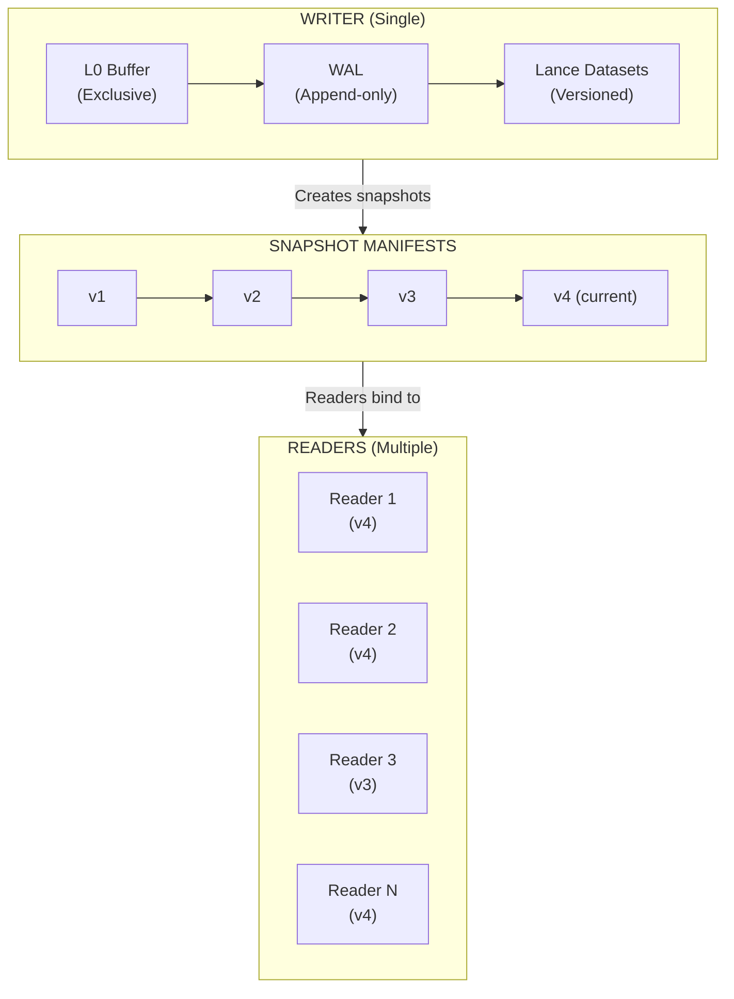
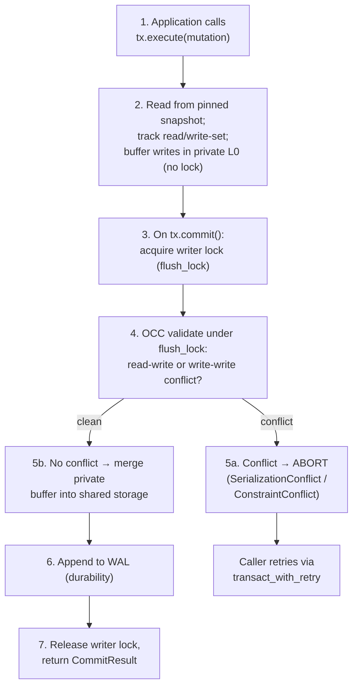
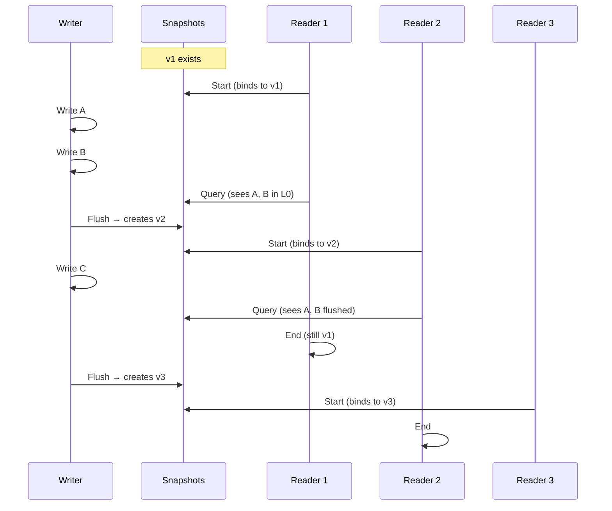
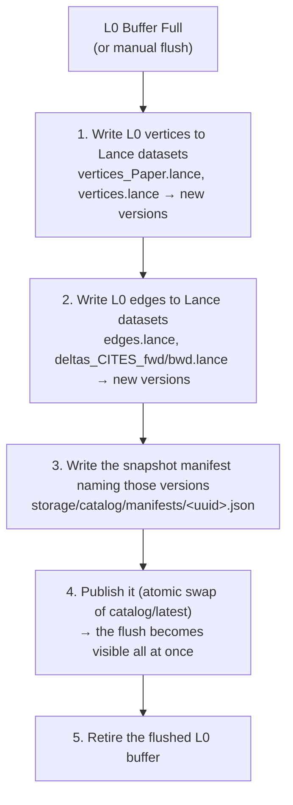
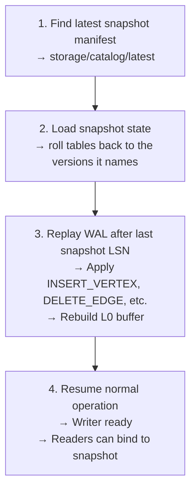

# Concurrency Model

Uni provides snapshot isolation with **Serializable Snapshot Isolation (SSI)** via optimistic concurrency control (OCC) as the default. Multiple sessions and transactions can coexist, each with its own plan cache and private write buffers. Read-write transactions read from a pinned snapshot — buffered and flushed vertices, edges and property values alike, so another transaction's commit or flush does not change what they see — and track an item-level read/write-set; the writer lock acquired at commit time is the *validation* point, where a transaction whose reads or writes conflict with a commit that landed since its snapshot is **aborted** and must be **retried**. SSI is controlled by `UniConfig.ssi_enabled` (default `true`); setting it to `false` reverts to the older last-writer-wins behavior.

## Design Philosophy

Traditional distributed databases require complex consensus protocols (Raft, Paxos) to maintain consistency across replicas. Uni takes a different approach:

| Traditional Distributed | Uni's Approach |
|------------------------|----------------|
| Multiple writers | Optimistic concurrency (commit-time validation) |
| Network consensus | Local coordination |
| Eventual consistency | Snapshot isolation (SSI) |
| Complex conflict resolution | Abort-and-retry on conflict |
| Operational complexity | Embedded simplicity |

This model is ideal for:
- Embedded databases in applications
- Multi-session workloads (each session has its own plan cache)
- Batch processing pipelines
- Single-node analytics workloads
- Development and testing environments

---

## Architecture



---

## Sessions and Transactions

### Multi-Session Architecture

Multiple sessions can coexist, each with its own plan cache. Sessions are created from the `Uni` instance and implement `Clone` (clones share the plan cache but get independent parameters and write guards):

```rust
let db = Uni::open("./my_db").build().await?;
let session = db.session();              // Each session has its own plan cache
let session2 = session.clone();          // Shares plan cache, independent params

// Sessions are read-only — mutations require a transaction
let tx = session.tx().await?;            // Start a transaction
tx.execute("CREATE (:User {name: 'Alice'})").await?;
tx.commit().await?;                      // Writer lock + OCC validation (may abort → retry)

// session.query("CREATE ...") would return an error
```

### Optimistic Concurrency & Commit-Time Validation

Multiple transactions can prepare writes concurrently in their private L0 buffers. When SSI is enabled (the default), a read-write transaction also pins an L0 snapshot at start and records the items it reads and writes. The writer lock acquired at commit is where Uni **validates** that read/write-set against any commits that landed since the snapshot:



The commit (including the `flush_lock` acquisition and validation) is bounded by `UniConfig.commit_timeout` (default 5s); exceeding it returns `UniError::CommitTimeout`. Pure CRDT-mergeable property writes are excluded from the write-set (the CRDT carve-out), so they never cause a spurious conflict.

### Why Optimistic Concurrency?

| Benefit | Explanation |
|---------|-------------|
| **Concurrent preparation** | Multiple transactions can prepare writes in parallel |
| **Conflicts are detected** | Write-write and read-write conflicts abort with `SerializationConflict` (duplicate unique `MERGE` → `ConstraintConflict`); no silent lost updates |
| **Automatic retry** | Wrap contended writes in `transact_with_retry` / `execute_with_retry`; `is_retriable()` identifies retriable conflicts |
| **Simple recovery** | WAL replay is deterministic |
| **No spurious CRDT conflicts** | CRDT-mergeable writes are carved out of the write-set |
| **Efficient batching** | Buffer many writes before flush |

### One Writable Handle per Store

Transactions within one database handle are validated as above. Across handles, a store has **one writable handle at a time**, and this is enforced: a local store is held by an OS lock, an object store by a lease (`UniConfig::writer_lease`). A second writable open fails with `StoreLocked`, and a writer that loses its lease stops with `WriterFenced`. Any number of read-only handles can open the store alongside it. `WriteLease::Custom` plugs in your own provider. See [Cloud Storage](../features/storage-cloud.md#concurrency).

### Handling Conflicts: Abort and Retry

With SSI enabled, a conflicting commit fails fast rather than silently overwriting. Callers should wrap contended read-modify-write logic in a retry helper, which re-runs the closure on a retriable conflict (`is_retriable()` classifies `SerializationConflict`, `ConstraintConflict`, and `CommitTimeout`):

```rust
// Retries the whole transaction body on a retriable conflict.
session.transact_with_retry(RetryOptions::default(), |tx| Box::pin(async move {
    let row = tx.query_with("MATCH (c:Counter {id:'x'}) RETURN c.n AS n").fetch_one().await?;
    let n: i64 = match row { Some(r) => r.get("n")?, None => 0 };
    tx.execute_with("MATCH (c:Counter {id:'x'}) SET c.n = $v")
        .param("v", n + 1)
        .run()
        .await?;
    Ok(())
})).await?;

// Single-statement convenience wrapper:
session.execute_with_retry("MERGE (u:User {email:'a@b.com'})").await?;
```

!!! warning "The default retry budget has a ceiling"

    `RetryOptions::default()` allows **5 attempts**. Under heavy key skew that
    is not enough, and the operations that run out do not retry forever — they
    return an error to the caller.

    Measured on 256 counters with Zipf-skewed read-modify-write (24 writers,
    abort rate = serialization conflicts / writing commit attempts):

    | skew (Zipf θ) | abort rate | ops that exhausted all 5 attempts |
    |---:|---:|---:|
    | 0.00 | 8.8% | 0 |
    | 0.90 | 40.2% | 1334 |
    | 1.20 | 59.4% | 3353 |

    Past roughly a 40% abort rate, plan for it: raise `max_attempts`, add
    application-level backoff, or take `FOR UPDATE` row locks on the hot keys so
    writers serialize instead of racing to validation.

    Note also that **uniform access is not conflict-free** — spreading writes
    over 256 keys still aborts 8.8% of commits at 24 writers. Spreading keys
    reduces contention; it does not remove it.

    Numbers from `crates/uni/benches/ssi_contention.rs`; full analysis in
    `docs/perf/contention-2026-08-25.md`.

### `FOR UPDATE` Row Locks

For read-modify-write hotspots, `FOR UPDATE` provides pessimistic per-key row locks held from `MATCH` until commit, serializing contending writers on those keys instead of letting them race to validation:

```cypher
MATCH (c:Counter {id: 'x'}) FOR UPDATE
SET c.n = c.n + 1
```

`FOR UPDATE` requires SSI; with `ssi_enabled = false` it is a no-op (a `tracing::warn!` is emitted when a query requests it).

### CRDT Carve-Out

Pure CRDT-mergeable property writes (e.g. counters, LWW registers/maps, OR-sets — see [CRDT Types](crdt-types.md)) are excluded from a transaction's write-set. Because their merge semantics are commutative, concurrent CRDT writes can be combined deterministically and therefore never trigger a spurious `SerializationConflict`.

### Disabling SSI

Setting `UniConfig.ssi_enabled = false` reverts to the legacy **last-writer-wins (LWW)** model: read-write transactions read the live L0 with no snapshot pinning, no read/write-set is tracked, and commits are not validated. This reproduces the pre-2.0 behavior and skips the (near-zero) validation overhead, but concurrent read-modify-write transactions can **silently lose updates** and concurrent `MERGE` can create duplicate unique keys. Use it only for single-writer workloads or when read-modify-write is guarded externally.

---

## Multiple Readers

### Snapshot Isolation

Readers operate on consistent snapshots of the database. Each snapshot represents a point-in-time view:

```rust
// crates/uni-common/src/core/snapshot.rs (abridged)
pub struct SnapshotManifest {
    pub snapshot_id: String,
    pub name: Option<String>,
    pub created_at: DateTime<Utc>,
    pub parent_snapshot: Option<String>,
    pub schema_version: u32,
    pub version_high_water_mark: u64,
    pub wal_high_water_mark: u64,
    pub vertices: HashMap<String, LabelSnapshot>,   // version and count per label
    pub edges: HashMap<String, EdgeSnapshot>,       // version and count per edge type
    pub next_vid: Option<u64>,
    pub next_eid: Option<u64>,
    pub tables: BTreeMap<String, u64>,              // the read cut: Lance version per table
    // ... writer_features, unpublished_bulk_versions
}
```

### Reader Independence



### Read-Your-Writes

The shared L0 buffer holds only committed data, so every read sees committed writes whether or not they have been flushed to Lance yet. A transaction additionally reads its own uncommitted writes from its private L0; no other transaction or session sees them before commit:

```cypher
// Inside one transaction: sees its own uncommitted CREATE
CREATE (n:Paper {title: "New Paper"})
WITH n
MATCH (p:Paper) WHERE p.title = "New Paper"  // Finds it immediately
RETURN p
```

**Pinned to a snapshot:**
```rust
// A session pinned to a named snapshot sees only the data committed at it
let id = db.create_snapshot("v2").await?;
let mut reader = db.session();
reader.pin_to_version(&id).await?;
reader.query("MATCH (p:Paper) RETURN count(p)").await?;  // Consistent count at v2
```

---

## Snapshot Management

### Snapshot Creation

Snapshots are created when L0 buffer is flushed to Lance:



### Snapshot Manifest Structure

```json
{
  "snapshot_id": "7f3c…",
  "parent_snapshot": "a91e…",
  "created_at": "2026-01-15T10:30:45.123Z",
  "schema_version": 12,
  "version_high_water_mark": 4211,
  "wal_high_water_mark": 98,
  "vertices": {
    "Paper": { "version": 7, "count": 1000000, "lance_version": 0 },
    "Author": { "version": 3, "count": 250000, "lance_version": 0 }
  },
  "edges": {
    "CITES": { "version": 3, "count": 5000000, "lance_version": 0 }
  },
  "next_vid": 1310720,
  "next_eid": 5242880,
  "tables": {
    "vertices": 41,
    "vertices_Paper": 38,
    "vertices_Author": 22,
    "edges": 29,
    "deltas_CITES_fwd": 17,
    "deltas_CITES_bwd": 17
  }
}
```

### Snapshot Lifecycle

| State | Description |
|-------|-------------|
| **Active** | Current snapshot, new readers bind to this |
| **Referenced** | Old snapshot still in use by active readers |
| **Unreferenced** | No readers, candidate for garbage collection |
| **Deleted** | Removed, storage reclaimed |

---

## Consistency Guarantees

### ACID Properties

| Property | Guarantee |
|----------|-----------|
| **Atomicity** | Flush is all-or-nothing (manifest written last) |
| **Consistency** | Schema validated on write, constraints enforced |
| **Isolation** | Snapshot isolation for readers; Serializable Snapshot Isolation (OCC) for read-write transactions by default |
| **Durability** | WAL ensures writes survive crashes |

### Isolation Level Comparison

| Level | Uni Equivalent | Anomalies Prevented |
|-------|----------------|---------------------|
| Read Uncommitted | N/A (only a transaction's own uncommitted writes are visible to it) | None |
| Read Committed | N/A | Dirty reads |
| Repeatable Read | Snapshot isolation (`ssi_enabled = false`, LWW) | Dirty reads, non-repeatable reads |
| Serializable | SSI / OCC (default, `ssi_enabled = true`) | All anomalies (write skew and lost updates prevented by commit-time conflict detection) |

Serializability comes from the SSI/OCC conflict detection described above — read/write-sets validated under the writer lock at commit, not from forcing writes through a single writer. With `ssi_enabled = false`, snapshot pinning and validation are disabled, so the engine offers snapshot-isolation-style reads but is subject to lost updates (LWW).

---

## Write-Ahead Log (WAL)

With WAL enabled, a transaction persists its commit's mutations before publishing
its private L0 buffer. Uncommitted transaction-local writes are not durable.
Segments live at `wal/{LSN:020}_{uuid}.wal` (forks use `wal_forks/{fork_id}/`).

The format in `crates/uni-store/src/runtime/wal.rs` is:

```text
UNIWAL2\n<64 hexadecimal BLAKE3 checksum characters>\n<WalSegment JSON payload>
```

`WalSegment` carries `lsn`, `mutations`, `writer_features`,
`announced_through`, and `commits` (commit spans). Mutation variants are
`InsertVertex`, `DeleteVertex`, `InsertEdge`, `DeleteEdge`, and
`SetVertexLabels`. Older raw JSON segments remain readable. Recovery verifies
the checksum and replays segments above the snapshot's WAL high-water mark.

### Recovery Process



---

## Concurrency Primitives

### Thread-Safe Components

| Component | Primitive | Pattern |
|-----------|-----------|---------|
| L0 Buffer | `RwLock<Arc<RwLock<L0Buffer>>>` (`L0Manager`) | Outer lock swaps the buffer at flush; inner lock guards its content |
| Adjacency Cache | `DashMap<K, V>` | Concurrent read, partitioned write |
| Property Cache | `Mutex<LruCache>` | Exclusive access with LRU eviction |
| ID Allocator | `tokio::sync::Mutex` plus `AtomicU64` mirrors | Batched reservation under the lock; reserved ends readable lock-free |
| Snapshot Manager | `Arc<SnapshotManager>` | Shared; manifests are immutable once written |

### Example: Concurrent Reads

```rust
// Multiple readers can execute concurrently
let id = db.create_snapshot("report").await?;
let (mut r1, mut r2) = (db.session(), db.session());
r1.pin_to_version(&id).await?;
r2.pin_to_version(&id).await?;

// Reader 1 (task A)
let a = tokio::spawn(async move { r1.query(query1).await });

// Reader 2 (task B)
let b = tokio::spawn(async move { r2.query(query2).await });

// Both run concurrently, both see the same consistent snapshot
```

---

## Scaling Considerations

### Single-Writer Throughput

| Operation | Latency | Throughput |
|-----------|---------|------------|
| L0 insert | ~550µs / 1K vertices | ~1.8M vertices/sec |
| WAL append | ~10µs per record | ~100K records/sec |
| Flush | ~6.3ms / 1K vertices | Batched |

### Scaling Strategies

1. **Batch Writes**: Group many operations before commit
2. **Async Flush**: Flush in background while accepting new writes
3. **Multiple Databases**: Shard data across independent Uni instances
4. **Read Replicas**: Sync snapshots to read-only replicas

### Long-Lived Transactions Hold Back Compaction

While a transaction is open, compaction does not fold edge changes committed
after it began: folded edges carry no version, so the transaction would see
them. A transaction left open for a long time keeps those changes in the
delta tables until it ends, so keep transactions short. A bulk load does not need its host transaction to stay
open, because `BulkWriter::commit` commits the load on its own, so end the host
transaction once the writer is built.

---

## Best Practices

### Write Optimization

```rust
// Good: Batch many writes into one transaction
let tx = session.tx().await?;
let props: Vec<HashMap<String, Value>> = items.iter().map(to_props).collect();
tx.bulk_insert_vertices("Item", props).await?;
tx.commit().await?;

// Bad: One transaction per write
for item in items {
    let tx = session.tx().await?;
    tx.execute_with("CREATE (:Item {name: $name})")
        .param("name", item.name.clone())
        .run()
        .await?;
    tx.commit().await?;  // Commit (and WAL append) per call
}
```

### Reader Management

```rust
// Good: Pin one snapshot, reuse it
let id = db.create_snapshot("batch").await?;
let mut reader = db.session();
reader.pin_to_version(&id).await?;
for query in queries {
    reader.query(query).await?;  // Same snapshot
}

// Bad: Live session (each query sees the latest commits, which may change in between)
let live = db.session();
for query in queries {
    live.query(query).await?;
}
```

---

## Next Steps

- [Architecture](architecture.md) — System overview
- [Storage Engine](../internals/storage-engine.md) — Lance integration and LSM design
- [Performance Tuning](../guides/performance-tuning.md) — Optimization strategies
