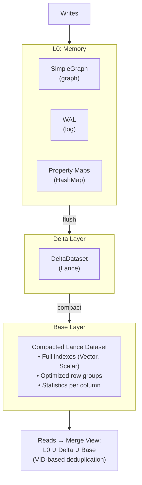
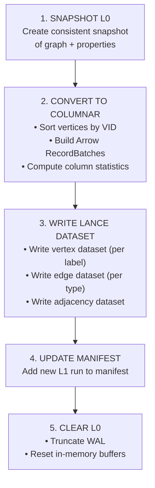
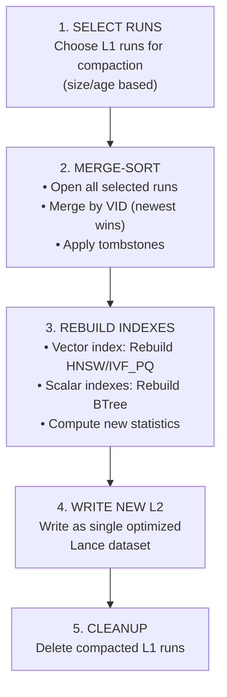
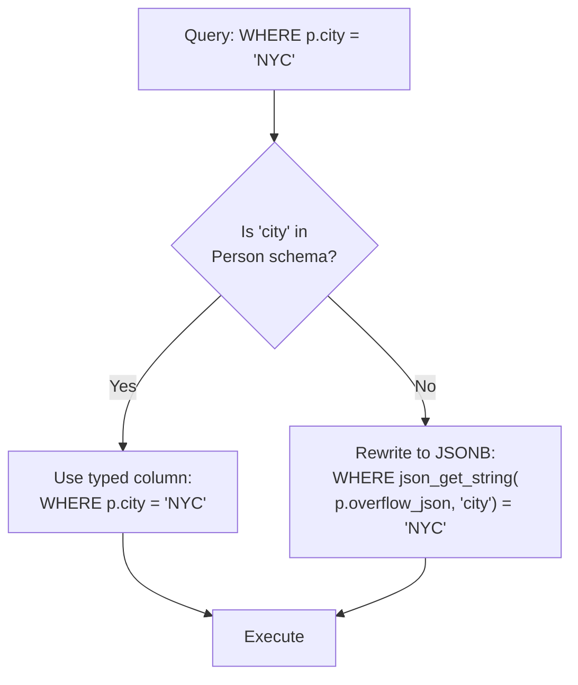

# Storage Engine Internals

Uni's storage engine is architected for high-throughput ingestion and low-latency analytics, leveraging a tiered LSM-tree-like structure backed by **Lance** columnar format. This design enables both OLTP-style writes and OLAP-style analytical queries on the same data.

## Architecture Overview



---

## Tiered Storage Model

### L0: Memory Buffer

The L0 layer handles all incoming writes with maximum throughput.

```rust
pub struct L0Buffer {
    /// In-memory graph structure (SimpleGraph)
    pub graph: SimpleGraph,

    /// Edge tombstones with version tracking
    pub tombstones: HashMap<Eid, TombstoneEntry>,

    /// Vertex tombstones
    pub vertex_tombstones: HashSet<Vid>,

    /// Edge version tracking
    pub edge_versions: HashMap<Eid, u64>,

    /// Vertex version tracking
    pub vertex_versions: HashMap<Vid, u64>,

    /// Edge properties (separate from graph structure)
    pub edge_properties: HashMap<Eid, Properties>,

    /// Vertex properties (separate from graph structure)
    pub vertex_properties: HashMap<Vid, Properties>,

    /// Edge endpoint mapping (eid -> (src, dst, edge_type))
    pub edge_endpoints: HashMap<Eid, (Vid, Vid, u32)>,

    /// Vertex labels (VID -> list of label names)
    pub vertex_labels: HashMap<Vid, Vec<String>>,

    /// Edge type names (EID -> edge type name)
    pub edge_types: HashMap<Eid, String>,

    /// Current version number
    pub current_version: u64,

    /// Mutation counter for flush triggering
    pub mutation_count: usize,

    /// Mutation statistics (vertices/edges created/deleted)
    pub mutation_stats: MutationStats,

    /// Estimated memory usage in bytes
    pub estimated_size: usize,

    /// Constraint index for uniqueness enforcement
    pub constraint_index: HashMap<Vec<u8>, Vid>,

    /// Creation timestamps per vertex
    pub vertex_created_at: HashMap<Vid, i64>,
    /// Update timestamps per vertex
    pub vertex_updated_at: HashMap<Vid, i64>,
    /// Creation timestamps per edge
    pub edge_created_at: HashMap<Eid, i64>,
    /// Update timestamps per edge
    pub edge_updated_at: HashMap<Eid, i64>,

    /// Write-ahead log reference
    pub wal: Option<Arc<WriteAheadLog>>,

    /// WAL LSN at last flush
    pub wal_lsn_at_flush: u64,
}
```

**Characteristics:**

| Property | Value | Notes |
|----------|-------|-------|
| Format | SimpleGraph + HashMap | Row-oriented for inserts |
| Durability | WAL-backed | Survives crashes |
| Latency | ~550µs per 1K writes | Memory-speed |
| Capacity | Bounded by `auto_flush_threshold` (default 10,000 mutations) | Auto-flush when reached |

**Write Path:**

Each `Transaction` owns a private L0 buffer. Writes accumulate in the transaction's buffer without holding any global lock. At commit time, the transaction acquires a serialization lock, validates against the current database version, and merges its buffer into the shared state.

```
1. Write into transaction-private L0 buffer (lock-free)
2. On commit: acquire serialization lock (commit-time, not write-time)
3. Append to WAL (sync or async based on config)
4. Merge into shared SimpleGraph (vertex/edge)
5. Merge properties into shared HashMap
6. Increment mutation counter, release lock
7. If threshold reached → trigger async flush
```

### Auto-Flush Triggers

L0 buffer is automatically flushed to L1 (Lance storage) based on two configurable triggers:

| Trigger | Default | Description |
|---------|---------|-------------|
| **Mutation Count** | 10,000 | Flush when mutations exceed threshold |
| **Time Interval** | 5 seconds | Flush after time elapsed (if mutations > 0) |

**Configuration:**

```rust
let config = UniConfig {
    // Flush on mutation count (high-transaction systems)
    auto_flush_threshold: 10_000,

    // Flush on time interval (low-transaction systems)
    auto_flush_interval: Some(Duration::from_secs(5)),

    // Minimum mutations before time-based flush triggers
    auto_flush_min_mutations: 1,
    ..Default::default()
};
```

**Flush Decision Logic:**

```
┌─────────────────────────────────────────────────────────────────────────────┐
│                         AUTO-FLUSH DECISION                                  │
├─────────────────────────────────────────────────────────────────────────────┤
│                                                                             │
│   After each write:                                                         │
│                                                                             │
│   mutations >= 10,000?  ─────Yes────►  FLUSH IMMEDIATELY                   │
│           │                                                                 │
│           No                                                                │
│           │                                                                 │
│           ▼                                                                 │
│   Background timer (every 5s):                                              │
│                                                                             │
│   time_since_last_flush >= 5s                                               │
│   AND mutations >= min_mutations?  ─────Yes────►  FLUSH                    │
│           │                                                                 │
│           No                                                                │
│           │                                                                 │
│           ▼                                                                 │
│   Continue buffering                                                        │
│                                                                             │
└─────────────────────────────────────────────────────────────────────────────┘
```

**Interval Tradeoffs:**

| Interval | Min Mutations | Data at Risk | I/O Overhead | Use Case |
|----------|---------------|--------------|--------------|----------|
| 1s | 1 | ~1s | High | Critical data, local storage |
| **5s** | **1** | **~5s** | **Moderate** | **Default** |
| 30s | 100 | ~30s | Low | Cost-sensitive cloud workloads |
| None | - | All unflushed | None | Legacy behavior, WAL-only |

!!! note "WAL Still Provides Crash Recovery"
    Regardless of flush interval, the Write-Ahead Log ensures no committed data is lost on crash. Time-based flush determines when committed data reaches Lance L1/cloud storage. Committed L0 writes are already query-visible, and WAL durability is separate.

### Delta Layer

When L0 fills up, it flushes to the Delta layer as Lance datasets.

```rust
pub struct DeltaDataset {
    /// Edge type this delta is for
    edge_type: String,

    /// Direction: "fwd" or "bwd"
    direction: String,

    /// Lance branch for branched (fork) reads; `None` = primary
    branch: Option<String>,
}

pub struct L0Manager {
    /// Active L0 buffer (outer lock swaps it on rotation)
    current: RwLock<Arc<RwLock<L0Buffer>>>,

    /// Rotated buffers still being flushed; visible to reads until done
    pending_flush: RwLock<Vec<Arc<RwLock<L0Buffer>>>>,

    // ... snapshot pin token, plugin registry, bulk version reservations
}
```

**Flush Process:**



### L2: Base Layer

The L2 layer contains fully compacted, indexed data.

!!! warning "Illustrative, not the real API"
    The struct shown below is a **sketch**, not a type in the codebase.
    `L2Layer`, `L0ManagerConfig`, `LanceFragment`, `FragmentStatistics`,
    `ColumnStats`, `VectorIndexStorage` and `ScalarIndexStorage` do not exist
    anywhere in the workspace. Read it as a shape description; consult
    `crates/uni-store/src/` for the actual types.

```rust
pub struct L2Layer {
    /// Main vertex dataset (per label)
    vertex_datasets: HashMap<LabelId, Dataset>,

    /// Main edge dataset (per type)
    edge_datasets: HashMap<EdgeTypeId, Dataset>,

    /// Adjacency datasets (per edge type + direction)
    adjacency_datasets: HashMap<(EdgeTypeId, Direction), Dataset>,

    /// Vector indexes
    vector_indexes: HashMap<IndexId, VectorIndex>,

    /// Scalar indexes
    scalar_indexes: HashMap<IndexId, ScalarIndex>,
}
```

**Compaction Process:**



### Compaction Tiers

Uni uses a three-tier compaction strategy, each operating at a different level of the storage stack:

#### Tier 1: CSR Overlay Compaction

Automatic in-memory merge of frozen L0 CSR segment overlays into the main CSR after flush. The flush checks the count and, when `frozen_segments >= frozen_segments_compact_threshold` (default 2), spawns the merge as a background task; a flush skips it while the previous one is still running.

#### Tier 2: Semantic Compaction

Background process that consolidates L1 delta runs into L2. Operations include:

- Vertex deduplication (newest VID wins)
- CRDT merge for conflict-free property resolution
- L1 → L2 delta consolidation
- Tombstone cleanup (remove soft-deleted records)

Triggered by any of the three compaction thresholds (ByRunCount, BySize, ByAge). Executed via `Compactor::compact_all()`.

#### Tier 3: Lance Storage Optimize

Background process that runs immediately after Tier 2 in the same compaction cycle. Operations include:

- Fragment consolidation (merge small fragments)
- Index rebuild on optimized data
- Space reclamation

Optimizes all table types: delta datasets, vertex datasets, adjacency datasets, and main tables.

---

## Lance Integration

Uni uses [Lance](https://lancedb.github.io/lance/) as its core columnar format.

### Why Lance?

| Feature | Benefit |
|---------|---------|
| **Native Vector Support** | Built-in HNSW, IVF_PQ indexes |
| **Versioning** | Time-travel, ACID transactions |
| **Fast Random Access** | O(1) row lookup by index |
| **Columnar Scans** | Efficient analytical queries |
| **Object Store Native** | S3/GCS support built-in |
| **Zero-Copy** | Arrow-compatible memory layout |

### Lance File Format

```
Lance Dataset Structure:

data/
├── _versions/                    # Version metadata
│   ├── 1.manifest               # Version 1 manifest
│   ├── 2.manifest               # Version 2 manifest
│   └── ...
├── _indices/                     # Index data
│   ├── vector_idx_001/          # Vector index
│   │   ├── index.idx
│   │   └── ...
│   └── scalar_idx_002/          # Scalar index
└── data/                         # Column data
    ├── part-0.lance              # Data fragment
    ├── part-1.lance
    └── ...
```

### Data Fragment Structure

!!! warning "Illustrative, not the real API"
    The struct shown below is a **sketch**, not a type in the codebase.
    `L2Layer`, `L0ManagerConfig`, `LanceFragment`, `FragmentStatistics`,
    `ColumnStats`, `VectorIndexStorage` and `ScalarIndexStorage` do not exist
    anywhere in the workspace. Read it as a shape description; consult
    `crates/uni-store/src/` for the actual types.

```rust
pub struct LanceFragment {
    /// Fragment ID
    id: u64,

    /// Row range in this fragment
    row_range: Range<u64>,

    /// Physical files for each column
    columns: HashMap<String, ColumnFiles>,

    /// Fragment-level statistics
    stats: FragmentStatistics,
}

pub struct FragmentStatistics {
    /// Row count
    num_rows: u64,

    /// Per-column statistics
    column_stats: HashMap<String, ColumnStats>,
}

pub struct ColumnStats {
    null_count: u64,
    min_value: Option<ScalarValue>,
    max_value: Option<ScalarValue>,
    distinct_count: Option<u64>,
}
```

---

## Dataset Organization

### Vertex Datasets

One Lance dataset per vertex label, plus one main `vertices` table that holds every vertex (all labels, and schemaless ones) with its properties as JSONB in `props_json`:

```
storage/
├── vertices.lance/               # Main vertex table (all labels)
├── vertices_Paper.lance/         # :Paper vertices
│   ├── _versions/
│   ├── _indices/
│   │   └── <uuid>/               # One directory per Lance index (vector, scalar, FTS)
│   ├── _transactions/
│   └── data/
├── vertices_Author.lance/        # :Author vertices
└── vertices_Venue.lance/         # :Venue vertices
```

Table names come from `crates/uni-store/src/backend/table_names.rs` (`vertex_table_name`, `main_vertex_table_name`).

**Vertex Schema:**

```
┌─────────────────────────────────────────────────────────────────────────────┐
│                           VERTEX DATASET SCHEMA                              │
├─────────────────────────────────────────────────────────────────────────────┤
│                                                                             │
│   System Columns:                                                           │
│   ┌───────────────┬──────────────┬────────────────────────────────────────┐│
│   │ Column        │ Type         │ Description                            ││
│   ├───────────────┼──────────────┼────────────────────────────────────────┤│
│   │ _vid          │ UInt64       │ Internal vertex ID                     ││
│   │ _uid          │ FixedSize(32)│ UniId (32-byte SHA3-256) - optional   ││
│   │ _deleted      │ Bool         │ Tombstone marker (soft delete)        ││
│   │ _version      │ UInt64       │ Last modified version                 ││
│   │ ext_id        │ String       │ External ID (extracted from props)    ││
│   │ _labels       │ List<String> │ Complete label set (multi-label)      ││
│   │ _created_at   │ Timestamp(ns)│ Creation timestamp                    ││
│   │ _updated_at   │ Timestamp(ns)│ Last update timestamp                 ││
│   └───────────────┴──────────────┴────────────────────────────────────────┘│
│                                                                             │
│   User Properties (schema-defined, sorted by name):                         │
│   ┌──────────┬──────────┬────────────────────────────────────────────────┐ │
│   │ abstract │ String   │ Paper abstract (nullable)                      │ │
│   │ embedding│ Vector   │ 768-dimensional embedding                      │ │
│   │ title    │ String   │ Paper title                                    │ │
│   │ year     │ Int64    │ Publication year                               │ │
│   └──────────┴──────────┴────────────────────────────────────────────────┘ │
│                                                                             │
│   Schemaless Properties:                                                    │
│   ┌────────────────┬──────────────┬──────────────────────────────────────┐ │
│   │ overflow_json  │ LargeBinary  │ JSONB binary for non-schema props   │ │
│   │                │ (JSONB)      │ - Automatically queryable           │ │
│   │                │              │ - Query rewriting to JSON functions │ │
│   │                │              │ - PostgreSQL-compatible format      │ │
│   └────────────────┴──────────────┴──────────────────────────────────────┘ │
│                                                                             │
└─────────────────────────────────────────────────────────────────────────────┘
```

### Edge Datasets

Edges are stored in one main `edges` table (every edge, its properties as JSONB in `props_json`) and, per edge type, two delta tables, one per direction:

```
storage/
├── edges.lance/                  # Main edge table (all types)
├── deltas_CITES_fwd.lance/       # :CITES delta log, keyed by source
├── deltas_CITES_bwd.lance/       # :CITES delta log, keyed by destination
├── deltas_AUTHORED_BY_fwd.lance/
├── deltas_AUTHORED_BY_bwd.lance/
└── ...
```

**Edge Schemas:**

```
┌─────────────────────────────────────────────────────────────────────────────┐
│                            EDGE DATASET SCHEMAS                              │
├─────────────────────────────────────────────────────────────────────────────┤
│                                                                             │
│   Main `edges` table (storage/main_edge.rs):                                │
│   ┌───────────────┬──────────────┬────────────────────────────────────────┐│
│   │ Column        │ Type         │ Description                            ││
│   ├───────────────┼──────────────┼────────────────────────────────────────┤│
│   │ _eid          │ UInt64       │ Internal edge ID                       ││
│   │ src_vid       │ UInt64       │ Source vertex VID                      ││
│   │ dst_vid       │ UInt64       │ Destination vertex VID                 ││
│   │ type          │ Utf8         │ Edge type name                         ││
│   │ props_json    │ LargeBinary  │ All properties (JSONB)                 ││
│   │ _deleted      │ Bool         │ Tombstone marker                       ││
│   │ _version      │ UInt64       │ Last modified version                  ││
│   │ _created_at   │ Timestamp(ns)│ Creation timestamp                     ││
│   │ _updated_at   │ Timestamp(ns)│ Last update timestamp                  ││
│   └───────────────┴──────────────┴────────────────────────────────────────┘│
│                                                                             │
│   Delta table `deltas_{type}_{fwd|bwd}` (storage/delta.rs):                 │
│   ┌───────────────┬──────────────┬────────────────────────────────────────┐│
│   │ src_vid       │ UInt64       │ Source vertex VID                      ││
│   │ dst_vid       │ UInt64       │ Destination vertex VID                 ││
│   │ eid           │ UInt64       │ Edge ID                                ││
│   │ op            │ UInt8        │ 0 = insert, 1 = delete                 ││
│   │ _version      │ UInt64       │ Version of the operation               ││
│   │ _created_at   │ Timestamp(ns)│ Creation timestamp                     ││
│   │ _updated_at   │ Timestamp(ns)│ Last update timestamp                  ││
│   │ <properties>  │ (declared)   │ Schema-defined edge properties, sorted ││
│   │ overflow_json │ LargeBinary  │ JSONB for non-schema properties        ││
│   └───────────────┴──────────────┴────────────────────────────────────────┘│
│                                                                             │
└─────────────────────────────────────────────────────────────────────────────┘
```

### Adjacency Datasets

Optimized for graph traversal (CSR-style), one table per edge type and direction, written by compaction:

```
storage/
├── adjacency_CITES_fwd.lance/    # Outgoing CITES edges
├── adjacency_CITES_bwd.lance/    # Incoming CITES edges (reverse)
└── ...
```

**Adjacency Schema:**

```
┌─────────────────────────────────────────────────────────────────────────────┐
│                         ADJACENCY DATASET SCHEMA                             │
├─────────────────────────────────────────────────────────────────────────────┤
│                                                                             │
│   Adjacency table (one row per source vertex):                              │
│   ┌─────────────┬──────────────┬────────────────────────────────────────┐  │
│   │ src_vid     │ UInt64       │ Source vertex                          │  │
│   │ neighbors   │ List<UInt64> │ Destination VIDs                       │  │
│   │ edge_ids    │ List<UInt64> │ Matching edge IDs                      │  │
│   └─────────────┴──────────────┴────────────────────────────────────────┘  │
│                                                                            │
│   Three columns, one row per vertex — see `storage/adjacency.rs`           │
│   (`get_arrow_schema`). There is no chunk_id/offsets encoding.             │
└─────────────────────────────────────────────────────────────────────────────┘
```

---

## Write-Ahead Log (WAL)

With WAL enabled, committed mutations are persisted before their L0 changes
are published. Uncommitted transaction-local buffers are not durable.
`db.flush()` subsequently moves committed L0 data into Lance L1.

### WAL Format and Recovery

The implementation is `crates/uni-store/src/runtime/wal.rs`.
Segments are named `{LSN:020}_{uuid}.wal` and contain:

```text
UNIWAL2\n<64 hexadecimal BLAKE3 checksum characters>\n<WalSegment JSON payload>
```

The payload contains `lsn`, `mutations`, `writer_features`,
`announced_through`, and `commits` (commit spans). Legacy raw JSON segments
are still readable. `decode_segment` rejects corrupted v2 checksums.
`replay_since(high_water_mark)` reads later segments; the writer's recovery
path restores mutations and commit announcements.

Mutation variants are `InsertVertex`, `DeleteVertex`, `InsertEdge`,
`DeleteEdge`, and `SetVertexLabels`. Insert records preserve properties and
creation/update timestamps. Vertices carry complete labels; edge records
carry the edge-type name for replay across schemaless registry changes.
Labels are resolved explicitly, never decoded from VID bits. Property values
use the `cv_props` codec to preserve engine types through JSON serialization.


---

## Snapshot Management

Snapshots provide consistent point-in-time views.

### Manifest Structure

A manifest (`catalog/manifests/{id}.json` under the table root; `catalog/latest` holds the id of the latest) is a `SnapshotManifest`:

```json
{
  "snapshot_id": "7f3c…",
  "parent_snapshot": "a91e…",
  "created_at": "2026-11-21T10:30:00Z",
  "schema_version": 12,
  "version_high_water_mark": 4211,
  "wal_high_water_mark": 98,
  "vertices": { "Paper": { "version": 7, "count": 1000000, "lance_version": 0 } },
  "edges": { "CITES": { "version": 3, "count": 5000000, "lance_version": 0 } },
  "next_vid": 1048576,
  "next_eid": 5242880,
  "tables": {
    "vertices": 41,
    "vertices_Paper": 38,
    "edges": 29,
    "deltas_CITES_fwd": 17,
    "deltas_CITES_bwd": 17,
    "indexes/uni_id_to_vid/Paper/index.lance": 12
  }
}
```

`tables` is the **read cut**: the Lance version of every table and index dataset that readers of this manifest read. (`lance_version` in `vertices` / `edges` is always 0 and kept for compatibility.)

### The manifest is the commit point

- **Reads** open each table at the version the latest manifest names, not at its newest. A table the manifest does not name holds nothing a reader can see.
- **A flush** commits its tables, then publishes a manifest naming them, so it becomes visible all at once. Its table commits are unread until then.
- **Compaction, index builds and schema widening** commit outside a flush. The handle that made them reads them at once; a successor of the latest manifest publishes them for everyone when each finishes, before each catalog save, and at `shutdown()`. A flush manifest names the published cut, the flush's own commits, and loose commits on tables no other running flush has written. Version cleanup never removes the version the latest manifest names.
- **A writable open** rolls every table back to the versions the manifest it resumes from names (Lance `restore()`), and empties a table the manifest does not name, before the WAL replays. What it discards was never published: a crashed flush's commits, which the WAL writes again, or a stale writer's.
- **A foreign commit** (a table version this handle did not write, met while it has no other commit on that table running) trips the writer's fence: it stops writing (`WriterFenced`), and the next writable open discards the version.
- **Read-only handles** re-read `catalog/latest` at the start of a query, at most once per `UniConfig::read_cut_refresh`.
- **Rewrites read the newest versions.** A path that reads a table to rewrite it (semantic compaction, index builds, schema evolution, restore, bulk load) reads each table's newest version, so it keeps rows a running flush has committed but not yet published.
- **Older stores.** A manifest written before 6.0 names no tables; reads see every table's newest version until the first flush records them. Fork branches are read at their newest versions.

### Snapshot Operations

A flush manifest records the read cut but no restore point. `Uni::create_snapshot` (and `uni.admin.snapshot.create`) flushes and also records a restore point, which tags every table's version so a restore can return to it. `VERSION AS OF` reads a snapshot with a restore point at its tagged versions, and a flush manifest through its version ceiling over the live tables.

---

## Index Storage

### Vector Index Storage

Vector indexes (HNSW, IVF_PQ) are stored within Lance datasets:

!!! warning "Illustrative, not the real API"
    The struct shown below is a **sketch**, not a type in the codebase.
    `L2Layer`, `L0ManagerConfig`, `LanceFragment`, `FragmentStatistics`,
    `ColumnStats`, `VectorIndexStorage` and `ScalarIndexStorage` do not exist
    anywhere in the workspace. Read it as a shape description; consult
    `crates/uni-store/src/` for the actual types.

```rust
pub struct VectorIndexStorage {
    /// Lance dataset with index
    dataset: Dataset,

    /// Index configuration
    config: VectorIndexConfig,
}

impl VectorIndexStorage {
    pub async fn create_index(
        dataset: &mut Dataset,
        column: &str,
        config: VectorIndexConfig,
    ) -> Result<()> {
        match config.index_type {
            IndexType::Hnsw => {
                dataset.create_index()
                    .column(column)
                    .index_type("IVF_HNSW_SQ")
                    .metric_type(config.metric.to_lance())
                    .build()
                    .await?;
            }
            IndexType::IvfPq => {
                dataset.create_index()
                    .column(column)
                    .index_type("IVF_PQ")
                    .metric_type(config.metric.to_lance())
                    .num_partitions(config.num_partitions)
                    .num_sub_vectors(config.num_sub_vectors)
                    .build()
                    .await?;
            }
        }

        Ok(())
    }
}
```

### Scalar Index Storage

Scalar indexes use Lance's built-in index support:

!!! warning "Illustrative, not the real API"
    The struct shown below is a **sketch**, not a type in the codebase.
    `L2Layer`, `L0ManagerConfig`, `LanceFragment`, `FragmentStatistics`,
    `ColumnStats`, `VectorIndexStorage` and `ScalarIndexStorage` do not exist
    anywhere in the workspace. Read it as a shape description; consult
    `crates/uni-store/src/` for the actual types.

```rust
pub struct ScalarIndexStorage {
    /// Index metadata
    metadata: ScalarIndexMetadata,
}

impl ScalarIndexStorage {
    pub async fn create_index(
        dataset: &mut Dataset,
        column: &str,
        index_type: ScalarIndexType,
    ) -> Result<()> {
        dataset.create_index()
            .column(column)
            .index_type(match index_type {
                ScalarIndexType::BTree => "BTREE",
                ScalarIndexType::Hash => "HASH",
                ScalarIndexType::Bitmap => "BITMAP",
            })
            .build()
            .await?;

        Ok(())
    }
}
```

---

## Schemaless Properties and Query Rewriting

### Overview

Uni supports **schemaless properties** - properties not defined in the schema that can be stored and queried dynamically. This enables flexible data modeling without requiring schema migrations.

### Storage Mechanism

Properties are stored differently based on whether they're in the schema:

| Property Type | Storage Location | Format | Performance |
|---------------|-----------------|---------|-------------|
| **Schema-defined** | Typed Arrow columns | Native type (Int32, String, etc.) | ⚡ Fast (columnar) |
| **Non-schema** | `overflow_json` column | JSONB binary | 🟡 Good (parsed) |

### JSONB Binary Format

The `overflow_json` column uses JSONB binary format (PostgreSQL-compatible):

```rust
// Schema definition
overflow_json: LargeBinary  // Not Utf8!

// Encoding (on write)
let overflow_props = build_overflow_json_column(vertices, schema)?;
// Returns JSONB binary, not JSON string

// Decoding (on read)
let raw_jsonb = jsonb::RawJsonb::new(bytes);
let json_string = raw_jsonb.to_string();
let props: HashMap<String, Value> = serde_json::from_str(&json_string)?;
```

**Benefits:**
- 🚀 Faster than JSON strings (binary representation)
- 🔗 PostgreSQL-compatible (same JSONB format)
- ⚙️ Enables Lance's optimized built-in JSON UDFs

### Automatic Query Rewriting

When queries access overflow properties, the planner automatically rewrites them to use Lance's JSON functions:

**Original Cypher:**
```cypher
MATCH (p:Person) WHERE p.city = 'NYC' RETURN p.name, p.age
```

**If `city` and `age` are not in schema, rewritten to:**
```sql
WHERE json_get_string(p.overflow_json, 'city') = 'NYC'
RETURN p.name, json_get_string(p.overflow_json, 'age')
```

**Supported JSON Functions:**
!!! warning "`json_get_*` are not real functions"
    No `json_get_string` / `json_get_int` / `json_get_float` / `json_get_bool`
    function is registered anywhere. Overflow-property extraction is performed
    **inline by the scan operator** (`df_graph/scan.rs`) when it sees a property
    that is not a typed column — there is no user-callable JSON accessor to
    write in a query. Write `p.city` and the scan resolves it.

### Rewriting Algorithm



### Mixed Schema + Overflow Queries

Queries seamlessly mix both types:

```cypher
// Schema: Person has 'name' property
// Overflow: 'city' and 'verified' not in schema

MATCH (p:Person)
WHERE p.name = 'Alice'        // Typed column (fast)
  AND p.city = 'NYC'          // overflow_json (rewritten)
  AND p.verified = true       // overflow_json (rewritten)
RETURN p.name, p.city, p.age  // Mixed access
```

**Planner automatically:**
1. Identifies schema vs overflow properties
2. Uses typed columns for schema properties
3. Rewrites overflow property access to JSON functions
4. Ensures `overflow_json` column is materialized in scan

### Performance Characteristics

| Metric | Schema Properties | Overflow Properties |
|--------|------------------|---------------------|
| **Filtering** | ⚡ Fast (columnar predicate pushdown) | 🟡 Good (JSONB parsing) |
| **Sorting** | ⚡ Fast (native type sorting) | 🟡 Slower (extract then sort) |
| **Compression** | ⚡ Type-specific (5-20x) | 🔴 Limited (binary blob) |
| **Indexing** | ✅ Supported (BTree, Vector, etc.) | ❌ Not indexed |
| **Schema Evolution** | ⚠️ Requires migration | ✅ No migration needed |

### Usage Guidelines

**Use Schema Properties for:**
- ✅ Frequently queried fields (filters, sorts, aggregations)
- ✅ Core data model properties
- ✅ Properties requiring indexes
- ✅ Performance-critical fields

**Use Overflow Properties for:**
- ✅ Optional/rare properties
- ✅ User-defined metadata
- ✅ Rapidly evolving schemas
- ✅ Prototyping and experimentation

### Example: Schemaless Label

```rust
// Create label without property definitions
db.schema().label("Document").apply().await?;

let session = db.session();

// Create with arbitrary properties
let tx = session.tx().await?;
tx.execute("CREATE (:Document {
    title: 'Article',
    author: 'Alice',
    tags: ['tech', 'ai'],
    year: 2024
})").await?;
tx.commit().await?;

// All properties stored in overflow_json
db.flush().await?;

// Query works transparently (automatic rewriting)
let results = session.query("
    MATCH (d:Document)
    WHERE d.author = 'Alice' AND d.year > 2020
    RETURN d.title, d.tags
").await?;
```

### Example: Mixed Schema + Overflow

```rust
// Define core properties in schema
db.schema()
    .label("Person")
    .property("name", DataType::String)  // Schema property
    .property("age", DataType::Int)      // Schema property
    .apply().await?;

let session = db.session();

// Create with schema + overflow properties
let tx = session.tx().await?;
tx.execute("CREATE (:Person {
    name: 'Bob',       // Schema (typed column)
    age: 25,           // Schema (typed column)
    city: 'NYC',       // Overflow (overflow_json)
    verified: true     // Overflow (overflow_json)
})").await?;
tx.commit().await?;

db.flush().await?;

// Query mixing both (transparent to user)
let results = session.query("
    MATCH (p:Person)
    WHERE p.name = 'Bob'      // Fast: typed column
      AND p.city = 'NYC'      // Rewritten: json_get_string(...)
    RETURN p.age, p.verified  // Mixed: typed + overflow
").await?;
```

### Implementation Details

**Write Path:**
1. Properties split into schema vs non-schema
2. Schema properties → Typed Arrow columns
3. Non-schema properties → Serialized to JSONB binary
4. `overflow_json` column written to Lance dataset

**Read Path:**
1. Query planner identifies overflow properties
2. Rewrites expressions to `json_get_*` functions
3. Ensures `overflow_json` in scan projection
4. PropertyManager decodes JSONB binary
5. Results merged with typed properties

**Flush Behavior:**
- L0 buffer stores all properties equally (no distinction)
- During flush, properties partitioned by schema
- `build_overflow_json_column()` serializes non-schema props
- Both typed columns and overflow_json written to Lance

**Read-your-writes guarantee:**
- `properties(node)` and direct property reads consult the L0 overlay before storage.
- Unflushed `SET` mutations on overflow properties are visible immediately.
- Those overflow properties persist across flush cycles and remain queryable after they reach Lance storage.

**Compaction:**
- Overflow properties preserved through L1 → L2 compaction
- Main vertices table includes all properties in `props_json`
- Per-label tables maintain separation (typed + overflow)

---

## Object Store Integration

Uni uses the `object_store` crate for storage abstraction, supporting local filesystems and major cloud providers.

### Supported Backends

| Backend | URI Scheme | Status |
|---------|------------|--------|
| Local filesystem | `file://` or path | **Stable** |
| Amazon S3 | `s3://bucket/path` | **Stable** |
| Google Cloud Storage | `gs://bucket/path` | **Stable** |
| Azure Blob Storage | `az://container/path` | **Stable** |

There is no in-memory object store: a `memory://` URI is rejected, and `Uni::in_memory()` opens a store in a temporary directory that is removed when the database is dropped.

### Using Local Storage

```rust
// Standard local storage
let db = Uni::open("./my-database").build().await?;

// Explicit file:// URI
let db = Uni::open("file:///var/data/uni").build().await?;

// Temporary directory for testing
let db = Uni::in_memory().build().await?;
```

### Cloud Storage

Open databases directly from cloud object stores:

```rust
// Amazon S3
let db = Uni::open("s3://my-bucket/graph-data").build().await?;

// Google Cloud Storage
let db = Uni::open("gs://my-bucket/graph-data").build().await?;

// Azure Blob Storage
let db = Uni::open("az://my-container/graph-data").build().await?;
```

**Credential Resolution:**

Cloud credentials come from the environment, a typed `CloudStorageConfig`, or raw storage options (highest precedence); see [Storage & Cloud Durability](../features/storage-cloud.md).

| Provider | Environment Variables | Config Files |
|----------|----------------------|--------------|
| AWS S3 | `AWS_ACCESS_KEY_ID`, `AWS_SECRET_ACCESS_KEY`, `AWS_SESSION_TOKEN`, `AWS_REGION`, `AWS_ENDPOINT_URL(_S3)`, web identity, container credentials, `AWS_PROFILE` | `~/.aws/config` and `~/.aws/credentials` only for the profile `AWS_PROFILE` names (or `AWS_CONFIG_FILE` / `AWS_SHARED_CREDENTIALS_FILE`) |
| GCS | `GOOGLE_APPLICATION_CREDENTIALS` | Application Default Credentials |
| Azure | `AZURE_STORAGE_ACCOUNT(_NAME)`, `AZURE_STORAGE_ACCOUNT_KEY`, `AZURE_STORAGE_SAS_TOKEN`, client-secret/federated/MSI keys | Azure CLI only with `azure_use_azure_cli=true` |

### Hybrid Mode (Local + Cloud)

Hybrid mode keeps the WAL and ID allocator in a local directory and everything else in the object store:

```rust
// The remote side is configured from the environment.
let db = Uni::open("./local-wal")
    .hybrid("s3://my-bucket/graph-data")
    .build()
    .await?;
```

**Hybrid Mode Operation:**

```
┌─────────────────────────────────────────────────────────────────────────────┐
│                            HYBRID MODE                                       │
├─────────────────────────────────────────────────────────────────────────────┤
│                                                                             │
│   WRITES                           READS                                    │
│   ┌─────────┐                      ┌─────────────────────────────────┐     │
│   │ Client  │                      │ Query                           │     │
│   └────┬────┘                      └──────────────┬──────────────────┘     │
│        │                                          │                         │
│        ▼                                          ▼                         │
│   ┌─────────────┐                  ┌─────────────────────────────────┐     │
│   │ Local L0    │◄────────────────►│ Merge View                      │     │
│   │ (WAL+Buffer)│                  │ (Local L0 ∪ Cloud Storage)      │     │
│   └──────┬──────┘                  └─────────────────────────────────┘     │
│          │                                        ▲                         │
│          │ flush                                  │                         │
│          ▼                                        │                         │
│   ┌─────────────┐                                 │                         │
│   │ Cloud       │─────────────────────────────────┘                         │
│   │ (S3/GCS)    │                                                           │
│   └─────────────┘                                                           │
│                                                                             │
└─────────────────────────────────────────────────────────────────────────────┘
```

**Semantics:**
- **Commits** go to the local WAL and L0, so they don't wait on the object store. They are on that host only until a flush (on `auto_flush_interval` / `auto_flush_threshold`) writes them to the object store. `shutdown()` flushes; a failed flush there is logged and leaves the commits in the WAL.
- **One host at a time.** The store is held by the object-store lease and by an OS lock on the local directory.
- **Crash recovery** replays the local WAL when the same directory reopens.
- **WAL lineage.** The local WAL has an id (`wal_id.json`), and the store records the id of the WAL it follows (`catalog/wal_claim.json`, in the object store). A writable open records its own WAL's id before its first commit. An open whose WAL is not the recorded one, and which holds segments with mutations, belongs to a host that crashed or was dropped and whose store another host has opened since: it fails with `StaleWal` (or, with `set_aside_stale_wal()`, moves the segments to `wal_set_aside/`). Replaying such a WAL would apply commits made against an older state, with IDs the newer writer may have reused. A read-only open skips it. The claim also names the directory the WAL lives in (host, path, device and inode), so a copy of the directory is not taken for the original; a non-hybrid writable open of a store that has a claim re-claims it for its own shared WAL.
- **Forks** keep their WAL in the object store (`R/storage/wal_forks/`), so they are not tied to the host.

---

## Performance Characteristics

### Write Performance

| Operation | Latency | Throughput | Notes |
|-----------|---------|------------|-------|
| L0 insert (vertex) | ~50µs | ~20K/sec | Memory only |
| L0 insert (edge) | ~30µs | ~33K/sec | Memory only |
| L0 batch insert (1K) | ~550µs | ~1.8M/sec | Amortized |
| L0 → L1 flush | ~6ms/1K | - | Lance write |
| L1 → L2 compact | ~1s/100K | - | Background |

### Read Performance

| Operation | Latency | Notes |
|-----------|---------|-------|
| Point lookup (indexed) | ~2.9ms | BTree index |
| Range scan (indexed) | ~5ms + 0.1ms/row | B-tree index |
| Full scan | ~50ms/100K rows | Columnar |
| Vector KNN (k=10) | ~1.8ms | HNSW index |

### Storage Efficiency

| Data Type | Compression | Ratio |
|-----------|-------------|-------|
| Integers | Dictionary + RLE | 5-20x |
| Strings | Dictionary + LZ4 | 3-10x |
| Vectors | No compression | 1x |
| Booleans | Bitmap | 8x |

---

## Configuration Reference

Storage behavior is configured via `UniConfig` (see the Configuration reference). Key storage-related fields include:

- `auto_flush_threshold`, `auto_flush_interval`, `auto_flush_min_mutations`
- `wal_enabled`
- `compaction.*` (e.g., `max_l1_runs`, `max_l1_size_bytes`)
- `object_store.*`
- `index_rebuild.*`

Example:

```rust
use std::time::Duration;
use uni_db::UniConfig;

let mut config = UniConfig::default();
config.auto_flush_threshold = 10_000;
config.auto_flush_interval = Some(Duration::from_secs(5));
config.compaction.max_l1_runs = 8;
config.compaction.max_l1_size_bytes = 256 * 1024 * 1024;
```

---

## Next Steps

- [Vectorized Execution](vectorized-execution.md) — Query execution engine
- [Query Planning](query-planning.md) — From Cypher to physical plan
- [Benchmarks](benchmarks.md) — Performance measurements
